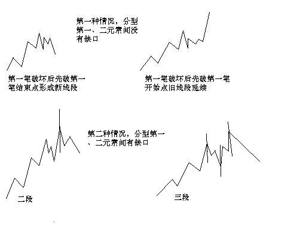
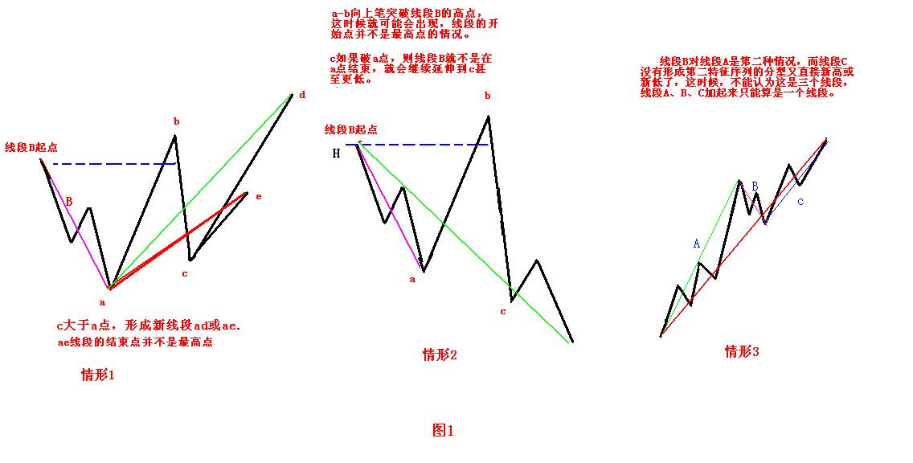
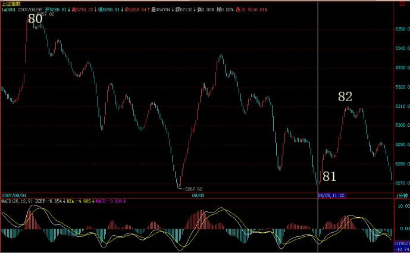

# KWX 009 — 线段

[返回 KWX005 八篇范式](memoKWX_005_batchConcept1to8.md) · [来源核验](../../artifacts/mas/kwx005-first-batch-20261111/coverage-S4-S6.md)

上游概念见[KWX008 笔](memoKWX_008_Chan_bi.md)。

## 000 — 范围

说明线段如何由笔构成，以及用特征序列确认结束的两种情况。[1]

## 001 — 定义（是什么）

版本一为 KWX 确定稿，版本二、三由 AI 补写。

**（版本一）** 线段由至少连续相接且有共同重叠区间的三笔构成，笔数为奇数，各线段首尾相连，方向交替，并由反向线段的破坏确认结束。

**（版本二）** 线段至少包含三笔，前三笔的价格区间须有共同重叠部分，总笔数为奇数。段内各笔按时间顺序连续相接，相邻线段首尾相接、方向相反。线段受到反向线段破坏后，确认结束。

1. **总笔数**　段内每一笔都计入总数，每段至少 3 笔。
2. **前三笔**　段首三笔的价格区间须有三者共同覆盖的部分。
3. **奇数**　总笔数须为奇数，即 3、5、7……笔。
4. **段内连续**　从本段第一笔到最后一笔，所有笔都属于本段。每相邻两笔，前一笔的终点就是后一笔的起点。
5. **段间连接**　前一线段的终点就是后一线段的起点，向上段与向下段交替。
6. **结束确认**　反向线段对本段构成破坏后，本段才确认结束。

**（版本三）** 记 `S = (b[1], …, b[n])`，`T` 为 `S` 的相邻后段。

```text
段内  n ∈ {3, 5, 7, …} ∧ b[i].终点 = b[i+1].起点（1 ≤ i < n）
重叠  共同重叠(b[1].区间, b[2].区间, b[3].区间)
段间  T 存在 ⇒ (S.终点 = T.起点 ∧ S.方向 ≠ T.方向)
结束  反向线段破坏(S) ⇒ 确认结束(S)
```

第77课规定线段至少三笔，笔数为奇数，首三笔有重合，并由反向线段破坏来确定完成。第67课以向上段的向下笔构成其特征序列，只考察顶分型。向下段以向上笔构成特征序列，只考察底分型。特征序列相邻元素没有重合区间即有缺口。[2][3]

- **第一类。** 特征分型的第一、第二元素无缺口，线段在对应顶分型的高点或底分型的低点结束。第71课说明，跨假定分界的两个元素须分开处理。第77课以首三笔不重合的情形说明单笔破坏可以失败。[2][4][3]
- **第二类。** 两元素有缺口，需要从假定端点后的反向走势中取得对应的第二序列分型。原缺口可以不回补。第二序列采用其自身的包含处理，分型无需再按缺口分类。[2][5]

第78课把原始段的端点与供下游使用的高低点标准化区分开来。某段的最高或最低点可以在段内。标准化供中枢等下游分析使用。[5]

## 002 — 算法（怎么做）

本项目算法待定。以下依据 CC 标准路径，说明笔输入、特征元素、候选及冻结状态的关系。源码入口和分支见附录 B。[6][7]

### 002.a — 算法树

CC 的线段构建流程如下。[6]

```text
笔数达到三笔 → 检查起段候选及反向候选
→ 按线段方向收集反向笔，处理第二、第三元素的包含和相等
→ 检查对应顶底及实际突破
   ├─ 第一、第二元素有缺口 → 记录缺口候选，继续核对反向特征序列
   └─ 其余转移 → 见附录 B
→ 输出冻结段、尚可变化的段及形成中尾部
```

### 002.b — 逻辑演示

沿用 WX021 附录 B.4 的手工输入。前三笔为 10→18、18→14、14→22，区间交集为 [14,18]。向上段的三个向下特征区间为 [14,18]、[17,22]、[12,20]。第一和第二元素重合 [17,18]。其顶形满足 CC 比较式 18<22、20≤22、12<17，第三元素低点也低于中间原笔低点 17。此时几何候选顶为 22。该例须读到后续反向候选才取得首对，至后续候选齐备才冻结首段。完整连续输入和过程图见 WX021 附录 B.4。[1][6]

### 002.c — 辅助函数

| CC 函数 | 判断 |
|---|---|
| _basic_valid | 至少三笔、奇数、首尾方向相同、首三笔闭区间相交 |
| _Eigen.test_combine、_Eigen.merge | 按元素位置及方向判断包含和合并，记录源笔下标 |
| _is_fx、_actual_break | 检查特征分型及实际突破，保留所读取的证据范围 |
| _revert_confirm | 从旧段终笔下标加 2 开始寻找反向序列分型 |

### 002.d — 伪代码

本项目伪代码待定。CC 实际入口为 build_xianduans，构建器及输出转换见附录 B。[6]

## 003 — 原理（为什么）

首三笔重合用于判断起段资格。结束还取决于特征序列、缺口与反向结构。第71课以假设分界的方式讨论包含范围。第78课给出单笔破坏后旧段仍可延伸的情形。[4][3][5]

## 004 — 其他说明

几何成员可止于候选端点，证据笔可能在其右侧。CC 的依赖范围和冻结状态可用来区分端点和确认时点。线段向[中枢](memoKWX_010_Chan_zhongshu.md)提供工程部件时，其来源层级和口径仍须注明。[6]

## 005 — 待确认事项

- 输入的笔需要达到什么确认状态？窗口起点和断档怎样处理？
- 特征序列包含方向、假设分界和同价极值如何处理？
- 首三笔仅触及一个价位时，是否满足重合？
- 两类结束分别需要哪些证据？第二类候选在何时撤回或冻结？
- 几何端点与下游标准化端点如何映射？

## 附录 A — 缠论原文与原图

下面直接选自用户指定的本地保存本；课号、行号以本轮文件为准，本批核验见篇首记录。[8] 引文保留“娇注”等编者标识；这些插注并非作者原话。后部读者学习材料不自动并入正文。每段为连续回读后的摘录，并非穷尽检索结果。

### A.1 — 第67课：特征序列与两种情况

本地067.md第16–44行连续选录。原保存本头部`images: []`；本篇不补造一张“原图”。[2]

> 笔的划分标准在前面已经严格给出，因此，下一关键问题，就是如何划分线段。下面，给出类似笔划分，但有重大区别的划分标准。用S代表向上的笔，X代表向下的笔。那么所有的线段，无非两种：一、从向上笔开始；二、从向下笔开始。简单起见，以向上笔开始的线段为例子说划分的标准。
>
> 以向上笔开始的线段，可以用笔的序列表示：S1X1S2X2S3X3…SnXn。容易证明，任何Si与Si+1之间，一定有重合区间。而考察序列X1X2…Xn，该序列中， Xi与Xi+1之间并不一定有重合区间，因此，这序列更能代表线段的性质。
>
> **定义：序列X1X2…Xn成为以向上笔开始线段的特征序列；序列S1S2…Sn成为以向下笔开始线段的特征序列。特征序列两相邻元素间没有重合区间，称为该序列的一个缺口。**
>
> 关于特征序列，把每一元素看成是一K线，那么，如同一般K线图中找分型的方法，也存在所谓的包含关系，也可以对此进行非包含处理。经过非包含处理的特征序列，成为标准特征序列。以后没有特别说明，特征序列都是指标准特征序列。<span style="font-weight:bold;font-style:italic">（娇注：这里的描述有欠缺，出现肯定论点后找论据的逻辑顺序错误。没有明确同一段前不能进行非包含处理。）</span>
>
> 参照一般K线图关于顶分型与底分型的定义，可以确定特征序列的顶和底。注意，以向上笔开始的线段的特征序列，只考察顶分型；以向下笔开始的线段，只考察底分型。
>
> 在标准特征序列里，构成分型的三个相邻元素，只有两种可能：
>
> **第一种情况：**
>
> **特征序列的顶分型中，第一和第二元素间不存在特征序列的缺口，那么该线段在该顶分型的高点处结束，该高点是该线段的终点；特征序列的底分型中，第一和第二元素间不存在特征序列的缺口，那么该线段在该底分型的低点处结束，该低点是该线段的终点；**<span style="font-weight:bold;font-style:italic">（娇注：这里描述不全面，后期有补充。）</span>
>
> **第二种情况：**
>
> **特征序列的顶分型中，第一和第二元素间存在特征序列的缺口，如果从该分型最高点开始的向下一笔开始的序列的特征序列出现底分型，那么该线段在该顶分型的高点处结束，该高点是该线段的终点；特征序列的底分型中，第一和第二元素间存在特征序列的缺口，如果从该分型最低点开始的向上一笔开始的序列的特征序列出现顶分型，那么该线段在该底分型的低点处结束，该低点是该线段的终点；**
>
> <span style="font-weight:bold;font-style:italic">（娇注：第二种情况属于第三线段成立倒推第二线段成立的判断）</span>
>
> 强调，在第二种情况下，后一特征序列不一定封闭前一特征序列相应的缺口，而且，第二个序列中的分型，不分第一二种情况，只要有分型就可以。
>
> 上面两种情况，就给出所有线段划分的标准。显然，出现特征序列的分型，是线段结束的前提条件。本课，就是把前面“线段破坏的充要条件就是被另一个线段破坏”精确化了。因此，以后关于线段的划分，都以此精确的定义为基础。
>
> 这个定义有点复杂，首先请先搞清楚特征序列，然后搞清楚标准特征序列，然后是标准特征序列的顶分型与底分型。而分型又以分型的第一元素和第二元素间是否有缺口分为两种情况。一定要把这逻辑关系搞清楚，否则一定晕倒.<span style="font-weight:bold;font-style:italic">（娇注：这里的线段划分顺序是错误的论述，注意看后期补充）</span>
>
> 显然，按照这个划分，一切同一级别图上的走势都可以唯一地划分为线段的连接，正如一切同一级别图上的走势都可以唯一地划分笔的连接。有了这两个基础，那么整个中枢与走势类型的递归体系就可以建立起来。这是基础的基础，请务必搞清楚，否则肯定学不好。

### A.2 — 第71课：同一序列包含与假设分界

本地071.md第28–58行连续选录。最后链接图实际查看后等字节复制至本篇同名图片目录；它是来源图，不是本篇算法输出。图上文字不能替代正文条件。[4]

> 虽然67课已经给出了线段划分的标准，但由于那里用的是比较抽象的类数学语言，所以理解上可能还有困难，因此，逐一进行再分辨。
>
> 首先要分辨的，是特征序列中元素的包含关系。注意，特征序列的元素包含关系，首先的前提是这元素都在一特征序列里，如果两个不同的特征序列之间的元素，讨论包含关系是没意义的。
>
> 显然，特征序列的元素的方向，和其对应的段的方向是刚好相反的，例如，一个向上段后接着一个向下段，前者的特征序列元素是向下的，后者是向上的，因此，根本也不可能存在包含的可能。
>
> *那么，为什么可以定义特征序列的分型呢？因为在实际判断中，在前一段没有被笔破坏时，依然不能定义后特征序列的元素，这时候，当然可以存在前一特征序列的分型，这时候，由于还在同一特征序列中，因此，序列元素的包含关系是可以成立的；*
>
> **<span style="color:#800080">而当前一段被笔破坏时，显然，最早破坏的一笔如果不是转折点开始的第一笔，那么，特征序列的分型结构也能成立，因为在这种情况下，转折点前的最后一个特征序列元素与转折点后第一个特征元素之间肯定有缺口，而且后者与最早破坏那笔肯定不是包含关系，否则该缺口就不可能被封闭，破坏那笔也就不可能破坏前一线段的走势。这里的逻辑关系很明确的，线段要被笔破坏，那么必须其最后一个特征序列的缺口被封闭，否则就不存在被笔破坏的情况。</span>**
>
> **那么，现在只剩下最后一种情况，就是最早破坏那笔就是转折点下来的第一笔，这种情况下，这一笔，如果后面延伸出成为线段的走势，那么这一笔就属于中间地带，既不能说是前面一段的特征序列，更不能说是后一段的特征序列，在这里情况下，即使出现似乎有特征序列的包含关系的走势，也不能算，因为，这一笔不是严格地属于前一段的特征序列，属于待定状态，一旦该笔延伸出三笔以上，那么新的线段就形成了，那时候谈论前一线段特征序列的包含关系就没意义了。**
>
> **总之，上面说得很复杂，其实就是一句话，特征序列的元素要探讨包含关系，首先必须是同一特征序列的元素，这在理论上十分明确的。**
>
> 从上面的分析就可以知道，从转折点开始，如果第一笔就破坏了前线段，进而该笔延伸出三笔来，其中第三笔破点第一笔的结束位置，那么，新的线段一定形成，前线段一定结束。
>
> 这种情况还有更复杂一点的情况，就是第三笔完全在第一笔的范围内，这样，这三笔就分不出是向上还是向下，这样也就定义不了什么特征序列，为什么？因为特征序列是和走势相反的，而走势连方向都没有，那怎么知道哪个元素属于特征序列？这种情况，无非两种最后的结果：1、最终还是先破了第一笔的结束位置，这时候，新的线段显然成立，旧线段还是被破坏了；2、最终，先破第一笔的开始位置，这样，旧线段只被一笔破坏，接着就延续原来的方向，那么，显然旧线段依然延续，新线段没有出现。
>
> 在67课里，把线段的划分分为两种情况，显然，分清楚是哪种情况，对划分线段十分关键**。其实，在那里已经把问题说得很清楚，判断的标准只有一个，就是特征序列的分型中，第一和第二元素间存不存在特征序列的缺口。**从上面的分析可以知道，这个分型结构中所谓特征序列的元素，**其实是站在假设旧线段没被破坏的角度说的**，而就像所有的分型一样，就算是一般K线的，都是前后两段走势的分水岭、连接点。这和包含的情况不同，包含的关系是对同一段说的，而分型，必然是属于前后的，这时候，在构成分型的元素里，如果线段被最终破坏，那后面的元素肯定不是特征序列里的，也就是说，这时候，分型右侧的元素肯定不属于前后任何一段的特征序列。
>
> 这个道理其实很明白，例如前一段是向上的，那么特征序列元素是向下的，而在顶分型的右侧元素，如果最终真满足破坏前线段的要求，那么后线段的方向就是向下的，其特征序列就是向上的，而顶分型的右侧元素是向下的，显然不属于后一段的特征元素，而该顶分型的右侧元素又属于后一段，那么显然更不是前一段的特征元素。**<span style="color:#008080">所以，对于顶分型的右侧特征元素，只是一般判断方面的一种方便的预设，就如同几何里面，添加辅助线去证明问题一样，辅助线不属于图形本身，就如同顶分型的右侧特征元素其实不一定属于任何的特征元素，但对研究有帮助，当然是要大力去用的，如此而已。</span>**
>
> **<span style="color:#008080">其实，线段的划分，都是可以当下完成的，无非是如下的程序：假设某转折点是两线段的分界点，然后对此用线段划分的两种情况去考察是否满足，如果满足其中一种，那么这点就是真正的线段的分界点；如果不满足，那就不是，原来的线段依然延续，就这么简单。</span>**
>
> **特征序列的分型中，第一元素就是以该假设转折点前线段的最后一个特征元素，第二个元素，就是从这转折点开始的第一笔，显然，这两者之间是同方向的，因此，如果这两者之间有缺口，那么就是第二种情况，否则就是第一种，然后根据定义来考察就可以。**
>
> **这里还要强调一下包含的问题，上面的分析知道，在这假设的转折点前后那两元素，是不存在包含关系的**。因为，这两者已经被假设不是同一性质的东西，不一定是同一特征序列的；但假设的转折点后的顶分型的元素，是可以应用包含关系的。为什么？因此，这些元素间，肯定是同一性质的东西，或者就是原线段的延续，那么就同是原线段的特征序列中，或者就是新线段的非特征序列中，反正都是同一类的东西，同一类的东西，当然可以考察包含关系。
>
> 估计看了上面的话，很多人更晕了。下面有几个图，各位可以仔细揣摩一下。但最好还是习惯从定义出发。另外，大盘网友问到的那个图，显然，根据定义，是两个线段，而今天42-44的分段，显然也是成立的。
>
> 

### A.3 — 第77课：首三笔重叠与不递归反向确认

本地077.md第73–89行连续选录，未越过97行的另一张未选图。[3]

> 有了笔以后，就是线段了。线段划分的最基本原则，就是线段必须至少有三笔，这是十分显然的，否则，一笔都能构成线段，那笔和线段又有什么区别？至于两笔为什么不能构成线段，这理由更简单，因为两笔，那么线段的两段的分型的性质肯定是一样的，和笔一样，一个完整线段的两段的分型不可能是同性质的。也就是说，和笔一样，线段也不可能从一个顶开始结束于一个顶，或者从一个底开始结束于一个底。由此可见，线段中包含笔的数目，都是单数的。
>
> 而且，线段开始的那三笔，必须有重合，开始三笔没有重合的，是构不成线段的。
>
> 另外，线段必须被线段所破坏才能确定其完成。对于线段划分的第一种情况，如果第一笔出现笔破坏后，接着的一笔就创新高，而且再后一笔，根本就不触及笔破坏那一笔，那么，这时候，显然构成不了线段对线段的破坏，因为后面这这三笔没有重合，不可能构成一线段。
>
> 而这，用第一种情况的判断法就更明确了，上面这种情况根本不可能形成特征序列的分型，当然就不可能是线段的完成。
>
> 再者，线段被线段破坏，必须不能是被同一性质的线段所破坏，也就是从向上一笔开始的线段不可能被向上一笔的线段所有破坏，必然是被从向下一笔开始的线段所破坏。
>
> 线段的第二种情况，其实就包含这种情况。也就是，按第一种情况，线段A没有被接着的线段B破坏，但接着的线段C破坏了线段B，因此，线段B是完成的，当然线段A也应该是完成的。注意，这里的线段A、B、C只是用结合律的原则先划分，括弧里面满足线段的基本性质，在这破坏关系没被确认之前，这只是一个假设的称呼。
>
> 各位肯定注意，在第二种情况下特别强调，第二特征序列，其实就是对应着线段C对线段B的破坏，不再分第一、二种情况了。这，其实是一个简化的方法。为什么？
>
> 如果我们坚持线段的最终破坏回补特征序列缺口情况，那么，如果线段C对线段B还是第二种情况，那么线段C的区间肯定就在线段A特征序列缺口与线段B特征序列缺口之间，如此类推，总会出现一个线段X，使得对应前面的线段是回补特征序列缺口，否则，这些线段的区间就会无限缩小，最后就会形成一个点，这显然是不可能的，学过极限的都应该能理解。所以，在一串的相对前一线段是第二种情况的线段串中，比如最终会出现第一种情况的破坏，这样倒推回来，必然有这一串假定线段间的连续破坏。
>
> 正因为这样，所以在第二种情况中的第二特征序列判断中，就不再分第一、二种情况了，这样是免得有一串线段串不断收敛后倒推回来的麻烦。这在数学上当然是绝对完美，但操作起来太麻烦，而且这种特殊的情况很少见，就更没必要了。

### A.4 — 第78课：单笔破坏失败、二类序列包含及高低点标准化

以下为本地正文42–72行，保留连续论证和该节图片。[5]

> 所有古怪的线段，都是因为线段出现第一种情况的笔破坏后最终没有在该方向由该笔发展形成线段破坏所造成的，这是线段古怪的唯一原因。因为，如果线段能在该方向出现被线段破坏，那就很正常了，没什么古怪的。
>
> 
>
> 注意，这里有一个细节必须注意，线段最终肯定都会被线段破坏，但线段出现笔破坏后最终并不一定在该方向由该笔发展形成线段破坏。
>
> 由最简单概念知道，任何线段都有方向的，例如线段B，其方向是下，也就是由向下笔开始的线段，那么其结束笔肯定也是向下笔。因此，线段出现第一种情况的笔破坏，这破坏的一笔肯定是向上笔，但这一笔之后，没有形成特征序列的分型，满足不了第一种线段破坏的情况，因此，就在这个方向上形成不了线段的破坏。
>
> 而线段，不可能被同方向的线段破坏，任何同方向的线段，或者互相毫无关系，或者就是其中一线段其实是前一线段的延续，也就是说前一线段其实根本没完成。
>
> 但线段出现第一种情况的笔破坏后最终没有在该方向由该笔发展形成线段破坏时，在上面例子中的向上破坏笔完成后，接下来肯定是向下的笔，这笔肯定会形成一个向下的线段，否则，就意味着前面那向上破坏笔能延续出线段，这和假设矛盾。
>
> 这个向下的线段，如果破了该向上笔的底，那么，原来的线段B就是没结束，在继续延续。这种情况下，如果那向上笔突破线段B的高点，这时候就会出现，线段的开始点并不是最高点的情况。<span style="font-weight:bold;font-style:italic">（娇注：注意，和这个情况一样，昨天的贴图里，81那点应该在09051101的5268.74位置上，而82的位置不变，因为原来标记的位置是一个急跌，当时的数据收集可能有点乱，用数据修正功能后发现实际上比09051101时高，因此必须有此修正。）</span>
>
> 娇注：本例图走势没有比09051101时高，按照理论维持原来定位。为解释缠文，特配图
>
> 
>
> 这个向下的线段，如果没破该向上笔的底，那么就可以肯定，由这向上的笔可以延伸出一个线段来，这时候，线段B肯定被破坏了。
>
> 注意，这个例子中有一个最关键的前提，就是线段B已经确认线段破坏了他前面的线段，如果线段B对前面线段的破坏都没确认，那就先确认，这里的分析都不适用了。
>
> 从这个例子就知道，笔破坏与线段破坏的异同。对于线段破坏的第二种情况，例如线段B对线段A是第二种情况，而线段C没有形成第二特征序列的分型又直接新高或新低了，这时候，不能认为这是三个线段，线段A、B、C加起来只能算是一个线段。
>
> 另外，一定要注意，对于第二种情况的第二特征序列的分型判断，必须严格按照包含关系的处理来，这里不存在第一种情况中的假设分界点两边不能进行包含关系处理的要求。为什么？因为在第一种情况中，如果分界点两边出现特征序列的包含关系，那证明对原线段转折的力度特别大，那当然不能用包含关系破坏这种力度的呈现。而在第二种情况的第二特征序列中，其方向是和原线段一致，包含关系的出现，就意味着原线段的能量充足，而第二种情况，本来就意味着对原线段转折的能量不足，这样一来，当然就必须按照包含关系来。
>
> 通过上面的讲解，应该没有任何线段问题能难倒各位了，当然前提是能把上面的内容搞明白。
>
> 注意，这里必须提醒一句，就是这在以前也曾说过，就是，如果线段中，最高或最低点不是线段的端点，那么，在任何以线段为基础的分析中，例如把线段为基础构成最小级别的中枢等，都可以把该线段标准化为最高低点都在端点。因为，在以线段为基础的分析中，都把线段当成一个没有内部结构的基本部件，所以，只需要关心这线段的实际区间就可以，这样就可以只看其高低点。
>
> 经过标准化处理后，所有向上线段都是以最低点开始最高点结束，向下线段都是以最高点开始最低点结束，这样，所以线段的连接，就形成一条延续不断、首尾相连的折线，这样，复杂的图形，就会十分地标准化，也为后面的中枢、走势类型等分析提供了最标准且基础的部件。

## 附录 B — CC 源码与实现核对

**身份与检查范围**：2026-11-11静态读取`D:/Codex/CC`的实际文件，HEAD `af305b0812131be71e49cf91851016012ea63a78`；所读源文件与提交内容一致，哈希见本批核验记录。没有导入CC包、运行引擎、查询行情或执行CC测试。算法卡旧版标题曾保留未实现说明，但当前`build_xianduans`有实际实现，因此按当前源码说明行为。[6][9]

### B.1 — 入口、候选与输入

| 位置 | 已读到的实现事实 | 适用边界 |
|---|---|---|
| `build_xianduans`，237–260行 | 少于3笔返回空；创建builder、run、finish；默认特征序列路径 | 返回空不能证明原文所有不足三笔的对象不存在其他层级解释 |
| `_basic_valid`，940–951行 | 至少3笔、奇数、首尾方向同；首三笔闭区间相交 | 这是本实现的必要检查组合，不表示任意三笔即可成立 |
| `_extreme_problem`，953–971行 | 候选起止需对应实际极值，否则重建／延后 | 重复极值的处理见源码 |
| `_first_xianduan`，923–938行 | 首段热身要求合法候选及反向候选配对 | 热身选择属于有限窗口工程处理 |

### B.2 — 包含与特征分型的实际细节

`_Eigen.test_combine`（283–304行）与`merge`（306–314行）不是直接复用原始K线流水线：旧含新合并；新含旧是否排除合并由`exclude_included`控制；合并数值按候选段方向UP取高低最大、DOWN取最小，并累加源笔下标。`_EigenFX._treat_second`（371–386行）启用排除新含旧合并以保护分界；第三元素（388–405行）关闭该排除，并有等顶／等底释放规则。[6]

`_is_fx`（441–460行）实际顶条件是`e0.high < e1.high`、`e2.high <= e1.high`、`e2.low < e1.low`；底为`e2.high > e1.high`、`e0.low > e1.low`、`e2.low >= e1.low`。缺口判断上段`e0.high < e1.low`，下段`e0.low > e1.high`。

`_actual_break`（407–439行）明确分角色：主序列`PRIMARY`比较中间元素最后一根原始笔，并可能读到第三元素原始笔的`k+2`后续笔；`GAP_REVERT`第二序列比较合并后中间元素，严格突破且无前看。前看时更新最晚证据水位，不能把几何顶点时间充作已知时间。

`peak_end_bi_idx`（476行起）把中间极值反向笔的前一笔作为旧段终笔；`_revert_confirm`（742–768行）从`end_bi+2`开始反向特征确认，不再次递归缺口分类。候选构建（640行附近）还检查≥3笔及真正端点极值，失败后继续找。

### B.3 — 冻结层及可选工程策略

`_XianduanFreezeMachine`（108–226行）分别维护frozen、soft N0和pending N1。N2成段、N1破N0起点、gap反向确认等路径可触发冻结；`gap_revert`原子冻结前段及缺口段，并记录确认时间。`_emit`（974行起）与`_finish`（1058–1102行）同时输出frozen、soft/pending和forming尾部，并保留source/merged范围、依赖与冻结证据。[6]

配置默认`STANDARD`、`break_policy=line_only`；`STANDARD_STRONG`/`PRACTICAL`允许`strong_bi`分支（源码710行附近）用强笔破坏加后续结构证据产生工程变体。这是 CC 的工程变体。[7]


### 核对范围

本篇对照所列源码和例中数值。CC 未实际运行。

## References

[1] [WX021 线段](memoWX_021_Chan_xianduan.md)，001及附录A/B，合作者的定义与研究。

[2] [教你炒股票67：线段的划分标准](../../references/chan_theory/067.md)，本地16–44行；保存本后部学习材料与正文不混记。

[3] [教你炒股票77：一些概念的再分辨](../../references/chan_theory/077.md)，本地73–89行。

[4] [教你炒股票71：线段划分标准的再分辨](../../references/chan_theory/071.md)，本地28–58行及链接图image001.jpg。

[5] [缠论第78课 — 继续说线段的划分](../../references/chan_theory/078.md)，正文42–72行及配图。

[6] [CC xianduan.py](../../../CC/src/cc/algo/xianduan.py)。实际核查D:/Codex/CC同路径；HEAD af305b0812131be71e49cf91851016012ea63a78；关键函数及行号见附录B。

[7] [CC config.py](../../../CC/src/cc/algo/config.py)，112–122、177–186行。

[8] [首批来源核验](../../artifacts/mas/kwx005-first-batch-20261111/coverage-S4-S6.md)，源码版本与引文范围。

[9] [CC 线段算法卡](../../../CC/docs/algo-cards/xianduan-v1.md)，与可执行代码一并核对。
