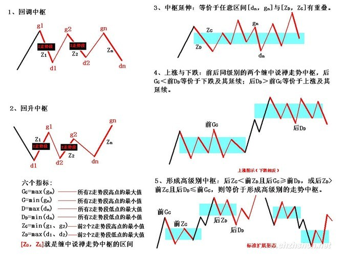

# KWX 010 — 中枢

[返回 KWX005 八篇范式](memoKWX_005_batchConcept1to8.md) · [来源核验](../../artifacts/mas/kwx005-first-batch-20261111/coverage-S4-S6.md)

上游概念见[KWX009 线段](memoKWX_009_Chan_xianduan.md)。

## 000 — 范围

研究走势中枢的成立、初始核心、延伸、结束和级别扩展。[1]

## 001 — 定义（是什么）

**（版本一）** 三个连续、已完成的线段在价格上的共同重叠区间，构成最低级别中枢。一段已完成的走势只含一个本级中枢，称为盘整；含两个或更多彼此分离的本级中枢，依次上移称为上涨，依次下移称为下跌。三个连续、已完成的本级走势在价格上的共同重叠区间，构成上一级中枢。

有单独的进入段时，从它结束后的第一段开始数三段。

**（版本二）** 最低级别中枢是三条连续、已完成的线段在价格上的共同重叠区间。一段已完成的走势只含一个本级中枢时为盘整，含两个或更多彼此分离的本级中枢时，依次上移为上涨，依次下移为下跌。三段连续、已完成的本级走势的共同价格区间，构成上一级中枢。

1. **三个连续线段**　三条线段按时间首尾相接，且都已完成。有单独的进入段时，从它结束后的第一段开始数。
2. **共同重叠**　三段必须共同覆盖同一部分价格。下界取三个低点中的最高值，上界取三个高点中的最低值。
3. **走势类型**　已完成的走势只含一个本级中枢为盘整。含至少两个本级中枢，且外围区间彼此分离、依次上移为上涨，依次下移为下跌。

**（版本三）** 记 `X₁、X₂、X₃` 为构成中枢的三段，`I(X)` 为一段的价格区间。`n` 为一段已完成走势所含的本级中枢数，`DD`、`GG` 分别为中枢外围波动区间的下界和上界。[6]

```text
最低级别中枢   X₁、X₂、X₃ 为线段
三段共同条件   按时间连续相接，均已完成，且有共同价格重叠
起算           有单独的进入段 E ⇒ X₁ 从 E 的终点开始
中枢区间       I(X₁) ∩ I(X₂) ∩ I(X₃)

本级走势已完成
  盘整         n = 1
  上涨         n ≥ 2，且每对相邻中枢均满足 前.GG < 后.DD
  下跌         n ≥ 2，且每对相邻中枢均满足 后.GG < 前.DD

上一级中枢     X₁、X₂、X₃ 为本级走势，沿用三段共同条件和起算规则
```


## 002 — 算法（怎么做）

本项目算法待定。以下说明 CC 的 EXTEND 扫描与初始相位处理。SAME_LEVEL 的独立入口见附录 B。[7][8][9]

### 002.a — 算法树

以下为 CC 的 EXTEND 中枢流程。[7][8]

```text
按来源筛选笔或线段，沿连续部件分组
→ 找交替的 E 与 A、B、C，计算初始核心并检验 E 是否触及
→ 固定初始核心，依次检查后续同相位 Z 部件
   ├─ 触及核心 → 成对追加连接部件和 Z 部件，更新 GG、DD
   └─ 完全脱离 → 登记关闭证据
→ 尚无关闭证据 → 保留 OPEN
→ 首个闭合候选 → 可按进入、退出方向校正相位
```

### 002.b — 逻辑演示

沿用 WX022 附录 B.4 的 EXTEND 手工例。E、A、B、C 的价格区间依次是 [10,18]、[12,18]、[12,16]、[13,16]。三项交集为 [13,16]，E 触及核心。后续 Z3 为 [14,19]，与核心交于 [14,16]，因此追加对应成员，核心仍为 [13,16]。再遇 Z4=[18,22]，18>16，登记向上关闭证据。若同一位置改用 [16,22]，其与核心在 16 相切，CC 的闭区间判断仍成立。连续输入及成员、时点和过程图见 WX022 附录 B.4、B.5。[1][7][8]

### 002.c — 辅助函数

| CC 函数 | 判断 |
|---|---|
| _continuous | 检查共端点时间及相邻方向 |
| _overlap | 检查最大低点是否小于或等于最小高点 |
| scan_zhongshu_candidate | 返回核心、延伸成员和关闭证据 |
| resolve_initial_zhongshu_phase | 对连续组的首中枢按已知退出方向检查相邻相位 |

### 002.d — 伪代码

本项目伪代码待定。CC 的核心与延伸计算见 scan_zhongshu_candidate 的 53–102 行。[8]

## 003 — 原理（为什么）

价格交集和级别资格各有前提。初始核心描述前三项的交集，外围描述 Z 走势经过的更广价格范围。比较相邻中枢时，核心和外围分别参与第20课的条件判断。CC 的关闭证据还可能晚于几何成员的终点。[2][3][6][7][8]

## 004 — 其他说明

[线段](memoKWX_009_Chan_xianduan.md)可作为 CC 的工程输入。原文的次级别资格与[走势](memoKWX_011_Chan_zoushi.md)的构成依赖于底层和递推口径。CC 相切规则和[买卖点](memoKWX_013_Chan_buysellpoint.md)所用的回试边界须核对各自条件与观察时点。[7][8][5]

## 005 — 待确认事项

- 如何选定最低分析层级并认证各级输入？工程笔段怎样映射到理论层级？
- 点接触、零宽核心及等边回试分别怎样处理？
- 进入部件是否必需？首个中枢的相位如何确定？
- 延伸和关闭采用什么证据？核心、外围及成员范围如何记录？
- 新生中枢与级别扩展如何确认？形成、关闭和复核时间如何保留？

## 附录 A — 缠论原文与原图

本附录来自指定本地原文。选录保留连续上下文及“娇注”等编者插注；插注不改署作者。课名、文件行号、原图哈希和本次覆盖见来源清单。[10] 附录是选录，不是全部相关原文的完备集合。

### A.1 — 第17课：定义与最低级别例外

017.md第45–47行连续选录。最低不可再分级别的例外不能直接扩展成所有层级“三笔／三段”。[2]

> 为了深入研究这复杂问题，必须先引入**缠中说禅走势中枢的概念：某级别走势类型中，被至少三个连续次级别走势类型所重叠的部分，称为缠中说禅走势中枢。**
>
> **换言之，缠中说禅走势中枢就是至少三个连续次级别走势类型重叠部分所构成。**这里有一个递归的问题，就是这次级别不能无限下去，就像有些半吊子哲学胡诌什么“一分为二”，而“分”不是无限的，按照量子力学，物质之分是有极限的，同样，级别之次也不可能无限，在实际之中，对最后不能分解的级别，其缠中说禅走势中枢就不能用“至少三个连续次级别走势类型所重叠”定义，而定义为至少三个该级别单位K线重叠部分。一般来说，对实际操作，都把这最低的不可分解级别设定为1分钟或5分钟线，当然，也可以设定为1秒种线，但这都没有太大区别。

### A.2 — 第18课：已完成次级别走势及类型

018.md第18–36行连续选录，包括核心表达及盘整／趋势相关条件。[3]

> **走势：打开走势图看到的就是走势。走势分不同级别。**
>
> **走势类型：上涨、下跌、盘整。**
>
> **趋势：上涨、下跌。**
>
> **缠中说禅走势中枢：某级别走势类型中，被至少三个连续次级别走势类型所重叠的部分。具体的计算以前三个连续次级别的重叠为准，严格的公式可以这样表示：次级别的连续三个走势类型A、B、C，分别的高、低点是a1\a2,b1\b2,c1\c2。则，中枢的区间就是（max**<span style="font-weight:bold;font-style:italic;color:#339966">（娇注：a2,b2,c2）</span>**，min**<span style="font-weight:bold;font-style:italic;color:#339966">（娇注：a1,b1,c1）</span>**）而实际上用目测就可以，不用这么复杂。注意，次级别的前三个走势类型都是完成的才构成该级别的缠中说禅走势中枢，完成的走势类型(娇：盘整和趋势），在次级别图上是很明显的，根本就不用着再看次级别下面级别的图了。**
>
> **缠中说禅盘整：在任何级别的任何走势中，某完成的走势类型只包含一个缠中说禅走势中枢，就称为该级别的缠中说禅盘整。**
>
> **缠中说禅趋势：在任何级别的任何走势中，某完成的走势类型至少包含两个以上依次同向的缠中说禅走势中枢，就称为该级别的缠中说禅趋势。该方向向上就称为上涨，向下就称为下跌。注意，趋势中的缠中说禅走势中枢之间必须绝对不存在重叠。**
>
> **“缠中说禅技术分析基本原理一”：任何级别的任何走势类型终要完成。**
>
> **“缠中说禅技术分析基本原理二”：任何级别任何完成的走势类型，必然包含一个以上的缠中说禅走势中枢。**
>
> **“缠中说禅走势分解定理一”：任何级别的任何走势，都可以分解成同级别“盘整”、“下跌”与“上涨”三种走势类型的连接。**
>
> **“缠中说禅走势分解定理二“：**任何**级别的任何走势类型，都至少由三段以上次级别走势类型构成。**

018.md第50–64行连续选录，保留维持／破坏及离开返回的级别条件。[3]

> **“缠中说禅走势中枢定理一”：在趋势中，连接两个同级别“缠中说禅走势中枢”的必然是次级别以下级别(娇注：次级别以及次级别以下级别）的走势类型。**
>
> 用反证法，该定理的证明是很简单的，而这也回答了上一章中的作业一“连接两相邻同级别缠中说禅走势中枢的一定是趋势吗？一定是次级别的趋势吗？”首先，这不必然是趋势，任何走势类型都可能，最极端的就是跳空缺口后形成新的“缠中说禅走势中枢”；其次，也不一定是次级别的，只要是次级别以下，例如跳空缺口，就属于最低级别，如果图上是日线、周线，就不会是次级别了；最后，往往相连走势类型的级别越低，表示其力度越大，这也就是为什么缺口在分析中有比较强技术含义的理论依据所在。
>
> 由定义知道，“缠中说禅走势中枢”的产生原因以及判断标准，也就是其“生”问题已经解决，那余下的就是其“住、坏、灭”的问题。也就是说，一个“缠中说禅走势中枢”是如何“维持”以及最终被“破坏”进而废弃的。先考虑其“维持”的问题。维持“缠中说禅走势中枢”的一个充分必要条件就是任何一个离开该中枢的走势类型都必须是次级别以下的并以次级别以下的走势类型返回，该问题很容易证明，因为无论是离开还是返回，只要是同级别的走势类型，就意味着形成新的“缠中说禅走势中枢”，这与原中枢的维持前提矛盾。该命题表述成如下定理：
>
> **“缠中说禅走势中枢定理二”：在盘整中，无论是离开还是返回“缠中说禅走势中枢”的走势类型必然是次级别以下的。**
>
> 由此，上一章作业三“盘整的高低点是如何造成的”就有了相应的答案：无论离开与返回的走势类型是何种级别的，在站最低级别上看，例如把1分钟图当成最低级别，那么最后连接离开与返回走势类型连接处的最低级别图，只能有两种可能：三根以上1分钟K线的来回重叠震荡后回头；二、1分钟K线无三根以上K线重叠的V型走势。对于第一种情况，这几根重叠K线最极端那根的极端位置，就构成盘整中的高低点，一般来说，这种情况比较少见；对于第二种情况，这个V型尖顶那根K线的极端位置就构成盘整中的高低点，这种情况十分常见。这也是为何真正的低点和高点总是盘中一闪而过的理论依据。本ID的理论能解释技术图表上任何细致的问题，这才是一种真正理论所应该具有的品质。这种的理论，不需要什么诺贝尔的奖励，那一百万美圆在市场上算得了什么？精通这样的理论，市场会给予你多得多的回报。
>
> (娇注：趋势的高低点也是这样形成的。这里涉及的是最低级别K的组合。不单是盘整高低点形成的理由）
>
> 有了上面两个**“缠中说禅走势中枢”定理，不难证明定理三：**
>
> **某级别“缠中说禅走势中枢”的破坏，当且仅当一个次级别走势离开该“缠中说禅走势中枢”后，其后的次级别回抽走势不重新回到该“缠中说禅走势中枢”内。**

### A.3 — 第20课：延伸、新生与级别扩展

020.md第30–58行连续选录，不能只摘“方框不重叠”删去外围波动及扩展的前提。[6]

> 前面已经很明确地指出，缠中说禅走势中枢由前三个连续次级别走势类型的重叠部分确定，其后的走势有两种情况：
>
> **一、该走势中枢的延伸。**
>
> **二、产生新的同级别走势中枢。**
>
> <span style="font-weight:bold;font-style:italic">（娇注：二之1类：中枢新生，二之2类：产生新同级别中枢后和前中枢扩张成大中枢）</span>**而在趋势里，同级别的前后缠中说禅走势中枢是不能有任何重叠的，这包括任何围绕走势中枢产生的任何瞬间波动之间的重叠**<span style="font-weight:bold;font-style:italic;color:#c0392b">（娇注：中枢新生）</span>**。**
>
> 因此，如果三个连续次级别走势类型的重叠区间虽然不和前面的走势中枢有任何重叠，但围绕该中枢产生的波动触及前面走势中枢延续时的某个瞬间波动区间，这时候，就不能认为该走势类型是趋势，而只是产生一个更大级别的缠中说禅走势中枢<span style="font-weight:bold;font-style:italic">（娇注：中枢扩张）</span>。
>
> <span style="font-weight:bold;font-style:italic">（娇注：前段落讲述3类情况；1、中枢延伸； 2、新生不重叠本级别中枢； 3、 新本级别中枢波动触及前中枢延续波动区间产生高级别中枢）</span>
>
> 这里，必须把两种情况严格区分<span style="font-weight:bold;font-style:italic">（娇注：区分1和3类情况）</span>：
>
> *一、走势中枢以及其延伸。*这种情况下，所有围绕走势中枢产生的前后两个**次***级波动*都必须至少有一个触及走势中枢的区间。否则，就必然产生一个新的三次连续次级走势类型的重叠部分离开原来的走势中枢，这与走势中枢的延续矛盾。
>
> *二、一个走势中枢完成前，其波动触及上一个走势中枢或延伸时的某个瞬间波动区间，由此产生更大级别的走势中枢。*
>
> 一个简单的例子就能区别以上的情况：例如，一个股票开盘立刻封涨停，那么，只能算是一分钟级别上出现了走势中枢的延伸，无论这个延伸有多长时间，都不可能产生更大级别的走势中枢。如果该股票第二天开始继续开盘涨停，那么就形成一个一分钟级别上的趋势，这个趋势可以无限延伸下去，但只要依然只是只形成一分钟的走势中枢，无论能连续涨停多少天，都不足以形成即使是五分钟的走势中枢，除非中途有打开涨停的时候。还有一种特殊的情况，就是所谓的庄股，如果有一个庄家特别有毛病，每天就成交一次，每天的价位都一样，这样也只形成一个一分钟的走势中枢，大级别的中枢都不能形成。
>
> **换言之，走势中枢的延伸***与***不断产生新的走势中枢并相应围绕波动互不重叠而形成趋势，**在这两种情况下<span style="font-weight:bold;font-style:italic">（娇注：中枢延伸和趋势的情况下）</span>，一定不可能形成更大级别的走势中枢。
>
> **而要形成一个更大级别的走势中枢，**必然要采取第三种的方式：*就是围绕新的同级别走势中枢产生后的波动与围绕前中枢的某个波动区间产生重叠。*由此可马上得到一个重要的定理：
>
> **缠中说禅走势级别延续定理一：***在更大级别缠中说禅走势中枢产生前，该级别走势类型将延续。*也就是说，只能是只具有*该级别缠中说禅走势中枢*的**盘整**或**趋势**的**延续**。
>
> 看看去年指数的走势，就知道该定理的重要。很多人总是说，怎么都涨那么多了还涨，明白这个定理，就知道，要这个市场跌，现在这种最多只出现过日线走势中枢的走势，在周线走势中枢出现前，不可能结束。而且，从去年8月份开始的走势，甚至连日线的走势中枢都没形成过，最多就是30分钟的，要结束这种走势，首先要形成日线的中枢。明白这个定理，就不会整天自己吓自己。这里由定理一很简单就能证明一个更重要的定理对走势改变给一个更精确、预先的界定：
>
> **缠中说禅走势级别延续定理二：***更大级别缠中说禅走势中枢产生，当且仅当围绕连续两个同级别缠中说禅走势中枢产生的波动区间产生重叠。*

020.md第62–72行连续选录。image005.jpg已实际查看后等字节复制；保存本图中的补充文字保持原状，不能据此额外认定每条图中文字均由作者亲绘。[6]

> 有了上面的定理，就可以很精确地讨论走势中枢的问题了：根据走势中枢的数学表达式： A、B、C，分别的高、低点是a1\a2,b1\b2,c1\c2，则中枢的区间就是[max<span style="font-weight:bold;font-style:italic">（娇注：a2,b2,c2）</span>，min<span style="font-weight:bold;font-style:italic">（娇注：a1,b1,c1）</span>]。而**中枢的形成无非两种，一种是回升形成的，一种是回调形成的**。
>
> 
>
> 对于第一种有a1=b1,b2=c2；对第二种有a2=b2,b1=c1。但无论是哪种情况，中枢的公式都可以简化为[max<span style="font-weight:bold;font-style:italic">（娇注：a2,c2）</span>，min<span style="font-weight:bold;font-style:italic">（娇注：a1,c1）</span>]。显然，A、C段，其方向与中枢形成的方向是一致的，由此可见，在中枢的形成与延伸中，由与中枢形成方向一致的次级别走势类型的区间重叠确定。例如，回升形成的中枢，由向上的次级别走势类型的区间重叠确定，反之依然。为方便起见，以后都把这些与中枢方向一致的次级别走势类型称为Z走势段，按中枢中的时间顺序，分别记为Zn等，而相应的高、低点分别记为gn、dn,定义四个指标：GG=max(gn),G=min(gn),D=max(dn),DD=min(dn)，n遍历中枢中所有Zn。
>
> 特别地，再定义ZG= min(g1、g2),ZD=max(d1、d2)，显然，[ZD，ZG]就是缠中说禅走势中枢的区间，由此有了如下定理：
>
> **缠中说禅走势中枢中心定理一：***走势中枢的延伸等价于任意区间[dn，gn]与[ZD，ZG]有重叠。换言之，若有Zn，使得dn>ZG或gn<ZD，则必然产生高级别的走势中枢或趋势及延续。*<span style="font-weight:bold;font-style:italic;color:#2a5db0">（娇注：3买卖点后中枢移动趋势延续或者3买卖点后中枢扩展成高级别中枢）</span>
>
> **缠中说禅走势中枢中心定理二：***前后同级别的两个缠中说禅走势中枢，后GG<前DD，等价于下跌及其延续；后DD>前GG等价于上涨及其延续。后ZG<前ZD且后GG>=前DD，或后ZD>前ZG且后DD=<前GG，则等价于形成高级别的走势中枢。*

### A.4 — 第17课答疑：最初三项、类型资格及完成要求

1045–1055行为读者提问及作者答复。1103行为另一问答的作者答复，明确最初三项均须完成。[4]

> “缠中说禅走势中枢就是至少三个连续次级别走势类型重叠部分所构成”所说的
>
> 1、“三个连续次级别走势类型”不一定全是由趋势组成，也可以由趋势+盘整组成，是吗？
>
> 2、“重叠部分”是否指走势中高点中最低的+低点中最高的之间的部分
>
> ===
>
> **1、对**
>
> **2、一般以前三个次级别重叠为标准，严格的公式可以这样表示：走势类型A、B、C，分别的高、低点是a1\a2,b1\b2,c1\c2。则，中枢的区间就是（max（a2,b2,c2)，min（a1,b1,c1))**

> **错，次级别的前三个走势类型都是完成的才构成该级别的中枢，完成的走势类型，在次级别图上是很明显的，根本就不用看到再下面的级别去。**

### A.5 — 第84课：起始函数与逐级递推

63–71行解释最低层构造和递推的区别。第17课提出单位K线例外，第84课明列可用分型、线段构造底层。具体口径待定。[5]

> <span style="color:#000080">其次，分型只是中枢与走势级别递归定义的一个启始程序，甚至可以说，并不是本ID理论中必然需要的东西，其目的，不过是为了中枢等的递归性定义中给出其最开始的部分，完全可以用别的定义去取代。例如，我们可以用收盘的价位去定义顶分型、低分型结构，也可以用成交量给出相应的递归开始部分，只要能保证分解的唯一性，就可以。</span>
>
> <span style="color:#000080">本ID关于中枢等的定义，其实一直没有改变过，因为中枢定义的关键，在于定义的递归性。一般的递归定义，由两部分组成，一、f1(a0)=a1；二、f2(an)=an+1；关于第二条的中枢过程规则，是一直没有任何改变的，而关于第一条，其实，可以随意设置任何的，都不会改变中枢定义的递归性。而且，任何有点数学常识的都知道，f1(a0)=a1之前是不需要再有什么递归性的，也就是，一和二之间的f1、f2可以是完全不同的两个函数。</span>
>
> <span style="color:#000080">有些人一直还搞不清楚中枢，就是一直都搞不清楚这点。例如，可以用分型、线段这样的函数关系去构造最低级别的中枢、走势类型，也就是一中的a1，而在二中，也就是最低级别以上，可以用另一套规则去定义，也就是有着和f1完全不同的f2。这个问题其实太简单了，有点数学常识都不会有疑问，所以这问题，以后就不再说了。</span>
>
> <span style="color:#000080">至于MACD的辅助判别，已经反复说过多次，关键不是MACD，而是走势的分解，这才是关键。如果MACD真有用，那光用MACD就可以，连这问题都没解决，那前面的课程是白学了。</span>
>
> <span style="color:#000080">另外，必须再给一种错误的想法敲打一下。级别，本质上与时间无关，级别也不是什么时间结构。级别，只是按照本ID的规则，自生长出来的一种分类方法。而所谓的时间结构，本质上和电脑软件上的K线时间周期选择一样。一个最低级别不到的走势类型，可以生长100年不长成更高级别的，级别与时间，本质上没有太大的关系。级别的关键，就是本ID设计的那套规则。级别，本质上不对任何时间结构有任何绝对的承诺，为什么？因为这里没有任何的绝对的理论推导可以保证这一点，级别被破坏了，就是因为被破坏了，只此而已，并不是因为有什么时间的因素、结构就被破坏了。</span>

## 附录 B — CC 源码与实现核对

**身份**：2026-11-11静态读取实际`D:/Codex/CC`文件；HEAD `af305b0812131be71e49cf91851016012ea63a78`；本批实际读取的文件和 SHA-256 见篇首记录。没有运行CC引擎、导入算法、查询行情或执行测试。[7][8][11]

### B.1 — 普通笔／段工程来源

`zhongshu.py`的`ZsLeg`（43–59行）要求区间有效；确认笔前缀构造（77行起）与标准线段前缀构造（89–108行）不同：线段来源要求STANDARD、L1、FROZEN。`_continuous`（126行附近）同时检查共端点时间与方向相反，`build_zhongshus`（277–324行）按连续run分开，禁止跨断点。来源过滤表达的是本工程可用输入，不自动等于一般缠论次级别走势资格。[7]

### B.2 — 相位、核心与延伸的实际流程

`zhongshu_phase.scan_zhongshu_candidate`（53–102行）从`E+A/B/C`四项起步，要求交替方向，A/B/C交集非空且E触及该核心；ZD取三个低点最大，ZG取三个高点最小。`_overlap`（49行）实际使用`<=`，所以接触点也算重叠。初始化GG/DD只用A、C；后续按每隔一个输入的Z腿更新，连接腿与Z腿成对列入extended。[8]

若Z腿完全脱离固定核心，则记`close_index`及退出方向；该Z腿作为结束证据，不吸入旧中枢成员。`zhongshu._build_run`（193–274行）据此写OPEN/CLOSED、核心及扩展成员、进入段证据、关闭证据和时点；`_restart_index`（111行起）按退出方向选终结附近的进入段，仍需后续候选扫描。[7]

`resolve_initial_zhongshu_phase`（105–127行）只对连续run的第一个中枢做初始相位定向：开放候选保留较早相位；若关闭后进入方向与退出方向相反，而且右移候选也以该方向退出，可选择移位候选。

### B.3 — 递归来源的限制

`zoushi_recursion._build_run`（135行起）消费`RecursiveLeg`，写入源走势ID、origin_level、depth、logical_level、进入与关闭证据。`build_recursive_zhongshus`（229–275行）明确限制`depth==1`及`EXTEND`模式，并检查origin、source_depth和period一致；分连续run后调用相同相位逻辑。接口有级别键，不表示输入来源已自动满足原文全部理论条件，也不表示任意递归深度已经实现。[11]

### B.4 — CC 同级别分解模式

Engine 在 SAME_LEVEL 模式调用一次共享构建入口并分别缓存中枢、走势视图。EXTEND 模式由普通入口单独构建中枢。两种模式的结果各自带口径，CC 的递归入口只接 EXTEND。[9]


### 核对范围

本篇对照所列源码和例中数值。CC 未实际运行。

## References

[1] [WX022 中枢](memoWX_022_Chan_zhongshu.md)，原文和代码研究参考。

[2] [教你炒股票17：走势终完美](../../references/chan_theory/017.md)，本地45–47行；保存本的正文、编注按原标识区分。

[3] [教你炒股票18：不被面首的雏男是不完美的](../../references/chan_theory/018.md)，本地18–36、50–64行。

[4] [第17课作者答疑](../../references/chan_theory/017.md)，本地1045–1055、1103行。

[5] [第84课 — 本ID理论一些必须注意的问题](../../references/chan_theory/084.md)，正文63–71行。

[6] [教你炒股票20：缠中说禅走势中枢级别扩张及第三类买卖点](../../references/chan_theory/020.md)，本地30–74行及链接图image005.jpg。

[7] [CC zhongshu.py](../../../CC/src/cc/algo/zhongshu.py)。实际核查D:/Codex/CC同路径；HEAD af305b0812131be71e49cf91851016012ea63a78。

[8] [CC zhongshu_phase.py](../../../CC/src/cc/algo/zhongshu_phase.py)，49–127行。

[9] [CC Engine 入口](../../../CC/src/cc/algo/engine.py)，382–420行。

[10] [首批来源核验](../../artifacts/mas/kwx005-first-batch-20261111/coverage-S4-S6.md)，源码版本与引文范围。

[11] [CC zoushi_recursion.py](../../../CC/src/cc/algo/zoushi_recursion.py)，135–275、398行起。
