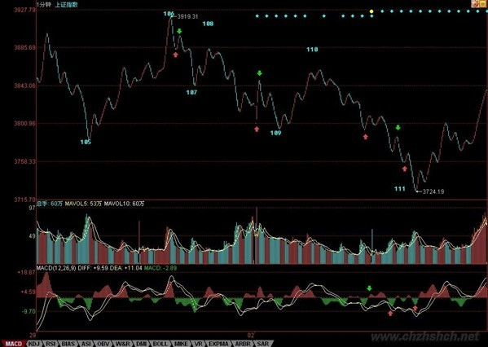

# KWX 012 — 背驰

[返回 KWX005 批次协调](memoKWX_005_batchConcept1to8.md)

## 000 — 范围

基于[中枢](memoKWX_010_Chan_zhongshu.md)与[走势](memoKWX_011_Chan_zoushi.md)，研究给定级别的趋势背驰和盘整背驰的比较段、力度、价格极值及完成时点。[1][2]

## 001 — 定义（是什么）

**（版本一）** 同一中枢的首次进入段与最后离开段同向，且离开段力度弱于进入段，即为背驰。

**趋势背驰**　在某级别的趋势中，末两个本级中枢的连接段与最后离开末中枢的走势同向，且离开段沿趋势方向创出新高或新低、力度弱于连接段，即为趋势背驰。

**盘整背驰**　在某级别的盘整中，本级中枢的首次进入段与最后离开段同向，且离开段力度弱于进入段，即为盘整背驰。

## 002 — 算法（怎么做）

趋势背驰和盘整背驰比较力度的辅助量法，按中枢结构选定比较段，再量力度。[1][2][6]

| 量法             | 怎么算                                                  | 看什么                            |
| -------------- | ---------------------------------------------------- | ------------------------------ |
| 价格幅度（涨跌幅）      | 用结构段的起止价计算，`（终价 − 起价）÷ 起价 × 100%`。                   | 看一段净走了多远。同向比较取涨跌幅的绝对值。         |
| 单位时间涨跌幅（斜率／角度） | `本段涨跌幅 ÷ 本段耗时`，例如涨 6% 用了 3 个交易分钟，就是每交易分钟涨 2%。        | 看平均涨跌速度。两段用同一计时口径，图上角度随坐标比例变化。 |
| 同向 MACD 柱面积    | 按结构段的 `(起点, 终点)` 取柱。上涨累加正柱，下跌累加负柱的绝对值。等宽柱以报价单位 × 根计。 | 看整段累积的同向柱面积，用于下文的力度比较。         |

### 002.a — 算法树

```text
已选定的两段可比同向走势
→ 在同一报价口径、原始 K 线周期及参数下，从连续原始收盘价计算 MACD
→ 将两段的结构起止锚点映射到原始 K 线，分别取 (起点, 终点] 的柱
→ 上涨累加正柱，下跌累加负柱的绝对值
→ 后段面积严格小于前段面积，即为本次力度减弱
```

取样排除起点柱、计入终点柱。按等宽柱计，面积单位为报价单位 × 根。前段面积大于零时可给出后段与前段的面积比。形成中的走势可记录候选观察，确认条件见 005。[2][5][10]

### 002.b — 逻辑演示

以上涨为例，两段区间内的柱值分别为 `4、-2、6` 和 `1、-3、5`。前段面积为 `4 + 6 = 10`，后段为 `1 + 5 = 6`，面积比为 `0.6`，后段力度减弱。

### 002.c — 辅助函数

| 函数 | 用途 |
|---|---|
| `build_macd_points` | 用给定参数从连续原始收盘价计算 DIF、DEA 及柱值 `hist = DIF - DEA`。 |
| `directional_hist_strength` | 在给定的 `(起点, 终点]` 区间累加同向柱绝对值。上涨只计正柱，下跌只计负柱。 |

### 002.d — 伪代码

```text
hist = build_macd_points(连续原始收盘价, 参数)
方向系数 = 上涨取 +1，下跌取 -1
段面积 = Σ max(方向系数 × hist[i], 0)，其中 起点 < i ≤ 终点
力度减弱 = 后段面积 < 前段面积
面积比 = 后段面积 / 前段面积（前段面积 > 0 时给出）
```

## 003 — 原理（为什么）

比较对象先由中枢身份和前后段确定。第64课所举 110–111 应比 104–105 的反例，说明时间更近的波段未必具有同一比较语境。第61课允许走势尚在发展时作区间套定位，但保留力度后来超过前段的否定路径。[5][6]

## 004 — 其他说明

第44课将小级别背驰引发大级别转折所需的最后次级别中枢第三类点写为必要条件，不能据此确认充分性。[7] 第25课指出一字涨停会干扰短周期 MACD。第29课讨论末中枢扩展、更高级别盘整及反趋势三类后续结构。比较这些论述时，先区分第37课的整个离开段 `c` 与第29课讲的背驰段范围。[8][9]

## 005 — 待确认事项

- `b/c` 如何定位，`c` 的内部次级别结构依据是什么？
- MACD 的周期、参数、起算和预热口径如何选，怎样处理缺失数据、极短段与比较精度？
- 盘整背驰的比较段如何确定，内外关系采用哪个区间？
- 如何判定背驰及相关走势的完成？

## 附录 A — 缠论原文与原图

在本地缠论库 109 个 Markdown 中检索背驰、背弛、盘整背、力度、MACD 和区间套，99 个文件命中。以下为回读原件后选取的相邻段落，覆盖比较前提、指标用法、例外及反例。选录去掉网页颜色标签，保留文内编者注。

### A.1 第37课，趋势和末段资格

第16–24行。[1]

> 背驰问题说过多次，但发现还有很多误解。不妨用最典型的a+A+b+B+c为例子把一些经常被混淆的细节进行说明。
>
> **没有趋势，没有背驰，不是任何a+A+b+B+c形式的都有背驰的。**当说a+A+b+B+c中有背驰时，首先要a+A+b+B+c是一个趋势。而一个趋势，就意味着A、B是同级别的中枢，否则，就只能看成是其中较大中枢的一个震荡。例如，如果A的级别比B大，就有a+A+b+B+c=a+A+（娇注：b+B+c），a与（娇注：b+B+c）就是围绕中枢A的一些小级别波动。这样，是不存在背驰的，最多就是盘整背驰。当然，对于最后一个中枢B，背驰与盘整背驰有很多类似的地方，用多义性，可以把b、c当成B的次级波动。但多义性只是多角度，不能有了把b、c当成B的次级波动这一个角度，就忘了a+A+b+B+c是趋势且A、B级别相同的角度。多义性不是含糊性，不是怎么干怎么分都可以，这是必须不断反复强调的。
>
> ** 其次，c必然是次级别的，也就是说，c至少包含对B的一个第三类买卖点，否则，就可以看成是B中枢的小级别波动，完全可以用盘整背驰来处理。**而b是有可能小于次级别的，力度最大的就是连续的缺口，也就是说，b在级别上是不能大于c的。例如，如果b是次级别，而c出现连续缺口，即使c没完成，最终也延续成次级别，但c是背驰的可能性就很小了，就算是，最终也要特别留意，出现最弱走势的可能性极大（娇注：扩展后续涨续跌）。
>
> 还有，如果a+A+b+B+c是上涨，c一定要创出新高；a+A+b+B+c是下跌，c一定要创出新低。否则，就算c包含B的第三类买卖点，也可以对围绕B的次级别震荡用盘整背驰的方式进行判断。
>
> **对c的内部进行分析，由于c包含B的第三类买卖点，则c至少包含两个次级别中枢，否则满足不了次级别离开后次级别回拉不重回中枢的条件。这两个中枢构成次级别趋势的关系，是最标准最常见的情况，这种情况下，就可以继续套用a+A+b+B+c的形式进行次级别分析确定c中内部结构里次级别趋势的背驰问题，形成类似区间套的状态，这样对其后的背驰就可以更精确地进行定位了。**

### A.2 第24课，先确定结构，再用 MACD

第14–44行，含作者对辅助用途、两段面积及回到中枢或留在中枢外的说明。[2]

> 这一章完全不在计划之中，其实该问题以前已说过，现在有点炒冷饭。但发现这里的人，绝大多数还是搞不懂，也就不妨结合点例子再说一次。要完全解决背弛问题，必须对中枢进行更进一步的分析，这是以后章节的事情了。但现在大家好象都急于用，而对中枢，好象真理解的没几个，继续深入下去，浅的都一团浆，深的更没法弄。因此，详细说说MACD 对背弛的辅助判断这样一种不绝对精确，但比较方便，容易理解的方法，对那些还没把握中枢基本分析的人，是有帮助的。也就是说，如果你一时真搞不懂中枢的问题，那就用这个方法，也足以应付一般的情况了。
>
> 首先，背弛同样有级别的问题，一个1 分钟级别的背弛，在绝大多数的情况下，不会制造一个周线级别的大顶，除非日线上同时也出现背弛。**但出现背弛后必然有逆转，这是没任何商量余地的。有人要问，究竟逆转多少？那很简单，就是重新出现新的次级别买卖点为止。**由于所有的买卖点，最终都可以归到某级别的第一类买卖点，而背驰与该种买卖点密切相关，所以可以这样说，任何的逆转，必然包含某级别的背驰，以后用严格的方法，可以证明如下定理：
>
> **缠中说禅背驰-买卖点定理：任一背驰都必然制造某级别的买卖点，任一级别的买卖点都必然源自某级别走势的背驰。**
>
> *该定理的证明这理暂且不说了，换句话说，只要你看到某级别的背驰，必然意味着要有逆转。但逆转并不意味着永远的，***例如，日线上向上的背驰制造一个卖点，回跌后，在5 分钟或30 分钟出现向下的背驰制造一个买点，然后由这买点开始，又可以重新上涨，甚至创新高，这是很正常的情况。**
>
> 用MACD 判断背驰，首先要有两段同向的趋势。同向趋势之间一定有一个盘整或反向趋势连接，把这三段分别称为A、B、C 段。显然，B 的中枢级别比A、C 里的中枢级别都要大，否则A、B、C 就连成一个大的趋势或大的中枢了。A 段之前，一定是和B 同级别或更大级别的一个中枢，而且不可能是一个和A 逆向的趋势，否则这三段就会在一个大的中枢里了。
>
> 归纳上述，用MACD 判断背驰的前提是，A、B、C 段在一个大的趋势里，其中A 之前已经有一个中枢，**而B 是这个大趋势的另一个中枢，这个中枢一般会把MACD 的黄白线**（娇注：也就是DIFF 和DEA）**回拉到0 轴附近。**而C 段的走势类型完成时对应的MACD 柱子面积（娇注：向上的看红柱子，向下看绿柱子）比A 段对应的面积要小，这时候就构成标准的背弛。
>
> 估计有些人连MACD 的最基本常识都没有，不妨说两句。首先你要打开带MACD 指标的图（娇注：千万别问本ID 怎么才会有MACD 的图，本ID 会彻底晕倒的），MACD 上有黄白线，也有红绿柱子，红绿柱子交界的那条直线就是0 轴。上面说的颜色都是通常系统用的，如果你的系统颜色不是这样，那本ID 只能说上面两条绕来绕去的曲线就是黄白线，有时一组向上、有时一组向下的就是红绿柱。本ID 也只能描述到这样地步了，如果还不明白，到任意一个证券部举个牌子，写上“谁是黄白线、谁是红绿柱”，估计会有答案的。
>
> *这样说有点抽象，就用一个例子，请看601628 人寿的5 分钟图：11日11 点30 分到15 日10 点35 分构成一个中枢。15 日10 点35 分到16日10 点25 分构成A 段。16 日10 点25 分到17 日10 点10 分，一个标准的三段构成新的中枢，也相应构成B 段，同时MACD 的黄白线回拉0轴。其后就是C 段的上涨，其对应的MACD 红柱子面积明显小于A 段的，这样的背驰简直太标准了。注意，看MACD 柱子的面积不需要全出来，一般柱子伸长的力度变慢时，把已经出现的面积乘2，就可以当成是该段的面积。所以，实际操作中根本不用回跌后才发现背驰，在上涨或下跌的最后阶段，判断就出来了，一般都可以抛到最高价位和买在最低价位附近。*
>
> 上面是一种最标准的背驰判断方法。那么，背驰在盘整中有用吗？首先，为明确起见，一般不特别声明的，背驰都指最标准的趋势中形成的背驰。而盘整用，利用类似背驰的判断方法，也可以有很好的效果。
>
> 这种盘整中的类似背驰方法的应用，称为盘整背弛判断。
>
> 盘整中往上的情况为例子，往下的情况反之亦然。如果C 段不破中枢，一旦出现MACD 柱子的C 段面积小于A 段面积，其后必定有回跌。比较复杂的是如果C 段上破中枢，但MACD 柱子的面积小于A 段的，这时候的原则是先出来，其后有两种情况，如果回跌不重新跌回，就在次级别的第一类买点回补，刚好这反而构成该级别的第三类买点，反之就继续该盘整。
>
> 昨天上海的5 分钟图上，就构成一个标准盘整背驰。12 日14 点35到16 日9 点45 构成A 段，16 日9点45 到16 日13 点30 构成B 段，16日13 点30 到17 日13 点05 构成C 段。其中B 段制造了MACD 黄白线对0 轴的回拉，C 段与A 段构成背驰。对C 段进行更仔细的分析，9 点35的第一个红柱，由于并没创新高，所以不构成背驰，10 点40 的第二个红柱子，由于这时候的C 段还没有形成一个中枢，根据走势必完美，这C 段肯定没完，所以继续。13 点05 分，第三个红柱子，这时候，把三个红柱子的面积加起来，也没有A段两个红柱子面积和大，显然背驰了，所以要走人了。而随后的回跌，马上跌回大的中枢之内，所以不可能有什么第三类买点，不过站在超短线的立场，如果出现次级别的第一类买点，又可以重新介入了。
>
> 那么，有没有盘整背驰后回跌形成第三类买点的例子，其实这种例子太多了，第三类买点，有一种情况就是这样构成的。例如，000002 万科的15 分钟图，12 月15 日10 点45 分，构成一个盘整背驰，所以要出来，其后的次级别回跌并不重新回到前面的中枢里，就在18 日9 点45 分构成了标准的第三类买点，这时候就该重新回补了。
>
> 背驰与盘整背驰的两种情况中，背驰是最重要的，一旦出现背驰，其回跌，一定至少重新回到B 段的中枢里，看看601628 人寿昨天的回跌，就一目了然了。而盘整背驰，一般会在盘整中弄短差时用到，如果其间突破中枢，其回跌必须分清楚上面的两种情况。
>
> **必须注意，无论背驰与盘整背驰，只要满足上面相应的标准，其技术上都是绝对的，没有任何的或然。问题不在于这种技术的准确性，而在于操作者判断的准确性，也就是说，必须先把什么是背驰，什么是盘整背驰，他们之间的标准是什么，如果连这些都搞不清楚，那是无法熟悉应用这项技术的。**
>
> 必须说明的是，由于MACD 本身的局限性，要精确地判断背驰与盘整背驰，还是要从中枢本身出发，但利用MACD，对一般人理解和把握比较简单点，而这已经足够好了。光用MACD 辅助判断，即使你对中枢不大清楚，只要能分清楚A、B、C 三段，其准确率也应该在90%以上。而配合上中枢，那是100%绝对的，因为这可以用纯数学的推理逻辑地证明，具体的证明，以后会说到。

### A.3 第27、53课，盘整的力度比较

第27课第16–22行。第53课第26行把 `a+B+c` 的 `a/c` 说明为同一中枢语境中的比较。第27课第54–58行另讨论大级别的类第一类用法。[3][4]

> 如果在第一个中枢就出现背驰，那不会是真正意义上的背驰，只能算是盘整背驰，其真正的技术含义，其实就是一个企图脱离中枢的运动，由于力度有限，被阻止而出现回到中枢里。
>
> **一般来说，小级别的盘整背驰，意义都不太大，而且必须结合其位置。如果是高位，那风险就更大了，往往是刀口舔血的活动；但如果是低位，那意义就不同了，因为多数的第二、三类买点，其实都是由盘整背驰构成的，而第一类买点，多数由趋势的背驰构成。**
>
> **一般来说，第二、三类的买点，都有一个三段的走势，第三段往往都破点第一段的极限位置，从而形成盘整背驰。**注意，这里是把第一、三段看成两个走势类型之间的比较，这和趋势背驰里的情况有点不同，这两个走势类型是否一定是趋势，都问题不大，两个盘整在盘整背驰中也是可以比较力度的。
>
> 这里，**先补充一个定义：就是在某级别的某类型走势，如果构成背驰或盘整背驰，就把这段走势类型称为某级别的背驰段。**

### A.4 第61、64课，比较对象和反例

第61课第36–46行讨论比较段尚未走出的假设、否定与逐层定位。第64课第39–49行讨论相邻波段不一定可比。下图为第64课第43行所引资料，图中标有 105–111 和上下对应的价格、MACD 面板。[5][6]

> 至于110-111。红箭头那两个为什么不是最终精确定位的背驰点？这都是些以前就应该解决的简单问题。像第一个红箭头位置，第一次略微跌破109那位置，这时候把已经出现的面积和前面108-109的对应面积之和比，已经十分接近，也就是说110-111，刚起跌，这力度已经和前面的108-109差不多，这恰好说明这一段的力度是很强的，不但不可能是对108-109背驰，而且站在中枢震荡的角度，这种力度，一定是小级别转大级别以时间换空间或与更大力度的对比产生的背驰才能化解的。后面这种情况，在这个实际的图形中，就是与前面104-105的下跌力度比。110-111这段，相比较的，是104-105这段，中间的中枢震荡的中枢，是105到110这个。因此，这里根本不存在与108-109对比的问题。站在105-107这个中枢的角度，110虽然不构成第三类卖点，但也极为接近，这种对中枢的离开，力度一般都很大，所以就算你搞不清楚和哪段比，也至少要等这段的结构被破坏，才有介入的可能，而后面，上下上的两次反抽，根本就没有破坏其结构，因此后面的破位下跌就是天经地义的。
>
> *机场到了，先保存起来。挺好玩的，帖子分两段写，中间过一安检。继续。*
>
> *至于第二红箭头那个，就更不可能是了。绿箭头那次反抽，等于对前面破位前那上下上的微型类中枢*（娇注：注意，站在严格意义上，线段以下是没有中枢的，所以说是类中枢）*的一个类第三类卖点，后面有两种变化，就是转大级别类中枢或类中枢移动直到形成新类中枢为止。而下面的黄白线，是一个典型的下上下结构中的第二下刚破上的低点，这是力度最大的一下，怎么可能有背驰出现？MACD第一个红箭头就指这大的下上下破的一下，这时候除非出现线段结构的突发性破坏，否则不可能有什么背驰出现。而后的回拉，其实刚好构成一个奔走型的上下上结构*（娇注：也就是第二上刚和第一上的低点稍微重合）*，这其实也就构成另一个微型类中枢。这和第一个红箭头指的那个一起，刚好构成两个类中枢的下跌走势。然后，后面的背驰判断就很简单了，和一般的趋势中背驰的判断一样。针对第二那奔走型的微型中枢的前后两段，MACD两个红箭头对应的绿柱子的比较，一目了然。*（娇注：千万别再问这时候为什么不看黄白线之类的问题，这类问题回答过N次了。）



### A.5 第44课，小级别转大级别的必要条件

第18–36行。保留作者的必要条件及其后的限定。[7]

> 有了上一课，对“背驰级别等于当下的走势级别”这最一般的情况，应该是很好把握了，唯一可能出现困难的，就是“背驰级别小于于当下的走势级别”这种情况，也就是所谓的小级别转折引发大级别转折，对这种情况，还要进行进一步的分析。
>
> 还是用上次的例子，向上30分钟级别的a+A+b+B+c，如果c是一个1分钟级别的背驰，最终引发下跌拉回B里，这时候，c里究竟发生了点什么事情？
>
> **首先，c至少要包含一个5分钟的中枢，否则，中枢B就不可能完成，因为这样不可能形成一个第三类的买点。**
>
> **不妨假设**c`是c中最后一个5分钟的中枢，显然，这个1分钟的顶背驰，只能出现在c`之后，而这个顶背驰必然使得走势拉回c`里，也就是说，整个运动，都可以看成了围绕c`的一个震荡，而这个震荡要出现大的向下变动，显然要出现c`的第三类卖点，因此，**对于那些小级别背驰后能在最后一个次级别中枢正常震荡的，都不可能转化成大级别的转折**，这个结论很重要，所以可以归纳成如下定理：
>
> **缠中说禅小背驰-大转折定理：**
>
> **小级别顶背驰引发大级别向下的必要条件是该级别走势的最后一个次级别中枢出现第三类卖点；**
>
> **小级别底背驰引发大级别向上的必要条件提是该级别走势的最后一个次级别中枢出现第三类买点。**
>
> （娇注：换个说法：小级别顶背驰引发大级别向下，那么，该级别走势的最后一个次级别中枢出现一定出现第三类卖点；如果该级别走势的最后一个次级别中枢出现出现第三类卖点，小级别顶背驰不一定引发大级别向下。小级别底背驰反过来就是）
>
> 注意，关于这种情况，只有必要条件，而没有充分条件，也就是说不能有一个充分的判断使得一旦出现某种情况，就必然导致大级别的转折。**小级别顶背驰后，最后一个次级别中枢出现第三类卖点并不一定就必然导致大级别的转折。**在上面的例子里，并不必然导致走势一定回到最后的该级别中枢B里。
>
> **显然，这个定理比起“背驰级别等于当下的走势级别”必然回来最后一个该级别中枢的情况要弱一点**，但这是很正常的，因为这种情况毕竟少见点而且要复杂得多。因此，在具体的操作中，必须有更复杂的程序来对付这种情况。而对于“背驰级别等于当下的走势级别”，如果你刚好是该级别为操作级别的，只要在顶背驰时直接全部卖出就可以。

### A.6 第25、29课，指标例外和后续结构

第25课第18–24行，含短周期指标在连续一字涨停时的限制。[8]

> 发现很多人把以前的东西都混在一起了，所以先把一些问题再强调一下。所谓的“吻”，是和均线系统相关的，而均线系统，只是走势的一个简单数学处理，说白了，离不开或然率，这和后面所说的中枢等概念是完全不同的，所以一定要搞清楚，不要把均线系统和中枢混在一起了。均线系统，本质上和MACD等指标是一回事，只能是一种辅助性工具。由于这些工具比较通俗，掌握起来比较简单，如果不想太深研究的，可以先把这些搞清楚。
>
> 但“学如不及”，对事情如果不能穷根究底，最终都是“犹恐失之”的，因此，最终还是要把中枢等搞楚。MACD，当一个辅助系统，还是很有用的。MACD的灵敏度，和参数有关，一般都取用12、26、9为参数，这对付一般的走势就可以了，但一个太快速的走势，1分钟图的反应也太慢了(注：最快速的走势用MACD柱子长度到达的极限数值参考），如果弄超短线，那就要看实际的走势，例如看600779的1分钟图，从16。5上冲19的这段，明显是一个1分钟上涨的不断延伸，这种走势如何把握超短的卖点？不难发现，MACD的柱子伸长，和乖离有关，大致就是走势和均线的偏离度。**打开一个MACD图，首先应该很敏感地去发现该股票MACD伸长的一般高度，在盘整中，一般伸长到某个高度，就一定回去了，而在趋势中，这个高度一定高点，那也是有极限的，一般来说，一旦触及这个乖离的极限，特别是两次或三次上冲该极限，就会引发因为乖离而产生的回调。这种回调因为变动太快，在1分钟上都不能表现其背驰，所以必须用单纯的MACD柱子伸长来判断。注意，这种判断的前提是1分钟的急促上升，其他情况下，必须配合黄白线的走势来用。**从该1分钟走势可以看出，17。5元时的柱子高度，是一个标杆，后面上冲时，在18。5与19元分别的两次柱子伸长都不能突破该高度，虽然其形成的面积大于前面的，但这种两次冲击乖离极限而不能突破，就意味着这种强暴的走势，要歇歇了。
>
> *还有一种，就是股票不断一字涨停，这时候，由于MACD设计的弱点，在1分钟、甚至5分钟上，都会出现一波一波类似正弦波动的走势，这时候不能用背弛来看，最简单，就是用1分钟的中枢来看，只要中枢不断上移，就可以不管。直到中枢上移结束，就意味着进入一个较大的调整，然后再根据大一点级别的走势来判断这种调整是否值得参与。如果用MACD配合判断，就用长一点时间的，例如看30分钟。一般来说，这种走势，其红柱子都会表现出这样一种情况，就是红柱子回跌的低点越来越低，最后触及0轴，甚至稍微跌破，然后再次放红伸长，这时候就是警告信号，如果这时候在大级别上刚好碰到阻力位，一但涨停封不住，出现大幅度的震荡就很自然了。例如600385，在2。92那涨停，MACD出现一点的绿柱子，然后继续涨停，继续红柱子，而3。28元是前期的日线高位，结果3。22涨停一没封住，就开始大幅度的震荡。*
>
> 注意，如果这种连续涨停是出现在第一段的上涨中，即使打开涨停后，震荡结束，形成一定级别的中枢后，往往还有新一段的上涨，必须在大级别上形成背驰才会构成真正的调整，因此，站在中线的角度，上面所说的超短线，其实意义并不太大，有能力就玩，没能力就算了。关键是要抓住大级别的调整，不参与其中，这才是最关键的。

第29课第35–37行，给出三种转折结果。第41行明确写到触及外围低点 DD，第49行另讨论至少重触最后中枢的情形。[9]

> **缠中说禅背驰-转折定理：某级别趋势的背驰将导致该趋势最后一个中枢的级别扩展、该级别更大级别的盘整或该级别以上级别的反趋势。**
>
> 该定理的证明有点抽象，估计大多数的人都没兴趣，那就用一个例子来说明，也大致知道证明的轮廓，更重要的是，这样，各位对走势的形成有一个更深切的认识。例如，一个5分钟背驰段的下跌，最终通过1分钟以及1分钟以下级别的精确定位，最终可以找到背驰的精确点，其后就发生反弹。注意，反弹只是一般的术语，在本ID的理论中，对这反弹会有一个很明确的界定，**就是包括三种情况：一、该趋势最后一个中枢的级别扩展、二、该级别更大级别的盘整、三该级别以上级别的反趋势。**

## 附录 B — CC 源码与实现核对

静态复核 CC 提交 `af305b0812131be71e49cf91851016012ea63a78`，所列源码与该提交一致。背驰模块已有趋势和盘整两个构建器。路由和叠加层绑定同版本的 canonical 结果，L0 用笔、L1 用线段，路由只接收 extend 中枢及标准 L1 线段预设。CC 输出的是工程观察。[10][11]

1. `build_macd_points` 用首根原始收盘价播种两条 EMA，DEA 从零起算，系数为 `2/13、2/27、2/10`，`hist=DIF−DEA`。`directional_hist_strength` 在 `(from,to]` 累加同向柱绝对贡献。空输入无结果，乱序或非有限收盘价报错。[10]
2. `build_trend_beichis` 筛选趋势，取末两只在走势范围相交且成员已经到达的合格中枢，比较前中枢末成员终点到末中枢首成员起点，以及末中枢末成员终点到走势末端。价格须越过末中枢外围，并严格刷新前面来源极值。代码依赖上游结构资格，未另外遍历 `c` 的第三类结构和内部次级别中枢。[1][10]
3. `build_consolidation_beichis` 要求单中枢、同版本进入证据和连续成员。比较段是进入腿，当前段从中枢最后成员的终点起。终价在外围 `[DD,GG]` 内（含边界）或按方向位于外围之外。是否超过进入腿的终价另记 `new_extreme`，允许无新极值的观察。[10]
4. 两分支都要求前段面积大于零且当前面积严格较小。状态依据所属走势是否 `FROZEN`，默认排除形成中。趋势叠加标记取当前段终点时间与走势极值，盘整取同一时点和终价。API 提供观察及 trace，可查看指标采样，不派生买卖点。[10][11]

**静态手算。** 若单中枢外围 `[9,13]`，向上进入腿终价为12，末成员终价为10，两段的正柱贡献分别是 `4+6=10` 和 `1+5=6`。其他输入条件给定时，终价11走 `inside` 且 `new_extreme=false`，终价13仍走 `inside` 但 `new_extreme=true`，终价14走 `outside`。三者比例均为0.6。此例固定人工柱值，只用来检查分支和边界。现行测试源码另列镜像、形成中更新和强度拒绝用例，本轮未运行 CC 引擎或这些测试。[10][12]

## References

[1] [缠论第37课，背驰的再分辨](../../references/chan_theory/037.md)，16–24行。

[2] [缠论第24课，MACD对背驰的辅助判断](../../references/chan_theory/024.md)，14–44行。

[3] [缠论第27课，盘整背驰与历史性底部](../../references/chan_theory/027.md)，16–22、54–58行。

[4] [缠论第53课，三类买卖点的再分辨](../../references/chan_theory/053.md)，26–34行。38行分隔线后的材料另属整理。

[5] [缠论第61课，区间套定位标准图解](../../references/chan_theory/061.md)，36–46行。

[6] [缠论第64课，去机场路上给各位补课](../../references/chan_theory/064.md)，39–49行及第43行[本地原图](../../references/chan_theory/064/image001.jpg)。

[7] [缠论第44课，小级别背驰引发大级别转折](../../references/chan_theory/044.md)，18–36行。

[8] [缠论第25课，吻，MACD、背弛、中枢](../../references/chan_theory/025.md)，18–32行。

[9] [缠论第29课，转折的力度与级别](../../references/chan_theory/029.md)，35–49行。

[10] [CC背驰模块](../../../CC/src/cc/algo/beichi.py)，1–3、175–243、454–540、637–1028行。

[11] [CC引擎入口](../../../CC/src/cc/algo/engine.py)，521–621行；[背驰叠加与版本绑定](../../../CC/src/cc/api/routes/overlay_beichi.py)，83–310行；[API与trace](../../../CC/src/cc/api/routes/beichi.py)，358–501、516–631行。

[12] [CC盘整背驰测试源码](../../../CC/tests/algo/test_consolidation_beichi_gate_b.py)，194–319、395–448行。
