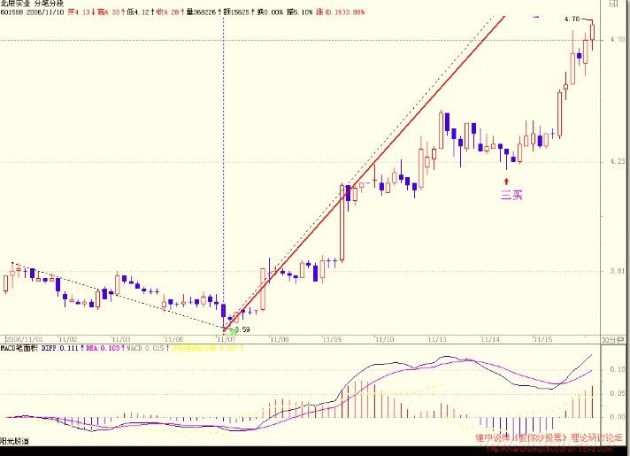
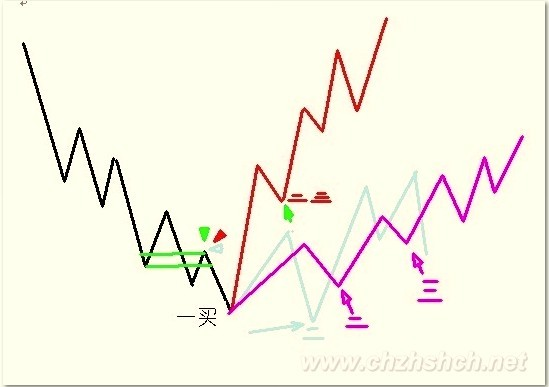

# KWX 013 — 买卖点

[返回 KWX005 批次协调](memoKWX_005_batchConcept1to11.md)

## 000 — 范围

研究同一级别三类买卖点的结构、价格锚点与获知时间，以及它们与[中枢](memoKWX_010_Chan_zhongshu.md)、[走势](memoKWX_011_Chan_zoushi.md)、[背驰](memoKWX_012_Chan_beichi.md)的关系。[1][2]

## 001 — 定义（是什么）

三类买卖点在同一观察级别上定义。

- **一类买卖点**　本级下跌趋势结束时，本级底背驰对应的低点为一买，本级上涨趋势结束时，本级顶背驰对应的高点为一卖。[1][2]
- **二类买卖点**　本级出现一买卖点转折后的首次次级别回试，若相对转折点未创新低／新高，或出现盘整背驰，其低点／高点为二买／二卖。[1][2][3]
- **三类买卖点**　次级别走势离开本级中枢后，首次次级别回试的低点高于本级别中枢上沿为三买，高点低于本级别中枢下沿为三卖。[4]

## 002 — 算法（怎么做）

KWX 的三类买卖点识别算法待定。原文给出了类别及其结构条件，所查 CC 源码的入口与缺口见附录 B。[1][2][4][8][9]

### 002.a — 算法树

算法树待定。下表列出原文判据。

| 类别 | 原文所述结构 |
|---|---|
| 第一类 | 第17课讨论下跌完成时的转折，第53课将同级一类与同级背驰联系。[1][2] |
| 第二类 | 第17课讨论一类之后首次次级别回调。第53课补充可无同级一类的小转大情形，并列出未创新极值或盘整背驰两种条件。[1][2] |
| 第三类 | 第20课讨论次级别离开中枢和第一次次级别回试，以「不跌破 ZG」或「不升破 ZD」描述边界条件。[4] |

### 002.b — 逻辑演示

第61课给出74点同时为二卖和三卖的例子。按原文，三卖对应69–72中枢。作者排除70–73中枢，因为前三段形成中枢，第四段离开，第五段才构成三类点。原文图及上下文见第61课。[6]

### 002.c — 辅助函数

待定。

### 002.d — 伪代码

待定。

## 003 — 原理（为什么）

第一类定位趋势转折。第二类关注转折后的次级别回试。第53课将未创新极值与盘整背驰并列。第三类关注原中枢离开后的首次回试位置，后续可以是趋势，也可以是更大级别盘整。二类与三类可以重合。[1][2][3][4][5]

## 004 — 其他说明

第53课在同一观察级别区分三类。第44课指出，小级别背驰引发大级别转折时，最后一个次级别中枢出现相应第三类点是必要条件。[2][7]

## 005 — 待确认事项

- 第一类如何核对同级背驰和趋势转折？
- 第二类如何处理小转大、次级别一类及回试的盘整背驰？
- 第三类的回试极值等于 ZG 或 ZD 时如何判定？
- 如何确认首次回试完成和二、三类重合？

## 附录 A — 缠论原文与原图

在本地缠论库 109 个 Markdown 中检索买卖点、第一／二／三类买、小背驰和小转大，87 个文件命中。回读下面各课的相关上下文后选录。去网页样式，保留文内编者注。

### A.1 第17课，第一、二类与走势完成

第67–79行。[1]

> 这些证明都很简单，就和初中几何的证明一样，有兴趣自己来一下。由上面的原理和定理，就可以严格地给出具体操作唯一可以依赖的两个坚实的基础。因为某种类型的走势完成以后就会转化为其他类型的走势，对于下跌的走势来说，一旦完成，只能转化为上涨与盘整，因此，一旦能把握下跌走势转化的关节点买入，就在市场中占据了一个最有利的位置，而这个买点，就是前面反复强调的“第一类买点”；而因为无论是趋势还是盘整在图形上最终都要完成，所以在第一类买点出现后第一次次级别回调制造的低点，是市场中第二有利的位置，为什么？因为上涨和盘整必然要在图形上完成，而上涨和盘整在图形上的要求，是必须包含三个以上的次级别运动，因此后面必须还至少有一个向上的次级别运动，这样的买点是绝对安全的，其安全性由走势的“不患”而保证，这，就是在前面反复强调的第二类买点。买点的情况说了，卖点的情况反之亦然。
>
> 综上所述，就不难明白为什么本ID在前面反复强调这两类买卖点了。因为该两类买卖点是被最基础的分析所严格保证的，就如同几何中严格定理一样，只要找准了这两类买卖点，在市场的实际走势中是战无不胜的，是波涛汹涌的市场中最坚实的港湾。关于该两类买卖点与走势及上述原理、定理间密不可破的逻辑关系，必须切实理解体会，这是所有操作中最坚实、最不能混淆的基础。
>
> 由上面的原理、定理，就可以继续证明前面已经说过的**“缠中说禅买卖点定律一”：**
>
> **“缠中说禅买卖点定律一”：任何级别的第二类买卖点都由次级别相应走势的第一类买点构成。 **
>
> 这样，就像前面曾说过的，任何由第一、二类买卖点构成的缠中说禅买卖点，都可以归结到不同级别的第一类买卖点。由此得到：
>
> **“缠中说禅趋势转折定律”：任何级别的上涨转折都是由某级别的第一类卖点构成的；任何的下跌转折都是由某级别的第一类买点构成的。**
>
> 注意，这某级别不一定是次级别，因为次级别里可以是第二类买卖点，而且还有这种情况，就是不同级别同时出现第一类买卖点，也就是出现不同级别的同步共振，所以这里只说是某级别。

### A.2 第20课，中枢边界与首次回试

第68–76行，图取原件第78行链接。图中为北辰实业分时价格及「三买」标注，图作者身份未另核。[4]

> 特别地，再定义ZG= min(g1、g2),ZD=max(d1、d2)，显然，[ZD，ZG]就是缠中说禅走势中枢的区间，由此有了如下定理：
>
> **缠中说禅走势中枢中心定理一：***走势中枢的延伸等价于任意区间[dn，gn]与[ZD，ZG]有重叠。换言之，若有Zn，使得dn>ZG或gn<ZD，则必然产生高级别的走势中枢或趋势及延续。*（娇注：3买卖点后中枢移动趋势延续或者3买卖点后中枢扩展成高级别中枢）
>
> **缠中说禅走势中枢中心定理二：***前后同级别的两个缠中说禅走势中枢，后GG<前DD，等价于下跌及其延续；后DD>前GG等价于上涨及其延续。后ZG<前ZD且后GG>=前DD，或后ZD>前ZG且后DD=<前GG，则等价于形成高级别的走势中枢。*
>
> 由定理一，可以得到**第三类买卖点定理：***一个***次级别走势类型***向上离开缠中说禅走势中枢，然后以一个***次级别走势***类型回试，其低点不跌破***ZG***，则构成第三类买点；一个***次级别走势***类型向下离开缠中说禅走势中枢，然后以一个***次级别走势***类型回抽，其高点不升破***ZD***，则构成第三类卖点。*
>
> 例如，工商银行在12月14日构成典型的日线级别第三类买点；北辰实业在11月14日构成典型的日线级别第三类买点；000803在1月20日构成典型的日线级别第三类卖点。注意，第三类买卖点比第一、二类要后知后觉，但如果抓得好，往往不用浪费盘整的时间，比较适合短线技术较好的资金，但一定要注意，并不是任何回调回抽都是第三类买卖点，必须是第一次。而且，第三类买卖点后，并不必然是趋势，也有进入更大级别盘整的可能，但这种买卖之所以必然赢利，就是因为即使是盘整，也会有高点出现。操作策略很简单，一旦不能出现趋势，一定要在盘整的高点出掉，这和第一、二类买点的策略是一样的(娇注：一买后不突破长期均线依旧男上位缠绕盘整，二买后破一买低点退出）。

### A.3 第21、61课，二三重合和中枢身份

第21课第34–40行连续段落。第61课第50–58行对74点补充，重合的三卖应对应69–72中枢，不能引用70–73中枢。[5][6]

> **对于中枢下形成的买点，但如果该中枢是在上涨之中的，在中枢之下并不能必然形成买点，中枢下的买点，只可能存在于下跌与盘整的走势类型中。换言之，一个上涨趋势确定后，不可能再有第一类与第二类买点，只可能有第三类买点。**
>
> *而对于盘整的情况，其中枢的扩张与新生，都不能必然保证该买点出现后能产生向上的转折，因为其扩张与新生完全可以是向下发展的，***而对于中枢延续的情况，中枢形成后随时都可以打破而结束延续，也不必然有向上的转折，所以盘整的情况下，中枢下也不必然产生买点。因此，只有在下跌确立后的中枢下方才可能出现买点。这就是第一类买点。**
>
> **第二类买点是和第一类买点紧密相连的，因为出现第一类买点后，必然只会出现盘整与上涨的走势类型，而第一买点出现后的第二段次级别走势低点就构成第二类买点，根据走势必完美的原则，其后必然有第三段向上的次级别走势出现，因此该买点也是绝对安全的。第二类买点，不必然出现在中枢的上或下，可以在任何位置出现，中枢下出现的，其后的力度就值得怀疑了，出现扩张性中枢的可能性极大，在中枢中出现的，出现中枢扩张与新生的机会对半，在中枢上出现，中枢新生的机会就很大了。但无论哪种情况，赢利是必然的。**
>
> **显然，第一类买点与第二类买点是前后出现的，不可能产生重合，而第一类与第三类买点，一个在中枢之下、一个在中枢之上，也不可能产生重合。只有第二类买点与第三类买点是可能产生重合的，这种情况就是：但第一类买点出现后，一个次级别的走势凌厉地直接上破前面下跌的最后一个中枢，然后在其上产生一个次级别的回抽不触及该中枢，这时候，就会出现第二类买点与第三类买点重合的情况，也只有这种情况才会出现两者的重合。当然，在理论上没有任何必然的理由确定第二、三类买点重合后一定不会只构成一个更大级别的中枢扩张，但实际上，一旦出现这种情况，一个大级别的上涨往往就会出现。**

### A.4 第53、44课，小转大及二类的补充条件

第53课第26–34行。第44课第18–36行区分必要条件和充分条件。第53课第38行分隔线后的转载材料没有纳入作者引文。[2][7]

> 其次，对于背驰与盘整背驰，前者是有着最基础意义的，而后者，只是利用前者相应的力度分析方法进行的一个推广用法，主要用在与中枢震荡相关的力度比较中。注意，a+B+c中，a和c的盘整背驰，其实都可以看成是B的中枢震荡，虽然a存在时，B还没出现，但也不妨这样看。
>
> 至于*第一、二、三***买卖点**，归根结底都可以归到第一类买卖点上，只是级别不同。那么为什么不就说第一类买卖点，因为这样，就会涉及不同的级别，等于同时用不同级别的显微镜去看，太乱，实际用起来更乱，因为不同级别的买卖点意义是不同，因此要同一在一个级别上研究，这个才有三类买卖点的分别。当然，最充分的操作，就是按分笔的买卖点，这样所有波动的最细微波动都可以把握了，但这在实际中是不可能的，人需要反应的时间、有交易成本等等。因此，忽略掉某些波动，按更大的级别统一操作，就是客观条件的必然要求。本ID的理论可不是什么先验理论，而是根本客观条件充分反映当下可能的充分可操作性的理论，这必须要彻底明确。因此，三类买卖点，都不能偏废，不能说哪一个更重要，站在同一级别上，三者都重要。
>
> **第一类买卖点，就是该级别的背驰点，**这足以应付最大多数的情况，**但有一种情况是不可以的，就是前面反复强调的小级别转大级别的情况。**为什么？因为当小级别背驰时，并未触及该级别的第一类买卖点，所以就无须操作。对这种情况，就需要第二类买卖点来补充。该买卖点，不是专门针对这小转大情况的，一般说，高点一次级别向下后一次级别向上，如果不创新高或盘整背驰，都构成第二类卖点，而买点的情况反过来就是了。所以，在有第一类买卖点的情况下，第一类买卖点是最佳的，第二类只是一个补充；但在小级别转大级别的情况下，第二类买卖点就是最佳的，因为在这种情况下，没有该级别的第一类买卖点。
>
> **第二类买卖点，站在中枢形成的角度，其意义就是必然要形成更大级别的中枢，**因为后面至少还有一段次级别且必然与前两段有重叠。
>
> **而对于第三类买卖点，其意义就是对付中枢结束的，**一个级别的中枢结束，无非面对两种情况，转成更大的中枢或上涨下跌直到形成新的该级别中枢。第三类买卖点就是告诉什么时候发生这种事情的，而在第二、三买卖点之间，都是中枢震荡，这时候，是不会有该级别的买卖点的，因此，如果参与其中的买卖，用的都是低级别的买卖点。

### A.5 第101课，二买低于一买的例外

第28–44行保留最强、最弱和一般情形。下图为第48行附图，原件第46行明注「网络收集」，并说明图中遗漏最后中枢的三卖表达。用于核对例外，不作规则图。[3]

> **(一)、最强的情况**
>
> 第二类买点刚好构成原来下跌的最后一个中枢开始的震荡走势的第三类买点，也就是第二、三类买点合一了，这是最强的走势，这情况，一般都对应V型反转的快速回升，是最有力度的。
>
> **(二)、最弱的情况**
>
> 第二类买点跌破第一类买点，也就是第二类买点比第一类买点低，这是完全可以的，这里一般都构成盘整背驰，后面对应这从顺势平台到扩张平台等不同的走势（娇注：扩张ABC 或者顺势ABC），这在后面的课程里会说到。
>
> （娇注：反向力度调整非常弱的时候出现。也叫强势整理或者弱势反弹。虽然少见。也有）
>
> **(三)、一般性走势**
>
> 也就是前面两者之间的走势。这种情况下，第一、二、三买点，是依次向上，一个比一个高。
>
> 站在原来下跌最后一个中枢的角度，第一、二、三类买点都可以看成是中枢震荡的结果，因此，在第二类与第三类之间，可能会存在着更多的中枢震荡走势，不一定如第一、二之间是紧接的。那第二类与第三类买点之间的震荡买点，一般就不给特别的名称了，当然，也可以看成是第二类买点，这样，并没有多大的影响。
>
> 注意，只有在这回升的中阴状态下才有第一、二类买点，中阴状态结束后，所有的中枢震荡只存在第三类买卖点以及中枢震荡的买卖点，就不存在第一、二类买卖点了。

## 附录 B — CC 源码与实现核对

核对 CC 提交 `af305b0812131be71e49cf91851016012ea63a78` 的算法、API、通知、前端和相关测试，所列路径与该提交一致。用 `BuySellPoint`、`buy_sell`、`bsp`、三类买卖点、买卖点及信号相关词检索，再沿实际入口读取。所检范围内尚未定位第一至第三类买卖点的检测器。[8][9][10]

| 实际入口 | 可核实的行为 |
|---|---|
| 背驰构建器和叠加层 | 返回趋势和盘整背驰观察及证据，画点使用当前段终点和终价或极值。模块声明与返回对象均限定为背驰观察。[8] |
| UDF `/marks` | 函数返回空 `UDFMarks()`。源码注释说明买卖点标记计划另接。[9] |
| WebSocket `/ws/signal` | 连接时发 `hello`，接收文本后回 `pong`。前端面板订阅并显示消息，通知模型只定义载荷。[9][10] |
| 算法说明卡 | `example/chan.py-main/BuySellPoint/BSPointList.py` 是文档列出的第三方参考路径。其名称不提供 CC 检测器已接入的证据。[11] |

买卖点检测器源码仍待核。本次为静态查阅。

## References

[1] [缠论第17课，走势终完美](../../references/chan_theory/017.md)，67–79行。

[2] [缠论第53课，三类买卖点的再分辨](../../references/chan_theory/053.md)，26–34行。

[3] [缠论第101课，答疑1](../../references/chan_theory/101.md)，28–48行及[本地附图](../../references/chan_theory/101/image001.jpg)。

[4] [缠论第20课，中枢级别扩张及第三类买卖点](../../references/chan_theory/020.md)，68–78行及[本地附图](../../references/chan_theory/020/image001.jpg)。

[5] [缠论第21课，买卖点分析的完备性](../../references/chan_theory/021.md)，34–40行。

[6] [缠论第61课，区间套定位标准图解](../../references/chan_theory/061.md)，50–58行。

[7] [缠论第44课，小级别背驰引发大级别转折](../../references/chan_theory/044.md)，18–36行。

[8] [CC背驰模块](../../../CC/src/cc/algo/beichi.py)，1–3、637–1028行；[叠加层序列化](../../../CC/src/cc/api/routes/overlay_beichi.py)，267–310行；[算法协议](../../../CC/src/cc/algo/protocols.py)，1–17、121–147行。

[9] [CC UDF入口](../../../CC/src/cc/api/routes/udf.py)，528–536行；[WebSocket信号入口](../../../CC/src/cc/api/routes/ws.py)，151–165行。

[10] [CC信号面板](../../../CC/frontend/src/components/LeftPane/SignalPanel.vue)，1–21行；[信号订阅](../../../CC/frontend/src/composables/useSignalStream.ts)，1–26行；[通知载荷](../../../CC/src/cc/notify/models.py)，10–30行。

[11] [CC趋势背驰算法卡](../../../CC/docs/algo-cards/beichi-v1.md)，34、58行。
