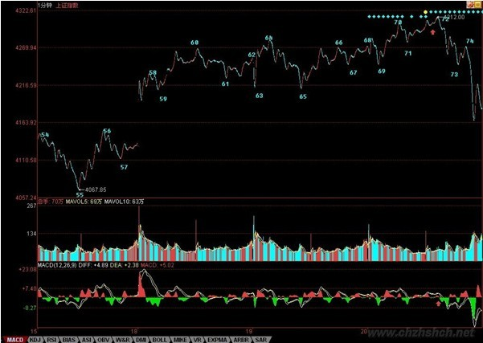

# KWX 014 — 区间套

[返回 KWX005 批次协调](memoKWX_005_batchConcept1to11.md)

## 000 — 范围

研究在大级别背驰段内部逐层定位转折范围的方法，衔接[背驰](memoKWX_012_Chan_beichi.md)、[买卖点](memoKWX_013_Chan_buysellpoint.md)和[力度](memoKWX_015_Chan_strength.md)。分析终点取本次选定的最低层级，保留原文关于级别有限的条件。[1]

## 001 — 定义（是什么）

**（版本一）** 区间套先找大级别背驰段，再找它内部的次级别背驰段。随后在找到的段内重复这一步，逐层缩小大级别转折点所在的范围。[1][2]

## 002 — 算法（怎么做）

本项目自动识别算法待定。下列为按第61课整理的研究流程，输入为同一行情来源、同一观察时点下已经分解的父段及其内部走势。[2]

### 002.a — 算法树

~~~text
选定目标级别和待考察的背驰段
→ 核对本层中枢、比较段、方向及力度证据
   ├─ 证据不足 → 保留待观察范围
   ├─ 后续证据否定背驰假设 → 重新审查本层判断及其依赖
   └─ 假设仍可继续考察 → 查看该段内部结构
       ├─ 找到合格内部背驰段 → 记录父子关系和范围，再考察内部
       └─ 已到选定最低层级或证据不足 → 输出当前可说明的范围
~~~

“证据不足”与“已确认转折”分别记录。何时允许继续细分、停止和确认，由005逐项确定。

### 002.b — 逻辑演示

沿用第61课的原始点号。对60–65中枢，先比较55–60与65开始的走势，再在后者内部考察69开始的段、71开始的段及71内部走势，逐层定位到72附近。[2]

| 层次 | 本层考察对象 | 原文所述判断 |
|---|---|---|
| 第一重 | 65开始的走势 | 与55–60比较，先作为背驰段假设，保留力度转强的否定路径 |
| 第二重 | 69开始的走势 | 在65开始段内部进一步比较 |
| 第三重 | 71开始的走势 | 考察其相对69–70的力度与内部结构 |
| 第四重 | 71内部的走势 | 结合价格和MACD箭头定位72 |

点号是原图的结构标注。各层的父段和内部段要逐项核对，层数依据图中分解而定。原图与连续文字见附录A.2。

### 002.c — 辅助函数

函数名与接口待定，拟议职责如下。

| 职责 | 需要保留的信息 |
|---|---|
| 定位本层比较对象 | 观察时点、中枢身份、方向及前后段来源 |
| 选择内部背驰段 | 父段范围、内部走势分解及本层证据 |
| 记录定位链 | 每层的原始时间范围、来源、假设及否定状态 |
| 检查停止条件 | 最低层级、证据是否齐备及当前定位精度 |

### 002.d — 伪代码

~~~text
当前段 = 已选父级背驰段
逐层记录当前段及其比较证据
若本层被否定，结束本次定位并保留原因
若达到最低层级，返回当前段范围和证据状态
若内部证据不足，返回待观察范围
否则进入当前段内部的合格背驰段，继续核对
~~~

这是流程草案。父层失效后的依赖处理、同层多个候选及实时修订仍待定义。

## 003 — 原理（为什么）

第27课将定位过程表述为不同级别背驰段的逐级收缩。第37课以特定的内部次级别趋势说明如何继续分析，应用时须保留该内部结构的前提。[1][3]

第61课保留了大段尚未走完时的假设与否定过程。定位结果同时需要说明“范围缩到了哪里”和“当时已取得哪些证据”。[2]

## 004 — 其他说明

第65课在线段以下使用“类背驰”的力度比较措辞，项目最低分析层级及这类证据的命名仍待确认。[4] 原始K线周期、结构级别与定位层次分别登记，父子段应能沿同一原始时间轴追溯。

## 005 — 待确认事项

- 从哪种父段开始定位，如何确认每层的结构资格？
- 最低层级、停止精度和同层多个候选怎样选取？
- 父段的背驰假设被否定后，已有子段证据怎样保留或更新？
- 形成中观察、结构端点和首次可确认时刻怎样区分？

## 附录 A — 缠论原文与原图

在本地109份Markdown中检索“区间套、背驰段、精确定位”，40份命中。重点回读第27、37、43、61、65课相关段落，以下按定义、例子和限制选录。引文保留原有编者注。

### A.1 第27课，逐级收缩与有限层级

第32–46行连续选录，保留有限层级的限制。[1]

> 学过数学分析的，都应该对区间套定理有印象。这种从大级别往下精确找大级别买点的方法，和区间套是一个道理。
>
>  以万科为例子，季度图上的第三段，在月线上，可以找到针对月线最后中枢的背驰段，而这背驰段，一定在季度线的背驰段里，而且区间比之小，把这个过程从月线延伸到周线、日线、30分钟、5分钟、1分钟，甚至是每笔成交，这区间不断缩小，在理论上，甚至可以达到这样一种情况，就是明确指出，就这一笔是万科历史底部的最后一笔成交，这成交完成意味着万科一个历史性底部的形成与时代的开始。
>
> 当然，这只是最理想的情况，因为这些级别不是无限下去的，因此，理论上并不能去证明就是一个如极限一样的点状情况的出现，但用这种方法去确认一个十分精确的历史底部区间，是不难的。
>
> 推而广之，可以证明缠**中说禅精确大转折点寻找程序定理：**
>
> **定理：某大级别的转折点，可以通过不同级别背驰段的逐级收缩范围而确定。**
>
> 换言之，某大级别的转折点，先找到其背驰段，然后在次级别图里，找出相应背驰段在次级别里的背驰段，将该过程反复进行下去，直到最低级别，相应的转折点就在该级别背驰段确定的范围内。
>
> 如果这个最低级别是可以达到每笔成交的，理论上，大级别的转折点，可以精确到笔的背驰上，甚至就是唯一的一笔。（娇注：当本ID十几年前发现这个定理时，有一个坏毛病，总是希望在实际操作上也精确到笔，因此还发明了其他古怪的看盘方法，不过这些其实都意义不大，1分钟的背驰段，一般就是以分钟计算的事情，对于大级别的转折点，已经足够精确了，对大资金，基本没什么用处。）
>
> 要理解本章，如果忘了的，最好把高数里的区间套定理复习一下，这个思路是一样的，当然，由于级别不是无限可分的，不可能达到数学上唯一一点的精度。各位有时间可以参考一下，600640、000001、000006、000009、000012、600643的季度图，看看历史底部是怎么形成的。当然，只有特别老的股票才可以用季度图。而月线图的，看600663、一个标准的例子。

### A.2 第61课，四重定位及假设否定

第38–46行连续选录。原图含55–74点号及价格、成交量、MACD面板，原样复制供对照。[2]

> **要比较力度，发现背驰，首先要搞清楚是哪两段比较，其实，只要是围绕一中枢的两段走势都可以比较力度。**显然，对于60-65这个1分钟中枢，55-60与65开始的一段之间就可以比较。在实际操作中，65开始的走势，由于没实际走出来，所以在和55-60比较时，都可以先假设是进入背驰段。而当走势实际走出来，一旦力度大于前者，那么就可以断定背驰段不成立，也就不会出现背驰。在没有证据否定背驰之前，**就要观察从65开始的一段其内部结构中的背驰情况，**这种方法可以逐次下去，这就是区间套的定位方法，这种方法，可以在当下精确地定位走势的转折点。
>
> 对于65开始背驰段的内部走势，当下走到69时，并不构成任何背驰，为什么？因为背驰如果没有创新高，是不存在的。所以，只有等70点出现时，大盘才进入真正的背驰危险区。由于69-70段与67-68段比并没有盘整背驰，所以70点并没有走的理由，除非你是按线段以下级别操作的。而71点，构成对66-69这1分钟中枢的第三类买点。按照本ID的理论，其后无非只有两种情况，中枢级别扩展或者**走出新的中枢上移。对后者**（娇注：走出新的中枢上移）**，一个最基本的要求就是，从71点这第三类买点开始的向上段不能出现盘整背驰；**而在实际中，不难发现，71点开始的走势力度明显比不上69-70段，而对于65-66段，69开始的走势力度也明显比不上，这从两者下面对应的MACD红柱子面积之和可以辅助判断。(娇注：盘背比较先最近同向一段再中枢两头）
>
> 
>
> **因此，65开始的走势是第一重背驰段，69开始的是第二重背驰段，也就是65开始背驰段的背驰段，而71开始的是第三重背驰段，也就是65开始背驰段的背驰段的背驰段，最后当下考察71开始的走势，从走势上红尖头以及MACD上红尖头可以当下知道，71的内部背驰也出现，也就是第四重的背驰段出现了。**
>
> 由此可见，72点这个背驰点的精确定位，是由65开始背驰段的背驰段的背驰段的背驰段构成的，这就构成一个区间套的精确定位，这一切，都可以当下地进行。

### A.3 第37、65课，内部结构和类背驰

第37课第16–24行讨论a+A+b+B+c的级别、方向及内部结构，第24行将继续套用次级别趋势分析限定为最标准、最常见的情况。[3] 第65课第107行另说明线段以下类背驰的力度比较用途。[4]

## 附录 B — CC 源码与实现核对

静态核对CC提交 `af305b0812131be71e49cf91851016012ea63a78`。读取范围为下列入口及其关联模型，实际运行验证留待算法任务。

| 所读位置 | 当前行为 |
|---|---|
| engine.py 521–624行 | 从本级canonical结果取得趋势和盘整背驰，维护版本及指标缓存。[5] |
| beichi.py 637–1028行 | 按给定走势、中枢和比较段生成本级背驰观察。[6] |
| engine.py 626–703行、zoushi_recursion.py 229–250、665–703行 | 另外构建递归中枢与走势，所读构建器只接收depth=1。[5][7] |

在所查入口中，尚未找到把父级背驰段、内部子段、逐层范围和否定状态组织成区间套定位链的步骤。单级背驰和递归中枢提供了部分结构材料，014的自动识别接口仍待设计。

## References

[1] [第27课，盘整背驰与历史性底部](../../references/chan_theory/027.md)，32–46行。

[2] [第61课，区间套定位标准图解](../../references/chan_theory/061.md)，38–46行及[原图](../../references/chan_theory/061/image001.jpg)。

[3] [第37课，背驰的再分辨](../../references/chan_theory/037.md)，16–24行。

[4] [第65课，再说说分型、笔、线段](../../references/chan_theory/065.md)，107行。

[5] [CC引擎入口](../../../CC/src/cc/algo/engine.py)，521–703行。

[6] [CC背驰构建器](../../../CC/src/cc/algo/beichi.py)，637–1028行。

[7] [CC递归走势构建](../../../CC/src/cc/algo/zoushi_recursion.py)，229–250、665–703行。
