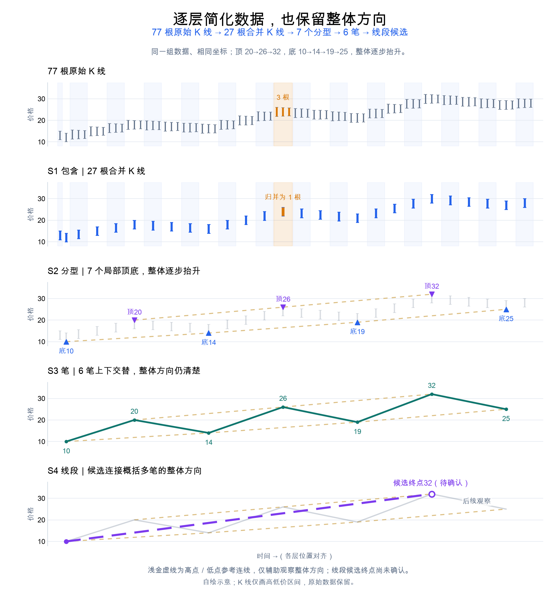
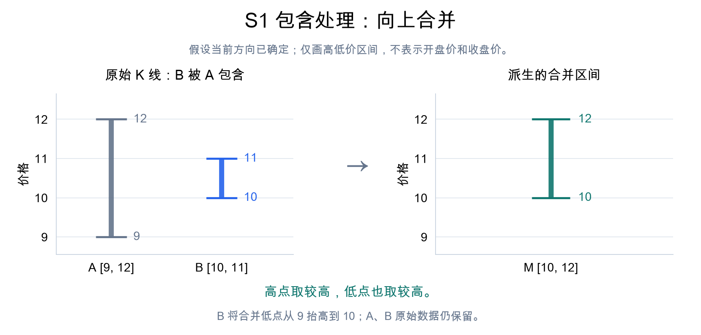
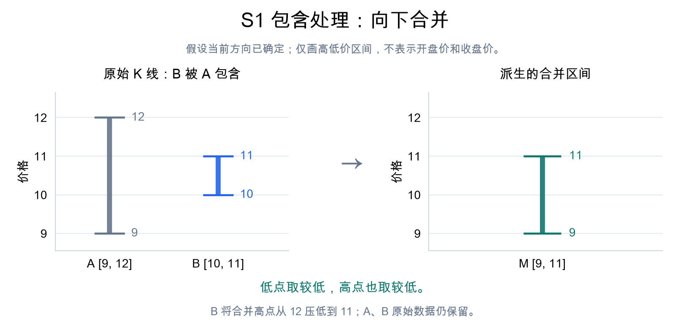
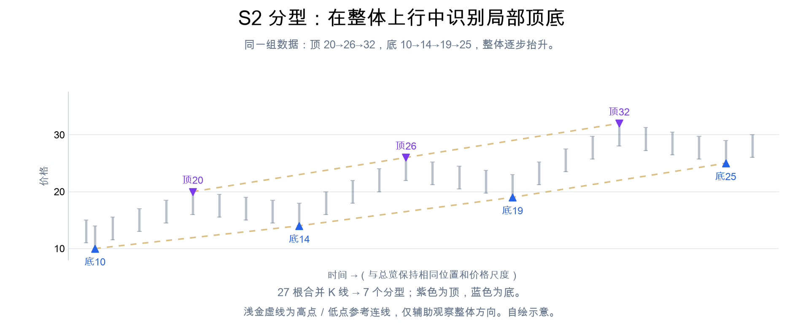
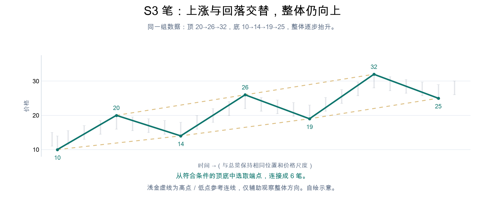
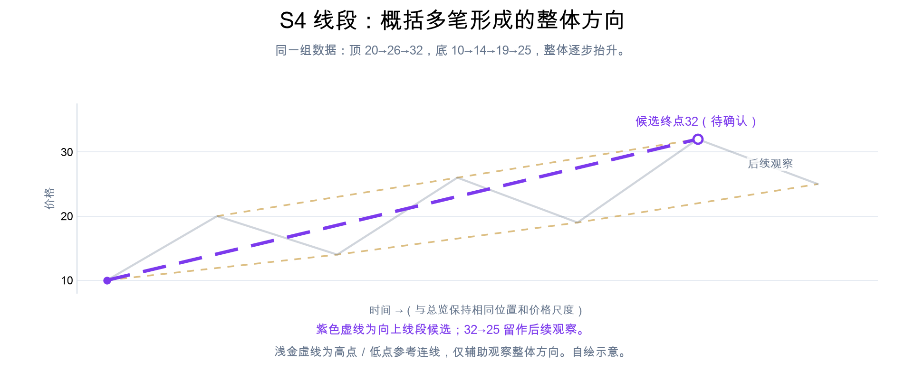
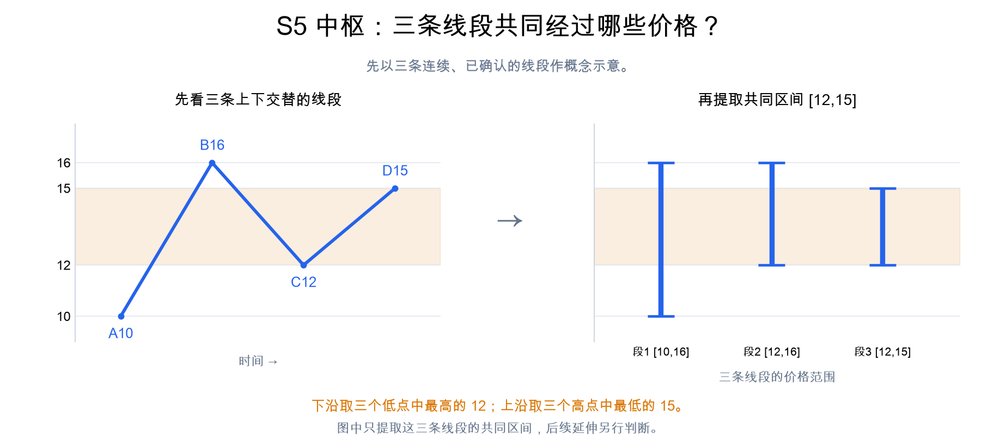
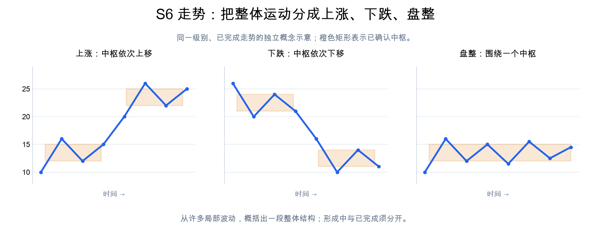
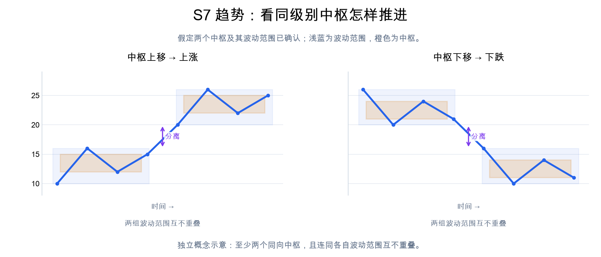
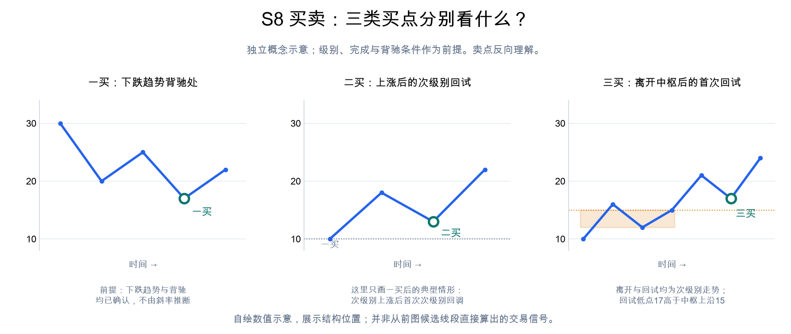

# Chan Large Picture
## 000 — Scope
Describe the big picture of Chan Theory and how its main ideas fit together.
## 001 — Key concepts and flow
主线：K线简化 → 分型 → 笔 → 线段 → 中枢 → 走势类型 → 买卖位置。
示例中高点和低点逐步抬高，S2–S4 都保留这个整体上行方向。
### S1 包含
包含处理是第一层信息简化：在保留原始数据的基础上，归并价格区间，形成更清楚的结构表示。[1]

### S2 分型
处理包含后，比较相邻三根合并K线：中间一根的高点、低点都高于左右两根，为顶分型；都低于左右两根，为底分型。这里按 proj009 的严格比较口径，须等右侧K线出现才能确认。[2]

### S3 笔
笔以选出的顶、底分型极值为两端，把其间的K线运动简化为一次上涨或下跌。连接还须满足所选口径的间隔和价格条件，并非任意相邻分型都能直接相连。[3]

### S4 线段
线段把连续、上下交替的多笔简化为一段整体方向运动，至少三笔，且起始三笔须有重叠。它可以继续延伸，终点须按结束规则确认，不能每三笔机械分组。[4]

### S5 中枢
先从线段引入：图中这三条连续、已确认线段的共同价格区间，可以用来直观理解线段中枢。它把多次来回运动简化为一个核心价格区间；图中是线段层示意。[5][6]

### S6 走势
走势是选定级别上一段价格运动的整体结构，类型包括上涨、下跌和盘整，需区分形成中与已完成。各级别都有走势；严格理论中，中枢取连续、已完成的次级别走势的重叠，前面的线段示意与这一输入的对应关系需另行明确。[5][6]

### S7 趋势
趋势是走势的一种：一个已完成走势中，同一级别至少两个中枢依次同向推进，且连同各自波动范围互不重叠。向上为上涨，向下为下跌；只含一个中枢的已完成走势属于盘整。[5][7]

### S8 买卖
买卖点把前面的结构分析落实为指定级别上的转折或回试位置。一买关注下跌趋势背驰（末段力度衰减）处；二买关注上涨后的次级别回试，图中先画一买后的典型情形；三买关注次级别向上离开中枢后的首次次级别回试，低点不跌破中枢上沿；卖点反向理解。[7][8]

## References

1. [references/proj009Memo/memo0020_class_merged_kline_series.md](../../references/proj009Memo/memo0020_class_merged_kline_series.md)
2. [references/proj009Memo/memo0023_class_fenxing_series.md](../../references/proj009Memo/memo0023_class_fenxing_series.md)
3. [references/proj009Memo/memo0033_algo_of_bi.md](../../references/proj009Memo/memo0033_algo_of_bi.md)
4. [references/proj009Memo/memo0031_algo_of_xianduan_1st.md](../../references/proj009Memo/memo0031_algo_of_xianduan_1st.md)
5. [references/proj009Memo/memo0035_algo_of_zhongshu.md](../../references/proj009Memo/memo0035_algo_of_zhongshu.md)
6. [references/proj009Memo/memo0015_oop_trading_architecture.md](../../references/proj009Memo/memo0015_oop_trading_architecture.md)
7. 缠中说禅. 教你炒股票20：缠中说禅走势中枢级别扩张及第三类买卖点. 2007-01-05. [原文存档](https://eczsc.com/originals/20).
8. 缠中说禅. 教你炒股票53：三类买卖点的再分辨. 2007-05-23. [原文存档](https://eczsc.com/originals/53).
