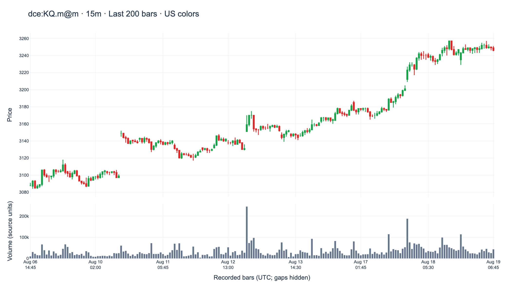
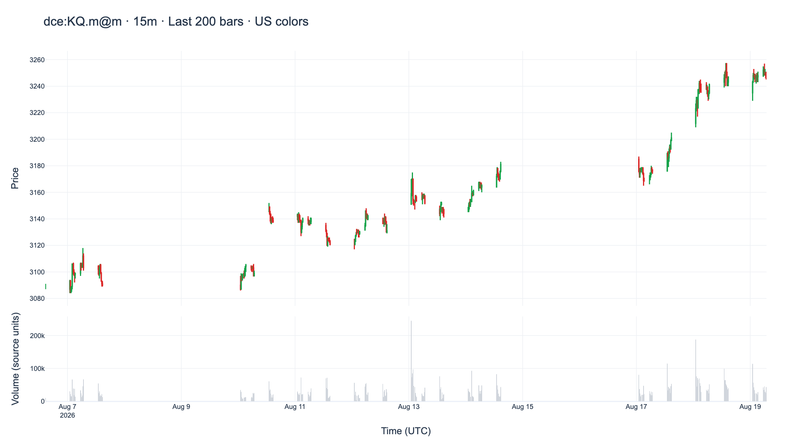
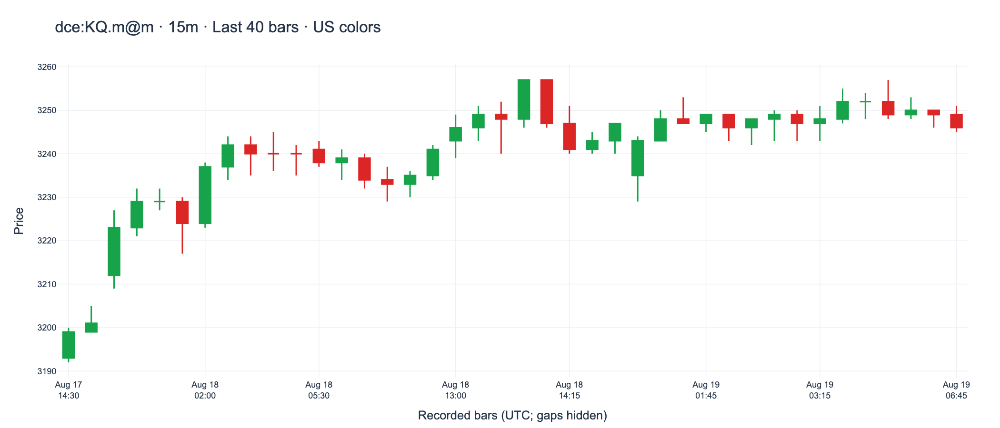
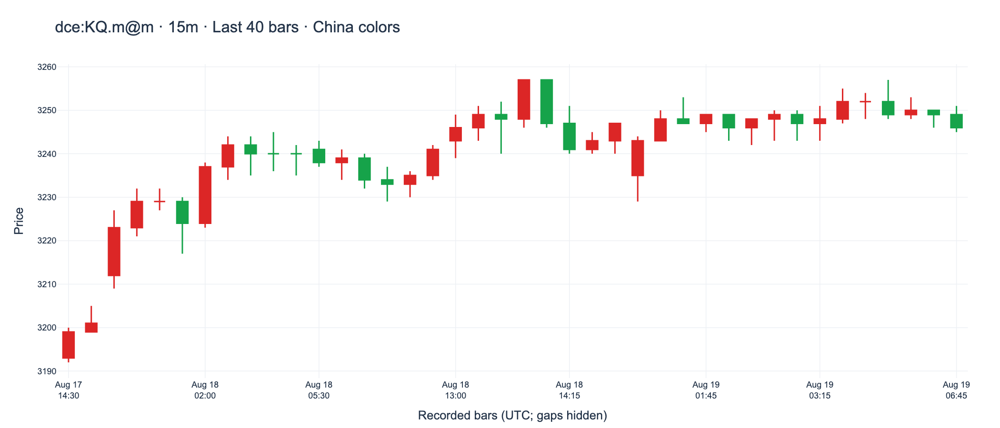

# Kline family implementation plan
## 000 — Scope
Implement `Kline` and `KlineTSeries` according to memo 009, sections 001.a and 002.b–002.c.[1] Follow memo 011’s plan structure, including baseline and Python Pro implementations.[2] Raw-class/CSV implementation, comparison and Plotly plotting are implemented. Results, public interfaces and sample charts are recorded below; the Appendix summarizes Plotly integration.
## 001 — Implementation plan
Use the existing Project 009 master table and source context prepared for memo 011 in `samples/chan_table/`; no separate data preparation is needed.
### 001.a — Implement the Kline family
1. Keep immutable domain classes in `src/chanlab/algo/` and loading/serialization adapters in `src/chanlab/data/`.
2. Implement `Kline` with symbol, period, source, timestamp and OHLCV; construction automatically validates required metadata, aware UTC timestamps, finite values, price bounds and nonnegative volume.
3. Implement `KlineTSeries` with an immutable tuple of valid bars; require nonempty input, one symbol/period and strictly increasing timestamps. Allow mixed sources.
4. Implement length, iteration and indexing. Integer access returns a Kline; slices return tuples with normal Python indexing behavior.
5. Expose CSV I/O as `KlineTSeries.read_csv(...)` and `series.write_csv(...)`; the series owns immutable provenance in `context`. Delegate format details internally while preserving values and row/field validation errors.
6. Add `KlineTSeries.plot()` as proposed in memo009, delegating candlestick/optional volume rendering to a separate Plotly helper. Support US colors by default and an explicit China preset. Return a figure; keep rendering logic outside the domain classes. See the Appendix for the interface and checks.
7. Keep ChanTable object interchange, DataFrame conversion, indicators and feature detection separate.
### 001.b — Repeat the raw-class/CSV implementation using Python Pro
1. Read the installed `mas/skills/python-pro/SKILL.md` before the second implementation.[3]
2. Repeat the raw-class/CSV work with the same design, interface, data and acceptance tests. The later Plotly extension is recorded separately in002.f.
3. Preserve both versions separately under `artifacts/mas/kline-family/`; do not overwrite the baseline.
4. Record the exact skill invocation request verbatim and the skill source/version in the MAS task; link it from section 002.
### 001.c — Compare the two raw-class/CSV implementations
1. Run both versions against the same fixtures and full dataset.
2. Compare correctness, memo 009 compliance, immutability, error clarity, readability and dependencies.
3. Save both versions and a concise comparison in `artifacts/mas/kline-family/`; record which version is selected for shared source code and why.
### 001.d — Test the Kline family
1. Check valid construction and rejection of missing metadata, naive/non-UTC timestamps, nonfinite OHLCV, invalid price bounds and negative volume.
2. Check empty series, mixed symbols/periods, duplicate/decreasing timestamps, mixed-source acceptance, immutability, iteration, negative indexing and slicing.
3. Check full-dataset loading and read→write→read preservation of raw values, timestamps and provenance.
4. Run pytest and report-only Ruff; record actual commands, results, blockers and deferred integrations under `mas/tasks/`.
5. Verify plotted data against the selected bars, optional volume, both time-axis modes, both color presets, invalid options, empty selections, missing optional dependency, source immutability and HTML export; inspect representative charts visually.
## 002 — Implementation notes and logs
### 002.a — Implement the Kline family → 001.a
Implemented immutable `Kline` and `KlineTSeries` with automatic validation and normal sequence behavior in [kline.py](../../src/chanlab/algo/kline.py). [kline_csv.py](../../src/chanlab/data/kline_csv.py) reads the existing master table's raw fields or a nine-column raw CSV and writes raw CSV plus provenance context. Errors name the file, row and field. No changes to the master table or ChanTable implementation.
### 002.b — Apply Python Pro → 001.b
Baseline code passed its original 109 acceptance cases and was frozen before reading Python Pro1.1.0. The same author then implemented the typed continuation; both versions are retained under `artifacts/mas/kline-family/`. [The task](../../mas/tasks/20261108-memo013-execution.md) preserves the exact invocation request and source version.
### 002.c — Compare and select → 001.c
Selected the Python Pro continuation plus review corrections: explicit types/indexing overloads, float-compatible numeric validation and protection against identical or aliased output files. The final identical 114-case suite gives baseline110 passed/4 failed and selected114 passed; baseline defects remain visible in [the comparison](../../artifacts/mas/kline-family/comparison.md). This is an incremental comparison, not proof of a skill-only effect.
### 002.d — Test → 001.d
Active regression: **165 passed**, including all51 unchanged ChanTable cases. Strict mypy, Black and report-only Ruff passed; new-module statement coverage93%. Complete10,060-row raw export/reload preserved numeric values, UTC instants, metadata and nine context entries. Float/ISO spelling may normalize; original inputs and baseline hashes are unchanged. [Verification and checks](../../artifacts/mas/kline-family/verification.json); [generated raw export and context](../../artifacts/mas/kline-family/roundtrip/).
### 002.e — Handoff and remaining scope
The user confirmed011 ready and released013 execution. Source UTC labels and source-defined volume units were used unchanged; independent provider start-label evidence is not claimed. Plotly plotting is implemented with an optional dependency. ChanTable object interchange, DataFrame conversion, indicators and feature detection remain deferred. [Plot interface, samples and reproduction commands](../../artifacts/kline/README.md).
### 002.f — Plotly implementation and samples
Added lazy `KlineTSeries.plot()` delegating to [kline_plot.py](../../src/chanlab/visualization/kline_plot.py). Optional `plot` extra is locked at Plotly7.1.0; raw/CSV use works without it. At initial implementation,11 focused plotting tests and all176 regression tests passed; Ruff, Black and strict mypy checks pass. Core/plot statement coverage93%. Generated and visually inspected200-bar candles/volume and40-bar price detail, verifying every plotted value against source. [Samples and verification](../../artifacts/kline/README.md); [implementation task](../../mas/tasks/20261108-memo013-plotly-implementation.md). The original165-test result and frozen baseline comparison above describe the earlier raw/CSV phase; those snapshots were preserved.
### 002.g — Time-axis check and display options
The first sample used a date axis: its200 recorded bars span12 days16 hours, so absent intervals appeared as blank horizontal space. Original epoch/UTC labels match the chart; no display timestamps were invented. The raw chart now defaults to equal consecutive-bar spacing (`show_gaps=False`); `show_gaps=True` retains the calendar view. Compression does not classify source gaps as scheduled closures or missing records. At that checkpoint, merged charts from memo026 retained calendar mode. The 14 raw-plot tests and all205 regression tests passed; core/plot statement coverage was93%. Both modes and the close-up were regenerated and visually inspected. [Axis/source/image verification](../../artifacts/kline/gap-check-verification.json).
### 002.h — Class-centered CSV interface
CSV loading/saving are now exposed as `KlineTSeries.read_csv(...)` and `series.write_csv(...)`, alongside `series.plot()`. The series owns immutable `context` provenance, giving it two stored members: `klines` and `context`. Loading returns one series object; saving uses its owned metadata. Existing adapters remain behind the methods for reuse/compatibility; the two-class model and source data are preserved. [OOP refactor task and checks](../../mas/tasks/20261109-memo013-oop-methods.md); [full object-method roundtrip](../../artifacts/mas/kline-oop/method-verification.json).
### 002.i — US/China candle colors
Added `market="US"` (default) and `market="China"` to the raw series plot method. Both line and fill colors follow the selected convention; volume stays gray. The 14 new palette cases and all 278 regression tests pass; scoped typing, Ruff and Black pass, with 94% core/plot/OOP statement coverage. Existing samples were regenerated with the real preset (old generator overrides removed), and a same-data China close-up was added. All four PNGs were visually inspected. [Color verification and source/picture hashes](../../artifacts/kline/market-color-verification.json); [task](../../mas/tasks/20261109-memo013-market-colors.md). No class/member/data/schema changes; merged charts retain their separately documented settings.
## 003 — Implemented classes, members and methods
### 003.a — Class count and scope
**This memo implements two classes: `Kline` and `KlineTSeries`.** Both are defined in [kline.py](../../src/chanlab/algo/kline.py).

| Class | Represents | Stored members | Main methods |
| --- | --- | --- | --- |
| `Kline` | One raw OHLCV bar. | Nine fields, listed in003.b. | Constructor and `validate()`. |
| `KlineTSeries` | Ordered raw bars with their provenance. | Two fields: `klines` and `context`. | Constructor, `validate()`, length, iteration, indexing/slicing, `read_csv()`, `write_csv()` and `plot()`. |

This count is specific to memo013. `ChanTable` belongs to memo011; the merged-Kline classes belong to memo026. CSV loading, saving and plotting are public `KlineTSeries` methods. Their parsing/rendering implementations are delegated internally. The returned Plotly `Figure` is a third-party class.
### 003.b — Kline
**Members — the data stored in each bar**

| Member | Declared type | Meaning |
| --- | --- | --- |
| `symbol` | `str` | Instrument identifier. |
| `period` | `str` | Bar period, such as `15m`. |
| `source` | `str` | Data-source or provenance label. |
| `timestamp` | `datetime` | Timezone-aware UTC bar timestamp; memo009 specifies the bar-start convention. |
| `open` | `float` | Opening price. |
| `high` | `float` | Highest price. |
| `low` | `float` | Lowest price. |
| `close` | `float` | Closing price. |
| `volume` | `float` | Traded quantity in source-defined units. |

All nine members are immutable. Numeric fields also accept finite integers exactly representable as floats; booleans are rejected. Values are retained without conversion.

**Methods**

| Method | Normal use | Behavior |
| --- | --- | --- |
| `__init__(symbol, period, source, timestamp, open, high, low, close, volume)` | `bar = Kline(...)` | Generated dataclass constructor: initialize all nine members and automatically validate the new bar. |
| `validate() -> None` | `bar.validate()` | Check nonblank provenance, aware UTC timestamp, finite numeric values, `low <= open <= high`, `low <= close <= high` and nonnegative volume. Raise `ValueError` for invalid fields. |

Internal hook: `__post_init__() -> None` calls `validate()` during construction; callers normally use the constructor. Dataclass-generated representation/equality/hash methods are standard Python behavior, separate from this domain interface.
### 003.c — KlineTSeries
**Members — the data stored in each series**

| Member | Type | Meaning |
| --- | --- | --- |
| `klines` | `tuple[Kline, ...]` | Immutable, nonempty tuple of bars in strictly increasing timestamp order. |
| `context` | `Mapping[str, str]` | Immutable snapshot of source/version metadata. Defaults to an empty mapping; loaded CSV context is retained here. |

The series stores two members. Per-bar instrument, period and source labels remain on each `Kline`; shared source/version metadata is owned by `series.context`. Constructor context is copied, with nonblank string keys and string values. The series requires one symbol/period while allowing mixed sources.

**Methods**

| Method | Normal use | Behavior or result |
| --- | --- | --- |
| `__init__(klines: Iterable[Kline], *, context=None)` | `series = KlineTSeries(bars, context=metadata)` | Snapshot the iterable/context, then automatically validate both. |
| `validate() -> None` | `series.validate()` | Validate every bar, nonempty input, one symbol/period, strictly increasing timestamps and valid context strings. Raise `ValueError` for invalid data. |
| `__len__() -> int` | `len(series)` | Number of bars. |
| `__iter__() -> Iterator[Kline]` | `for bar in series` | Iterate in stored order. |
| `__getitem__(key)` | `series[index]` or `series[start:stop:step]` | Integer input returns one `Kline`; a slice returns `tuple[Kline, ...]`, possibly empty. Supports normal negative indices and indexing exceptions. |
| `read_csv(path, context_path=None) -> Self` | `series = KlineTSeries.read_csv(...)` | Class method: load raw-nine or master41 CSV and return a new series owning its provenance. |
| `write_csv(path, context_path=None) -> None` | `series.write_csv(...)` | Instance method: save raw-nine CSV and `series.context`; nonempty context requires a separate sidecar destination. |
| `plot(*, start=None, stop=None, volume=True, title=None, show_gaps=False, market="US") -> Figure` | `fig = series.plot(...)` | Delegate to the Plotly helper and return a figure without automatically displaying or exporting it. |

`read_csv()` is called on the class; `Self` means an instance of the invoked class. `write_csv()` and `plot()` operate on an existing series. `__getitem__` is one method with two typed overloads; double-underscore methods support normal Python operations. Equality includes bars and context; hashing uses bars so immutable metadata does not break hashability.

**Arguments of `plot()` — call options, not stored members**

| Argument | Type | Default | Meaning |
| --- | --- | --- | --- |
| `start` | `int \| None` | `None` | Inclusive bar position; negative indices count from the end. |
| `stop` | `int \| None` | `None` | Exclusive end position. Both bounds omitted selects all bars. |
| `volume` | `bool` | `True` | Include the aligned volume panel. |
| `title` | `str \| None` | `None` | Custom title; otherwise use symbol, period and color convention. |
| `show_gaps` | `bool` | `False` | `False`: place observed bars consecutively. `True`: show elapsed calendar time and its gaps. |
| `market` | `Literal["US", "China"]` | `"US"` | Candle color convention only: US green-up/red-down; China red-up/green-down. |

**Meaning of candle colors**

The comparison is each candle's **close versus its own open**.

| `market` | Up candle: `close > open` | Down candle: `close < open` |
| --- | --- | --- |
| `"US"` — default | Green | Red |
| `"China"` | Red | Green |

The preset changes display colors only, independently of the instrument's country; source values, UTC timestamps and gap settings stay unchanged. A doji (`close == open`) has a zero-height body and retains Plotly's native stroke handling; its color does not imply a gain/loss within that candle. Volume bars remain gray and show traded quantity. See the Appendix's color references.

An empty plot selection raises `ValueError`. Plotly is optional; `uv sync --extra plot` installs it. The returned figure belongs to the caller, who can use `fig.show()` or export it. Examples and pictures follow in003.e–003.f.
### 003.d — Object workflow and implementation boundary
Use `KlineTSeries.read_csv(...)` to create the object, then call `series.write_csv(...)` or `series.plot(...)`. The series carries both its bars and provenance; callers use one object rather than a separate `(series, context)` pair.

| Public operation | Owner | Internal implementation |
| --- | --- | --- |
| Load CSV and provenance | `KlineTSeries.read_csv(...)` | [CSV adapter](../../src/chanlab/data/kline_csv.py) parses/validates the files. |
| Save bars and owned provenance | `series.write_csv(...)` | The same adapter serializes the series and its context. |
| Build a chart | `series.plot(...)` | [Plotly renderer](../../src/chanlab/visualization/kline_plot.py) supplies drawing details. |

File-format and plotting code stays in dedicated modules behind these methods, following memo009. Existing module functions remain for compatibility; the class methods are the recommended interface.

Raw output columns: `timestamp,symbol,period,source,open,high,low,close,volume`. CSV export retains numeric values, UTC instants and provenance while ISO/float spelling may normalize. Read validation errors identify file, row and field. Nonempty context requires a context output file; data/context paths must refer to different files. ChanTable object-conversion methods and DataFrame conversion remain deferred for this raw family.
### 003.e — Usage examples
Run from the repository root using `.venv/bin/python` with `PYTHONPATH=src`:
```python
from datetime import UTC, datetime
from pathlib import Path
from tempfile import TemporaryDirectory

from chanlab.algo.kline import Kline, KlineTSeries

bar = Kline("EXAMPLE", "15m", "manual", datetime(2026, 1, 1, tzinfo=UTC),
            11.0, 13.0, 10.0, 12.0, 20.0)
single = KlineTSeries([bar])
assert single[0] is bar
assert single[:] == (bar,)

folder = Path("samples/chan_table")
series = KlineTSeries.read_csv(
    next(folder.glob("*chan_table*.csv")), next(folder.glob("*context*.csv"))
)
assert len(series) == 10060
with TemporaryDirectory() as directory:
    output = Path(directory)
    series.write_csv(output / "raw.csv", output / "context.csv")
    restored = KlineTSeries.read_csv(output / "raw.csv", output / "context.csv")
    assert restored == series
    assert restored.context == series.context
```
#### Plotting and sample charts
Install the optional package from the repository root with `uv sync --extra plot`. With `series` loaded in the preceding example:
```python
from pathlib import Path

fig = series.plot(start=-200, volume=True, title="CC · 15m · Last 200 bars")
assert len(fig.data[0].x) == 200
assert len(fig.data) == 2
calendar_fig = series.plot(start=-200, volume=True, show_gaps=True)
assert calendar_fig.layout.xaxis.type == "date"
china_fig = series.plot(start=-40, volume=False, market="China")
assert china_fig.data[0].increasing.line.color == "#dc2626"
output = Path("artifacts/kline/example-last200.html")
output.parent.mkdir(parents=True, exist_ok=True)
fig.write_html(output, include_plotlyjs=True)
```
Call `fig.show()` or `china_fig.show()` to display it. `market="US"` is the default; `market="China"` reverses candle colors. Use `show_gaps=False` (default) for adjacent observed bars or `show_gaps=True` for elapsed calendar time; both retain source timestamps and values. Set `volume=False` for price only, or omit `start`/`stop` to include every bar. HTML export preserves browser interaction.[4] PNG export additionally uses Kaleido and Chrome.[5]

| Generated sample | Interactive chart | PNG preview |
| --- | --- | --- |
| Last200 fifteen-minute bars with volume | [Open HTML](../../artifacts/kline/cc-15m-last200-volume.html) | [View PNG](../../artifacts/kline/cc-15m-last200-volume.png) |
| Last40 bars, price detail | [Open HTML](../../artifacts/kline/cc-15m-last40-detail.html) | [View PNG](../../artifacts/kline/cc-15m-last40-detail.png) |
| Same200 bars, calendar-time comparison | [Open HTML](../../artifacts/kline/cc-15m-last200-calendar.html) | [View PNG](../../artifacts/kline/cc-15m-last200-calendar.png) |
| Same40 bars, China color convention | [Open HTML](../../artifacts/kline/cc-15m-last40-china.html) | [View PNG](../../artifacts/kline/cc-15m-last40-china.png) |

### 003.f — Chart pictures
**Consecutive bars — default.** `series.plot(start=-200, volume=True)` gives each recorded candle the same horizontal space. Original UTC timestamps remain in the axis labels and trace data.



**Calendar time — gaps visible.** `series.plot(start=-200, volume=True, show_gaps=True)` plots the same200 bars against elapsed time. This reproduces the blank intervals seen in the first sample.



**US close-up — default colors.** `series.plot(start=-40, volume=False)` shows the last40 candles with consecutive-bar spacing and no volume panel.



**China colors — same40 bars.** `series.plot(start=-40, volume=False, market="China")` reverses the candle colors. Compare this with the US close-up above; the prices and timestamps are identical.



## Appendix — Plotly plotting
**Status:** Implemented through `KlineTSeries.plot()` and a separate rendering helper; section003 documents the working API.

1. **Purpose.** Use Plotly's candlestick trace for OHLC bars and interactive inspection.[6] Our helper supplies Kline data and labels; Plotly handles rendering. Future Chan overlays remain separate work.
2. **Interface.** `series.plot(*, start=None, stop=None, volume=True, title=None, show_gaps=False, market="US") -> plotly.graph_objects.Figure`. Bounds use Python slice positions; omitted bounds select the full series. Empty selections fail. The caller controls display and export.
3. **Code boundary.** `plot()` lazily delegates to `plot_kline_series(...)` in `src/chanlab/visualization/kline_plot.py`. No rendering implementation in the domain classes, no DataFrame required, and no source mutation.
4. **Chart.** Trace data retains original UTC timestamps and OHLCV. Default category axes place observed bars consecutively; `show_gaps=True` uses elapsed-time date axes. Optional volume bars share the same selected axis using `make_subplots`.[7] Ordered categories control bar spacing without changing data.[8] Labels show symbol/period, UTC and source-defined volume units; no resampling, filling or silent truncation. Select a smaller slice for detailed inspection.
5. **Dependency.** Plotly7.1.0 is locked under the optional `plot` extra. Install with `uv sync --extra plot`. Missing Plotly produces that installation instruction; raw classes and CSV continue working without the extra. Base runtime dependencies remain empty.
6. **Display/export.** Use `fig.show()` or `fig.write_html(..., include_plotlyjs=True)` for standalone interactive HTML.[4] Generated samples live in `artifacts/kline/`. PNG previews were exported with temporary Kaleido tooling and local Chrome; those tools are not needed for interactive plotting/HTML.[5]
7. **Checks.** The 14 raw-plot cases cover axes, volume alignment, source equality, slicing, delegation and missing Plotly; 14 additional cases cover the US/China palettes, invalid options and data preservation. All 278 project tests pass; the 164-case core/CSV/OOP/plot suite has 94% statement coverage. Four sample PNGs were visually inspected and embedded in003.f; trace values and protected data hashes match source. See [color verification](../../artifacts/kline/market-color-verification.json).
### Color references
TradingView describes standard candle colors relative to each candle's own opening/closing prices.[9] The Shenzhen exchange's investor manual describes China's usual red阳线/green阴线 convention.[10] For equal open/close, Plotly's native stroke calculation can consult the previous close/direction; a doji remains flat regardless of its selected stroke color.[11]
## References
1. [Memo 009 — Design pattern for Chan features](memoWX_009_designPatternForChanFeatures.md).
2. [Memo 011 — ChanTable implementation](memoWX_011_chanTableImplementation.md).
3. [Memo 012 — Python Pro skill](memoWX_012_Skill_python_pro.md).
4. Plotly. [Interactive HTML export](https://plotly.com/python/interactive-html-export/).
5. Plotly. [Static image export](https://plotly.com/python/static-image-export/).
6. Plotly. [Candlestick charts](https://plotly.com/python/candlestick-charts/).
7. Plotly. [Subplots](https://plotly.com/python/subplots/).
8. Plotly. [Categorical axes](https://plotly.com/python/categorical-axes/).
9. TradingView. [Introduction to candlestick charts and patterns](https://www.tradingview.com/support/solutions/43000745269-introduction-to-candlestick-charts-and-patterns/).
10. 深圳证券交易所. [投资者入市手册（股票篇）：K线介绍](https://www.szse.cn/www/investor/institute/bookshelf/manualseriesbook/P020190322685818724112.pdf).
11. Plotly.js. [OHLC/candlestick direction and doji calculation](https://github.com/plotly/plotly.js/blob/master/src/traces/ohlc/calc.js).
