# Chan_buysellpoint

## 000 — Scope

## 001 — Definition (What)

## 002 — Algorithm (How)

### 002.a — Algorithm Tree

### 002.b — Detailed Implementation logic and Numerical Examples

### 002.c — Helper Functions

### 002.d — Pseudocode

## 003 — Reasoning (Why)

## 004 — Other Notes

## 005 — Gaps and Pending Items

## Appendix A — Quotes from ChanOriginal

本附录研究同一级别第一、二、三类买卖点，兼顾其多级别定位、重合、小转大和中枢关系。2026-11-09 对全部 108 篇编号课程（001–108）作关键词检索；目录共 109 个 Markdown 文件，另一个是 README，不能计为课程。本概念关键词命中 97 篇，随后阅读下列候选段落及其上下文；不是逐字通读全部课程。检索清单见[批次证据](../../artifacts/mas/memo018-appendix-study/corpus_keyword_inventory.json)。

引文来自本地带批注整理本，保留原措辞、Markdown 强调、问答与“娇注”；仅去除 HTML span 样式并重写复制图片的相对路径。“娇注”、未署名“注”和图上其他作者署名不当作缠中说禅正文。图是整理本所收录的原文件，未认证为作者首发配图。原文论断不等于 TDS 已验证的结果。

### A.1 — 第17课：第一／二类点与走势完成的连续论证

正文连续保留盘整／趋势定义、完成／分解前提、第一类与第一次回调的第二类点、次级别第一类点及转折定律。 本快照 L51–79。[1]

> **缠中说禅盘整：在任何级别的任何走势中，某完成的走势类型只包含一个缠中说禅走势中枢，就称为该级别的缠中说禅盘整。**
>
> **缠中说禅趋势：在任何级别的任何走势中，某完成的走势类型至少包含两个以上依次同向的缠中说禅走势中枢，就称为该级别的缠中说禅趋势。**
>
> 该方向向上就称为上涨，向下就称为下跌。
>
> 那么，是否可能在某级别存在这样的走势，不包含任何缠中说禅走势中枢？这是不可能的。因为任何图形上的“向上+向下+向上”或“向下+向上+向下”都必然产生某一级别的缠中说禅走势中枢，没有缠中说禅走势中枢的走势图只意味着在整张走势图形上只存在两个可能，就是一次向下后永远向上，或者一次向上后永远向下。要出现这两种情况，该交易品种必然在一定时期交易后永远被取消交易，而这里探讨走势的一般情况，其前提就是该走势可以不断延续下去，不存在永远取消交易的情况，所以，相应有
>
> **“缠中说禅技术分析基本原理二”：任何级别任何完成的走势类型，必然包含一个以上的缠中说禅走势中枢。**
>
> 由原理一、二以及缠中说禅走势中枢的定义，就可以严格证明：
>
> **“缠中说禅走势分解定理一”：任何级别的任何走势，都可以分解成同级别“盘整”、“下跌”与“上涨”三种走势类型的连接。**
>
> **“缠中说禅走势分解定理二“：任何级别的任何走势类型，都至少由三段以上次级别走势类型构成。**
>
> 这些证明都很简单，就和初中几何的证明一样，有兴趣自己来一下。由上面的原理和定理，就可以严格地给出具体操作唯一可以依赖的两个坚实的基础。因为某种类型的走势完成以后就会转化为其他类型的走势，对于下跌的走势来说，一旦完成，只能转化为上涨与盘整，因此，一旦能把握下跌走势转化的关节点买入，就在市场中占据了一个最有利的位置，而这个买点，就是前面反复强调的“第一类买点”；而因为无论是趋势还是盘整在图形上最终都要完成，所以在第一类买点出现后第一次次级别回调制造的低点，是市场中第二有利的位置，为什么？因为上涨和盘整必然要在图形上完成，而上涨和盘整在图形上的要求，是必须包含三个以上的次级别运动，因此后面必须还至少有一个向上的次级别运动，这样的买点是绝对安全的，其安全性由走势的“不患”而保证，这，就是在前面反复强调的第二类买点。买点的情况说了，卖点的情况反之亦然。
>
> 综上所述，就不难明白为什么本ID在前面反复强调这两类买卖点了。因为该两类买卖点是被最基础的分析所严格保证的，就如同几何中严格定理一样，只要找准了这两类买卖点，在市场的实际走势中是战无不胜的，是波涛汹涌的市场中最坚实的港湾。关于该两类买卖点与走势及上述原理、定理间密不可破的逻辑关系，必须切实理解体会，这是所有操作中最坚实、最不能混淆的基础。
>
> 由上面的原理、定理，就可以继续证明前面已经说过的**“缠中说禅买卖点定律一”：**
>
> **“缠中说禅买卖点定律一”：任何级别的第二类买卖点都由次级别相应走势的第一类买点构成。 **
>
> 这样，就像前面曾说过的，任何由第一、二类买卖点构成的缠中说禅买卖点，都可以归结到不同级别的第一类买卖点。由此得到：
>
> **“缠中说禅趋势转折定律”：任何级别的上涨转折都是由某级别的第一类卖点构成的；任何的下跌转折都是由某级别的第一类买点构成的。**
>
> 注意，这某级别不一定是次级别，因为次级别里可以是第二类买卖点，而且还有这种情况，就是不同级别同时出现第一类买卖点，也就是出现不同级别的同步共振，所以这里只说是某级别。

阅读提示（非引文）：这里的“第一次次级别回调”不是任意两根K线的回落；第53课对小级别转大级别时第二类点的补充见A.4。

### A.2 — 第20课：中枢边界、第三类点、首次回试与原配图

连续正文及全部五张所嵌入的整理本图片，保留公式、次级别离开／回试、ZG/ZD、第一次和其后两种走向；“娇注”属于整理者。 本快照 L62–84。[2]

> 有了上面的定理，就可以很精确地讨论走势中枢的问题了：根据走势中枢的数学表达式： A、B、C，分别的高、低点是a1\a2,b1\b2,c1\c2，则中枢的区间就是[max（娇注：a2,b2,c2），min（娇注：a1,b1,c1）]。而**中枢的形成无非两种，一种是回升形成的，一种是回调形成的**。
>
> 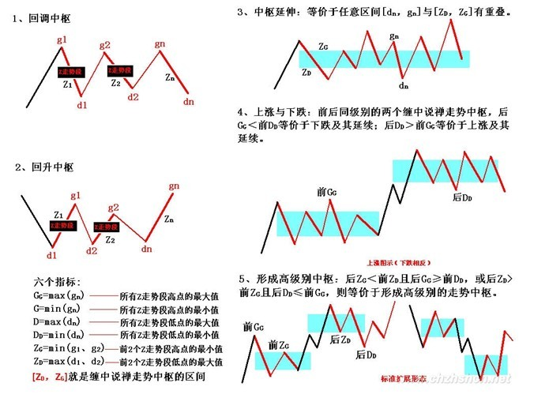
>
> 对于第一种有a1=b1,b2=c2；对第二种有a2=b2,b1=c1。但无论是哪种情况，中枢的公式都可以简化为[max（娇注：a2,c2），min（娇注：a1,c1）]。显然，A、C段，其方向与中枢形成的方向是一致的，由此可见，在中枢的形成与延伸中，由与中枢形成方向一致的次级别走势类型的区间重叠确定。例如，回升形成的中枢，由向上的次级别走势类型的区间重叠确定，反之依然。为方便起见，以后都把这些与中枢方向一致的次级别走势类型称为Z走势段，按中枢中的时间顺序，分别记为Zn等，而相应的高、低点分别记为gn、dn,定义四个指标：GG=max(gn),G=min(gn),D=max(dn),DD=min(dn)，n遍历中枢中所有Zn。
>
> 特别地，再定义ZG= min(g1、g2),ZD=max(d1、d2)，显然，[ZD，ZG]就是缠中说禅走势中枢的区间，由此有了如下定理：
>
> **缠中说禅走势中枢中心定理一：***走势中枢的延伸等价于任意区间[dn，gn]与[ZD，ZG]有重叠。换言之，若有Zn，使得dn>ZG或gn<ZD，则必然产生高级别的走势中枢或趋势及延续。*（娇注：3买卖点后中枢移动趋势延续或者3买卖点后中枢扩展成高级别中枢）
>
> **缠中说禅走势中枢中心定理二：***前后同级别的两个缠中说禅走势中枢，后GG<前DD，等价于下跌及其延续；后DD>前GG等价于上涨及其延续。后ZG<前ZD且后GG>=前DD，或后ZD>前ZG且后DD=<前GG，则等价于形成高级别的走势中枢。*
>
> 由定理一，可以得到**第三类买卖点定理：***一个***次级别走势类型***向上离开缠中说禅走势中枢，然后以一个***次级别走势***类型回试，其低点不跌破***ZG***，则构成第三类买点；一个***次级别走势***类型向下离开缠中说禅走势中枢，然后以一个***次级别走势***类型回抽，其高点不升破***ZD***，则构成第三类卖点。*
>
> 例如，工商银行在12月14日构成典型的日线级别第三类买点；北辰实业在11月14日构成典型的日线级别第三类买点；000803在1月20日构成典型的日线级别第三类卖点。注意，第三类买卖点比第一、二类要后知后觉，但如果抓得好，往往不用浪费盘整的时间，比较适合短线技术较好的资金，但一定要注意，并不是任何回调回抽都是第三类买卖点，必须是第一次。而且，第三类买卖点后，并不必然是趋势，也有进入更大级别盘整的可能，但这种买卖之所以必然赢利，就是因为即使是盘整，也会有高点出现。操作策略很简单，一旦不能出现趋势，一定要在盘整的高点出掉，这和第一、二类买点的策略是一样的(娇注：一买后不突破长期均线依旧男上位缠绕盘整，二买后破一买低点退出）。
>
> 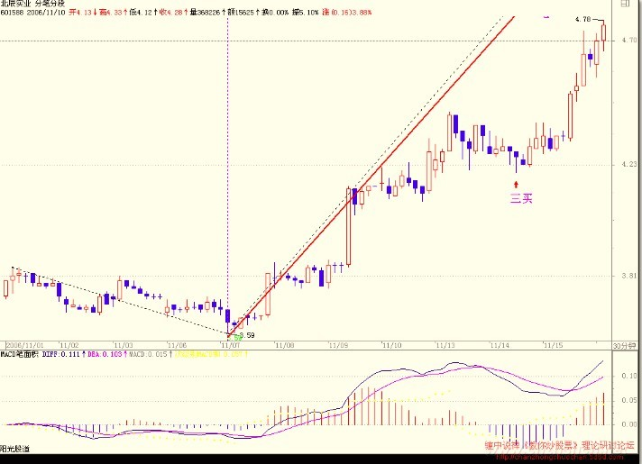
>
> 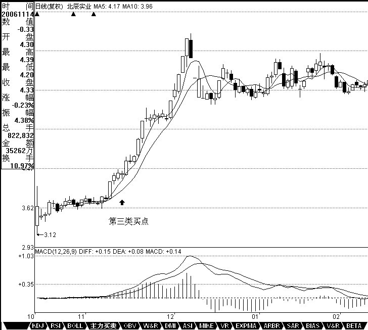
>
> 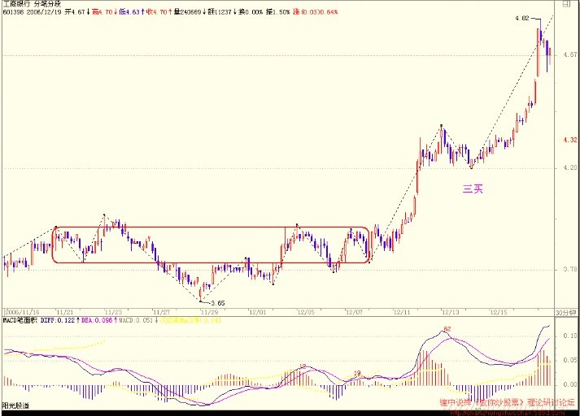
>
> 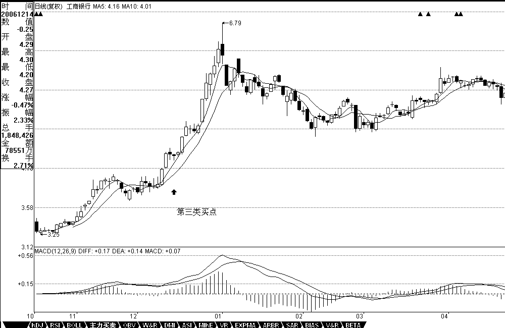

图像核对：image005是中枢指标／关系的整理示意；image001/002是北辰30分／日线、image003/004是工行30分／日线，均能看到第三类买点标注。它们并非本次运行图。正文同时举000803第三类卖点，但这五图没有该股对应图；不补造卖点行情。图和正文的边界取等／不触及措辞保留，源码未找到前不擅定浮点容差或等号处理。

### A.2 补充 — 第18课：中枢维持／破坏及离开回抽的组合

连续保留中枢定理一、二到三的推导与三种组合原话；后面第92课的具体解盘按其自身分解语境阅读，差异不由整理者代为抹平。 本快照 L50–66。[3]

> **“缠中说禅走势中枢定理一”：在趋势中，连接两个同级别“缠中说禅走势中枢”的必然是次级别以下级别(娇注：次级别以及次级别以下级别）的走势类型。**
>
> 用反证法，该定理的证明是很简单的，而这也回答了上一章中的作业一“连接两相邻同级别缠中说禅走势中枢的一定是趋势吗？一定是次级别的趋势吗？”首先，这不必然是趋势，任何走势类型都可能，最极端的就是跳空缺口后形成新的“缠中说禅走势中枢”；其次，也不一定是次级别的，只要是次级别以下，例如跳空缺口，就属于最低级别，如果图上是日线、周线，就不会是次级别了；最后，往往相连走势类型的级别越低，表示其力度越大，这也就是为什么缺口在分析中有比较强技术含义的理论依据所在。
>
> 由定义知道，“缠中说禅走势中枢”的产生原因以及判断标准，也就是其“生”问题已经解决，那余下的就是其“住、坏、灭”的问题。也就是说，一个“缠中说禅走势中枢”是如何“维持”以及最终被“破坏”进而废弃的。先考虑其“维持”的问题。维持“缠中说禅走势中枢”的一个充分必要条件就是任何一个离开该中枢的走势类型都必须是次级别以下的并以次级别以下的走势类型返回，该问题很容易证明，因为无论是离开还是返回，只要是同级别的走势类型，就意味着形成新的“缠中说禅走势中枢”，这与原中枢的维持前提矛盾。该命题表述成如下定理：
>
> **“缠中说禅走势中枢定理二”：在盘整中，无论是离开还是返回“缠中说禅走势中枢”的走势类型必然是次级别以下的。**
>
> 由此，上一章作业三“盘整的高低点是如何造成的”就有了相应的答案：无论离开与返回的走势类型是何种级别的，在站最低级别上看，例如把1分钟图当成最低级别，那么最后连接离开与返回走势类型连接处的最低级别图，只能有两种可能：三根以上1分钟K线的来回重叠震荡后回头；二、1分钟K线无三根以上K线重叠的V型走势。对于第一种情况，这几根重叠K线最极端那根的极端位置，就构成盘整中的高低点，一般来说，这种情况比较少见；对于第二种情况，这个V型尖顶那根K线的极端位置就构成盘整中的高低点，这种情况十分常见。这也是为何真正的低点和高点总是盘中一闪而过的理论依据。本ID的理论能解释技术图表上任何细致的问题，这才是一种真正理论所应该具有的品质。这种的理论，不需要什么诺贝尔的奖励，那一百万美圆在市场上算得了什么？精通这样的理论，市场会给予你多得多的回报。
>
> (娇注：趋势的高低点也是这样形成的。这里涉及的是最低级别K的组合。不单是盘整高低点形成的理由）
>
> 有了上面两个**“缠中说禅走势中枢”定理，不难证明定理三：**
>
> **某级别“缠中说禅走势中枢”的破坏，当且仅当一个次级别走势离开该“缠中说禅走势中枢”后，其后的次级别回抽走势不重新回到该“缠中说禅走势中枢”内。**
>
> 这定理三中的两个次级别走势的组合只有三种：趋势+盘整，趋势+反趋势，盘整+反趋势。其中的趋势分为上涨与下跌，分别代表从上方突破与下方跌破两种情况。而站在实用的角度，最用力的破坏，就是：趋势+盘整。**例如在上涨中，如果一个次级别走势向上突破后以一个盘整走势进行整理回抽，那其后的上涨往往比较有力，特别这种突破是在底部区间。**这种情况太常见了，其理论依据就在这里。

### A.3 — 第21课：按中枢关系分类及第二／三类重合

连续保留转折／延续、中枢上下、三个类别的分工、第二类点位置及第二／第三类重合条件。 本快照 L16–40。[4]

> **前面已经说过三类的买卖点，一个很现实的问题，就是除了这三类买卖点之外，还有什么其他类型的买卖点？答案是否定的。**
>
> 这里必须强调的是，这三类买卖点，都是被理论所保证的，100%安全的买卖点，如果对这三类买卖点的绝对安全性没有充分的理解，就绝对不可能也绝对没有对缠中说禅技术分析理论有一个充分的理解。市场交易，归根结底就是买卖点的把握，买卖点的完备性就是理论的完备性。 **所谓100%安全的买卖点，就是这点之后，市场必然发生转折，没有任何模糊或需要分辨的情况需要选择。**
>
> 从上面一系列关于缠中说禅走势中枢的分析可知，**在走势中的任何一个点，必然面临两种可能：走势类型的延续或转折**。换言之，例如对于一个必然的买点，必须满足以下的两种情况之一：**一个向上的延续或一个由下往上的转折**。对于延续的情况，能产生的，只能是在一个上升的过程中，否则就无所谓延续了，对于上升的延续中产生的买点，必然有一个中枢在前面存在着；
>
> 对于转折，被转折的前一段走势类型只能是下跌与盘整，而无论的下跌还是盘整，买点之前都必然有一个走势中枢存在。
>
> 归纳上述，无论前面的走势是什么情况，都唯一对应着一个中枢存在后走势的延续或转折，这分析对卖点同样有效。**因此，所有买卖点都必然对应着与该级别最靠近的一个中枢的关系。**对于**买点**来说，该**中枢下**产生的必然**对应着转折**，**中枢上**产生的必然对应着**延续**。**而中枢有三种情况：延续、扩张与新生**。
>
> 如果是中枢延续，那么在中枢上是不可能有买点的，因为中枢延续必然要求所有中枢上的走势都必然转折向下，在这时候，只可能有卖点。
>
> **而中枢扩张或新生，在中枢之上都会存在买点，这类买点，就是第三类买点。**
>
> 也就是说，**第三类买点是中枢扩张或新生产生的。中枢扩张导致一个更大级别的中枢，而中枢新生，就形成一个上涨的趋势，这就是第三类买点后必然出现的两种情况。**
>
> **对于更大级别中枢的情况，肯定没有马上出现一个上涨趋势的情况诱人，所以对于实际操作中，任何尽量避免第一种情况就是一个最大的问题。但无论是哪种情况，只要第三类买点的条件符合，其后都必然要赢利，这才是问题的关键。**
>
> **对于中枢下形成的买点，但如果该中枢是在上涨之中的，在中枢之下并不能必然形成买点，中枢下的买点，只可能存在于下跌与盘整的走势类型中。换言之，一个上涨趋势确定后，不可能再有第一类与第二类买点，只可能有第三类买点。**
>
> *而对于盘整的情况，其中枢的扩张与新生，都不能必然保证该买点出现后能产生向上的转折，因为其扩张与新生完全可以是向下发展的，***而对于中枢延续的情况，中枢形成后随时都可以打破而结束延续，也不必然有向上的转折，所以盘整的情况下，中枢下也不必然产生买点。因此，只有在下跌确立后的中枢下方才可能出现买点。这就是第一类买点。**
>
> **第二类买点是和第一类买点紧密相连的，因为出现第一类买点后，必然只会出现盘整与上涨的走势类型，而第一买点出现后的第二段次级别走势低点就构成第二类买点，根据走势必完美的原则，其后必然有第三段向上的次级别走势出现，因此该买点也是绝对安全的。第二类买点，不必然出现在中枢的上或下，可以在任何位置出现，中枢下出现的，其后的力度就值得怀疑了，出现扩张性中枢的可能性极大，在中枢中出现的，出现中枢扩张与新生的机会对半，在中枢上出现，中枢新生的机会就很大了。但无论哪种情况，赢利是必然的。**
>
> **显然，第一类买点与第二类买点是前后出现的，不可能产生重合，而第一类与第三类买点，一个在中枢之下、一个在中枢之上，也不可能产生重合。只有第二类买点与第三类买点是可能产生重合的，这种情况就是：但第一类买点出现后，一个次级别的走势凌厉地直接上破前面下跌的最后一个中枢，然后在其上产生一个次级别的回抽不触及该中枢，这时候，就会出现第二类买点与第三类买点重合的情况，也只有这种情况才会出现两者的重合。当然，在理论上没有任何必然的理由确定第二、三类买点重合后一定不会只构成一个更大级别的中枢扩张，但实际上，一旦出现这种情况，一个大级别的上涨往往就会出现。**

### A.3 补充 — 第21课：完备性定理的作者表述

原文论断，未把后面的网络选载或读者思考题答案并入作者证明。 本快照 L52–56。[4]

> **对卖点的分析是一样的，归纳起来，就有缠中说禅买卖点的完备性定理：市场必然产生赢利的买卖点，只有第一、二、三类。**
>
> **相同的分析，可以证明:**
>
> **缠中说禅升跌完备性定理：***市场中的任何向上与下跌，都必然从三类缠中说禅买卖点中的某一类开始以及结束。换言之，市场走势完全由这样的线段构成，线段的端点是某级别三类缠中说禅买卖点中的某一类。*

### A.4 — 第53课：观察级别、三类点与小转大补充

本课连续正文到操作讨论结束，保留观察级别与次级别的压缩、盘整背驰、第一类点例外、第二类补充和第三类结束中枢。L38以后为另外的说明／转载，未混入此段。 本快照 L16–36。[5]

> 由于新来的人越来越多，请都先把课程认识从头看一遍再讨论问题。另外，在分析一定要搞清楚中枢的递归定义，这是基础中的基础，连这都搞不清楚，没有彻底明白，那根本就不可能继续下去。
>
> 再者，关于级别的问题，如果想不明白，可以当成用不同倍数的显微镜去看一滴水，由此当然会看出不同的精细度，级别之与走势也一样。
>
> 一个最简单的例子，三个5分钟级别的走势重叠构成一个30分钟中枢，站在30分钟级别的角度，5分钟的走势都可以看成就是一个线段，没有内部结构的，这线段的高低点就是对应5分钟走势的高低点；而站在5分钟的次级别1分钟上看，每段5分钟的高低点都不绝对是在5分钟走势的结束或开始位置，当然，按1分钟的级别重新用结合律重新组合，总能让高低点分别在开始或结束的位置，但站在分笔的级别上，这又不行了。为什么？因为当我们用1分钟的级别重新组合时，其实就先把分笔上的级别都看成没有结构的线段了。这是十分自然的，就像我们研究猴子的行为时，如果还考虑其中的每个细胞里包含的分子里的原子里的电子的走势问题，那猴子就不是猴子了。所以，这个原则是必须明确的，例如你决定用30分钟来操作、观察时，其实就已经先假定把所有完成的5分钟走势都看成线段了。
>
> 注意，这里和区间套定理是没有冲突的，当30分钟进入背驰段，为了更精细的定位，用倍数更大的显微镜去看这段走势，这是极为自然的。只要知道该在什么时候用什么倍数的去看就可以。再例如，在看30分钟的第三买卖点时，由于要涉及次级别5分钟的判断问题，所以那时候就不能光用30分钟级别的显微镜，同样要转换成5分钟的。但无论这些显微镜如何转换，一个原则是不变的，就是当你用一个级别的显微镜时，就等于先把次级别的当成线段了，也就是说次级别不在该级别的观察中。
>
> 当然，有这最精细最严格的方法，就是从最低级别的分笔中逐步组合分析上来，这样就不存在上面的问题，但这样太累，而且毫无必要。理论是用来用的，只要不违反理论的基础与绝对性，当然要选择更简单的用法。对这个问题，必须要了解，否则一下30分钟、一下1分钟、一下又年线，非把自己换晕了。
>
> 其次，对于背驰与盘整背驰，前者是有着最基础意义的，而后者，只是利用前者相应的力度分析方法进行的一个推广用法，主要用在与中枢震荡相关的力度比较中。注意，a+B+c中，a和c的盘整背驰，其实都可以看成是B的中枢震荡，虽然a存在时，B还没出现，但也不妨这样看。
>
> 至于*第一、二、三***买卖点**，归根结底都可以归到第一类买卖点上，只是级别不同。那么为什么不就说第一类买卖点，因为这样，就会涉及不同的级别，等于同时用不同级别的显微镜去看，太乱，实际用起来更乱，因为不同级别的买卖点意义是不同，因此要同一在一个级别上研究，这个才有三类买卖点的分别。当然，最充分的操作，就是按分笔的买卖点，这样所有波动的最细微波动都可以把握了，但这在实际中是不可能的，人需要反应的时间、有交易成本等等。因此，忽略掉某些波动，按更大的级别统一操作，就是客观条件的必然要求。本ID的理论可不是什么先验理论，而是根本客观条件充分反映当下可能的充分可操作性的理论，这必须要彻底明确。因此，三类买卖点，都不能偏废，不能说哪一个更重要，站在同一级别上，三者都重要。
>
> **第一类买卖点，就是该级别的背驰点，**这足以应付最大多数的情况，**但有一种情况是不可以的，就是前面反复强调的小级别转大级别的情况。**为什么？因为当小级别背驰时，并未触及该级别的第一类买卖点，所以就无须操作。对这种情况，就需要第二类买卖点来补充。该买卖点，不是专门针对这小转大情况的，一般说，高点一次级别向下后一次级别向上，如果不创新高或盘整背驰，都构成第二类卖点，而买点的情况反过来就是了。所以，在有第一类买卖点的情况下，第一类买卖点是最佳的，第二类只是一个补充；但在小级别转大级别的情况下，第二类买卖点就是最佳的，因为在这种情况下，没有该级别的第一类买卖点。
>
> **第二类买卖点，站在中枢形成的角度，其意义就是必然要形成更大级别的中枢，**因为后面至少还有一段次级别且必然与前两段有重叠。
>
> **而对于第三类买卖点，其意义就是对付中枢结束的，**一个级别的中枢结束，无非面对两种情况，转成更大的中枢或上涨下跌直到形成新的该级别中枢。第三类买卖点就是告诉什么时候发生这种事情的，而在第二、三买卖点之间，都是中枢震荡，这时候，是不会有该级别的买卖点的，因此，如果参与其中的买卖，用的都是低级别的买卖点。
>
> 实际操作中，最干脆的做法，就是不参与中枢震荡，只在预先设定的买卖点上买卖。但对于大资金来说，或者对于有足够操作时间和熟练度的资金来说，中枢震荡当然是可以参与的，而且如果中枢级别足够，其产生的利润往往更大而且稳定。而在趋势的情况下，一般小级别的买卖点并不一定要参与，但如果技术特别好或大资金，同样可以参与，这只是为了提高资金的利用率，加快成本变0或增加筹码的过程。当然，这种小级别的参与，就与该级别能容纳的资金量有关，这就涉及仓位调配控制的问题了，这问题以后再说。

归属核对：053.md L48–76 的“转载／思考贴9”及2009年整理讨论不是2007年第53课正文；本附录引用第二类点的小转大说明来自正文L30，没有把后来的转载解释代成作者结论。第二类点因此不能被程序限定为“同级第一类点必须已出现”。

### A.5 — 第37课答疑：低级别第一类点与盘整结束的确认

完整读者提问及作者答复；保留用户对次级别回抽／盘整延伸的疑问，答复没有提供通用预测软件。 本快照 L130–134。[6]

> **缠中说禅**：
>
> 2007-03-20 18:16:44
>
> [匿名] 缠文观止  2007-03-20 17:35:58  博主回来啦，还记着帮我们解答问题，感动ing...  下午的问题我重帖一下：  “缠中说禅买卖点定律一”：任何级别的第二类买卖点都由次级别相应走势的第一类买卖点构成。 －－－－－－－－－－－－－－－－－ 上面的“缠中说禅买卖点定律一”，能简单证明一下吗？有个证明对真正理解第二买点会有很大帮助，否则实践中还是模糊，找不好次级别相应走势的结束点。中枢概念出来后，第一、二类买卖点在博文中似乎没有特别精确的定义，实践中细节还是把握不好。能不能象第三买点那样，给出公式性的定义？  另外，第三类买卖点是否与第二类买卖点类似，也由“次级别”相应走势的第一类买卖点构成？还是“次次级别”第一类买卖点构成？  还有个关于第三买点问题，比如一个“下上下”的30F中枢，第三段“下”完成后紧接着一个5F走势向上突破，接着又是一段向下的5F回抽走势不破30F中枢。这个5F回抽走势如果是盘整的话，完全可能不断延伸，怎么确定其结束点呢？好像看次次级一类买点也解决不了这个次级盘整延伸问题。  ==  **所有买卖点，归根结底都是第一类买卖点，只是级别不同而已。没有绝对的规则可以预先区分盘整与趋势的，第三类买点后，必然面对两个选择，就是大级别盘整或一个趋势。问题不是去预测究竟最后走出哪个，这样的思维是有问题的，而是当下走出什么情况立刻采取相应的操作策略。对盘整，就是制定好相应的操作策略，把筹码成本降下来，直到出现第三类买卖点为止。  像盘整延伸的问题，根本就无须去预测，只要走出第三类买卖点，自然就结束。至于什么时候走出，这涉及预测，任何涉及预测的，都是或然的。当然，可以有很多配套的手段使得准确率高达90%以上，但这另外的问题。**

### A.6 — 第36课答疑：回试盘整的 A/C 比较与内部背驰

完整问答，补充第37课答疑所涉及的次级别定位；提问中的娇注保留身份。 本快照 L62–66。[7]

> **缠中说禅**：
>
> 2007-03-14 15:39:57
>
> [匿名] ED男猿    2007-03-14 15:32:18  另外请问老大，对于日线中枢，当其三买是以3个5分钟的走势类型（娇注：组成30F盘整）出现时，此时的买点确定有点困惑：  1：因为是盘整，又有分解定理，对于其三段5F走势的完成不能确定， 2：如果再找1F的背驰点，感觉在上一条都不能确定的情况下，很勉强。  请老大指点。   = **A、B、C三段，A、C之间可以比较盘整背驰，C内部又可以看小级别的背驰，两者一配合考察，就很简单了。**

### A.7 — 第92课解盘：次级别趋势／盘整两种离开路径

作者解盘连续三项分类与对应行情图；其中第二种明确说离开只是盘整。此处是具体当下分析，未将其泛化为任意盘整+盘整组合均成立。 本快照 L210–218。[8]

> **无论任何情况，首先都可以很教科书化地给出震荡的形式，按强弱分的一个完全分类，对应着相应的结果：**
>
> **1、如果在今天跳空附近站住，这样，5200点那5分钟上来的1分钟上涨就形成，该1分钟上涨结束后，就是对应那5分钟的第三类买点，然后，就有绝大的可能形成4800上来的5分钟上涨，最坏，也就是一大的30分钟中枢。**
>
> *2、如果在5360点那1分钟中枢处站住，这样，对原来5分钟中枢的1分钟向上只是一个盘整类型，后面站住形成一个第三类买点，后面形成一个大的5分钟中枢的机会更大，当然也有突破爆发形成继续中枢上移在更高位置形成5分钟中枢的可能，但一般来说，一个盘整类型的次级别偏移后的第三类买点，总是不那么激动人心。*
>
> **3、如果跌回5200点上那5分钟中枢才站住，那就没什么可说的，一个大的30分钟中枢就此形成。**
>
> 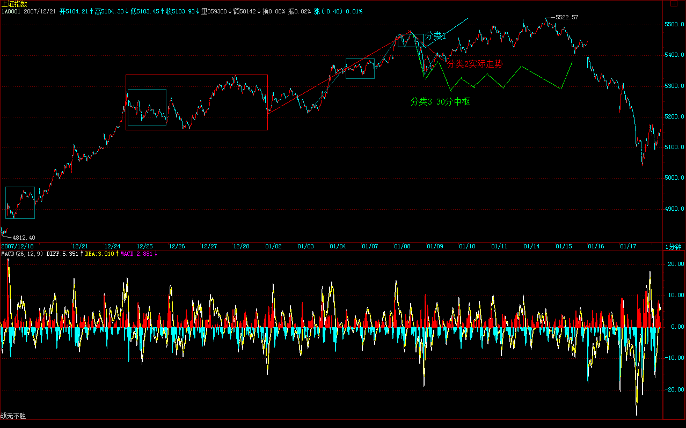

图像核对：原图image024绘有三类分解路径与实际后续线；图上补画和结果展示不等于当时每个节点均已确认。此例与第18课早期组合枚举的关系仍需在定义阶段核对，不能让编者转载替代原始语境。

### A.8 — 第86课整理本图页：大级别结构中的小级别点

本地该课开头以图为主，六张图全部查看后原字节复制。前五张图署“张大山习作”，是整理本所收的解释图，不能认证为缠中说禅首发原图；第六张为铜陵有色行情标记。 本快照 L27–37。[9]

> 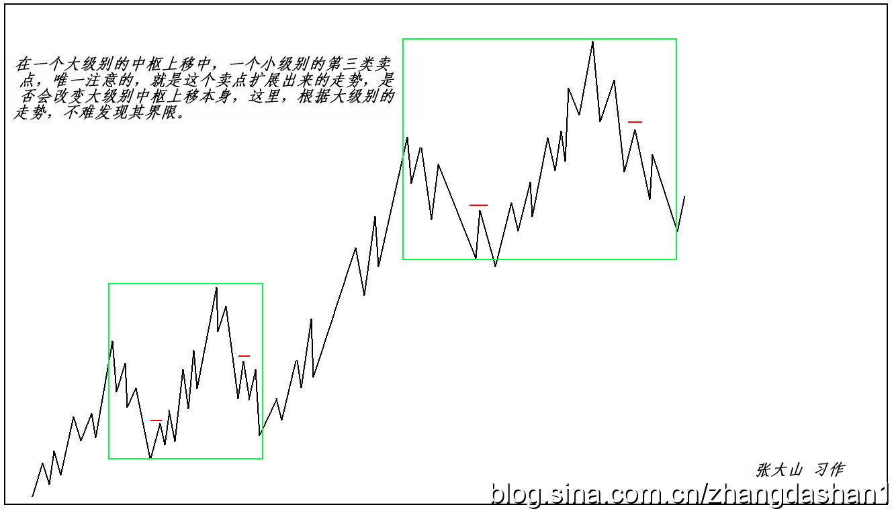
>
> 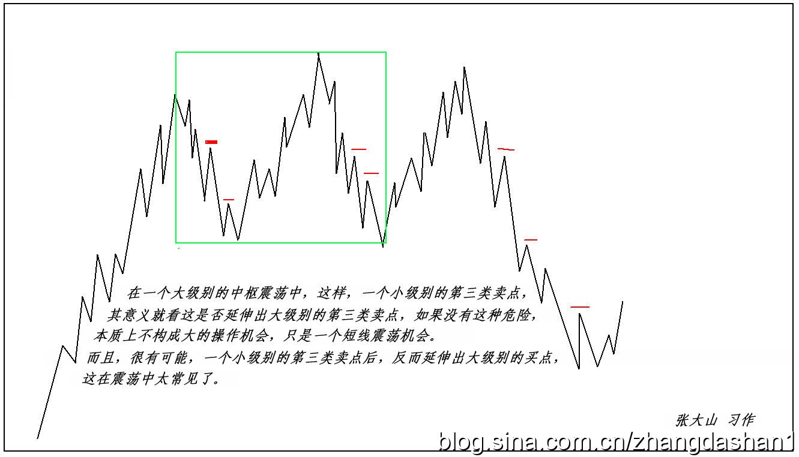
>
> 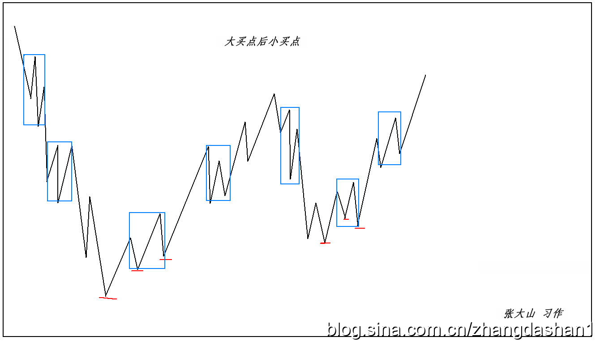
>
> 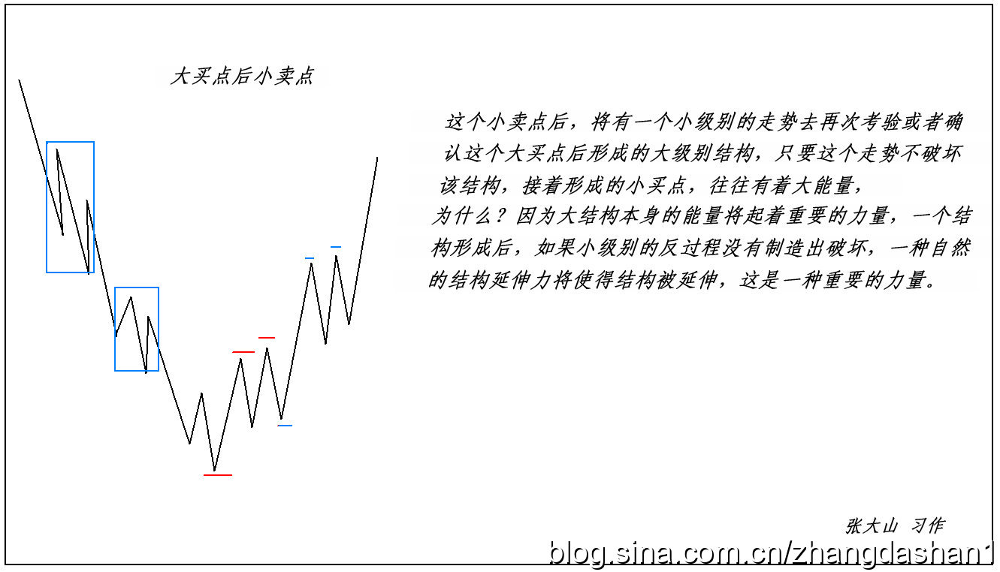
>
> 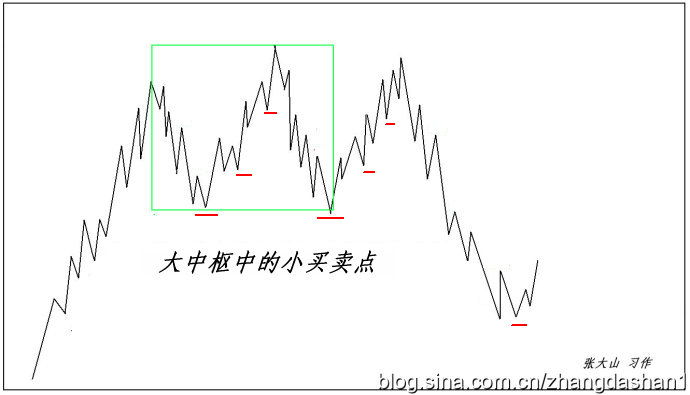
>
> 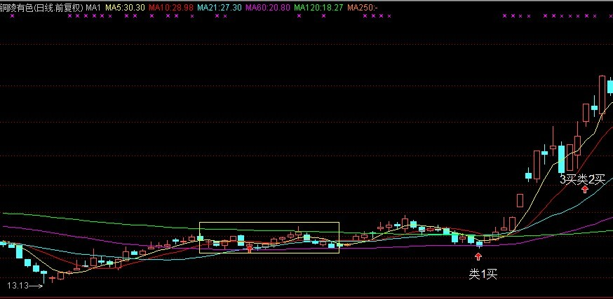

图页导读（非引文）：图001/002分别讨论小级别第三类卖点相对大级别中枢上移／震荡的意义；003/004画大买点后的较小结构与后续买点；005把大中枢内的小买卖点单列；006的行情图标有“1买”“3买类2买”，图中文字是来源标记，尚未逐笔核验其规则。多级别同屏不意味着各标记属于同一观察级别或强制按1→2→3排序。

### A.9 — 第101课第二类点的最强／最弱／一般情形

连续保留定义、三种强弱情形、中阴阶段与第二／第三类之间可以间隔更多震荡。L46已明示下图来自网络且严格讲有缺项，警示连同图一起保留。 本次快照 L18–48。[10]

> **1、第二类买卖点的问题**
>
> 简单地，就说第二类买点，卖点的情况反过来就是。
>
> **第一类买卖点就是背驰点，第三类买卖点就是中枢破坏点，这都是很清楚的。而这第二类买卖点，好象还是有很多不明白。**
>
> 其实，所谓第二类买点，就是第一类买点的次级别回抽结束后再次探底或回试的那个次级别走势的结束点。这个定义在前面说得很清楚。例如，一个5分钟底背驰后，第一类买点上去的1分钟走势结束后，回头肯定有一个1分钟的向下走势，这走势的结束点，就是第二类买点。
>
> 那么，第二类买点有哪几种可能的情况？
>
> **(一)、最强的情况**
>
> 第二类买点刚好构成原来下跌的最后一个中枢开始的震荡走势的第三类买点，也就是第二、三类买点合一了，这是最强的走势，这情况，一般都对应V型反转的快速回升，是最有力度的。
>
> **(二)、最弱的情况**
>
> 第二类买点跌破第一类买点，也就是第二类买点比第一类买点低，这是完全可以的，这里一般都构成盘整背驰，后面对应这从顺势平台到扩张平台等不同的走势（娇注：扩张ABC 或者顺势ABC），这在后面的课程里会说到。
>
> （娇注：反向力度调整非常弱的时候出现。也叫强势整理或者弱势反弹。虽然少见。也有）
>
> **(三)、一般性走势**
>
> 也就是前面两者之间的走势。这种情况下，第一、二、三买点，是依次向上，一个比一个高。
>
> 站在原来下跌最后一个中枢的角度，第一、二、三类买点都可以看成是中枢震荡的结果，因此，在第二类与第三类之间，可能会存在着更多的中枢震荡走势，不一定如第一、二之间是紧接的。那第二类与第三类买点之间的震荡买点，一般就不给特别的名称了，当然，也可以看成是第二类买点，这样，并没有多大的影响。
>
> 注意，只有在这回升的中阴状态下才有第一、二类买点，中阴状态结束后，所有的中枢震荡只存在第三类买卖点以及中枢震荡的买卖点，就不存在第一、二类买卖点了。
>
> (娇：下面配图为网络收集，严格讲是不对的，少了最后中枢的3卖表达。不改了。看图者注意。）
>
> 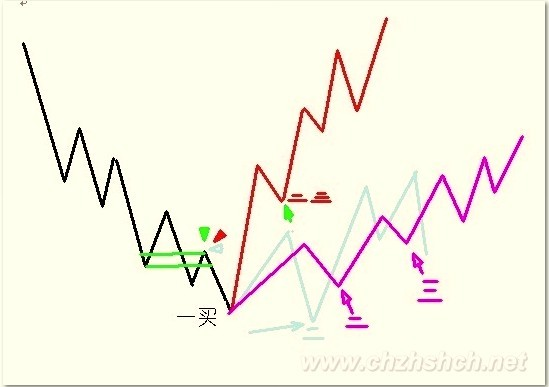

重要边界（非引文）：L34明确允许第二类买点低于第一类买点，不能把“二买不破一买”作为覆盖所有原文情形的必要条件。L40的1→2→3价位依次抬高只属于所列一般情形；L42又说明2→3未必紧邻。图是有已知缺项的网络整理图，不能反过来充当独立定义证据。第53课的小转大补充仍保留，未将第101课常规开头扩成程序强制已有同级一买的约束。

### A.10 — 第56课突发缺口、现实第二类卖点与个股差异

连续保留530事件图解、指数与个股类别可不同、缺口段的最低级别处理、第二类卖点内部结构、盘整背驰和实际配图；不是当前交易建议或本次运行结果。 本次快照 L50–76。[11]

> 本来不想说股票的，但知道现在说其他，大多数人也反应迟钝，被股票所迷惑了，所以还不如将错就错，就继续股票一把，说说昨天这530印花税当日行情如何去当下地分析。
>
> 本来这个问题十分简单，而且本ID一大早7点不到就发帖子提醒要在第二、三卖点把仓位减掉，很高兴看到不少人都能发现9点48那第二类卖点。注意，为什么同时强调第三类卖点，因为有些特别弱的股票，可能就是一个第三类卖点，大盘的走势是一个平均走势，而且当天比很多个股都强，所以大盘是第二类卖点，并不意味着个股是第二类卖点。
>
> 很多人大概到现在都不明白为什么本ID的理论中要有三类卖点，**其实，第二类卖点除了在小级别转大级别上比第一类卖点优越，在一些特殊的突发情况下，就是最佳的卖点。**例如这次，就是一个很好的例子。因为529那天，虽然30分钟明显进入背驰段，但由于当天尾盘是高收的，所以用区间套定理并不能确认当时就是背驰了，毕竟还有第二天的走势。而晚上的突发消息，使得这个背驰被立刻确认，这时候，第一类卖点已经不可能在实际操作中存在，那么，唯一可以进行操作的，只能是第二或第三类卖点。**这，在开盘前就可以有一个确定，也就是说，一旦大幅度低开，现实的、能被理论完全保证的卖点就是第二类或第三类卖点。**
>
> 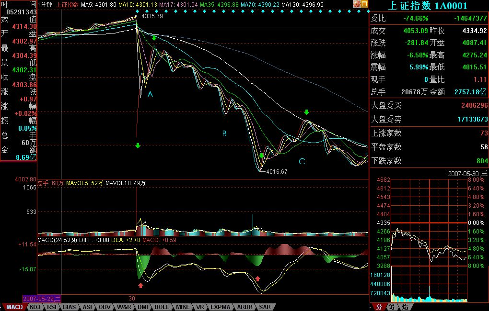
>
> 上图就是昨天走势的1分钟图。**缺口，被看成最低级别的**，而1分钟以下级别，在1分钟图上，被看成没有内部结构的线段，所以**缺口和1分钟以下级别在1分钟图上是同级别的**。图上绿尖头都指着两个1分钟以下级别的分界点，两相邻绿箭头之间都是1分钟以下级别的走势类型。其中B段，看似要形成3个1分钟的中枢，但由于每一个的第三段其实都是向下倾斜下去的，其实都是第二段向下的一部分，不能算是形成中枢。昨天走势其实就这么简单，就是5个1分钟以下走势类型的组合。
>
> 显然，这第一段的1分钟以下级别走势类型是以向下缺口的形成构成的，根据第二类卖点的定义，就知道，一旦一个1分钟以下级别的向上过程不能创新高或背驰，都将构成第二类卖点。因此，当图中A段走势出现时，一个构成第二类卖点的走势就当下地形成中。
>
> **有人可能有疑问，那怎么知道这A段一定构成第二类卖点而不是直接创新高强烈上升，这很简单，具体的方法和区间套定理是一样的，就是看A段的内部结构，一旦内部出现背驰而当时位置没创新高或与前面走势产生盘整顶背驰，那么就一定是第二类卖点。**在昨天的具体走势中，A段在内部出现上下上的内部结构时，其中的第二段向上明显出现背驰走势，这可以成交量，或从**第一个红箭头所指的MACD绿柱子**与**后面红柱子***绝对值大小*比较辅助判断。因此，这个第二类卖点，可以用理论完全明确地确认，一点含糊的地方都不会有。如果当时当下不能明白，那就要抓紧学习了，因为这个问题确实太简单了。
>
> **第二类卖点后，从第二绿箭头开始的B段走势，其力度就要和缺口那一段来对比，***比较MACD上两个红箭头指的绿柱子面积，***注意，第二个要把前面的三个小绿柱子面积也加上，可以看出，即使这个，后者的力度也不大过前者，由此就知道，B段构成了盘整背驰，也就是后面的反弹一定回到第一个绿箭头位置之上。**（娇注：注意，这里是1分钟以下级别的力度对比，只需要比较柱子面积，如果是1分钟级别的，就要同时考虑黄白线回抽0轴的情况。）
>
> 而后面C段的走势也证明了这一点。此外，C段的高点，用C段下方对应的MACD柱子高度对比不难用背驰的方法判断。由此，ABC三段就有了重叠，因此就构成了一个1分钟的中枢，区间在4087到4122点。这就成了直到后面、包括明天走势的最关键地方，究竟是中枢震荡，还是形成第三类买卖点，进而构成更大中枢或趋势，都以此为基准。而这是被理论所当下严格保证，毫无可以含糊的地方。
>
> **有些更细致的地方，其实还可以说的。例如，C段的高点，没有重回B段内部最后一个反弹的启始位置，这并不违反理论，因为在B段内部，最后一段向下并没有背驰，他的转折，完全是小级别转大级别造成的（**由于级别太小，可以从柱子的缩短参考看出），这自然就不一定能回到最后一个反弹的启始位置。而在B段内部，从绿柱子一个比一个面积大，就知道前面的向下都不会形成背驰而使B段结束，因此就可以当下地等待最后跌破A段低点，**形成B段与缺口段的盘整背驰。**
>
> **这个例子说明，一个大的盘整背驰段的内部结构，完全可以不必有该级别的背驰，完全可以小级别转大级别，昨天的图上就有这样一个标准的例子。**
>
> *实际操作中，第二类卖点后，***B段盘整背驰***造成的***买点***是否要参与回补，这和你的***操作级别***有关，如果是股指期货，这对应的是100点的空间，当然是可以参与的，但由于T+0，而且现在交易成本提高了，对于股票是否参与，这就与你实际操作的股票有关了，这必须根据自己的情况灵活处理。*但只要你明白了小级别的情况，大级别的操作是一样的，而且大级别的安全性、可操作性更高，操作的频率也更低而已。本ID说这里的例子，只是让大家对理论能更清楚地了解。
>
> 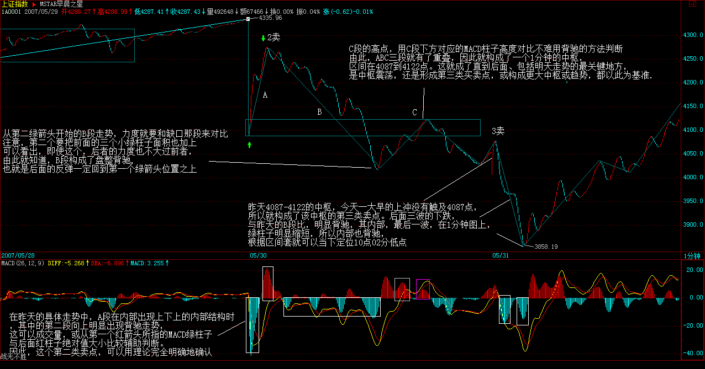
>
> 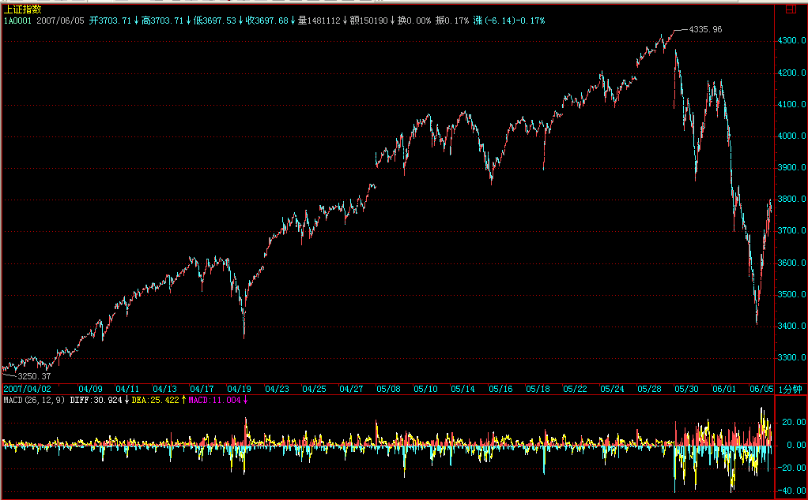

图像核对：image001有A/B/C、绿箭头和红色MACD箭头；指标参数显示24/52/9。image002为附文字的后续讲解图，指标显示12/26/9；两图不能被当作同参数、同范围的量化面积样本。image007是15分钟更长背景，既不能用它代替1分钟的确认细节，也不能把全部后加标注当作首发标记。

### A.11 — 第61课第二／第三类卖点重合必须用正确的中枢

保留从72后的操作级别说明到74重合及中枢归属的连续原段和相关原图；72的四重区间套前提详见本课L32–46及memo024A.14。编者“买点”标签与作者正文卖点表述分开阅读。 本次快照 L48–60。[12]

> （娇注：买卖）**第一买点**
>
> **对于实际的操作，72四重背驰点出现后，卖是唯一的选择，而区别只在于卖多少。**当然，如果是按5分钟级别以及以下级别操作的，当然就全卖了，因为后面至少会形成5分钟的中枢震荡，实际上，60-69就是一个5分钟中枢。而对于大级别操作的，显然不可能因一个5分钟震荡而清仓，所以可以根据5分钟震荡可以容纳的数量进行对冲操作。小资金的利润率，在相同操作水平下，显然要远高于大资金的，例如像这样的卖点，小资金就可以全仓操作，大资金是不可能的。
>
> 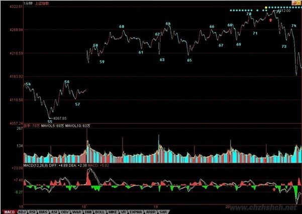
>
> （娇注：买卖）**第二买点**
>
> **如果说72的判断有点难度，需要知道区间套的精确定位，那么74的第二类卖点，就一点难度都没有了。唯一有点需要分辨的就是，这第二类卖点，同时又是一个1分钟中枢的第三类卖点，究竟哪个中枢？显然不是70-73这个，因为这里需要满足结合律。**一个第三类买卖点，至少需要有5段次级别的，前三段构成中枢，第四段离开中枢，第5段构成第三类买卖点。其实，这里的答案很简单，**74点是69-72这个中枢的第三类卖点。**
>
> 也就是说，**74点既是一个第二类卖点，又是一个第三类卖点，以前的课程已经说过，一旦出现二、三类买卖点同时出现的情况，往往后面的力度值得关注。(第二、第三类买点重合情况)。**实际上，74后面出现更大力度的下跌，这并没有任何奇怪的地方。
>
> **对于60-69这个5分钟中枢，69的4244点是一个关键位置，如果在其下出现第三类卖点，那么走势至少将扩展成一个30分钟中枢，调整的幅度与压力就大了。**而对于72开始的走势，73很重要，要重新走强，必须冲破73这一点，该点位置恰好也是4244点。因此，短线的4244点十分关键，重新站稳，则大盘将最多是5分钟中枢的延伸震荡，否则即使不演化成5分钟级别的下跌，也将扩展成30分钟级别的中枢震荡。

归属边界（非引文）：第三类点至少需要先有三段构成的中枢，再有离开和回试；本例74归于69–72而非70–73。不能在任意滚动三段里任挑一个中枢来替买卖点类别作证；第二／第三类可以同点，理论出处和结构来源仍需分别保存。

### A.12 — 后续定义／算法研究需要保留的问题

- 各事件必须带同一解释下的级别、买／卖方向、类别与相关中枢／走势；不能将图形外观相似直接当作同级买卖点。
- 第二类与第三类可能重合；小转大时可没有该级别第一类点。存储是否允许同一锚点多个类别，须另行设计，不能因现有类别字段而删掉原文情况。
- 第三类点要求适当级别的离开及第一次回试；原文“不跌破／不升破”与“不触及”的操作措辞、等号、容差和实时确认时点仍待针对性核对。
- 第三类之后可能中枢上移或形成更大级别盘整；“出现三买”不能替代对后续路径的实际确认。
- 第92课的具体盘整离开示例、第37课的走势分解语境与第53课转载中的疑问分别保留来源身份。定义阶段再统一适用条件，未在此形成默认实现约定。

- 二次补查补回二买可低于一买、2→3可以不紧邻，以及突发缺口下现实可操作点／不同品种类别不同的原文边界；这些条件不能被简化为固定的三点上升序列，见A.9–A.11。

## Appendix B — Notes from CC's implementation

### B.1 — 当前配对研究缺少买卖点检测器

2026-11-09 只读检查并保存当前 CC 干净工作树的选定源码，HEAD 与早先网站版分别标明。[13] 全部80个Python源码文件的买卖点词汇／常用标识检索命中4处，分别是接口范围说明、API占位函数及通用通知字段；没有找到可供追踪第一／二／三类点的检测函数。[14]

### B.2 — 源码逐处核对：接口说明、空标记与通知字段

1. `ChanEngineProtocol` 文件L16–17声明当前引擎不产买卖点信号；其查询接口返回分型、笔、线段、中枢、走势等结构。声明可指示阶段意图，仍须检查具体函数。[15]
2. `udf.py` 的 `/marks` 函数L527–536接收symbol、resolution和时间区间，仅把参数赋给 `_`，然后构造空 `UDFMarks()`；它没有调用类别判断器。文档字符串写着“阶段5起接通”，而执行体仍为空占位，不能用注释替代实际行为。[16]

```python
_ = (symbol, resolution, from_, to)
return UDFMarks()
```

3. `NotifyLevel` 含 `"buy_sell"`，`NotifyMessage.payload` 是可为空的通用字典。字段和注释表示通知容器的设计用途，没有从走势／背驰生成一、二、三类点的判断分支，也没有类别、确认或撤销状态机。[17]
4. `ChanEngine.get_zoushis` 返回上游结构列表，源码没有在这个出口生成点位事件。它可以提供未来研究所需的成员、级别、时间和状态事实，但不能据此反推出已实现的买卖点规则。[18]

### B.3 — 证据边界与下一步需要的源码

| 需要解释的步骤 | 当前源码可核对什么 | 未取得的证据 |
|---|---|---|
| 第一类点 | 可取走势／中枢对象 | 背驰检测、方向反转与确认锚点 |
| 第二类点 | 上游来源与形成／冻结字段 | 第一次回试、小转大分支及类别条件 |
| 第三类点 | 中枢边界与结构查询 | 离开／首次回试级别验证、取等与无效化规则 |
| 同点多类别 | 通用通知载荷占位 | 类别重合的实际数据结构与去重策略 |
| 实时增量与修订 | 上游具有末端更新接口 | 买卖点确认／撤销／重算范围与稳定ID |
| 数值逐步推演／金融图 | 已有来源理论图 | 买卖点可执行分支及可验证的CC运行样本 |

配对研究尚未完成：附录 A 已整理理论及原文件图示，附录 B 当前是代码边界与实现缺口记录。后续取得实际检测器及其调用链后，再按输入、状态、分支、更新、输出补充连续数值手工推演与图示。本次仅静态读源码及核对文件，没有运行 CC、没有将图上标签当作测试结果。

### B.4 — 信号面板／WebSocket与实现缺口

补查了Python算法目录之外的前端信号路径。`useSignalStream.ts` L16–36只建立 `/ws/signal` 连接、解析收到的JSON并维护连接状态；`SignalPanel.vue` L1–20仅展示最后一条消息或占位文字。后端 `ws.py` L151–163发送hello，对收到的文本回送 `{"type":"pong","received":data}`，没有在这个函数里消费结构、判断背驰或生成买卖点。注释中的未来接通计划不等于已有检测分支。三份源码原字节保存在单独补充快照，没有改写原19文件快照。[19]

另外检索到CC研究图脚本中的 `beichi_line/pz/qs` 名称，但它们出现在讲解 chanlun-pro 的图中文字和索引中，属于参考项目说明，不能拿来冒充当前CC检测器。现有MACD图表配置、通知类型、测试通知载荷、传输占位分别核对后，仍未定位到本概念的CC可执行检测器。因此B的连续CC算例／金融输出证据缺口继续保留；本次新增原图仍属于A的理论证据。候选取舍与缺图恢复检查见二次复核记录。[20]

## References

[1] [缠中说禅：《教你炒股票17》，本地整理本 017.md](../../references/chan_theory/017.md)。

[2] [缠中说禅：《教你炒股票20》，本地整理本 020.md](../../references/chan_theory/020.md)。

[3] [缠中说禅：《教你炒股票18》，本地整理本 018.md](../../references/chan_theory/018.md)。

[4] [缠中说禅：《教你炒股票21》，本地整理本 021.md](../../references/chan_theory/021.md)。

[5] [缠中说禅：《教你炒股票53》，本地整理本 053.md](../../references/chan_theory/053.md)。

[6] [缠中说禅：《教你炒股票37》，本地整理本 037.md](../../references/chan_theory/037.md)。

[7] [缠中说禅：《教你炒股票36》，本地整理本 036.md](../../references/chan_theory/036.md)。

[8] [缠中说禅：《教你炒股票92》，本地整理本 092.md](../../references/chan_theory/092.md)。

[9] [缠中说禅：《教你炒股票86》，本地整理本 086.md](../../references/chan_theory/086.md)。

[10] [缠中说禅：《教你炒股票101》，本地整理本101.md，L18–48](../../references/chan_theory/101.md)。

[11] [缠中说禅：《教你炒股票56》，本地整理本056.md，L50–76](../../references/chan_theory/056.md)。

[12] [缠中说禅：《教你炒股票61》，本地整理本061.md，L48–60](../../references/chan_theory/061.md)。

[13] [CC 当前选定源码快照与逐文件哈希（HEAD 374268381a3eaeee4d220e67d63364b3907405f4）](../../references/cc_algo/local_snapshot/374268381a3e/manifest.json)。

[14] [S7/S8 检测器全 src/cc 检索记录（80个Python文件）](../../artifacts/mas/memo018-appendix-study/s7-s8/cc_detector_search.json)。

[15] [CC protocols.py：阶段与输出边界，L9–17及查询接口](../../references/cc_algo/local_snapshot/374268381a3e/src/cc/algo/protocols.py)。

[16] [CC udf.py：UDFMarks L142–154与marks L527–536](../../references/cc_algo/local_snapshot/374268381a3e/src/cc/api/routes/udf.py)。

[17] [CC notify/models.py：NotifyLevel/NotifyMessage，L10–28](../../references/cc_algo/local_snapshot/374268381a3e/src/cc/notify/models.py)。

[18] [CC engine.py：结构查询 L467–477](../../references/cc_algo/local_snapshot/374268381a3e/src/cc/algo/engine.py)。

[19] [CC二次复核信号传输源码副本与出处（同一HEAD374268381a3e）](../../references/cc_algo/recheck_signal_boundary/374268381a3e/README.md)。

[20] [S7/S8二次复核：候选覆盖、源码与缺图核对](../../artifacts/mas/memo018-appendix-recheck/s7-s8/coverage.md)。
