# 教你炒股票86：走势分析中必须杜绝一根筋思维

**

**(2007-10-24 21:53:45)**

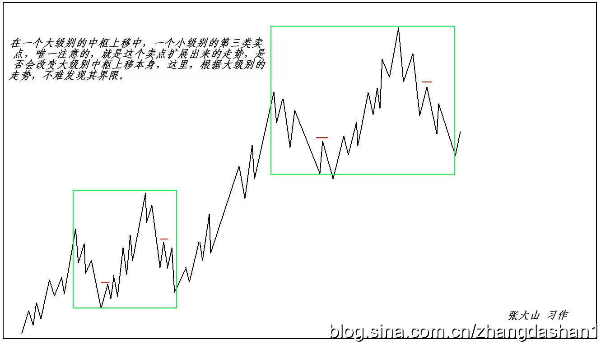

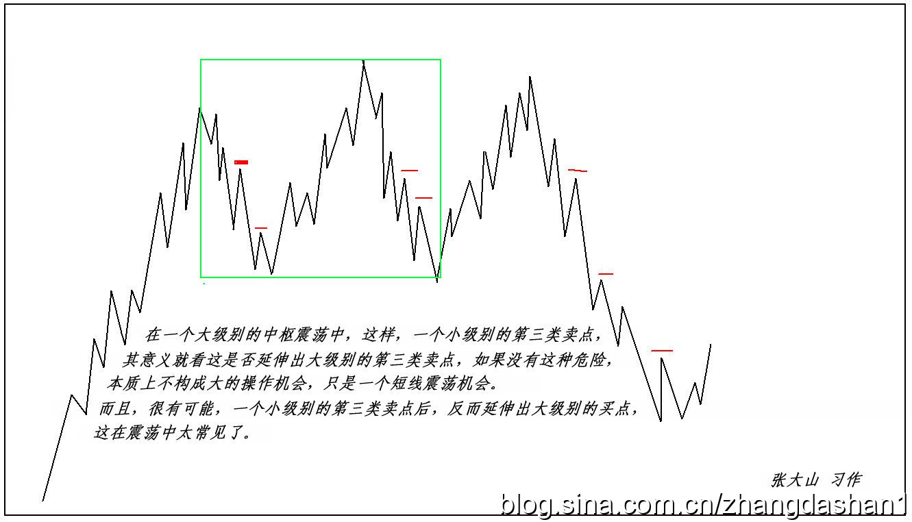

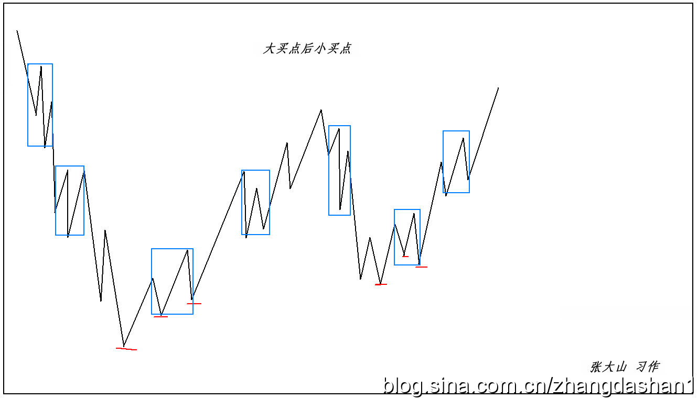

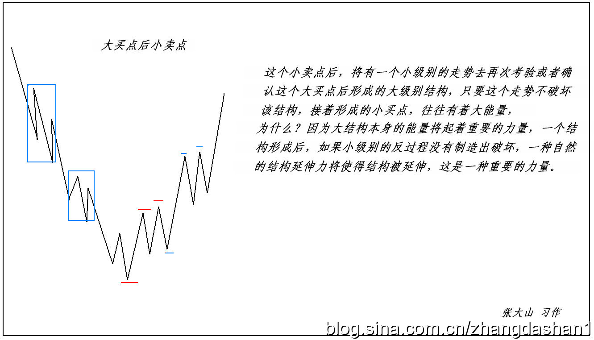

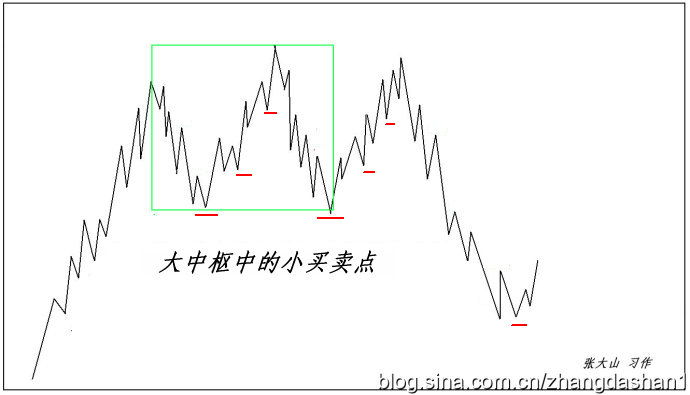

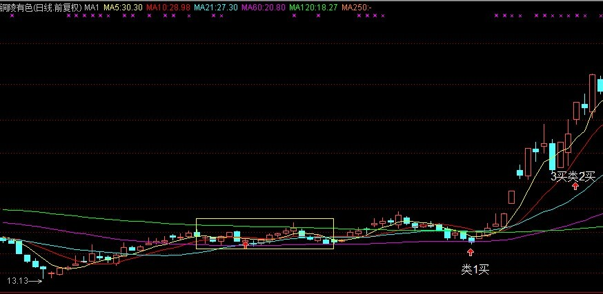

======================================================================================================

**终于再次强调宏观调控，中国希望大大的。**

(2007-10-25 15:43:22)

标签：

**证券/理财**

**缠中说禅**

分类：时政经济（娇注：缠中说禅经济学）

**请问，今晚的月亮圆吗？**

**今天最大的消息，就是关于强调宏观调控的，这是本ID最希望看到了。这点，本ID在“中国经济，已需治理整顿。** **2007-10-15 08:32:52”中已经强调，很高兴今天看到回应。**

**经济大局，最终决定市场大局，今天的消息，对所有心里有所希望的人，都是一个很好的提醒。**

**技术上，昨天已经把可能的情况进行最严密的分析，就是看那1分钟中枢的第三类买卖点情况，今天早上受消息影响低开后，第一小时的反抽刚好构成第三类卖点，这就是本ID理论规范下，短线最后的逃命线，**

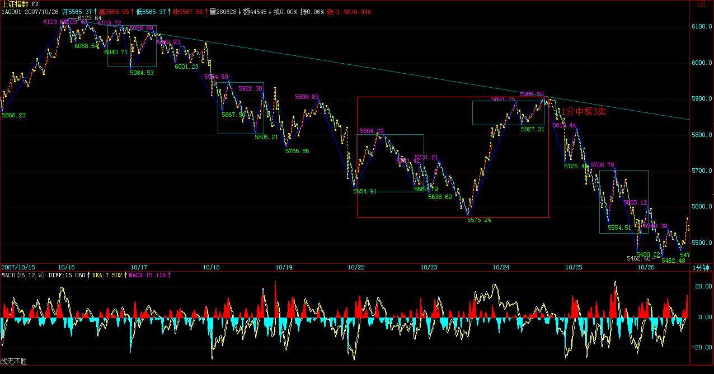

 

**但必须注意，这个二次探底的过程并不意味着顶部就已经完全成立，等大批资金解冻后，以及周末消息明朗后，一个有力度的反弹过程将可预期。**

**注意，这个反弹，在最恶劣的情况下，就是对跌破颈线后的反抽，目前颈线在5555点一带。这种最恶劣的走势，就是先跌到诸如5300点甚至5000点，然后一个反抽上不了5555点，然后确认顶部，然后继续大幅度下跌，这种走势，最终的调整目标，将在4000点，甚至更低。**

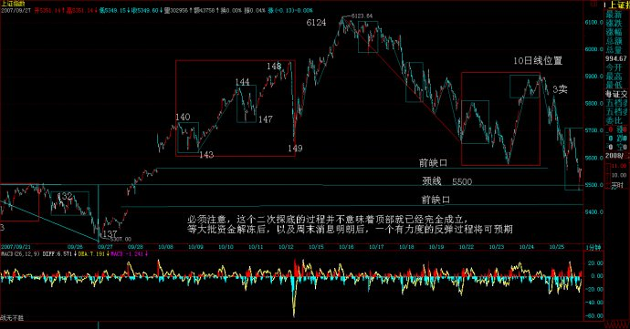

 

**当然，最好的走势，就是对颈线假跌破，然后反抽上来，这样，甚至有再冲6000点的可能，当然，这是最好的走势，能否出现，多头答应，空头不一定答应，即使空头答应，政策面可能也不一定答应。(注：实际走势为最好这类，反弹到6004点）**

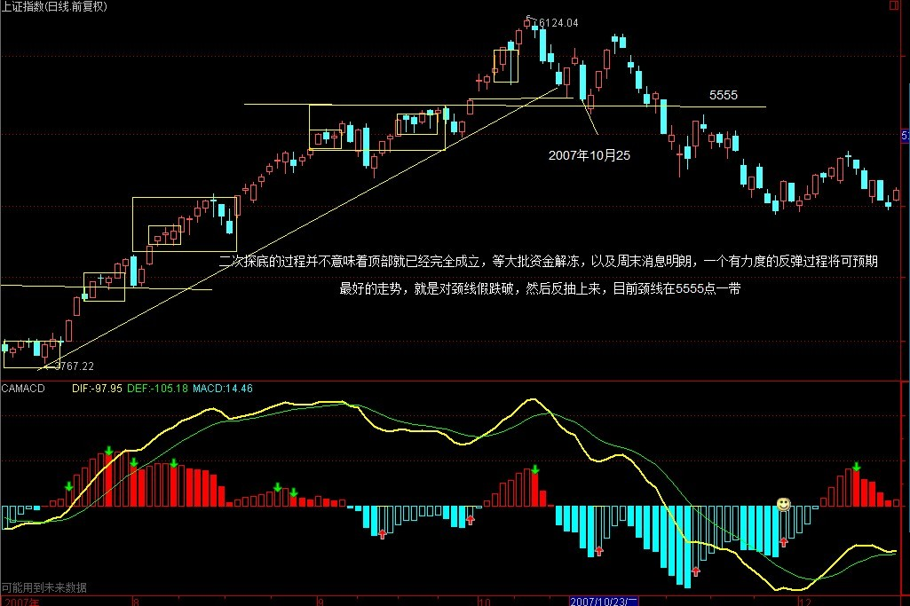

 

**本ID已经说过，反弹的操作，风险极大，如果你连第三类买卖点都分不清楚，那还是继续小板凳吧，这些反弹操作，你没资格参与。**

**虽然，本ID这一方已经全面大胜，但就像3600点大胜后，本ID要把后面的情况先说明一下。这次下来，为后面的低价股积聚了潜力，年底、明年的，又有不少好股票有好价位了，这才是这轮走势最大的用处。**

**节奏，有大节奏，也有小节奏。当然，首先必须有大思维、大节奏。这里的道道，自己漫漫体会吧。**

**先下，再见。**

**中国经济和股市的未来依然美好**

**(2007-10-25 21:04:33)**

**标签：**

**证券/理财**

**缠中说禅**

**分类：时政经济**（娇注：缠中说禅经济学）

**今天本不想说股票，但在这个月圆之时如期地鬼哭狼嚎的，一幅浮世绘，所以，本ID一早说，不于股市自由，就谈不上自由，因为这是世界上的一大炼狱。别以为股市就是股市，这里，有着最多的贪嗔痴疑慢，确实是一个好的修炼场所。所以，所有在股市中被股市的，都是有福慧的。受其灾，消其灾，三生有幸。**

**对年末的走势，本ID早有总体的分析。在“2007年末，资金与政策博弈下的走势分析** **2007-09-17 00:41:48”里，已经对走势给出最明确的分析，本ID后面的所有判断与行为，都在9月17日把剧本公布了，6100点，在这帖子里明确分析过了，但有多少人能留意？大概都被每天的波动所消磨掉了。**

**没有大的思路、大的节奏，为每天的波动所折磨，那是被股票面首，而不是面首股票。**

**请看那9月17日帖子其中的一段**

**：“由于去年大盘涨幅是130.43%，收盘在2675.47点，按相应比例，6165点成为今年一个标杆式的点位。还有，深圳成分指数在96年的行情中，也如本次上海指数一样略微跌破1000点后展开，而前者最终在6100点上见大顶，因此6100点附近是后者行情一个特别值得留意的位置。”**

**还有最后结论性的一段：“反之，一旦资金面的肆虐超乎合理范围，那么大盘将演化为一种疯狂走势，即在今年内强行突破上面所说的6100点区域，这样，一次超530级别的调整将难以避免。”**

**该说的，其实早说了，大蓝图都没看明白，盯着每天的盘子有用吗？**

**那么，现在难道就是世界末日吗？**

**不是，中国经济和股市的未来依然美好。这里本ID反而要为各位打气，因为中国经济的基本面没有任何实质的改变，人民币升值也在加速中，一切利好的因素依然存在。**

**但是，正如本ID反复强调的，现在需要的是中级调整，为了中国股市的未来，这调整是必须的。**

**关于中国股市的最大蓝图，本ID在“神州自有中天日，万国衣冠舞九韶2007-03-19 08:52:42 ”有着最明确的描画。这帖子发出的当天，大盘就拉出长阳，突破3000点下的震荡，展开了今年波澜壮阔的走势。**

**当时，大盘还在3000点下风雨飘摇，本ID明确说了：“在总市值超越GDP之前谈论股市的泡沫是可笑的，在中国股市总市值超越其GDP之前，第一阶段行情不会结束。”**

**后来，这一切都实现了，而且，目前这一阶段的行情其实并没有结束，在中级调整后，这行情依然要展开，依然要新高，这是毫无疑问的。**

**但是，一个合理的调整去积聚新的能量，让市场走势更加稳健，使得20年大牛市的基础更加牢固，这是必须的。**

**就像在3600点，本ID站出来说要满江红，因为在中国的市场，散户太多，散户天生就是死多，所以那肯定受欢迎。**

**而这次，本ID站出来说要做空，而且又刚好在提前说的6100点上阻挡了疯牛，这当然不会招人待见，但，为了中国股市的未来，这必须这样干。**

**试想，如果中国股市也如台湾、日本式地醉生梦死一次，然后是十几、二十年的大熊市，最终害的是谁？**

**特别中国，经济的转型还没完全结束，一旦资本市场被毁，经济转型所需要的核心动力就彻底丧失，最终伤害实体经济，而后面就是所有人的生活。**

**对于本ID这种人，经济好坏都不会影响到个人的风花雪月、99419，但绝大多数的人，特别那些还有住房、医疗、教育等等问题需要解决的人，一旦经济出现问题，将是最大的受害者。**

**最大的利好，对于任何一个中国经济的关系者来说，就是经济的长期稳定的发展，而不是暴冷暴热。**

**我们需要的是长牛，而不是疯牛。**

**中国股市的牛市依然，中国股市的未来依然是世界上机会最多的，有着最远大的前途，必将成为世界上最大的市场。暴风雨，只是让它更健康，如果没有这样的大视野，那么，在市场上注定不可能成功。**

**中国股市充满机会，未来无限。而这机会、未来如何成为你自己，这才是对每个人最重要的问题。**

**这市场不怕做错了，只怕死不改错。好好反思一下自己的操作，大概上面这个问题，就能更好地找到正确的答案了。**

**5555点守住，反弹酝酿ing**

**(2007-10-26 15:13:40)**

**标签：**

**证券/理财**

**缠中说禅**

**分类：时政经济**（娇注：缠中说禅经济学）

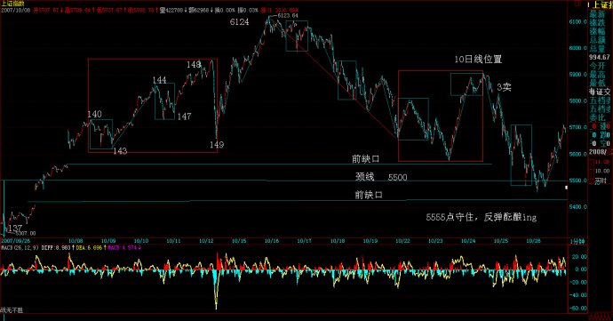

**上几天来的香港人的头今天过来了，在工体北他们的总部等着，本ID只能快速说两句，抱歉了。**

**本ID已经把5555点这个位置告诉各位了，这是颈线位置，守住，那么还有机会来一波有力度的反弹，否则，形势就更恶劣了。**

**由于股指期货、中石油等的预期，所以中字头依然在反弹中继续扮演最重要的角色，而一些跌到重要均线位置的题材股，也会有一定的表现，但将趋于个股，板块效应不大。**

**当然，反弹是否能在5555点颈线酝酿成功，还要看周末消息面的情况，如果没有特别的消息，在资金解冻前后，这个反弹将出现并延续，而中石油的上市表现，将决定这个反弹的最终命运。**

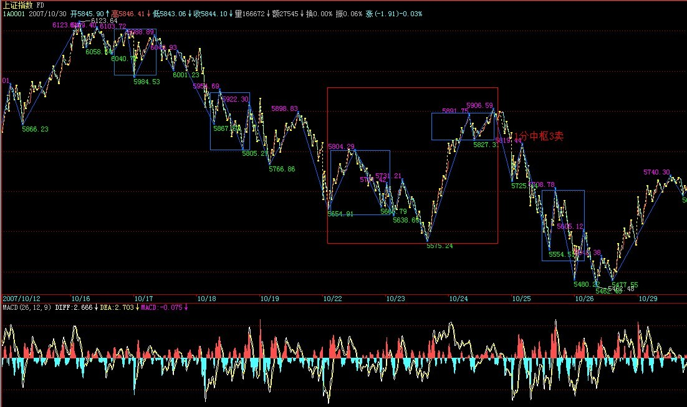

** **

**后面的游戏，关键是考技术，以及一看反弹不行就跑的灵活性，如果技术和灵活上都达不到要求，那就算了，这种活，一旦失手，痛但一定不会快乐着，除非你有受虐倾向。**

**好了，周末，让股票磨墙去。**

**今天不得不破例说股票**

**(2007-10-27 16:44:21)**

**标签：**

**证券/理财**

**缠中说禅**

**分类：时政经济**（娇注：缠中说禅经济学）

虽然道理上，那地方不是随便可以住的，但其实，只要认识门道，确实可以很随便就入住，特别今天开那所谓衍生品大会的地方。那地方今天就这么把股指期货如此地随便了一下，难道就为了里面那些别的最高档酒店也没有的古董玩意？

一些外国人或者外地来的，总是以能被带到那地方住为高规格的接待。其实，不妨揭密一下，那地方，如果认识门道，其价格比北京最好那几家酒店都要便宜点。当然，这里指的是标准的房间。而今天的衍生品在这个还算新装修的地方开，不知道是否有点上面那种希望住这种房子人的心态，说得难听点，就是土老冒心态。

土老冒心态，当然不一定是一般认为的土老冒才有。像现在，急着要被期货股指一下的心态，就与此类似。现在推出期货的时间根本就不合适，除非已经把股指期货当成一种住国宾馆显摆的玩意了。

住国宾馆的，特别那些做生意的去住的，往往不过是为了忽悠，真有实力是不用忽悠的。同样，没有股指期货，中国资本市场依然可以辉煌。

竟然有人在会上说，有了期货，就有了做空机制，就可以如何如何，股市就不会单边乱涨之类的玩意。说这话的人难道没经历过327？还有319难道不是一直单边乱涨最后导致国债期货停了？

本ID早把狠话说了，在目前的流通量环境下，期货推出后，主力做空的最后一定死得尸骨无存。连股票的卖空都没有，谈什么做空机制？想推出股指期货，先把流通量增大，卖空给搞了，否则，越期货越死人。

当然，本ID一点都不担心目前的状况，新官都没上任，更谈不上三把火，现在的，想说什么是什么，关键是说了算不算数。

如果目前的流通量与交易机制不变，那么，一旦在近期确认期货推出，本ID将成为最坚定的多头。当然，可能是先诱空再多。

汇丰都N百了，工行为什么不可以？把工行、中行干上200元，又有什么不可以的？

疯狂，谁不会？疯一把，一起死。早死早干净。

**明天面临下降通道上轨压力**

(2007-10-29 15:25:18)

标签：

**证券/理财**

**缠中说禅**

分类：时政经济（娇注：缠中说禅经济学）

**5555点站稳后反弹，这都在预计之中早说了，明天面临下降通道上轨压力，这是技术的话，基本面上，如果指数期货出来，点位根本没意义，特别在形成多空对赌的局面时，那时候，只需要关于如何把对方打爆了，什么点位不点位的，如果夹到100000点才能把空头夹死，那当然也是可以这样操作的。**

**期货，从来都是你死我活的斗争，没有什么仁慈可说的。拥有相应的筹码，就是拥有市场的发言权，有发言权比什么都重要。**

**明天一旦冲破上轨压力，反弹的空间将被彻底打开。当然，这个位置出现反复也是很自然的。由于大面积资金被冻，所以没什么消息的情况下，这反弹是不会轻易结束的。**

**如果期货在年内推出，那么6100点当然不会是什么位置了，这是目前大盘最大的变数。但无论走势到什么位置，其实和大多数人无关，因为真正上涨的股票基本依然是带指数的，其他股票，大多数只能暂时继续反弹然后回跌，最多保持盘整的走势，没什么大戏。**

**不过短线，超跌股票的反弹还是有一定机会的，但风险同样大。至于中字头，有期货这保护伞，当然是爱多疯有多疯。**

**期货出来后，个股分化将继续加剧，散户的生存空间进一步减少，事情就是这样了，天要下雨，自己找伞吧。**

**突破上轨，反弹空间如期打开。**

(2007-10-30 15:26:44)

标签：

**证券/理财**

**缠中说禅**

分类：时政经济（娇注：缠中说禅经济学）

**昨天说了，突破下降通道上轨后，反弹空间打开。今天走势极端规范，下午那次跳水，就是对上轨突破后的回抽，这些最基本的技术语言，如果都看不明白，就必须补课了。**

**站在本ID理论的角度，今天早上的绿盘与昨天的尾盘，刚好构成1分钟中枢，而下午的跳水，刚好构成该中枢的第三类买点。也就是说，下午的跳水，有两重的技术含义。**

**现在的走势十分简单，只要不出现回到这1分钟中枢，而在上面形成新的中枢，那这反弹的级别就至少不小于1分钟的上涨。这样，操作就极为简单，耐心等待背弛出现就可以。**

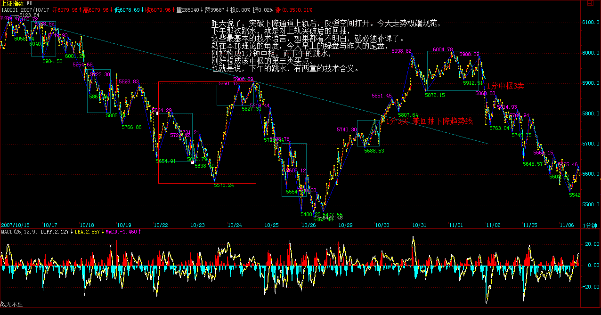

 

**短线总体的节奏，本ID在上周五“5555点守住，反弹酝酿ing 2007-10-26 15:13:40”已经说得很明确了，就是5555颈线站稳后，反弹至少延续到中石油资金解冻前后。就算是最坏的情况，也要先把这些资金骗进来再说，否则太对不住这3万亿资金的热情。**

**中期走势，本ID已经说得很清楚，如果期货出来，那点位就没什么意义了，6100点也不是大不了的位置，那时候只有疯狂，没什么点位不点位的。而如果期货被阻击出不来，那么，6100点当然还是一个位置，这次的反弹，也就是构成顶部图形的第二个尖。至于这个尖，比前面一个高点还是低点，都问题不大，例如双头，可能就低点；头肩顶，就高点，这都没有太大的影响。**

**无论什么顶部的最终图形，5555点都是生命线，只要不有效跌破，这图形就没完，而且有变成中继图形的潜力。否则，就是顶部图形成立，中级调整确立。而目前，唯一的变数就是期货的时间。**

**关于期货，本ID也说得很清楚了，本ID不愿意见到出来，特别是现在。因为这样将会耗尽中国资本市场的那点能量，然后的调整就不是小儿科了。现在，这事的折腾，依然不能说完全定局。有些事，最后一晚还可以改变，没到最后一下，市场外的努力是不会放弃的。**

**至于现在瞎忽悠的，又不是能拍板的人，本ID连看都不爱看他们的废话。**

**当然，现在舆论在造势，有一群势力在为自己的利益忽悠着，这事情，就看最后一下的智慧了，但本ID这里放一句狠话：请别像327、319那样，谁拍板、谁负责，这个政治、经济责任，不可能拍拍脑袋就没事。**

**另外，本ID还要说：所有忽悠这事的，请先说明白，出事了，你们负责吗？如果由此把资本市场和经济搞砸了，你们负责吗？不负责，为了名利而忽悠，这不是中国人该干的事情。**

**现在，站在本ID的立场，很简单，就是该反弹就反弹，该疯狂就疯狂，在5555跌破之前，进行大幅度的震荡操作去吸血。而在市场之外，该有的努力一定不会少，最终的结果如何，只要心到了、力到了，本ID也无怨无悔了。**

**但相信，管理层对目前点位风险会有足够的认识，一旦市场进入不可自我调节的状态，管理层一定不会袖手旁观。**

**好了，最近确实事多，明天要出差，还有很多事要忙，先下，再见。**
