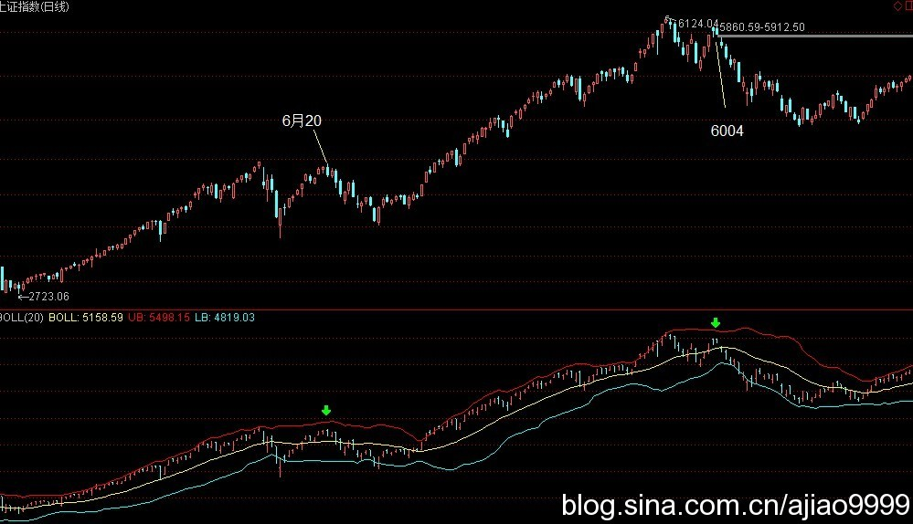
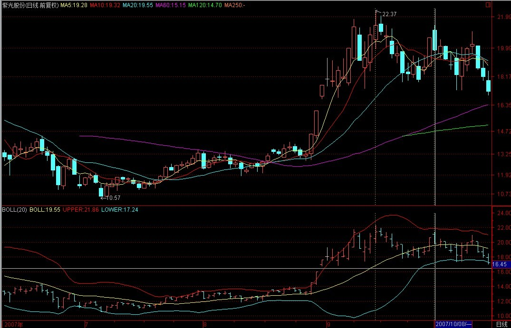
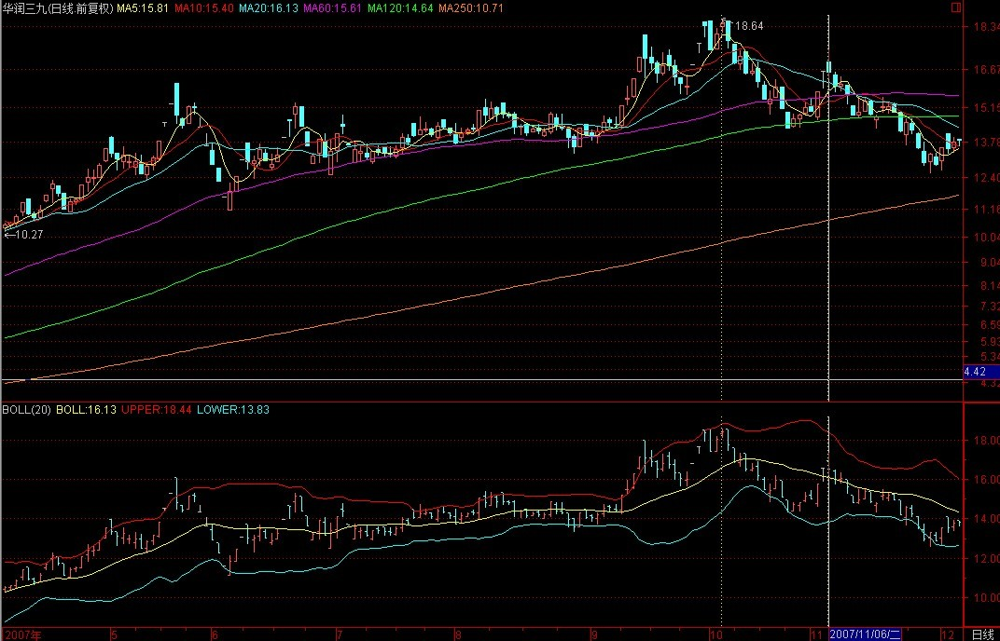
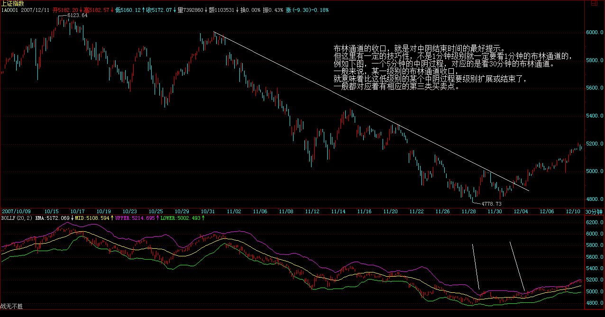
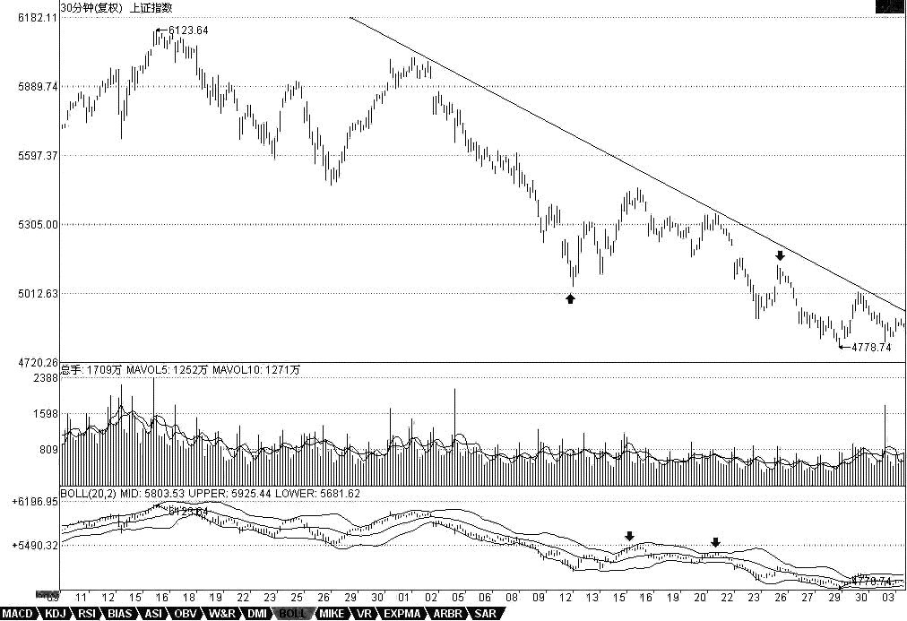
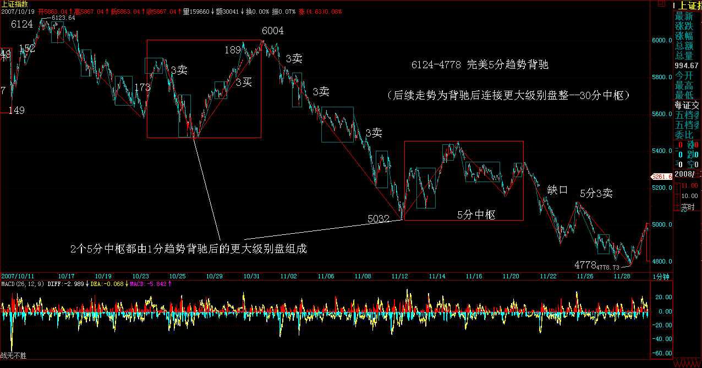
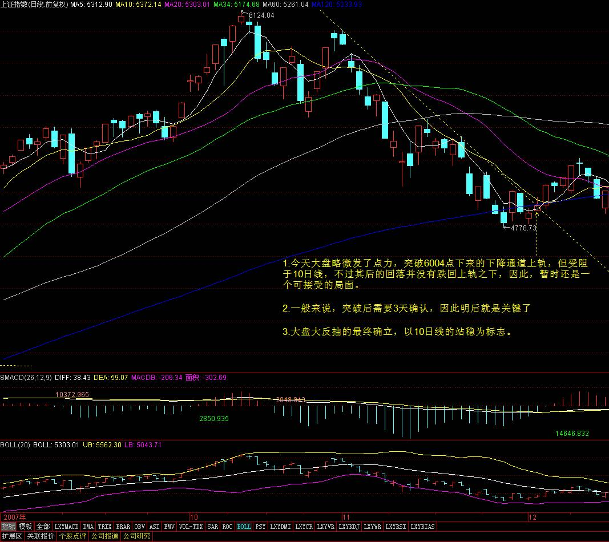

# 教你炒股票90：中阴阶段结束时间的辅助判断

**

(2007-12-03 22:33:08)

**缠师当年操作的几只股票**

反弹剧本第一目标胜利完成  (注：补5200点缺口）(2007-12-11 15:33:37)

**这几天，把本ID曾说过的股票都再分别说一次。注意，本ID说的股票，都是长线角度说的，你要充分理解本ID的理论才能发挥最大的效力。由于本ID现在比较乖，都是组合形式地操作，不会干在一只股票上买个90%筹码之类的活动，所以组合的股票比较多，一般的散户，可以按照股票池的观点来看，没必要在一棵树上吊死，如果能选择好轮动的节奏，那效果是最好的。当然，没这本事的，宁愿来是吊死在000999、600737之类的股票上算了。**

**600737，当然不会是单纯的农业股，属于什么牛板块，现在还不能说，说了会出毛病，以后就知道了，知道就会明白，8元的600737，简直比冬藏大白菜还便宜。**

**000999，以后可能牛得不得了，现在，没办法，谁让股改都没完成？就算不相信本ID，也应该相信曾搞掂万科的公司。**

**600195：垄断性公司，以后的牛闻不断，不过里面无聊人不少，否则怎么会只有现在的价格。**

**600779：现在的价格绝对是一个悲剧，怪就怪某些人拿得太多。**

**000915：创出6100点以来新高的股票不多，为什么他是？本ID在这里说的时候，只有3元多点，以后如果能翻10倍以上，并不是太奇怪的事情。**

**600635：本ID是在除权前的5元说的，等于现在的3元多，这股票当然是要10倍以上的，就一个PE概念已经足够。**

**000938：这股票当然不只PE一个概念，而且总体涨幅不大，以后会报仇的。在中国，连清华都不相信，你还能相信谁？**

**000822：该说的很多，但很多都不方便说，说了要出毛病。唯一可以说的，第一次到18元，该拿货的人都没拿着，大盘6100点的大跌，真是缘分哟、谢谢啊。**

第一目标达到后的例行休整(2007-12-12 15:33:01)

**注意，昨天说把原来说过的股票再点评，并不是推荐你现在去买。买与不买，图形会告诉你，本ID只是从长线的角度点评这些股票的基本面情况。由于很多股票都是N个月前推荐的，绝大多数涨幅都很大，所以如果不是一路游戏上来而且胆子比较小容易受刺激的，就观看算了。**

**600343：也快创历史新高了，军工、整体上市，诸如此类的概念。**

**600078：这股票关键是地底下的玩意，一个寻宝游戏，首先来回折腾，等地底的宝藏给承认了，才会有大行情。**

**600777：开始是里面人太多，后面是和上市公司没协调好，不过问题总会解决的，解决了，自然就好起来了。不过一路打架上来，也涨了N倍了。**

**600649：5元的时候说，现在N个月后，也翻了几倍了。一直在高位之上站着，就一个水资源概念就足以站住了。唯一的风险是，万一大盘反弹后，有补跌的压力，但站在长线看，根本不算什么。**

**000802：光这个名字就足以让这股票在2008年风光了，这有什么可怀疑的？**

**600578：环保、整体上市、奥运等等概念，虽然说以后涨了N倍了，不过2008年应该不会差的。**

**601111：说的时候3元不到，然后李军人李军人地说到今天。2008，你说如果连李军人都没戏的话，那还怎么2008？**

**000777：说的时候是8元，如果这个故事都能展开，80并不是太过分吧。长线看，如果整体上来，中船可以300，那么这中核两个字，是不是要值800？**

顶分型确立显威力(2007-12-14 00:49:00)

**个股上继续说原来说过的个股。注意，已经反复强调，说这些股票并不是让各位现在还去买，因为买与不买关键是看有没有买点，有多大级别的买点，没有买点去买，那是有毛病。本ID点评这些股票，只是从长线的角度说，别糊涂了。**

**600139：这股票叫等比，当时的闹剧估计很多人还记得。你可以叫它妖股，但妖总有妖的理由，关键你是否好的猎手。这世界上，很难找到9元多快速上涨到24又快速跌到12的股票了，这才是最好的股票，为什么？震荡够大，差价够狠。没这技术的，请远离。**

**600569：这也是一只折腾不少人的股票，最大的题材，还是整体上市与收购，股性比较顽皮，没技术的远离。**

**000998：农业股的问题就是概念好，但业绩跟不上，所以暂时只能大箱型折腾，等待大的业绩、题材突破机会，站在长线角度，总要牛起来的。**

**000416：这是一个典型的兴奋过度例子，说的时候3元，不到5个月飞奔到了18元，然后就是痛苦的调整，短线关键是业绩关，长线总是要反复被折腾的，为什么？股性在那里，里面折腾的人的个性在那里，当然，大突破需要等待一个时机。**

**000778：看看股东背景，就知道这股票天生就是要被折腾的。涨了4倍，休息一下也是应该的，中线大箱型整理，等待突破契机。**

**000099：和000778一样，一个特殊的大股东，一个特殊的行业，总要被折腾的，中线也是大箱型整理，等到突破契机。**

**600432：从20元不到冲到132，时间也就九个月，休整一下很应该，中长线当然没问题，有色的世界行情只要不倒，这是不用讨论的。**

**600234：本ID喜欢股票代码好玩的股票，有了600432，当然需要600234，而且一个等差数列，与前面的等比也要有一比。ST的股票，没技术的人别乱碰，这里玩的就是基本面的大改变，这里有不确定因素，因此才有大的投机价值。**

**周底分型构成待确立(2007-12-14 15:48:40)**

**周末，不想说太多股票，把以前说过的股票最后几只都说说。**

**600594：去年底，本ID说看好医药和钢铁，后来医药股里出了不少黑马，这股票不算黑马，涨幅也一般，还需要努力。**

**600607：本ID叫这是汉奸股，要吸其血。后来24元上说走人，但中线还要折腾。**

**600375：这股票震荡也不小，主要问题是公司治理有问题，如果这问题解决，这股票不会比三一差，现在只能耐心等待问题的解决。**

**600319：这和上面的问题一样，有投机性题材，机会一到，自然爆发。中线暂时箱型震荡。**

**600636：现在盘子稍微比前几个月干净了点，题材业绩概念都不错，就是盘子太脏，慢慢洗白白，洗干净自然就表现了。**

**000600：涨了4倍后休息一下，整体上市之类的题材，中长线没问题。**

**000021：好股票总要表现的，不过科技股不是现在的主流，但70元的历史高位，对于长线角度，并不是特了不起的位置。**

**000338：中国一个大行业的控制性企业，光这点就决定了其长线的价值。**

**002149：上市时短炒了几天，然后先走了。后来在答疑的时候描述过这类股票的中长线建仓手法，现在的走势基本按这剧本，当时说最好能到10几，估计有点难度，如果真有这些价位，那肯定是无敌风火轮了。砸的狠，往往是爱之深，想吃到中长线的便宜筹码，如此而已。公司基本面很好，最不好就是中长线的筹码很难买够。**

**000807：并购题材，这种题材的变数比较大，不过这股票的有色背景，使得业绩是有保障的，可以算是有业绩支持的投机。**

**中字头：中驴、中国人兽，中石头，中联通等等，这都是本ID两个翅膀中的一个。中联通一旦中移动回来，疯一次是很应该的。另外，整体业务的上市、整个电讯重组，都是很大的题材。其他几只，都是长线的好股票，只是中线上，前面发力过大，如果没有股指期货刺激一下，不会太过疯狂。**

**90课**（娇注：回复）

(2007-12-04 15:29:26)

**6004点下来的下降通道上轨，但受阻于10日线，不过其后的回落并没有跌回上轨之下，因此，暂时还是一个可接受的局面。**

**一般来说，突破后需要3天确认，因此明后就是关键了。**

**对6124点下来第一波调整的大反抽，这个结论是必然的。唯一的区别就是昨天所说的是否先有一空头陷阱的问题。**

**10日线的站稳为标志。**

**9119地折腾。**
