# 教你炒股票98：中医、兵法、诗歌、操作2

*(2008-02-04 19:51:49)*

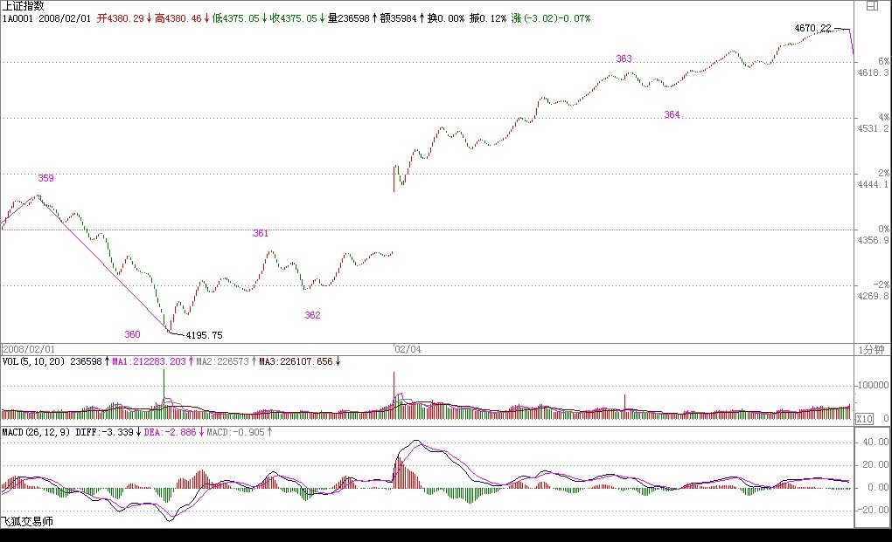

**阴线迎春给一根筋上了生动一课**

(2008-02-05 15:09:59)

**本ID前面说了，节前连涨三天是不允许的，而两天要看周末消息和石油的变态程度。昨天，有利好涨了，而今天的石油，有人疯狂地抛出来，似乎那石油是不用钱买的，这么变态，你说能红盘吗？**

**一根筋，不是别有用心就是脑子有水，市场操作，不脱离一根筋，那命运是怎么样，是不用讨论的。**

**技术上的问题，昨天说得很清楚了，就是线段类背驰后必然出现1分钟中枢，节后，就看这中枢的演化，事情就这么简单，不需要任何一根筋的想法。而中短线上，还是4500点上下那中枢的震荡走势。**

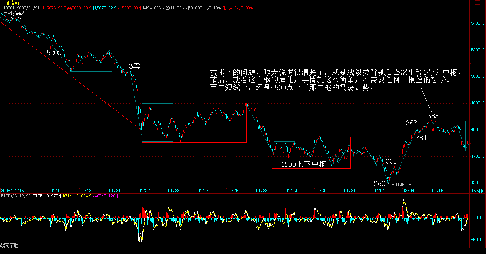

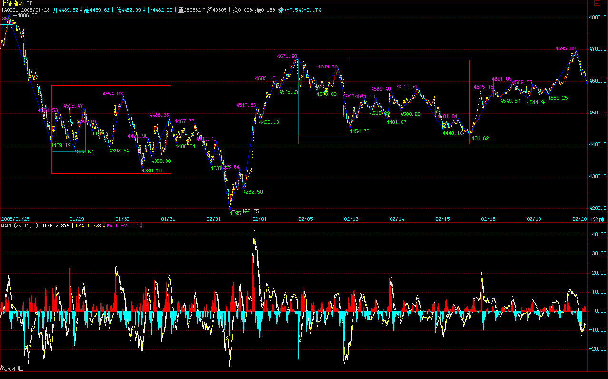

**请好好看看真正的大资金是如何运作的，大概很多人都忘了580989了吧，看看今天的走势，有什么想法？一个长假期，一个稳健的大资金，当然要这样进行有效的对冲，很多时候，不确定因素是要靠对冲来解决的。这样，不管外围在春节发生什么事情，都可以吃嘛嘛香了。**

**当然，对于小资金来说，580989这类东西风险太大，没必要参与，而且小资金不一定要对冲了，就要发挥自己机动灵活的特点，看不确定，就先走一部分，有钱在手里，什么都不怕了。**

**贪婪总是希望行情按自己的欲望发展，那是鸭屁思维，不改变，永无出期。**

**总结一句，任何不确定时，唯一正确的做法就是控制仓位，你能自如地控制仓位，那你的水平就能上一台阶。控制仓位，并不是说一定要空仓，而是把仓位控制在一旦发生特殊情况能有足够反应的水平。**

**任何想把最后一分钱赚到的，最终的命运只能是倾家荡产。**

**大过节的，就不说这些事情了。但市场的残酷，是不分节日的，那种春节一定要红盘，奥运一定要大行情的思维，要好好醒醒了。**

**大过节的，抛弃股票，享受人生。你的身体、家庭、父母、亲人，比股票重要一亿万倍，好好珍惜吧。**

**先下，再见。**

**开门不红又何妨？**

(2008-02-13 15:15:42)

**开门大红包，本ID可给足了，580989的两次启动，都给足提示，第一次，提示后在0.42下随便买到，这次，即使节前你自己没看明白，今天在0.5下随便买，而且还两次机会，操作好了，随便一天50%的利润。 **

**所以，本ID绝对不欠任何人红包了。 **

**至于大盘没有红，本ID可真没什么兴趣关心，具体的说法，在节前最后的帖子里已经无比清楚了。 **

**580989的中线中枢，本ID在第一次启动时已经明确说过，就是0.6上下，回头再看看，这走势是不是完全的教科书？请好好再看看本ID节前最后的帖子，看看关于如何对冲，如何平衡风险的做法。让那些预测连涨3天的吃西北风去吧，两次580989的礼包，足够连续30涨停的利润了。 **

**强烈注意，本ID再次必须声明，一般人绝对不能买580989，你想，600737在8元说的还有人是亏钱出来的，580989就是你的坟墓，没那本事心态，就继续当教科书演示看看吧。**

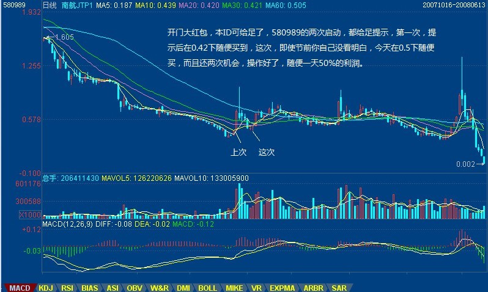

**还是说说这无聊的大盘吧。 **

**只有一根筋的才喜欢开门红，知道1993年开门红以后就从368点的深圳综指跌到94点，大概也只用了1年半不到时间。不开门红，其实真没有什么，至少证明，里面有足够多的资金都没觉得今年是必须在春节一开门就要骗人来埋单的，至少有足够多的资金还有下一步的打算。**

**技术上，本ID已经说得超明确，就是原来最后那中枢的扩展，这震荡什么时候结束的唯一标准，就是出现第三类买卖点，其他一切都是废话。**

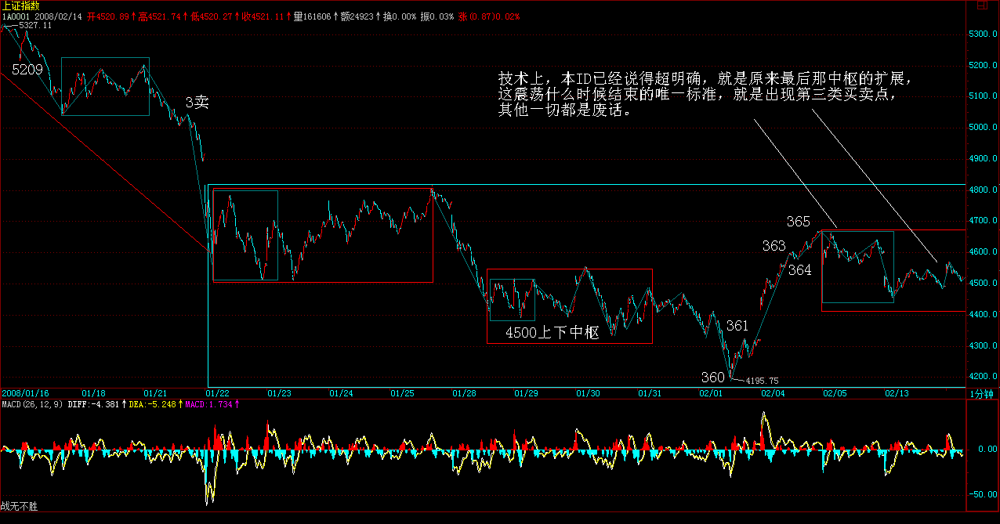

**个股方面，中石油站不稳，指数要站稳那绝对是没戏的，那10亿的玩意，这两天成交了4亿了，当然，里面还有很多水分，但中石油今天留下的缺口，应该很快就回补，问题还是这24元上下的中枢，最终如何突破，这和大盘中枢的突破是密切相关的。**

**说实在，今天这样的成交量，说明了这春节假期确实太短了，怎么都该放到15吧，各位在春晚是否看到那讽刺股民的节目了？有这样的现象，你说，这股市能好吗？**

**中线，就看3月的会能不能搞点什么了，面包会有的，但要靠自己去抢。**

**先下，再见。**

**后三日是技术上最关键时刻**

(2008-02-14 15:25:29)

**先请个假，今天晚上有事，晚上的帖子，本ID就克扣了，抱歉。**

**今天的580989，一个经典的走势，不管你是否参加，你都先请搞明白：今天尾盘的拉起故意和昨天是一样的，这就是一种典型的骗人手法，因为一根筋的人最多了，以为什么都是可以克隆，以为有一样的开始就有一样的结果，结果就给克死了。**

**世界就这么残酷，这一招，用了好几百年了，在中国市场上也用了好十几年了，还继续好用，人就这德行了。不管你参与与否，被骗与否，都要学着点吧，这样以后兴许不会再被骗。**

**当然，类似骗局有很多变招，因为前N-1次都是一样的，但这N可以不断地变化，用得最气势磅礴的，就是10几年前深圳194点到334点那次大反弹，不断同样的模式后，最后一天大跳水，多少人一直套到100点，可怜呀。**

**说大盘吧，大盘后三天是技术关键，因为所谓的MACD等指标金叉就要出现，要骗你，也就是这个时候。但这时候有两种骗的方向，一种是骗空头，一种是骗多头，都仔细看好了。(娇注：绿柱子缩短有两分类 1 继续绿柱子放长杀多骗多头 2金叉转多骗空头）**

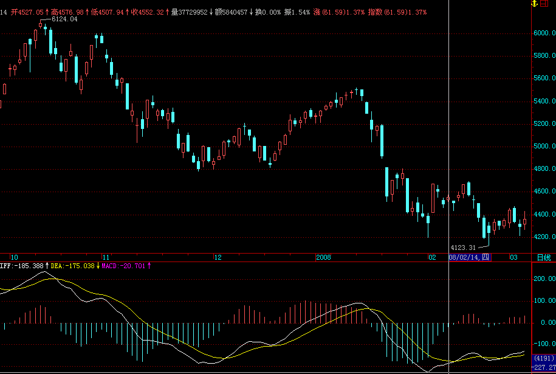

**大的方向，本ID说过N次了，但糊涂的人太多，再明确说一次：**

**一、下面最大的机会，就是6124点下来30分钟走势类型结束后的向上30分钟走势类型，这机会在酝酿中，也就是在中阴阶段。但那30分钟的向上类型，最坏的情况，就是一个盘整，并不一定走出上涨类型，这是必须明确的。如果是盘整，就在这上下搞出一个日的中枢，然后就面临6124下来的日走势类型的第一个中枢，后面无论延伸出下跌或盘整，都是完全可能的，如果是下跌，那当然恐怖无比，比这几个月都要恐怖。所以，3月前后，对中线走势极为关键，要继续全面富裕还是怎么着，就看着办了。**

**(注：真实走势30分盘背后构成最简单的30分3卖后继续跌延续30分趋势，禅师这里是设想年线上构成30分盘背走势类型的结束，开始新的上30分走势）**

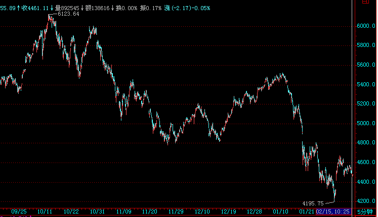

**二、个股依然机会不断，新股、高送配的，有各类题材的，都会有机会。当然，从上线角度，本ID看好的类型也说过无数次了，就是环保**（娇注：包括新能源）**、农业、消费类消耗品等等，短线，当然就是高送配中股价特别低的，例如现在不到20，而要送10之类。中线，化工等玩意是值得注意的。**

**注意，看本ID的文章，你必须连着看，因为有些前面的结论，本ID不可能每次都重复，例如对大盘的总判断。还有，本ID在前面那波中把人分为两类，一类就是坐小板凳的，一类是可以不断参与活动的，你首先要分清楚自己是哪一类。**

**就象从4778到5522那次，本ID从来没让坐小板凳的起来，为什么？因为那次是30分钟以下级别的活动，既然我们假设小板凳至少要搞30分钟以上的，否则搞不过来，那么当然就一直不用起来。但还是有无数孔男人的学生叫嚷，为什么涨了不让我们从小板凳起来，那你首先问自己，你有搞30分钟以下级别的本事吗？5522点的急促下跌，就是因为上来的级别小，下来的当然也就小，你能反应过来吗？那些下来时不会动的，你认清自己的水平了吗？**

**认清自己，否则一切瞎掰。就像580989，机会就这么大，但你首先要有这水平，自己都认清不了，那只能等着被屠杀。**

**认清自己，然后根据实际走势决定自己的操作，就这么简单，还孔男人什么呢？**

**先下，再见。**

**回试年线暂显支持**

(2008-02-15 15:39:01)

**今天回试年线暂显支持，但问题还是下周初，因为MACD的柱子是否有效放红，这是下周最关键的问题。目前的情况十分明确，就是技术面完全支持行情的展开，但基本面、政策面有太多令人不满意的因素，因此才有如此上下为难的局面。**

**整个政策面的明朗，大概还是要等到三月会后，因此，之前，一个震荡的局面依然。其间，上下尝试，左冲右突一下是很正常的。期间甚至不排除再有一次大的跳水去把最后的盘子洗干净，当然，这涉及最后的底部图形，如果是头肩底，那这次跳水就免不了，如果不是，那就不一定有了。是否头肩底，和后续的消息面相关，技术上反而没有太大的倾向。**

**但个股行情会继续展开，只要指数稳定筑底中，有题材的个股就不会寂寞。但操作中必须要有严密的布局，例如，昨天说的20以下送10的个股，其实就没几只，本ID没明确说出来，就是不希望养成懒惰的习惯，连自己功课都不想做，那干脆把账号告诉本ID，本ID把钱直接打给你算了。**

**最符合要求的，只要做点功课，显然不难找到，就是600795。这股票，业绩很好，10送10后就今早算9元，风险度很低。而且，530后大唐电力的送股行情表现，使得这股票的后续走势更有想象力。但这些都是估算，你介入时，就应该知道，这两天的小阴线是在构造一个小的第三类买点，18元上介入，大概的风险有10-15%，所以，你就根据自己的风险能力去决定自己的仓位，然后买入相应仓位，并留下一定的对冲资金去为后面减低成本，有了这一些安排，今天一大早有足够的时间让你去介入了。**

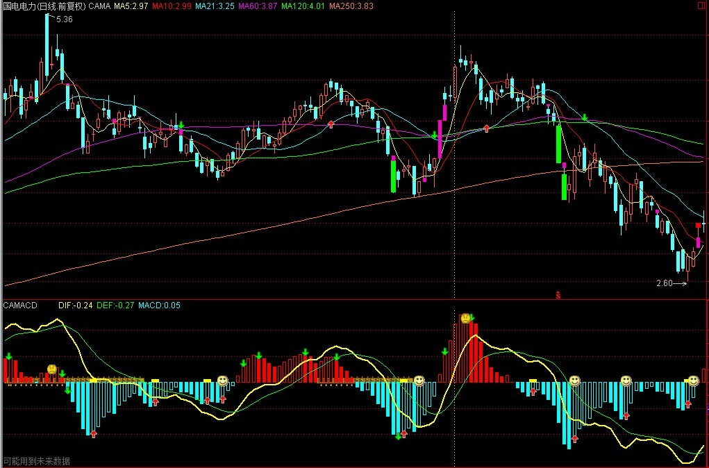

**注意，这里教的是一种思维操作方法，不是说一定让你去买600795，而且，现在拉起来了，再买就没意思了。**

**来这里，不是培养懒人的，这点，请一定注意。** **580989，今早又给了一次走的机会，没走就不要怪本ID了，当然，大盘只要走不好，这东西还要折腾，但至少这一走，逃过20%的跌幅，这已经足够了。** **周末，都好好休息吧，身体最重要。**

**先下，再见。**

**MACD红柱子终现待确认**

(2008-02-18 15:18:26)

**上周说了，本周最重要的事情就是这MACD的红绿柱子问题，今天，借点利好，终于把这红柱子给弄出来了，但注意，这并不意味着一切无忧，下面就是一个确认的问题。**

（娇注：绿柱子缩短后两种分类：1.继续逼多绿柱子加长。2.金叉出红柱子。第二类又分3小类: 1.出4到6根红柱子堆; 2. 5-8个红柱子堆; 3.红柱子连堆。注意观察第一根红柱子所在K线支撑作用）

*技术上，一般这种红柱子出来后，如果不能站住今天的位置，那么就会***出现出几根红柱子再出绿柱子***的情况，这种情况往往对应着新一轮的***杀跌***，所以这红柱子出来，需要预防的就是这种情况。*

（娇注：上涨下5分走势转折看死叉第一个绿柱子对应K高点能否突破续涨， 下跌上5分走势转折看金叉第一个红柱子对应K低点能否跌破续跌。）

**具体操作上很容易处理，也就是红柱子出来后，如果后续能量不能跟上，那么出现以上情况的可能就很大了，那么在冲高无力时，一定要先出来看看，因为后面对应的转折很可能是极为急促的。**

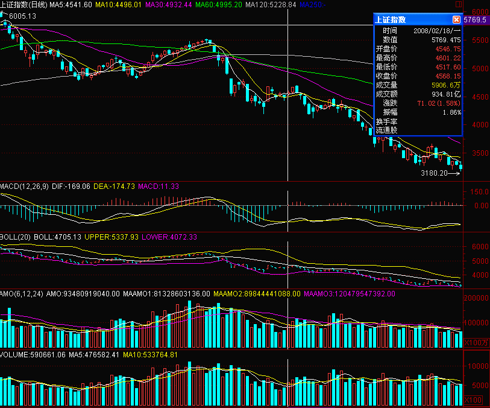

**技术上，底部的构造有头肩底的可能，这红柱后很快再绿柱的情况，往往就对应这种情况，在最好的情况下，也就对应双底的情况。**

**当然，以上都是些不精确的分析，如果按本ID的理论来，这些分析都没多大意义。现在就是一个中枢震荡的过程，这点说了多次了，今天并没构成线段类上涨，说明向上动力不足，因此今天构成的4575上下的1分钟中枢就有着重要的技术意义。后面的超短线走势完全由此中枢最终演变所决定。**

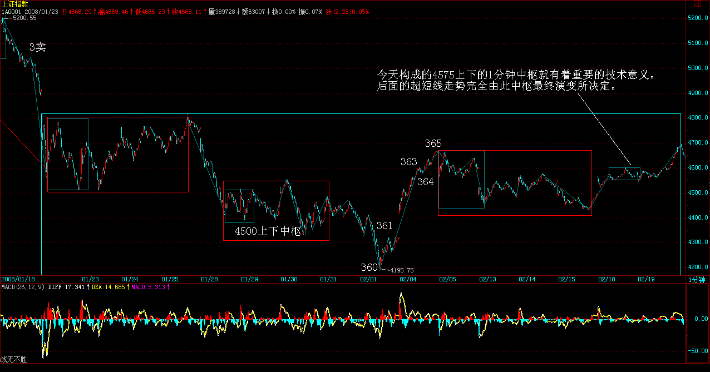

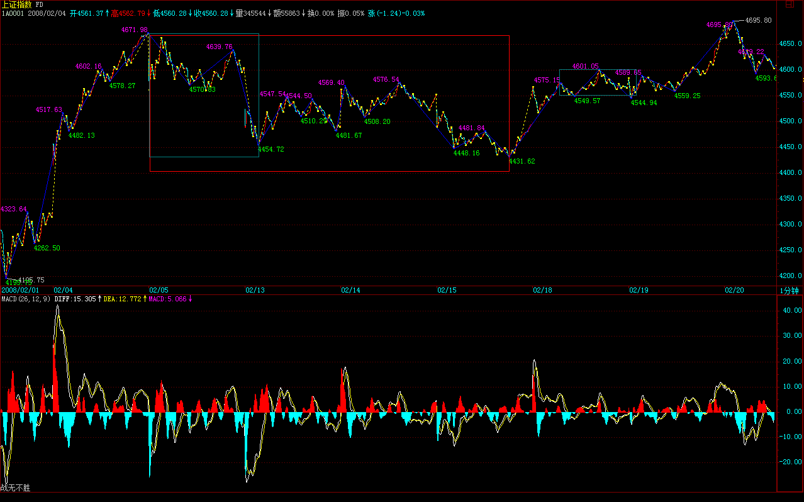

**个股方面，农业、化工、奥运等等都有表现，但板块持续性还是有问题，现在的问题是，一个超级裸奔的板块还没有形成，所以个股行情只能显现零散的局面。要改变这局面，还需要人气的不断培养。600795碰到20的整数关口，需要整理换手，如果高送股的板块都走不出来，其他板块就更难有戏了。**

**本周能否保持住MACD的红柱，并站稳4575之上，这是对多头最重要的技术要求，明天的CPI是一个考验，能否经受这考验，这是能否完成要求的关键。**

**先下，再见。**
