# 教你炒股票103：学屠龙术前先学好防狼术

*(2008-03-19 15:58:15)*

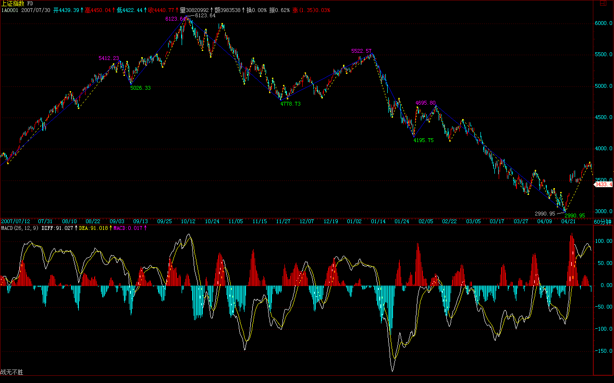

*(2008-03-20 11:13:56)*

转载

**2008年行情再展望**

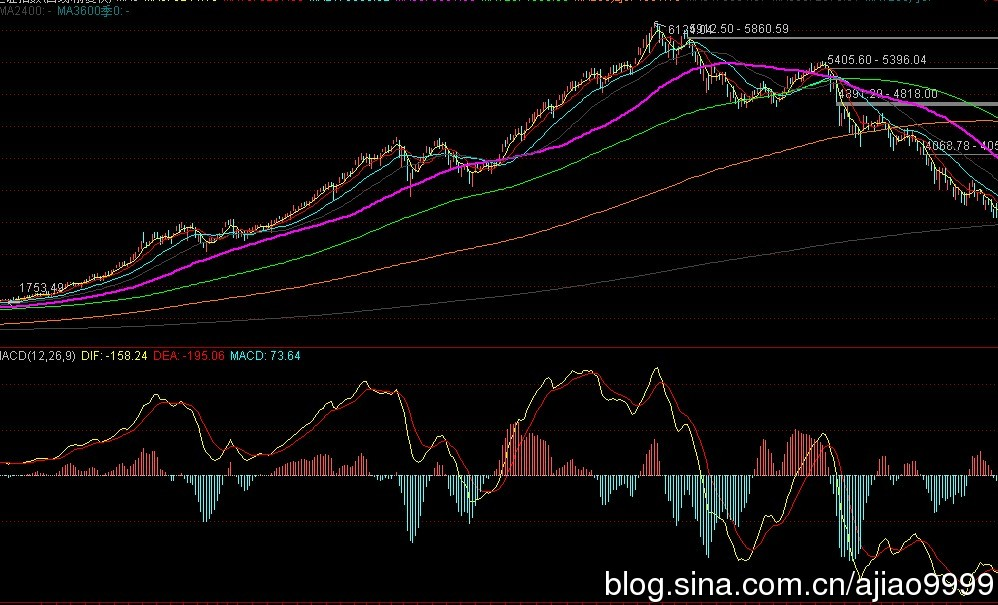

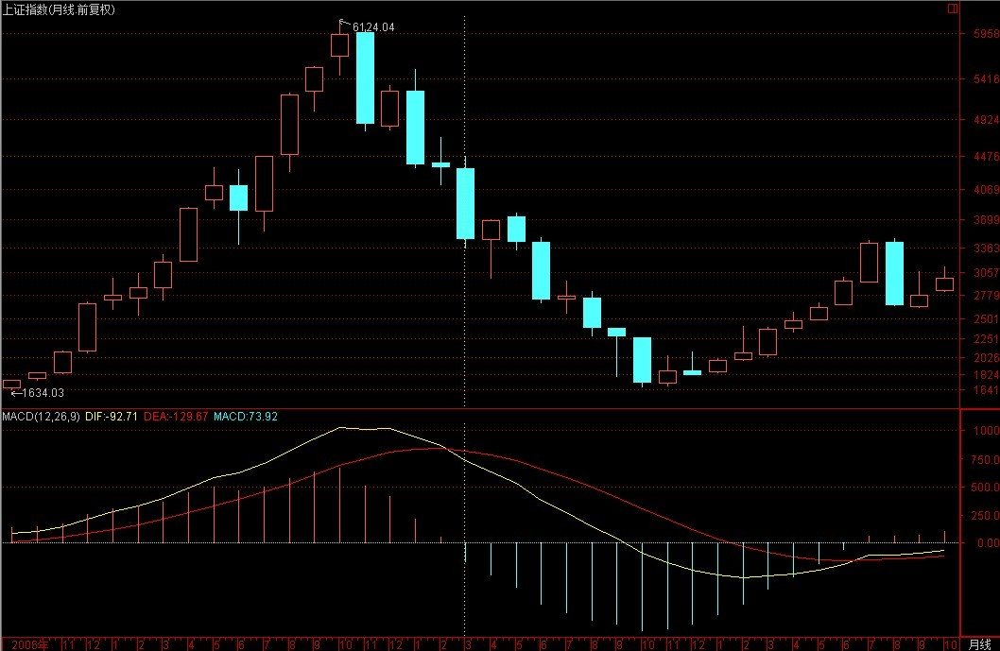

**从最直观的技术上说，下一轮真正的大行情，必须等到月MACD回到0轴附近才有可能展开，期间，都是一些小打小闹的走势。 **

**基本面上，其实也完全支持以上的技术走势分析。由于目前的估值完全是按前两年的高增长为背景的，而且依然达到很高的水平，一旦经济走平，这些高估值就完全没有支持的空间，赢利水平的大幅度下降在可预见的范围内，因此，目前那些所谓绩优股票，都有极大的中长线业绩压力，目前的价格都过度偏高。**

**而且，世界经济的经验告诉我们，大的商品投机潮过后，总会一地鸡毛，而美国经济的问题，远未到解决的时候，这些外部的定时炸弹将随时把经济繁荣的幻想炸裂，而真正的调整压力，在那时才会真正显现。 **

**极有可能，我们将要开始面对一个大的世界经济大调整的困难局面，而我们现在的经济结构，由于丧失了太多做大做强的机会，绝对已经不足以独善其外了。因此，后面的困难可能会超出现在一般人的想象，因为历史的经验告诉我们，真正可怕的调整压力，是经济基础方面产生的，而我们现在极有可能将面临如此的危机。 **

**个股方面，在原展望中已经明确指出，就是题材股，各类题材的反复炒作，将是今后很长时间的主题。而在大的调整市道中，历史经验反复证明，低价题材是永远不败的主题。由于目前的资金量，即使在大的调整中，炒作些低价题材永远是富裕的，所以，只要有投机性资金存在，这就是不死鸟，一有机会就要起飞。 **

**一句话，在今后很长时间内，市场都将是长跑选手的坟墓，短跑选手的天堂。 **

**站在20年的角度，这次的调整，依然是超级大牛市中的一个中继性调整，但20年的前提是，你能熬过这个冬天，否则，20年的超级大牛市，对于你来说，毫无意义。**

**3780点，短线生命线。**

(2008-03-21 15:29:38)

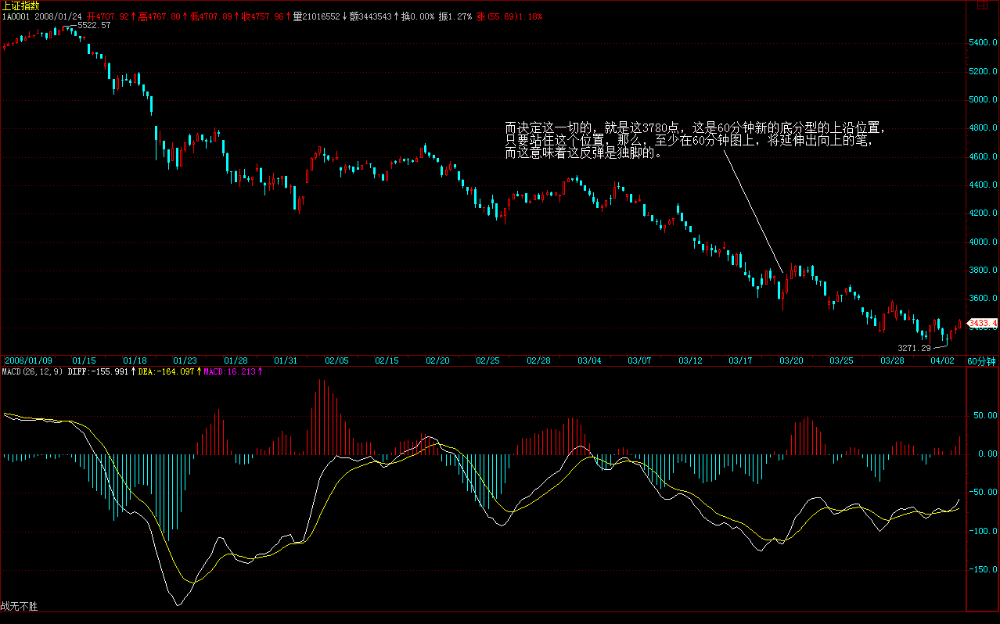

**技术上，30分钟的MACD刚好在0轴上受阻，因此，只要下周初能站住3780点，那么这0轴也就会被突破，从而带动60分钟的向0轴冲击，对应这走势上将往上再上攻一段。 当然，如果站不住3780点，30分钟MACD就会出现0轴受阻再回跌的形态，对应着大盘当然就要再次探底了，所以，从这角度更说明了，3780点的重要性。**

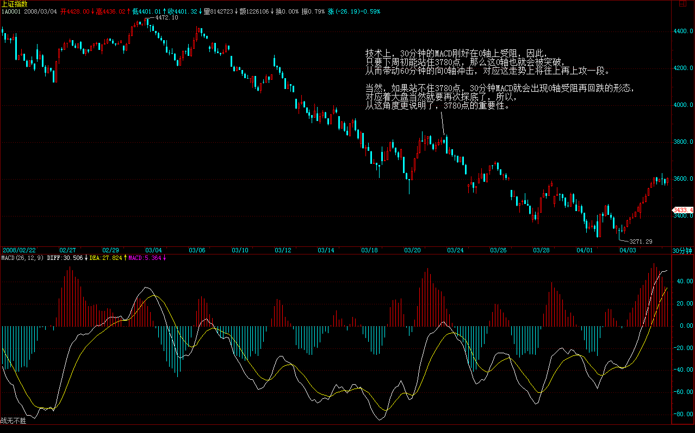

**由于目前的日线上已经出现底分型，而上边沿在3941点，因此那个位置，是决定大盘反弹的级别能否扩展的关键位置，一旦站住那个位置，重新回到原来60分钟3-4的类中枢就不成问题了。**

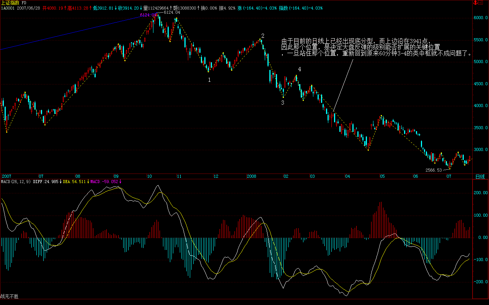

**3780生命线失守再次探底**

(2008-03-24 15:16:13)

**上周五已经超级明确地说了，3780点是短线生命线，站不住就再次探底。今天早上，跌破3780点后两次反抽上不去，确认跌破有效。然后下午2点那标准的第三类卖点成立后，跌幅明显加大。一切都极端技术化。**

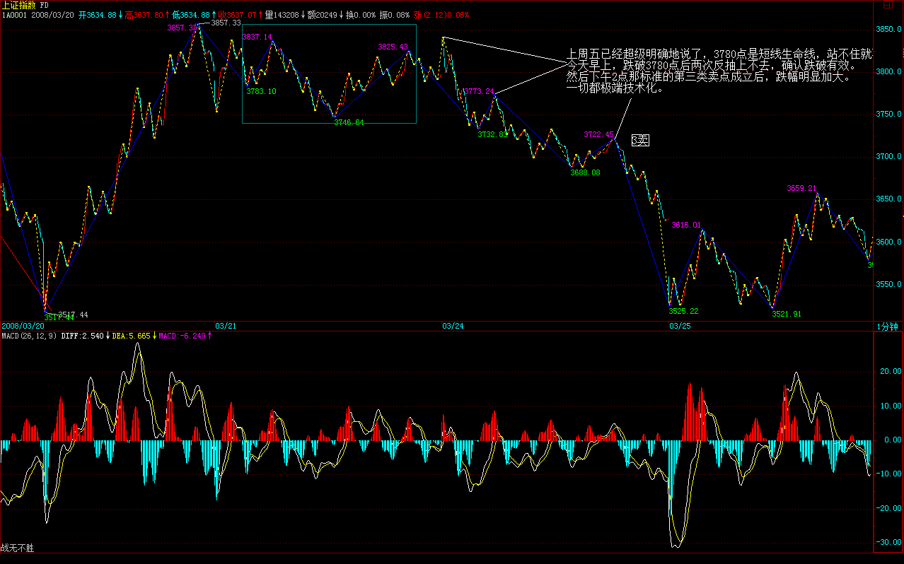

**万事具备只待平安事了**

(2008-03-25 15:09:37)

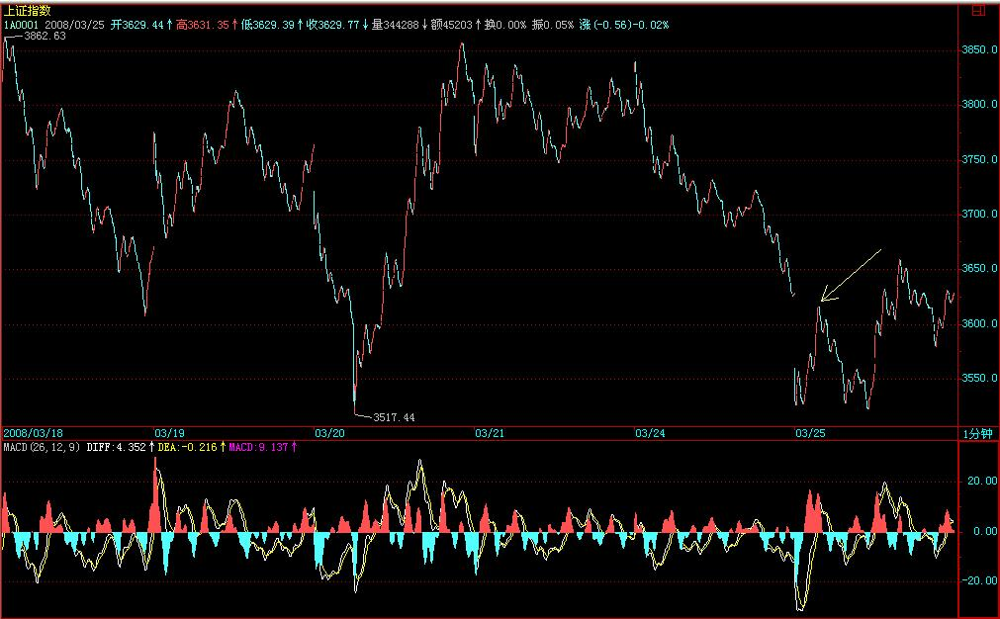

**上面的位置，还是和前面的分析一样，首先要面对的是3780点，这点不有效突破，大盘依然只能在底部徘徊。**（娇注：后底分在前底分范围内，观察前底分的分型上沿能否欲破延续成笔）

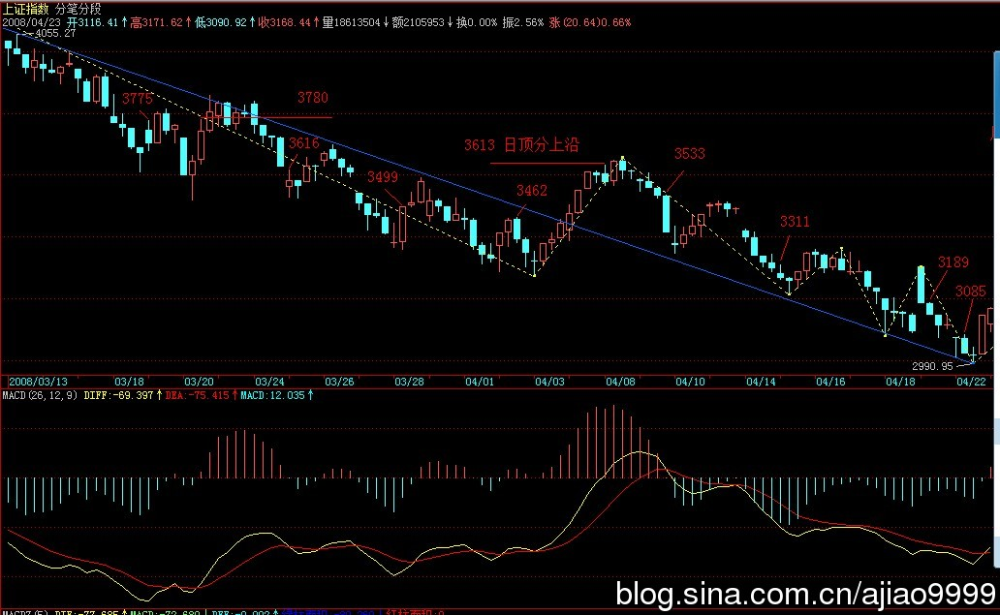

**明天，超短线，最简单就看5分钟的MACD，现在刚好站在0轴，明天如果能从此来起，那么将带动30分钟的MACD再次冲击0轴，对应大盘将有一个向上冲击的过程。如果这种局面出现，一定要注意30分钟MACD是否又在0轴受阻，一旦出现，应当把今天买入的择机退出。**

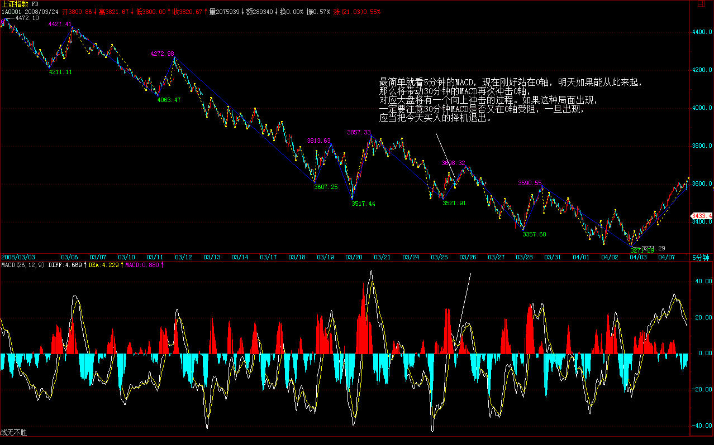

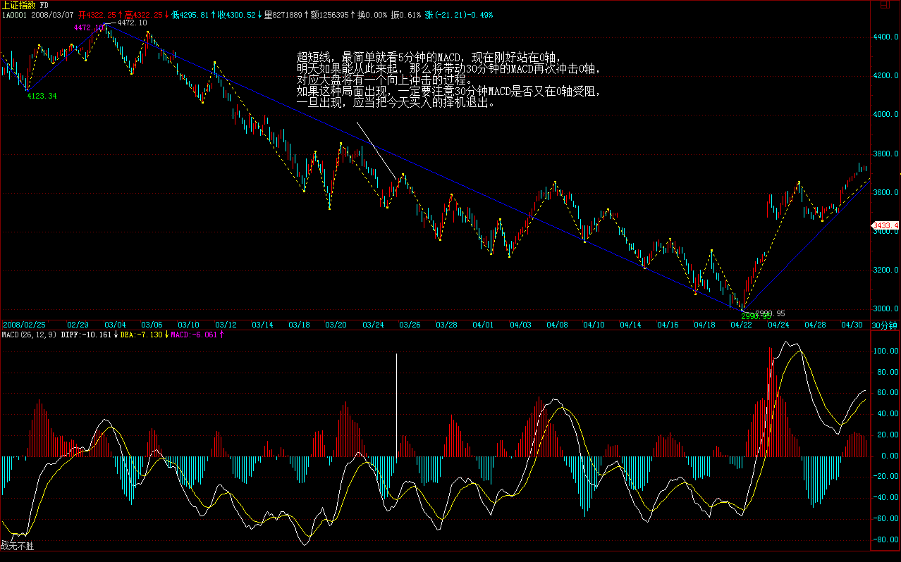

**但对于大资金，应该把适当筹码进行沉淀。大资金必须是成本不断降低而筹码不断增加的动态建仓，这是一个基本的原则。**

**先下，再见。**

**3616点，短线关键。**

(2008-03-26 15:15:26)

转载

**昨天让各位注意5分钟MACD站稳0轴后上攻的情况，结果今天早上走出一个标准的盘整背驰，红柱子小于前面一组，而也只带动了15分钟MACD回拉0轴受阻，因此其后的回落就理所当然了。**

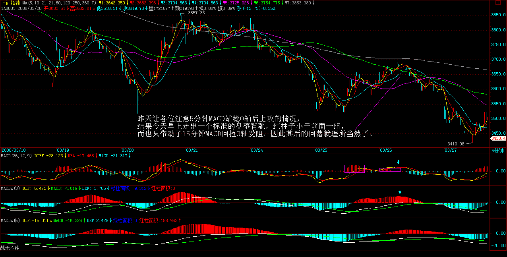

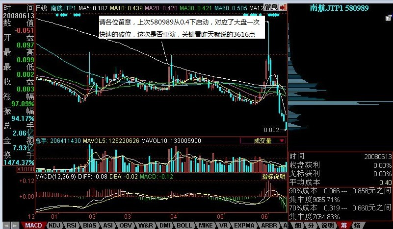
