# 教你炒股票104：几何结构与能量动力结构1

*(2008-03-26 15:47:42)*

**104课**（娇注：回复）

**破发竞赛宣泄市场情绪**

(2008-03-27 15:17:41)

**3424点初显威力**

(2008-03-28 15:12:27)

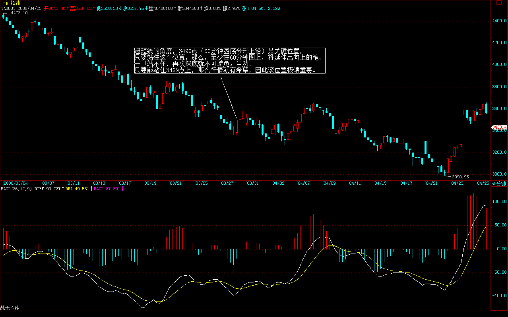

**  **

**超短线可以看下周初，5分钟MACD是否最终演化为红柱子不能再伸长而比前一柱子面积小的情况，对应着15分钟MACD的0轴能否被突破，一旦不行，肯定要回试诸如3499点这样位置的支持。当然，高明的并不需要等3499点真跌破再走。**

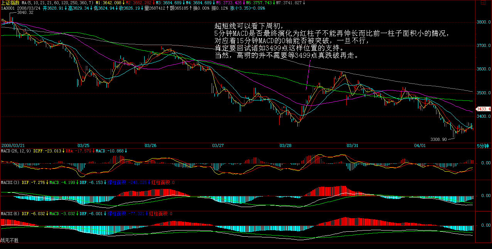

**   **

**对于小资金，原则已经多次说了，就是抓准机会咬一口，一看不能延续就先跑。这次从5522点下来，用这个原则抄了无数次底，都能按技术把钱赚了又先跑出来，就证明，下跌其实没什么大不了的，关键你能折腾，折腾好了，下跌一样是天堂。**

**当然，前面说了，对于大资金，现在折腾时一定要注意沉淀筹码，大资金和小资金不同，小资金1秒钟就可以把仓位建好，大资金可没这本事，因此必须有沉淀筹码的动作。注意，从5522点下来，本ID直到最近才给出大资金需要沉淀筹码的要求，为什么？因此以前离底部还远，所以根本不存在沉淀筹码的问题，而到了目前的位置，就算3424点最终不能底部，下面的也不过是空头陷阱了，对于大资金来说，根本不算什么，所以，现在开始沉淀筹码，完全对头。**

**周末，股票一边歇去。**

**先下，再见。**

**3499点继续决定短线命运**

(2008-03-31 15:16:35)

**在上周都比较兴奋时，本ID已经明确说，一旦传闻不兑现，又是一轮回试。至于给出的3499点，更成为今天震荡的中心，尾盘最终也没站住。**

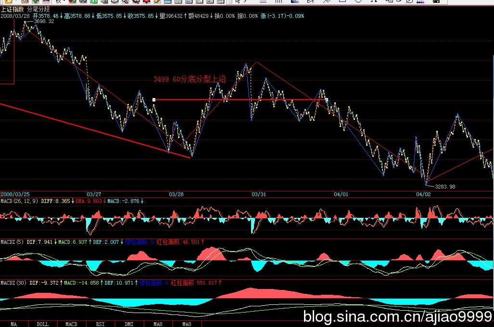

**  **

**由于该位置今天是震荡中心，所以明天如果能站上去，大盘还有点戏，否则，继续探底就不可避免了。底部不是一天成的，今天显然已经比以前类似的情况走得稍好一点，显示已经有一点新资金介入并对此位置有一定的信心，否则，今天将是单边下跌。因此，明天的走势很关键，如果能回拉上去，证明新资金的信心还是比较足。**

**但是，多次说了，现在需要的是干货。没有干货，任何信心都会被磨掉。没有干货，谁说话都是废话，市场能领情吗？废话说多了，只能显示自己的无能，这点，有眼睛的人都看得清楚。**

**其他也没什么可说的，现在就是等待，今天是月线和季线收盘，有兴趣的自己去看看，中线形势有多恶劣。这里不起来，季线上就有极大机会形成向下的笔，这意味着什么，自己想去。**

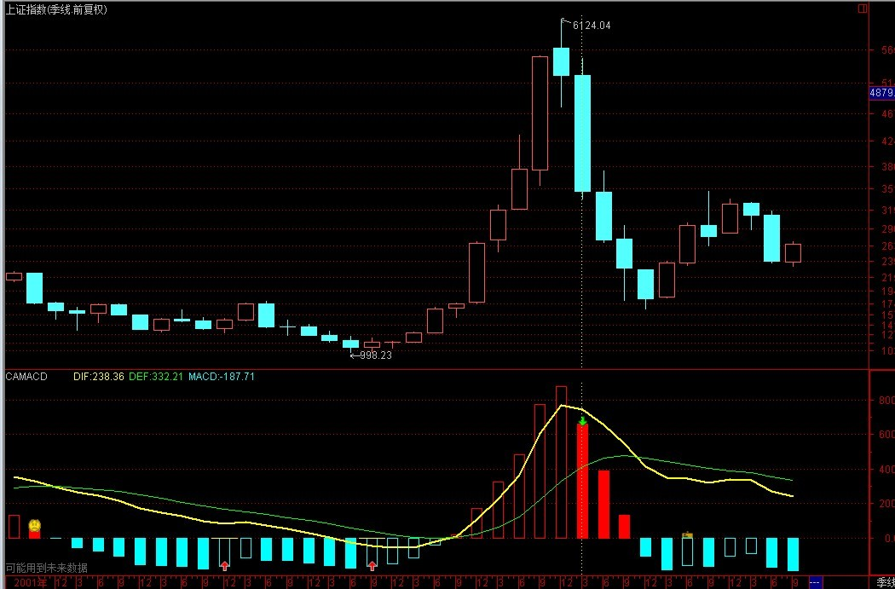

**  **

**现在主管金融的人，其办事风格是十分怪异的，这点，本ID有太多了解了。该来的没来，也只好这样了。**

**天灾不可怕，因此，对非系统性风险，要有时刻的提防。对于散户来说，咬一口就跑，与机会再咬一口，这是最好的策略。**

**先下，再见。**

**下一个短线机会又将来临**

(2008-04-01 15:16:38)

**别让本ID看不起，每次短线，本ID都把最后的走人位说得一清二楚，就象这次的3499，今天早上连续冲了两次不行，就开始大幅度下行，如果你这你都看不明白，还是去孔男人那里吧，你这样的水平在这里只有丢人的份。或者就自知之明一点，在自己额头上写好永不短线，因为自己无能。**

**最鄙视那些自己没本事，又要怀疑别人的人。你没本事短线不代表短线在下跌中就不行，为什么每次本ID都能顺利出来？按本ID最后的位置，如果你没更高的本事，你哪一次不能出来的？**

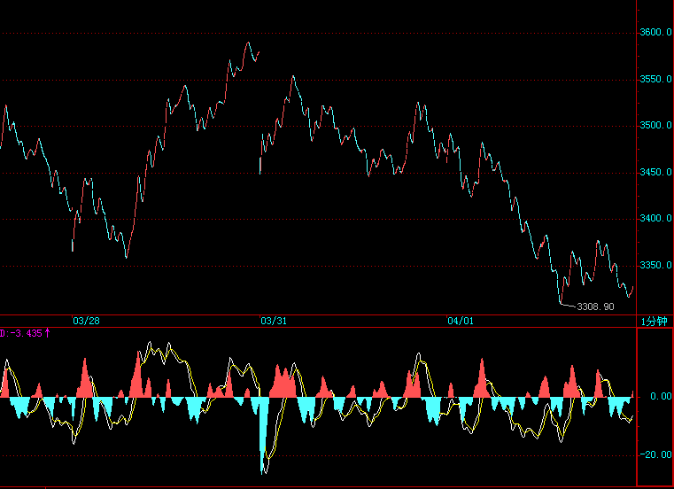

**  **

**现在，有本事的人将要干什么，就是马上迎接新的短线机会。这机会在破底后很快到来。其实，很多股票，回跌10%到20%后，今天尾盘就可以回补，特别资金大的。**

**现在，一个标准的下降通道，到下轨就可以短线，如果破下轨加速，那就要放爆竹了，大的反弹马上就在眼前，这都是最基本的技术常识，有什么难度？**

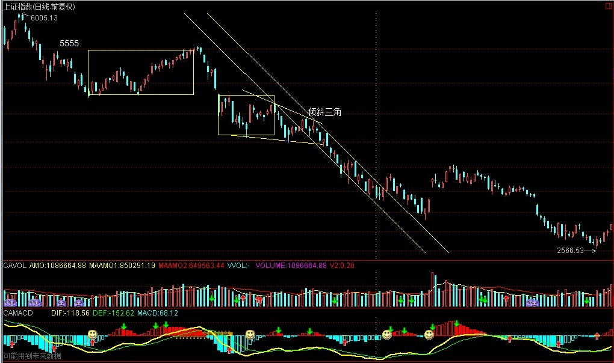

**  **

**那管理层爱干什么干什么，本ID就陪他们玩到2500，1500也无所谓，反正有本事的人钱就越来越多，到时候再大买便宜货，从1990年和他们玩了快20年了，谁怕谁呀。**

**这世界，只能靠自己的本事，哀求别人救你，有可能吗？本ID早说了，绝对不能依靠任何东西，即使那玩意叫政府。这就是本ID从1990年开始的最大经验之一。**

**本ID越来越感觉到，本年度最大的赚钱机会越来越近了，让孔男人哀号去，求政府去，我们开始磨刀霍霍了。**

**先下，再见。**

**现阶段中国资本市场的地位**

(2008-04-01 15:59:39)

**一个成熟的市场经济，其市场中心地位的就是资本市场，资本市场的任何风吹草动，都是国家级的大事。看看，这次次贷危机，美国股市的实际跌幅度一点都不大，连20%都没有。但已经是朝野倾动而出，用进一切的金融、财政、政府等的资源来稳定资本市场。为什么在美国以及西方所有的成熟市场经济国家，资本市场具有如此举足轻重的地位？因为，这是他们经济结构的核心，后面代表着最大多数人的利益。也就是说，这些成熟的市场经济国家，其经济已经进化到如此的境地，绝大多数公民的经济利益都与资本市场密切相关，而经济基础决定上层建筑，自然，没有任何的政府机构敢对资本市场有丝毫的怠慢。**

**而现在，中国的资本市场还远远达不到这样的地位，因为中国的市场经济依然在极为落后的阶段，资本市场可以说暂时只是一种点缀，本质上，在经济结构中还没有任何实质的地位。**

**因为，在中国，目前与资本市场利益相关联的，只是所谓中产阶级以上的阶层人的利益，而目前中国更多数的人，是与资本市场无关的，而他们所代表的是一种与市场经济相对无关的经济结构。而在整体的国家经济利益的取向中，牺牲少数以换取多数，显然是一个最被采纳的选择。**

**因此，例如在现在CPI与GDP的两难抉择中，资本价格的压制又被人错误地认为是压制CPI的好手段，因此，牺牲资本市场就成为最符合这种经济逻辑的选择了。**

**可以断言，在中产阶级以上阶层占据社会人口最大部分之前，这种利益的偏向都无可避免，对此没有明确的认识，不仅会对诸多中国特有的经济现象产生迷糊，也会对自身的操作产生重大影响。**

**其次，按照服务型政府的原则，资本市场的监管机构，本质上是市场的服务者，但现阶段，显然远远达不到如此的要求，否则，例如平安事件，就不会一拖几个月都毫无结果。而对于一个服务型的机构，这是显然的不作为行为，应该受到相应的监督、纠正甚至惩罚的。**

**看清本质，你才能有真正的力量。**

**3462点成短线关键位置**

(2008-04-02 15:17:01)

**今天，如期反弹，然后大幅度震荡。一般这种走势，最好就是进行对冲式操作，或者如昨天本ID所说，昨天尾盘就可以先介入。**

**现在，短线最关键位置在3462点，明白本ID的理论的，都知道在这位置为什么重要。今天下午冲到该位置，站不住，所以就出现大幅度震荡。但尾盘依然有资金再度介入，这样，这次反弹可以再来一次，高位出的下来又可以回补再来一次。**

**但下面，关键还是看3462点，只要再冲不过，那么大盘依然有继续破底的机会。短线就是要来回折腾，一看不行先回来，一看行了，甚至可以打点提前量，例如为了避开T+1，可以在前一天的尾盘。**

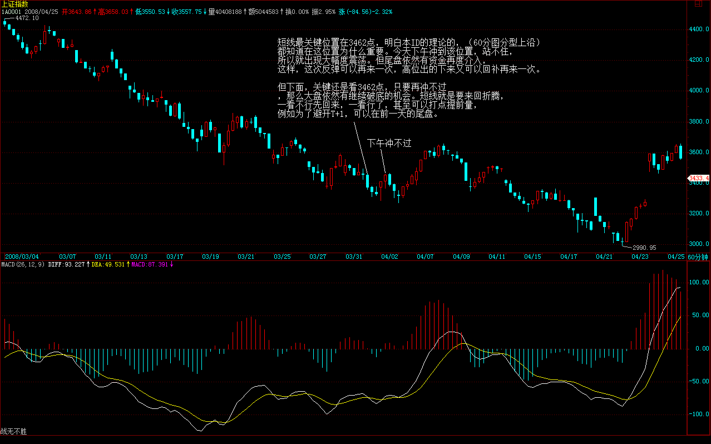

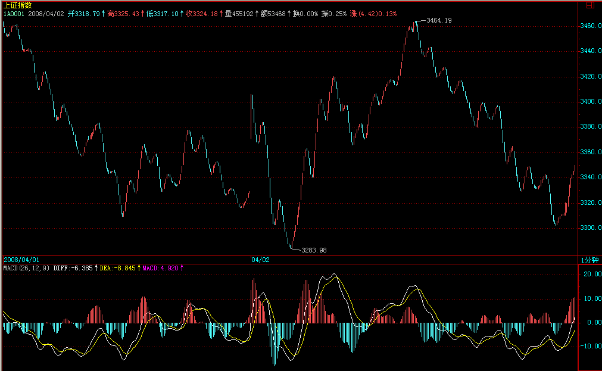

  

**个股方面，金融股已经率先走强，但这走强是否有延续性，是否能向地产、有色等蔓延，是行情能否延续的关键。题材股经过大洗盘，还会重来，但暂时以反弹为主。**

**这几天很难打开，系统好象也不稳定，不多写了，先下，再见。**

**3462点如期发挥神奇作用**

(2008-04-03 15:24:59)

**今天的走势大概出乎很多人的意外，但一定不包括本ID以及昨天看了本ID解盘的人。昨天的解盘很明确地告诉你要再来一次，请问，这一次爽吗？**

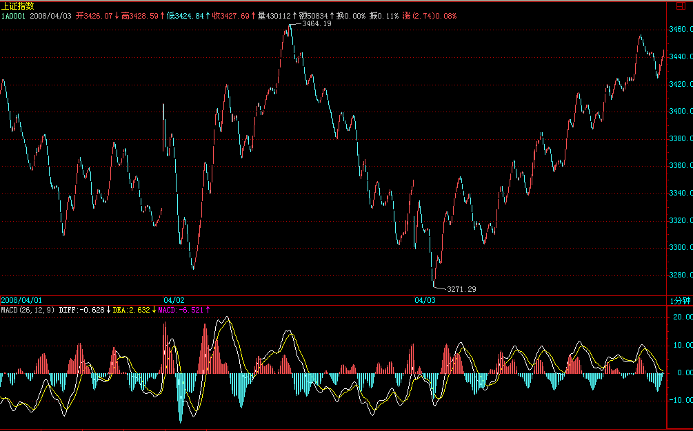

**  **

**昨天，更说了金融向地产或有色等蔓延的问题，今天，那聪明的驴的表现，请问爽了没有？有人昨天说，不是题材股吗？但难道这些云铝中铝不是本ID股票池子里的？50、60跑的，20下买点回来，难道有罪呀？简直病的不轻。**

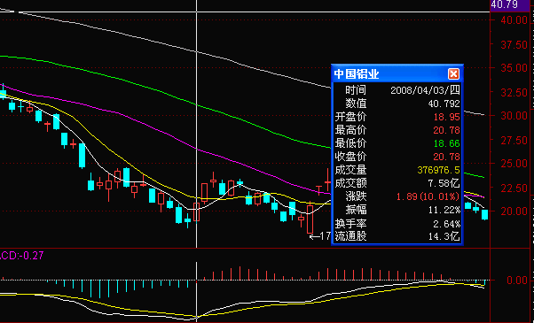

**   **

**兵无常形，如果要走一波本年度最大级别的向上走势，中字头不启动怎么可能完成？题材股当然要继续，但一波完整的行情，就是一、二、三线的轮动次序，这不最简单的道理，有什么可说的？**

**当然，这一切暂时还只是蓝图，因为实际的行情并没有走出来，暂时先当成反弹来干是比较靠谱的，一旦形势不对，反手狠砸，不亦快哉？**

**显然，昨天说的3462点，今天起了明显的作用，大盘最终在该点位前放下步伐。由于今天搏消息的比较多，所以尾盘小跳让人出来也是应该的。**

**下周是很关键的一周，因为日以及周是否能底分型，就看这了。当然，短线这一切，都可以简化为3462点能否有效站住的问题，一旦能站住，这些分型都不成为问题了。**

**个股方面，注意一线股的轮动次序，注意新资金流向。另外，如果周一没消息，注意回杀力度，如果力度不大，反而证明这行情真有戏了。**

**今天的走势图，超级技术化，留一个作业：13点30分到2点这段时间具体什么的技术意义，为什么一站住某位置后，就马上出现大的突破，向上攻击3462点。**

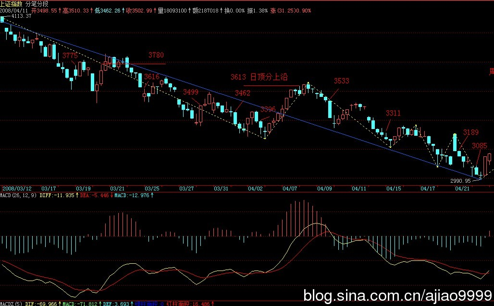

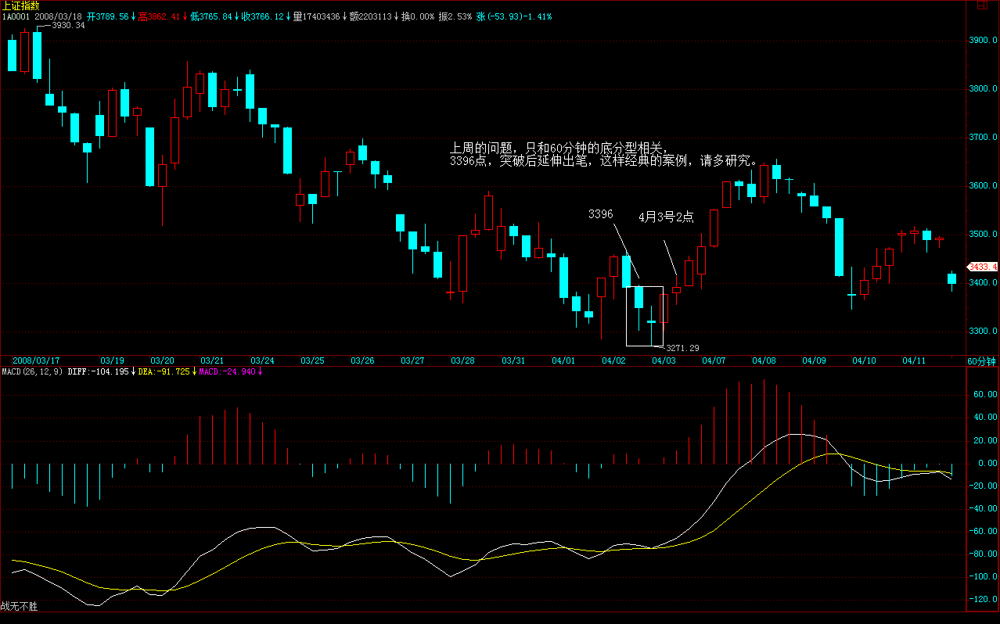

(注：缠师的作业的答案是分型上沿突破，但是趋势线的意义在此图中也很经典，故保留后图） 

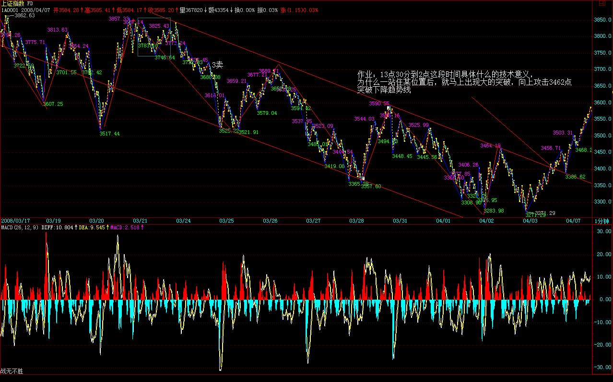

**提前一天收市，简直太美好了，清明时节雨纷纷，水为财。**

**先下，再见。**

**3613点成中短线关键位置**

（娇注：3613，前缺口和日分型上沿）

(2008-04-07 15:21:25)

**大盘今天突破短线关键位置3462点后一马平川，60分钟上N个月来第一次延伸出向上笔走势，显然了大盘的短线强势。**

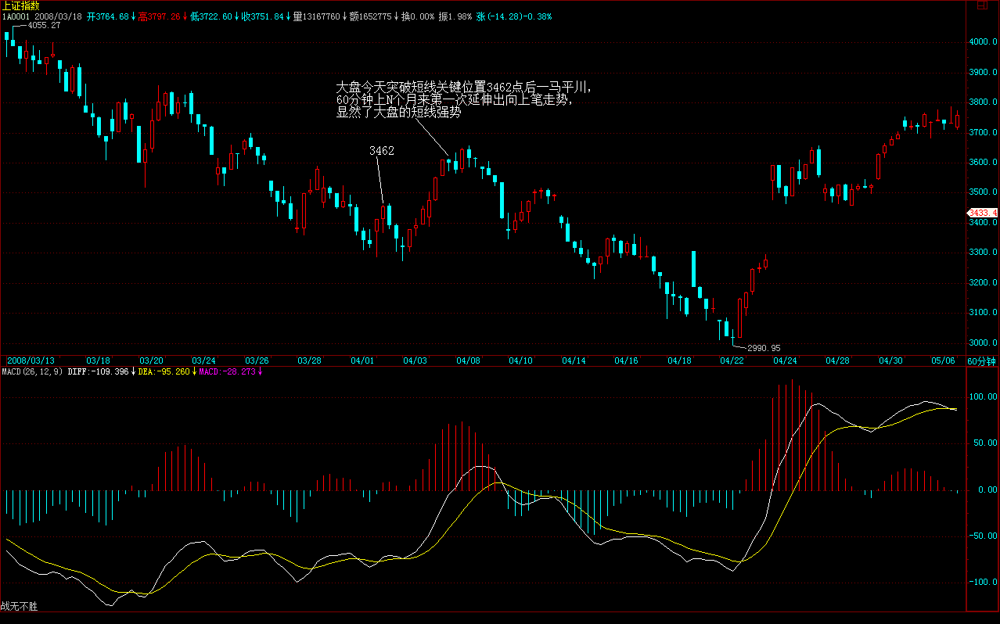

**  **

**周五解盘已经特别指出，如果周末没消息而大盘反应并不过烈，反而证明大盘行情真有戏了，今天的走势恰好证明了这一点。个股方面，中驴为代表的有色继续驴性大发，但要注意，这次启动的板块，都是回弹20-30%左右进入调整，例如地产、金融等，因此，有色能否改变这局面，暂时是有疑问的。**

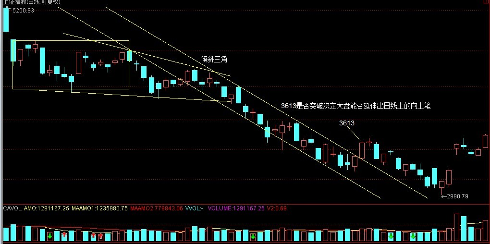

**现在，3613点已经成为中短线关键位置，因为这位置是否突破决定大盘能否延伸出日线上的向上笔，** 

**而今天的走势，由于已经突破3555点，因此，周线上形成底分型的可能性极大，除非在本周内出现再破底。**

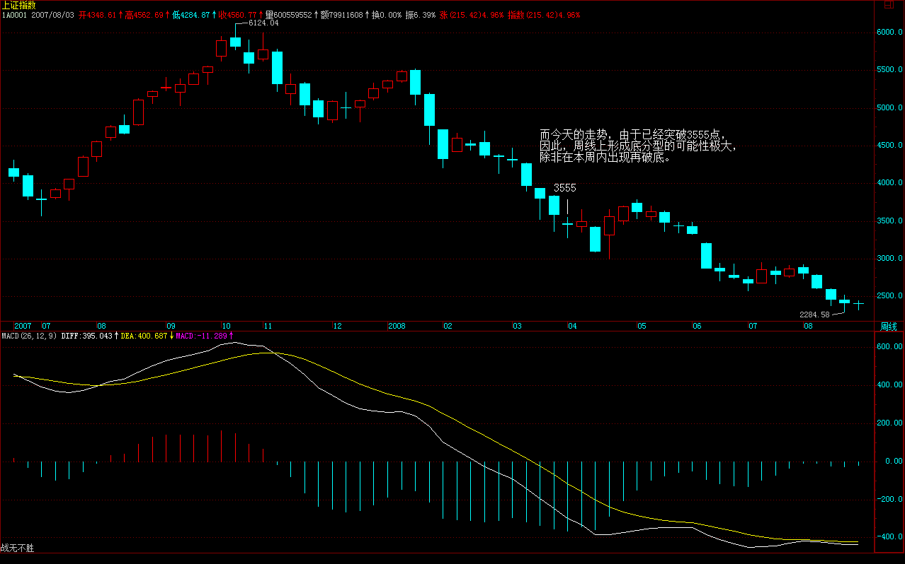

**因此，中线上，我们一直预言的本年度最大行情成立的几率已经越来越大。**

**当然，最安全的作法还见一步走一步，只要3613点攻击不破，就可以先对筹码进入相应调整，以应付后面的震荡走势。**

**虽然本ID一早就明确3424点附近将出现中线底部，但真走出来，我们反而要冷静。不能在操作上留下遗憾。而且，如果真是中线底部，在真正突破之前，洗盘震荡还少不了，所以，一定要按图作业。**

**上周的问题，只和60分钟的底分型相关，3396点，突破后延伸出笔，这样经典的案例，请多研究。**

**先下，再见。**

**中国人，不要习惯性当政府的奴才。**

(2008-04-07 16:05:58)

**几千年来，中国人在政府、衙门面前就从来没抬起过头，即使改朝换代，最终这奴才心理还是改不了。**

**而实质上，政府、衙门是我们的奴才，没有我们，哪里有什么政府、衙门，是我们的血汗供养了这些机构。面对这些机构，任何人都应该腰杆笔直。**

**可惜，实质上，绝大多数的人还是不自觉地、完全集体无意识地当了政府、衙门的奴才，例如，在资本市场上，例如现在还在叫嚣的救市言论。**

**本质上，根本不存在政府衙门那种从上而下施舍性的救市，问题的实质，只是要让这些奴才改正他们的错误，当然，如果奴才不好听，那么，我们就用公仆这个词。**

**没有救市，也无须救市，有的只是纠错。错了就要承认，就要改，就这么简单。**

**可惜，大多数的人的思维都扭了，都在等待所谓的施舍，这样，中国的资本市场、中国的现代化真是遥遥无期了。**

**衙门型的管理机构与服务型的管理机构相比，最大的特点就是行为完全脱离实际，所有的应对措施都严重慢几拍。例如，过去两年，面对快速的上涨，最简单的经济学常识都可以提供最简单有效的应对措施，就是快速加大供给。而供给的加大是要有时效性的，过了那时间，这措施就对不上点了。那么，请看实际上管理机构不仅没有加大供给，反而是提供了流通比例极低的疑似非法蓝筹，这难道不是典型的火上加油吗？**

**衙门型管理机构，甚至可以有这样一种可怕的思维，跌比涨好，跌就是安全，资本市场里的人的行为最好都完全统一到银行存款行为上去，这样就不惹事，不惹事就是最大的好事。正因为这十几年那如此思维的存在，因为中国的资本市场走势都显示出最大的投机性，因为大家都知道上涨的时日无多，一旦有机会就变本加厉地投机，尽量在最短时间内把最大的利润拿到手。**

**正因为管理层与投资者的心态都在这样一种氛围下，所以，那种稳健的长线行情就不可能真正出现，大起大落成为真正的常态。而这时候，还提防止市场大起大落就成为一件很滑稽的事情，成为衙门型管理机构语言的一个标准范本。请问，一年不到，从3400点到6124点又回到3400点还不是大起大落？一个已经是事实的东西，还能或还需要防止什么？**

**我们不希望再有类似的无聊衙门言论，我们也希望我们所有的投资者都要站立起来，知道自己的力量，市场是我们创造的，我们是市场的真正创造者，我们才是市场真正的主人，我们必须要用我们的力量彻底改变这一切。**

**3613点如期发挥神奇作用**

(2008-04-08 15:19:39)

**昨天给了短线的关键位置3613点，今天全天就是围绕着震荡，连收盘就在3612.5就知道，该点确实如期发挥了作用。**

**现在的问题很简单，站得住3613点，就继续上攻，否则就出现一个大的调整。所以，本周就看着该点就可以了。**

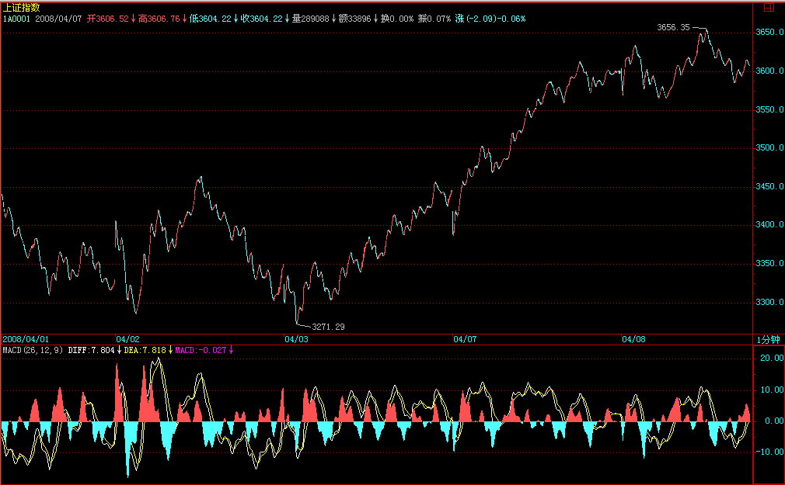

 

**个股方面，板块轮动加速，现在问题的关键是轮动后首先调整的板块能否再次启动，能，那大盘就肯定有戏，否则至少要调整一下。**

**目前，整个次序大致是地产、金融、有色、券商，然后今天是所有几乎大的题材都动了一下，创投、农业、三通、环保等等，因此，后面还是要看金融地产能否再次启动。**

**当然，一些小板块的轮动还会继续，但对于大局，这些都没多大的意义。行情，关键要看大角度。**

**大家应该注意到，本ID最近一直只用给级别的分型来统一进行分析，其实就是想告诉各位，你把一招真学会了，绝大多数的问题都能解决，这就是示范，请把这次整个探底到回升的整个过程好好研究，课程等这个示范以后再写。**

**不想说了，留点精力今晚熬夜看球，先下，再见。**

**3613点威力尽显**

(2008-04-09 15:16:57)

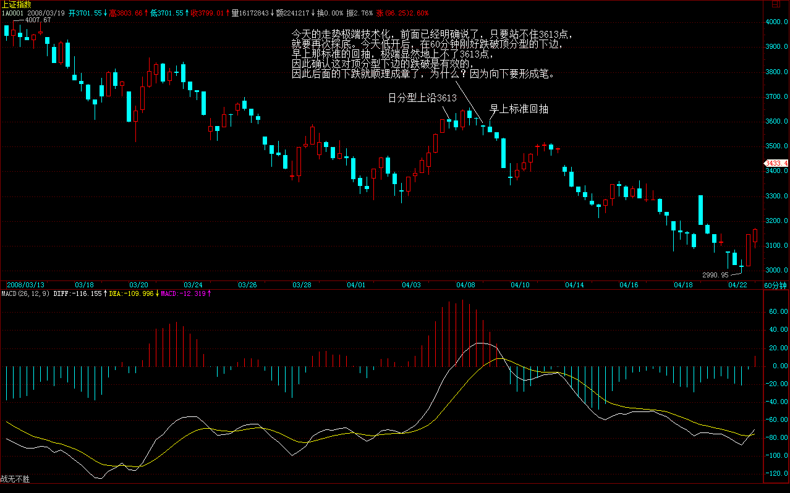

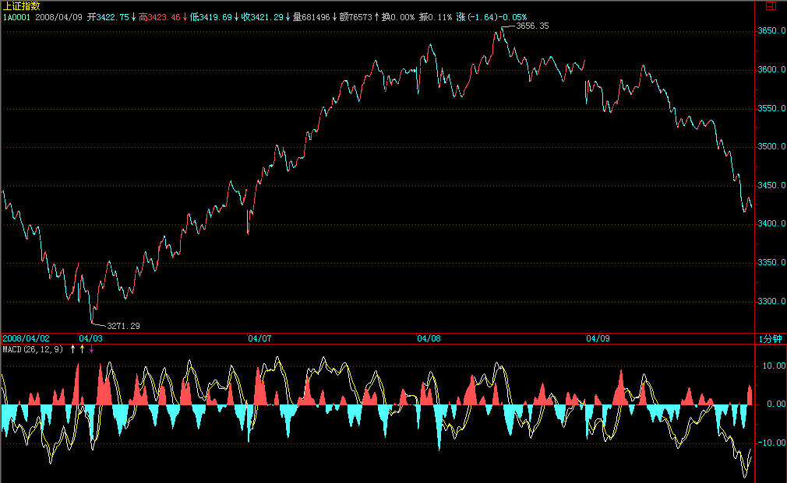

** **

**现在的走势很显然了，向上的笔后形成向下笔的调整，也就力度最大那种调整，因此，后面在向下笔结束前，都不适宜再度介入。但一旦向下笔结束，就又有一次美妙的短差机会。**

**各位，看到没有，就用一个简单的60分钟分型结构是否延伸为笔，我们就能完全把握这样的走势与相应的退出，现在，我们只需要等待新的买点出现，如此简单而已。**

**个股方面，昨天已经明确说了，只要地产不能重新启动，就有问题，今天万科等的走势，一个标准的短线多头陷阱，因此，引发回跌再正常不过了。**

**当然，就算有真行情，也需要大的洗盘，但是否洗盘还是继续下跌，其实根本不重要，我们只关心下一个买点，把走势支解了进行操作，我们不废那个脑子。**

**让脑子有水的人继续争论是否有真的行情，他们负责争论，我们负责挣钱，还有精力的，今晚继续加班看球。**

**先下，再见。**

**3533点成短线关键位置**

(2008-04-10 15:25:06)

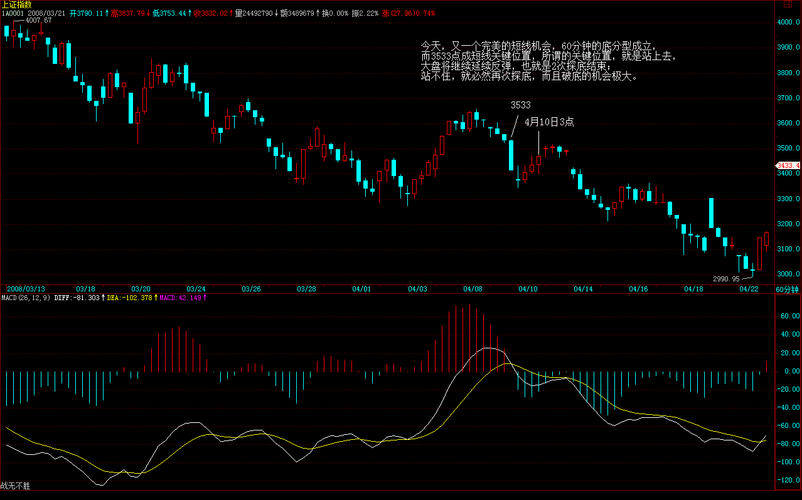

**  **

**今天，煤炭、券商、滨海等甚至创出本次反弹的新高，这是好现象，证明至少有部分资金是勇敢做多了。现在，指数上要有大突破，还是要看金融、地产、有色等，不过先有板块裸奔起来，绝对是好现象。**

**思维要改，今年的行情不会是一条直线的，底部也要震荡个N回才爽的，不明白这点，就痛苦去吧。**

**注意节奏，自然就爽。**

**这破网，按一下，N久才有反应，简直浪费时间，**

**不想写了，先下，再见。**

**周底分型成立令3840点成中线关键**

(2008-04-11 15:10:56)

**本周折腾，最后的结果还是把周底分型给折腾出来了，该分型的上边在3840点，因此，该分型是否最终有效，延伸为向上笔，或者最终失败，只构成中继型，3840点就成了周级别的关键位置了。 **

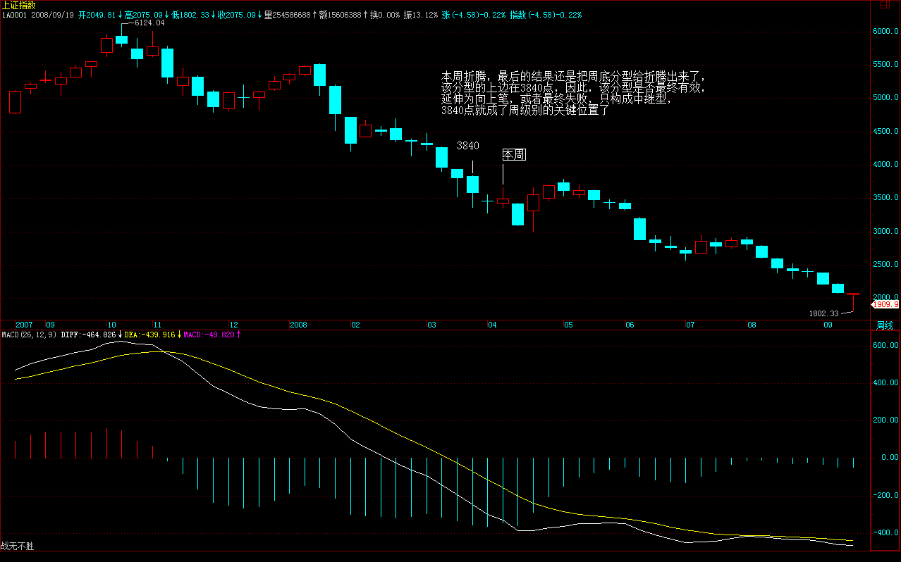

 

**今天，大盘全天在昨天所说的3533点下震荡，显示大盘不强，信心不足，大概是周末的心理压力，因此，下周初，就看这60分钟级别的关键位置能否突破，不行，就再次探底。**

**日线级别的对应位置在3613点，因此，3533、3613、3840，**（娇注：60分，日，周）**给出了一个市场运行的密码，由此，超短、短、中的走势都完全把握了。**

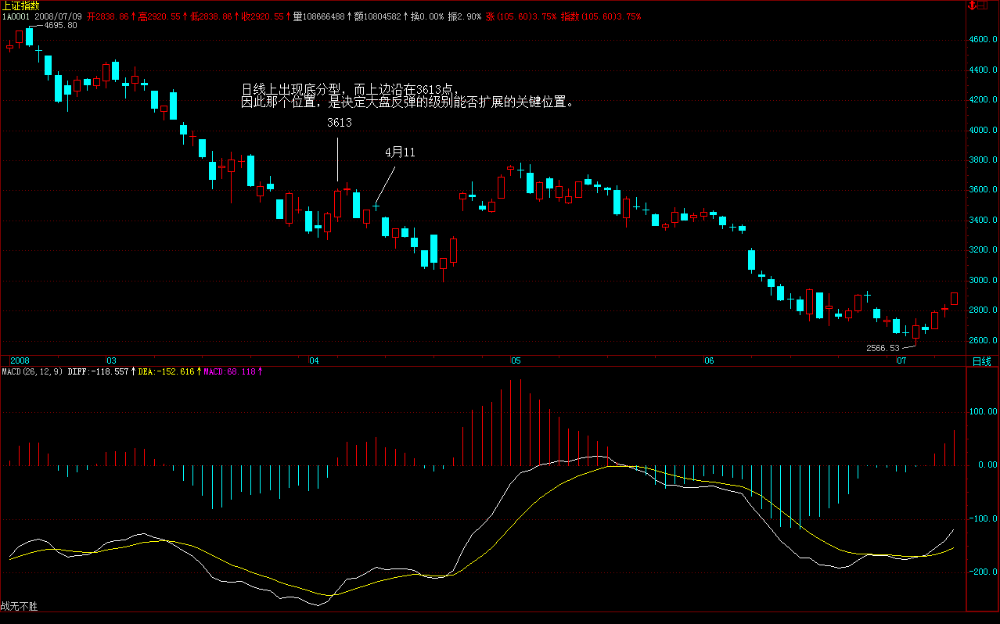

 

**个股方面，板块继续轮动，但力度有所减弱，现在，只要金融、地产等不再次动起来，大盘就不会有大戏。**

**周末，快点远离股票，好好休息，身体第一。**

**先下，再见。**
