# 教你炒股票106：均线、轮动与缠中说禅板块强弱指标

*(2008-07-10 12:12:22)*

**说说股票和咒语**

(2008-07-11 11:46:05)

**先说一句梦话：该修理都会被修理，该被王先生的最终都王先生，当然，时候未到，过了该过的无聊节目，真正的修理才会来的。本ID什么都没说，梦话一段，千万不要当真。**

**下午要去理疗，没时间写帖子，抱歉。**

**确实，如果你脑子里已经有了期盼，那么什么理论都是白费的，因为你甚至可以把刀子的白光看成了情人桥下那一轮月光。昨天中午就出来的帖子，这么多话，当然主要都是针对长期来说的，都是你终身受益的东西，但例子里也顺便给了短线的重要提示，可惜似乎看到的不多，竟然很多人，在今天明明要构成顶分型的时候还谈论轮动，虽然这顶分型最终不一定延伸为笔，但其中的风险是理论性存在的，因此这时候脑子里风险是第一位的，就算有轮动也可能是刀口舔血的勾当。**

**股票不是吃饭，一顿不吃就饿得慌，理论是让你心里不受贪婪恐惧影响，别明明是刀子都跑过去大吃一顿。请好好重温这两段：“从这分类可以看出两点，统计一下，目前被34天线上下压制的股票是最大量的，这就提示我们，34天线对于大盘也是压力很大的，由于大盘还没到该线，因此这提示就有预示的意义了。”**

**“此外，由于每类股票一旦在N类调整，要到N+1类，至少有很大一段时间折腾，所以这就给了一个轮动的最好选择，一旦一个趋势级别的走势在N类上出现顶背弛，就可以先出来一下，至少有几天偷欢的时间可以去找找别的已经调整可以再启动的股票或者补涨的。”**

**例如在昨天下午，一个品种出现短线顶背驰又接近压力线(娇：34线和周分型上沿2945），应该干什么？如果这品种恰好是大盘指数，应该干什么？注意，帖子可是中午就给出了，这是一个很好的现场例子，不管你如何了，但一定要记住这个例子。**

**今天，除非下午大幅度起来形成包含关系，否则这顶分型就构成了，因此最关键就是5日线，不有效破就不形成笔，就会再冲一次34天线，否则将形成笔的调整，那就等笔对应的短线出现底背驰再说了。**

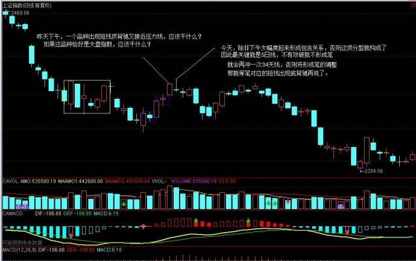

 

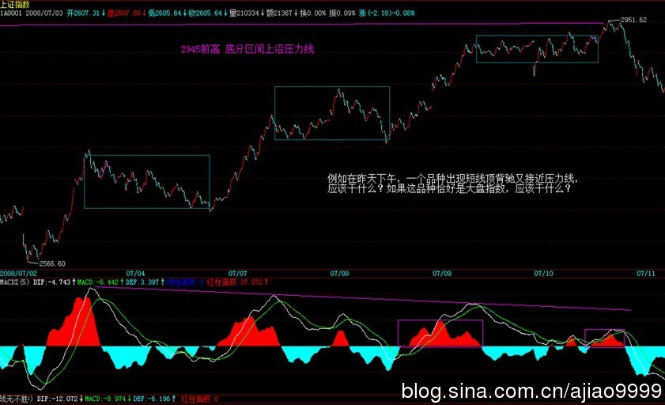

 

**昨天下午正确操作，现在就不用左右为难，左右为难的操作都是因为节奏不对，因此，节奏是一个永远的主题，高手还是低手，最终考验的就是节奏，轮动只是节奏的一种方式，而最重要的节奏，还是买卖点，一切的节奏都必须以此为基础，当然轮动也不例外。**

(2008-08-04 15:26:00)

**本不想说股市，因为确实没什么可讲的，但这时候发帖子不说两句，好象也不好。不过，说了也白说，例如，周末本ID把之定义为搏消息，结果就很多人不乐意，你说能让本ID说什么好？**

**大家如果想听好话，本ID这里没有，对不起了。本ID唯一知道的事情是，无论什么理由，别说那无聊的什么运，就是天王老子下凡，走势如果不体现出底部，就没有底部。每个人都企望来一下所谓的奥运行情，然后胜利大逃亡，都这样想，谁埋单？那些说奥运要到8000点的，现在死了多少了？**

**真正的钢铁战士，只看走势本身，一切都在其中反应，如果连这都遵守不了，就别学什么理论了，买把扫帚去证什么会门口无间道去吧。**

**本ID也不想再说本ID理论那些高深的道理，就用最简单的均线，5日线都上不去，能有行情？还有，现在最明确的技术提示就是MACD准备0轴破还是不破、破了是否假破这类老哈姆雷特问题，要看清楚行情，只要搞明白这问题就可以，在这没决断之前，你急什么？**

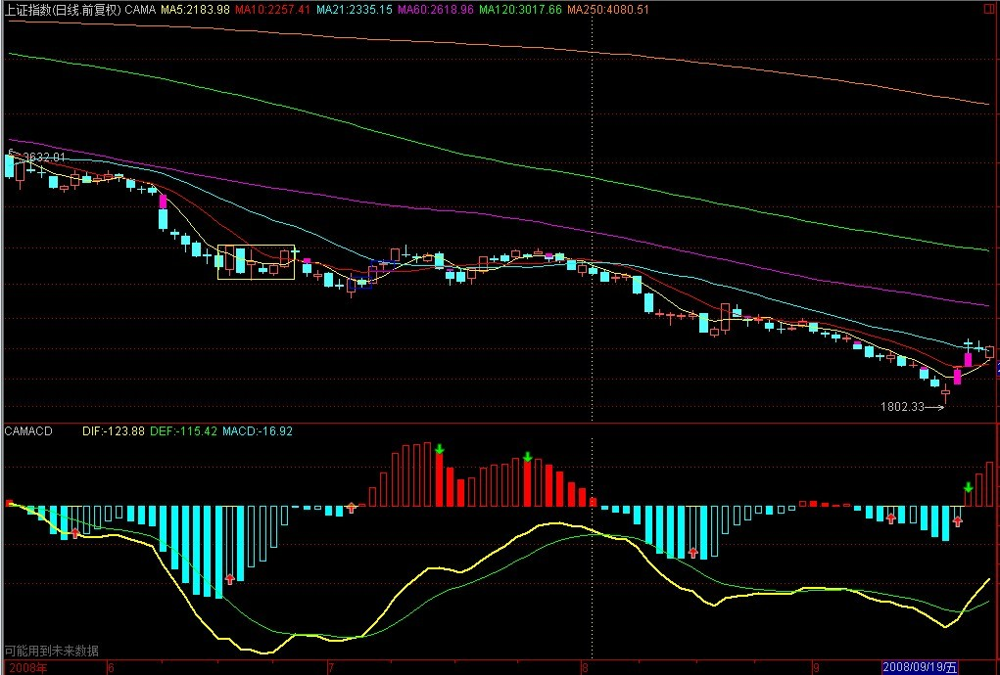

 

**本ID不想培养懒人，MACD的用法说过多次，自己去判别，真明白的，现在一看就知道该怎么安排后面的操作，做不到就学习。**

**打针得一律，记录下来。**

**短线关键2762点（附诗人画廊**（娇注：七)：孟郊）

(2008-08-06 15:38:08)

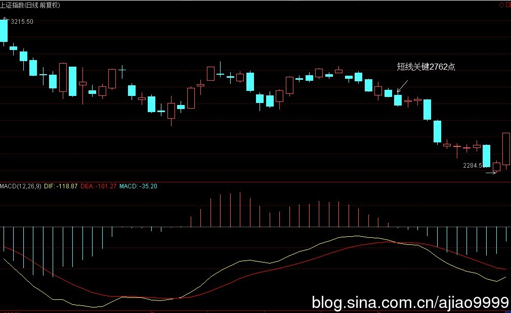

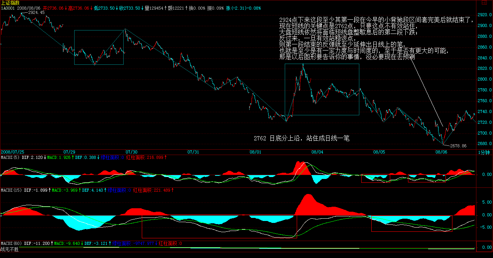

  

**大的角度看，目前依然在7月3日后形成的大中枢中，因此，目前的波动都可以看成是对该中枢的震荡，只要不形成对该中枢的第三类买卖点，该震荡就将一直延续。这一点是本ID理论的最基本常识，就不多说了。至于中枢震荡如何操作，课程了反复说了N遍，就更不再罗嗦了。**

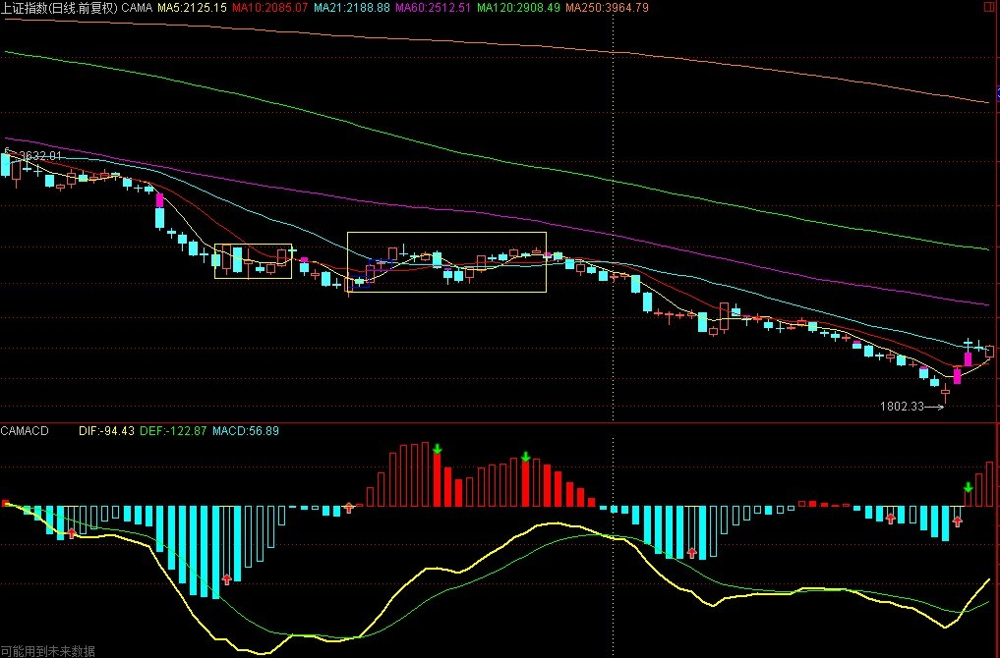

 

**打针时候骚扰了一下孟东野，就有了下面的七律，附录如下吧：**

**先下，再见。**

**2762点，大盘短线已到临界点**

(2008-08-08 08:23:58)

**昨天，一个包含性K线，构造出短线的第二类买点后回拉到5日线附近，大盘短线已到临界点。当然，最干脆的走势就是今天中长阳突破2762点确认笔走势，而反过来，若大盘依然在2762点下犹疑，那最晚下周初，大盘中继中枢扩展完成后向下延续新一段跌势就理所当然了。所以，今天开始三天内的走势是短线必须密切关注的。**

**中线来说，已经三次探底，一般性地，即使从概率的角度，如果还有第四次的探底，那破底的概率至少是95%。所以，这基本就是多头的最后一次努力了，就看如何收场了。**

**操作上，见买点就可以介入，冲不上去就把货倒给多头让多头去死，这就是目前唯一正确的操作。而没这短线本事的，或者就把持仓位每天继续折腾差价降低成本，或者就继续小板凳，自己根据能力选择吧。**

**本ID现在早对那些什么会审美大疲劳，快点完、别惹事就谢天谢地了。如果一定要让本ID说真话，那就让为资本全球化画眉贴金的末世大铺张见鬼去吧！中华民族的大复兴无须这种恶心的堕落背书！**

**先下，再见。**

**苦口良药，预演后奥运断崖走势**

(2008-08-08 15:20:58)

**今早，有人企图用为什么深成指四次探底就破底而上海没破之类的烂问题刁难本ID，不知道今天的走势算不算一个回答？本ID也想问，为什么你就不会完成以下的填空：“既然深成指都已破罐破摔，那么 还远吗？”**

**什么叫断崖走势？这几天本ID的长篇文章不断提到这个词，大白话就是破罐破摔，信心一致崩了那还有什么不可以摔的？本ID早上说冲不上去就把货倒给多头让多头去死，有人反问为什么要多头死？多头不死，哪里有大底？问题是，你为什么要站在死多头一边呢，世界如此宽广，你为什么要陪多头死呢？**

**多头是什么货色，请看：**

**你别砸盘，不然对你身体不利！（2008-08-08 14:21:32)**

**拜托，先照顾好自己吧，本ID的健康就不劳烦了。**

**苦口良药，什么会都养不起13亿中国人，今天不过是一个预演而已。如果真为中国、中国人好，那么就吸取教训吧，股市不算什么，经济断崖才是真正可怕的，过了今晚，面子也有了，干点实质的事吧，中国13亿人要吃饭的，一天都少不了，一顿都少不了，像今天中午那些饭还是少吃点吧。**

**为对抗经济断崖而努力，这是2008年8月8日唯一需要的口号。一个刘某、张某某、赵某某都大肆招摇的玩意，爱啥是啥吧。**

**密切关注买点出现**

(2008-08-11 07:54:18)

**2762点下的三角反弹构成2924点下来的第一个中枢，然后是新一段的下跌，那么，后面的演化无非两种：两段力度对比**（娇注：30或60分钟）**，后一段强于前一段，则还需要一个中枢后的下跌背驰才有机会完成2924点开始的下跌；反之，则2924点下来只是盘整走势，只需要一个中枢，其后将快速回到2679点之上。**

**大的角度，目前7月3日开始的中枢震荡暂时还没出现第三类卖点，依然可以看成是该中枢震荡的延续，除非2924点开始的向下次级别走势类型完成后，其后的次级别反弹不能重回该中枢，才能确认中枢的彻底破坏。**

**因此，综上所述，目前最大的短线机会，就是2924点下来的走势类型结束点构成的买点，其后至少有一个2924点下来同一级别的反弹。密切关注短线买点，就是本周最大的任务。**

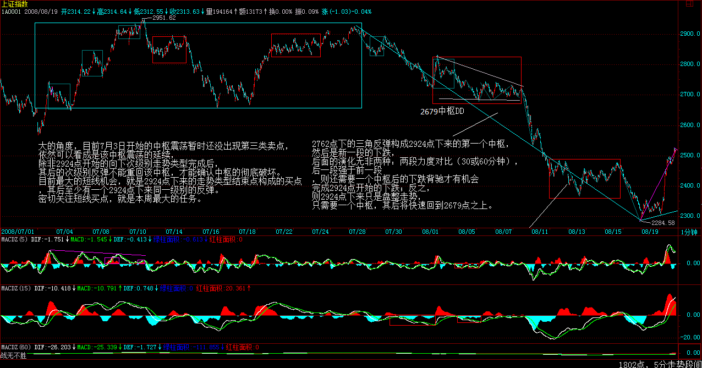

      

**看不明白上面所说的，也有两种途径：一、张某某去吧；二、虚心把课程真正读明白。**

**本ID可以自豪地宣告，本ID的所有财富都是靠自己的智慧从毁既得利益者手中抢来的，要击毁他们，就是要把他们的血吸光，资本市场是一个最公平的地方，关键你是否有如此的智慧。**

**没有智慧，就等着陪葬，这有什么可说的？当然，自我有清楚认识，危险之下坚持小板凳，也是智慧之一。自知之明，从来都是最大的智慧。没能力，练能力，没人可以替你。**

**先下，再见。**

**断崖走势继续让短线买点逼近**

(2008-08-11 15:07:35)

**今早已经让各位看30或60分钟图判断力度，从那60分钟不断伸长的绿柱子，只要是人，都知道下跌的动能依然强大，因此，早上说的第一种情况成立的可能性越来越演化为必然性了。**

**最坏的情况，本周只有2700点那中枢破位后的第二中枢反弹一般来说，这走势明天、最晚后天盘中就出现）**（娇注：1分中枢）**，这反弹的力度，甚至不能触及今天的高点，然后再继续暴跌；而第二中枢后，一旦出现背驰，就意味着更高一级别的买点出现，这买点，最小是2924点下来第二中枢级别，**（娇注：1分走势）**至少能构成30分钟上的笔走势。**（娇注：最坏的情况下，最迟下周初就一定出现，一般情况下，如果不是最坏，本周出现的概率很大。）

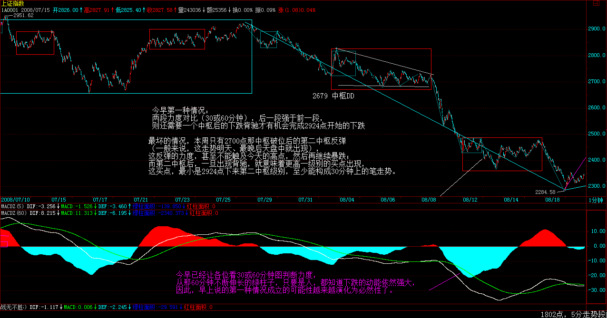

 

**但这个反弹的出现，如果只是2924点下来的第二中枢级别，那么后面还有下跌去构成背驰完成2924点以来的下跌走势，其后的更大级别就是所谓7月以来大中枢的次级别反弹将是最为重要的，**（娇注：30分中枢的5分级别反弹）**是否构成第三类卖点，就看这次了，一旦构成该卖点，后面还有更断崖的下跌。**（娇注：注:实际走势为此类30分中枢3卖点后断崖下跌）

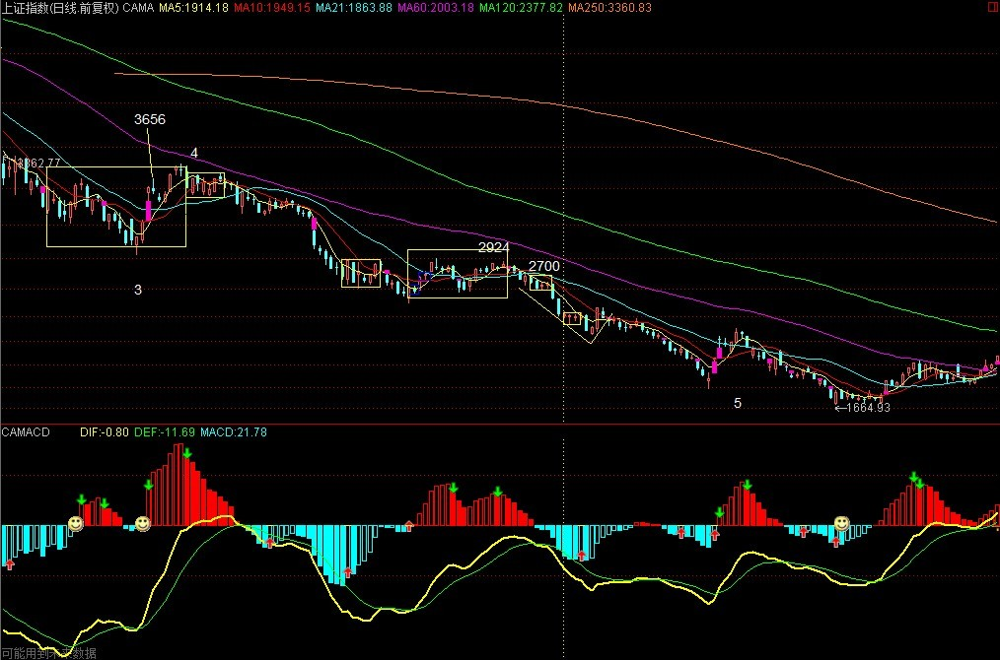

 

**时间上看，要不出现这种第三类卖点，就看政策是否明白事了，如果还幻想，还开幕式，那就如那无聊变态的烟花一样眼花吧，让断脚断腿漫天飞舞，这比烟花好看。**

**如果要严格分析，本次上海也是典型的四次破底，只是第二底比6月20那第一个要低，这是弱式盘整经常会碰到的。关于盘整形态的问题，以后在课程里再详细说。**

**股市开幕式地预演着断崖，本ID前段时间反复说的断崖是否蔓延到经济领域，就看某些人的表演了，有本事就如同开幕式那天发1000多支火箭来做假天气，本ID很想开开眼，拜托了。**

**经济基本面给了调控下台阶的机会**

(2008-08-12 15:21:43)

**大盘今天走得极为规范，如期出现昨天说的盘中反弹以构成2700点那中枢破位后的第二中枢反弹，后面请注意了，这里严格说将有两种演化可能：**

**一、最规范的就是破该中枢，然后再分两种可能，形成背驰见更大级别底形成更大级别反弹，不形成背驰就继续下跌去形成第三中枢，一般来说，后一种情况出现的概率不会超过10%，而且是否形成背驰，可以很直观地判断，根本没有模糊混淆的可能，除非你根本没搞清楚背驰的判断。**

**二、不大规范地的，就是直接从该中枢第三类买点扩展成更大级别的反弹。这等于标准的下跌走势a+A+b+B+c中的c不出现，读过课程的都知道，只要有A和B，a、c不出现不改变下跌的性质，趋势与盘整在于中枢数量，这是最基本的常识。**

**同样地，第二种情况的概率也不超过10%，按中枢震荡的判别原则，第三类买点与第三类卖点都分辨不清楚，那就根本没看明白课程，补课是唯一选择。**

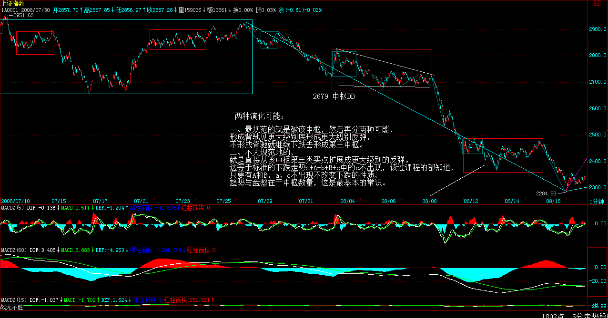

  

**看明白上面的内容，后面的操作就得心应手了。当然，具体个股与指数的节奏可能不同，这也是最基本的常识，那就各自去分析了，本ID不可能把个股也分析了，没那时间。**

**今天CPI有比较好的数据，油价、汇率都有了有利的变化，这也为某些人准备了台阶，下不下就是他们的事了，不下，市场是不会给面子的。所以，从基本面上看，短线反弹是有了些条件了，但中线的关键还是要低头、下台阶，否则给脸不要脸，只能撕破脸了。**

**不说了，看着办吧。**

**确保经济高增长已刻不容缓**

(2008-08-13 08:28:09)

**春节后写了要通胀还是要经济增长** **(2008-02-28 15:53:15) ，当时就很尖锐地指出高通涨低增长死局的潜在可能与危害性，在错过了诸多有利时机后，很不幸地，现在这种风险正日益迫近。现在，已经别无选择，当时已经给出了当下最现实的模式，高增长高通涨，然后在此基础上逐步利用有利时机改变经济结构与利益分配机制，使得结构性通涨的压力消解。无论如何，确保经济高增长已刻不容缓，不想死得很难看，这是唯一实际的选择了。**

**最近，对经济增长的再次强调逐渐有了较大的声音，这是好事情，但其中依然有诸多的摇摆，这是十分糟糕的，机会不会无条件地等你觉悟，因为迟疑，多少机会浪费了，而这会有什么报应，难道真想见识吗？**

**对于像本ID这类人，经济断崖不过提供一次大量买入超廉价资产以提供下次济热潮的筹码而已，但对于绝大多数的国人，那可能面对的就是生存问题了，这不是危言耸听，而是经济变动极可能出现的状况，大难几乎都在兴高采烈之时，这难道还少见？**

**本ID很希望自己错了，但无数的事实证明，本ID对经济的判断从来没错过，只不过本ID都很早就提醒，而绝大多数人却依然沉浸在梦里，难道一定要经济大地震才醒来？**

**股市方面，对于超短线，看好30、60分钟形成底分型后上边沿的位置是否能有效站住，一旦站不住，超短线依然要继续下探。这一简单的招数，用在日线上曾经让多少次短线操作最终能胜利大逃亡，这在以前屡次反弹中，本ID用短线关键位置是多少曾演示过多次，一定要把握好。当然，如果你对本ID的理论有很深入的认识，有更精确的方法，但对一般性的操作，这招数简单又有效率，不把握就浪费了。**

**这两天准备出院，诸多事情，明天开始就不可能一天两帖了，抱歉。**

**第二级别反弹教科书般降临**

(2008-08-13 15:23:14)

**今天的走势，前面都描述过了，没什么可说的，这极为标准地构成了前面所说那三级别反弹中的第二个，也就是构成2924点下来的第二中枢那一个。今早特别强调了底分型的用法，今天的走势教科书一样，各位如果还闹不明白的，就从15、30、60一直看过来，研究去吧。**

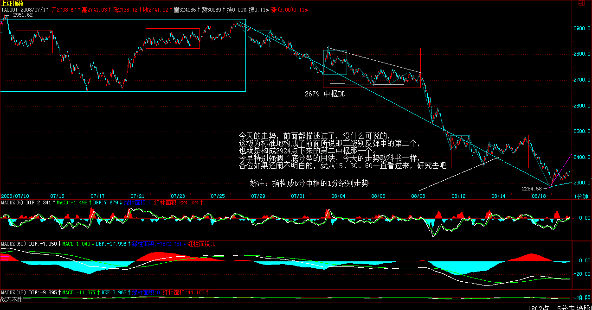

**最大那个反弹，也就是前面大中枢的次级别反抽，同样有两种可能：更大底背驰或从今天构成的中枢直接上去，分析和昨天说的那小级别的道理是一样的。**

**从大盘的实际走势，显然并不是最恐怖那种，本周已经出现第二级别的反弹，因此就是一般性走势，后面的操作无非是从这第二级别反弹成功逃掉然后再抄更大级别也就是第三级别那个底，如果你真有本事，这三级别的反弹你完全可以根据本ID的理论按照如此美妙的节奏自如地完成，现在达不到，就继续训练，没有什么东西是可以随意达到的。**

**至于经济，某些人爱干什么是什么，只要你有本事，越跌越赚钱，既然有人这么乐意送钱给咱们花，为什么要拒绝？**

**有时候，让大浪自然去淘沙，可能更有意义，浪淘尽千古风流人物，现在又有谁是千古风流人物呢？这和你的官位、财富无关，某些人有点自知之明吧！**

**最后说句狠话，之所以有人敢于如此，就是没人需要为经济出大问题负责任，因此就占着什么不什么了，那就随它去吧！**

**106课缠师的解盘及回帖什么才是真正的“和”？**

(2008-08-14 08:03:14)

**学东西，必须搞清楚细节。就像现在，依然有N多人把分型上边沿站稳作为最好的买入点，却搞不清楚，恰好相反，这只不过是判断是否延伸为笔的一个简单判断法，如果说买点，必须从走势类型去判别，分型上下边沿之类的东西，最多就类似于第三买卖点，因此以这当成买卖的根据，将不时面临买后第二根K线就是转折的尴尬。道理很简单，如果抛去包含关系，6根K线就可以构成笔，而确认站稳上下边沿的那至少是第4根，而转折在第5根，这意味着什么，不是很简单的问题吗？**

**因此，各种方法，必须知道其使用范围，在什么情况下如何用是最有效率的，否则如此囫囵吞枣，不亏钱真是没天理了。课程里也有单纯用分型的不同级别，用类似区间套的方法确定买卖点的方法，这可不是单纯的上下边沿判别，千万别搞糊涂了。**

**股票糊涂了，大不了就亏点钱，如果一些基本概念糊涂了，又当成国家的战略依据，那真是国将不国了。像最近被反复口淫的“和”，被解释成所谓的“和谐”之类的可笑玩意，甚至为所谓的“和平崛起”去依据，简直是祸国殃民。**

**“和”，是相应的意思，这在最基本的《说文解字》就有的意思，最后被阉割成“和谐”之类的废柴，大概也成了宋以后被长期凌辱的最好注释了。**

**何谓“相应”？就是根据当下实际的条件，给出的最适宜的行为，简单地说，就是构成“相互应和”。最简单的，对垃圾、衣冠禽兽就要彻底清扫，而不是去“和谐”，这才是相应；世界历史证明，“大国崛起”从来就没有“和平”的，当然，现在可能可以进化成经济、金融的战争，但这更不“和平”，所谓的“和平崛起”，真是不知所谓，可笑之极。**

**你只要想“崛起”，就有人不让你“和平”，从各方面折腾你，这是最基本的常识和世态，企图掩盖，究竟想蒙谁呢？美国之类的会让你的口号忽悠吗？最终害的不过就是自己而已。**

**要“崛起”，其“和”其相应就是斗争，斗争不一定都是大规模的对抗，斗争本来就是一门艺术，只是你是否把握而已，这点与把“和”折腾成口淫版的张某某之类人，根本没什么可谈的，就让他们继续口淫快乐吧，但这皇帝新衣必须指出来，让更多国人知道，这群人是如何光着腚子相互淫乱以让他们的利益继续既得的。**

**至于股票，该说的都说了，自己修炼吧。今天下午没帖子，可能要等明天或后天早上才有了，抱歉。**

**2484点，短线关键位置。**

(2008-08-15 15:27:47)

**昨天日包含关系，今天构成日底分型，2484点成短线关键，道理说过N遍，不再说了。下周初如果不能站住该点，大盘不可避免再次探底，最坏的情况，下周一就直接低开探底。因此，5日线成了短线的最基本支持判别，一旦有效跌破，探底就确认展开。当然，如果下周初能顶住，更大级别反弹就此扩展的机会就极大了，就看市场选择吧。**

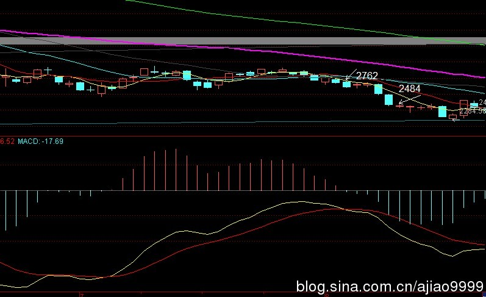

 

**今天万分不爽，现在不能坐飞机，怕上升下降时身体出问题，只好坐火车。结果那车竟然没有高包，坐软卧极端不习惯，一晚没睡好。早上到了武昌，一个超级乱的扩建中的车站，又刚好下大雨。本来有朋友说找省里的人接待，本ID怕欠人情就推了，真有点后悔。**

**送本ID来的朋友，性子特倔，本ID说去西广场出去，他偏要听人说走东广场，结果淋了一通，本ID火已经很大了。更无聊的是，为了三顾茅庐方便，本ID没法去住好酒店，只能就近找酒店，结果打车到目的点一看，几乎晕倒，这武汉也是的，这么多年，汉口竟然还有这么大片没开发的地方，还以为进了荒山野林里，找到那酒店如同老电影里所见的，最可恶的是，吃饭也没地方，附近有吃的地方看都看不见，说可以打车去，出租车在哪里呀？只好在所谓的酒店里将就，说好来湖北菜，随便什么三蒸、莲藕排骨就完了，结果没有，这里是山东师傅搞的四川菜，没辣就不会了，一口都吃不了。后来，去那所谓的小卖部，都是热气的东西，最后只好来了点喝的，今天晚上，听说能专门给我们弄条鱼清蒸，但要专门下午到老远的地方买，晕!**

**但比最可恶还要无聊的是，一回到房间，电话就上来了，问要不要房间服务，本ID就问，除了鸡，还有鸭有鹅有鸽子吗？一样来一队来挑挑，结果把电话给吓回去了，好无聊的地方呀。**

**但这里有奇人，这里就是光明之地，为了学会那本事，什么都认了。那奇人似乎特恨与官员有来往的人，本ID无论如何是不能让什么省里的人接待去那些不靠谱的地方，受苦受累也要顶着了。现在还没见到那人，估计真要N顾茅庐了，就看本ID有没有这善缘，奇人是不能强迫也不能利诱的，否则本ID也不会为此受此苦。心只能靠真心感动，本ID就在这里熬下去了。**

**不多说了，唯一惊喜的是，这里竟然还有光纤上网，这就够了。等天晴了，再想办法解决如何吃好的问题，能吃是福，听说这里的蟹比某某湖的还要好，污染少，不知道是否吹牛，找时间好好验证一下，至于还有什么好吃的东西，只要不是炸的、煎的、烤的之类，都要检验一下，有当地的朋友吗，麻烦介绍一下，哪里有美食？以前来武汉都是来去匆匆，这下要好好武汉一把，谢了。不知道最后结果怎样。**

**分型上边沿再起神奇作用**

(2008-08-18 15:09:52)

**十分感谢各位的关心，这边的问题，无论多难，本ID都会尽量处理好的，毕竟机会难得，是否最终如愿，就看是否有此善缘了。**

**今天大盘值得各位好好研究，周五所给的日底分型上边沿不能站住将继续探底，今天的走势已经给出最好的阐释。而这个探底，在最开始的三级别反弹分析中已经仔细分析过，这一般有90%可能性走势下面预防的走势无非是不能形成背驰从而只能先有第三中枢的问题，因此，明后两天走势极为关键，一旦延续跌势力度，那么第三中枢的可能性就很大了。反之，就那次级别的反弹就将展开。**

**一定要注意，这次级别反弹可能只构成原来大中枢的第三类卖点，其后将是更猛烈的下跌，第三类卖点后最好也就是构成更大级别中枢，因此，这反弹相面对的风险还是需要留意的。**

**从基本面上看，时间刚好极端配合，这次级别的反弹，最弱的就是平台式的，也就是连2500点都碰不到，然后基本对应上那什么会结束，最后的机会给管理层，如果还如此，后面不第三类卖点才怪了，这点必须有清醒认识，而这在原来三级别反弹的分析中已经明确指出过，市场显然与我们的分析完全合拍。**

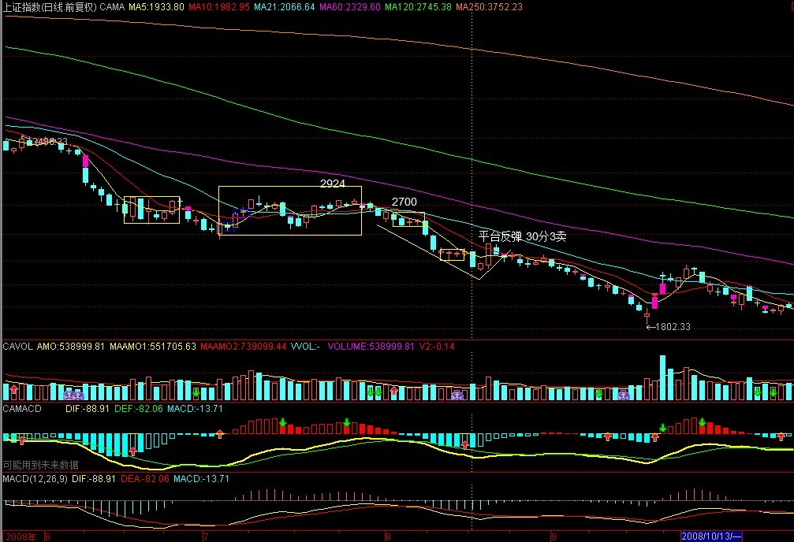

**不说了，本ID现在的任务是学习、治病，顺便看管理层的反应，一切都在分析之中，没什么可继续说了。**

**先下，再见。**
