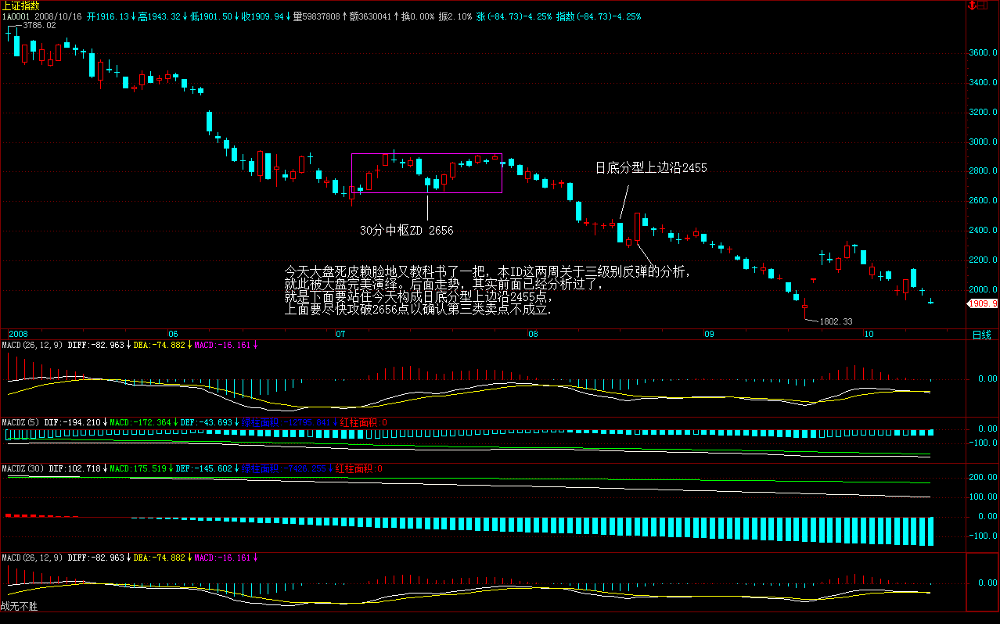
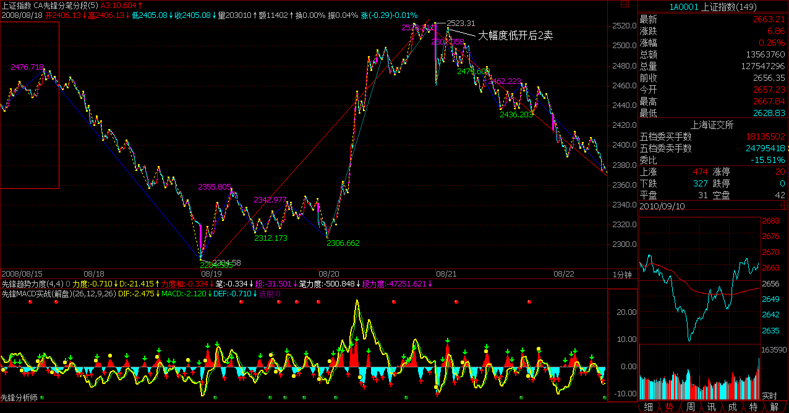
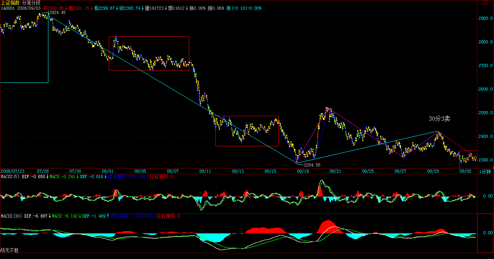

# 教你炒股票107：如何操作短线反弹

**

(2008-08-19 16:10:39)

**2455、2656成短线上下关键位置**

(2008-08-20 15:11:18)

**今天大盘死皮赖脸地又教科书了一把，本ID这两周关于三级别反弹的分析，就此被大盘完美演绎。后面走势，其实前面已经分析过了，就是下面要站住今天构成日底分型上边沿2455点，上面要尽快攻破2656点以确认第三类卖点不成立。**

**当然，以上表述是站在希望大盘涨的基础上说的，而实际操作，一定不能有这种想法，而是根据大盘实际走势进行机械化反应。**

**再强调一次，没分清级别之前就别谈什么背驰。所谓背了又背是天经地义的事情，但对应的是不同级别，否则，难道一个1分钟背驰就可以让大盘转向1000年，那不乱套了？本ID理论的基础之一是级别，不学会并完全机械化地精确把握，那还是别背驰了，因为这种水平，除了背还是背，还驰什么？**

**今天上来，主要配合了消息面上关于经济刺激的一些重大传闻，如果真能如此，跟着本ID的思路一把，这管理层还算有药可救，否则，又来假消息忽悠，那只有第三类卖点后更强力地暴跌了。所以，这几天消息面是最关键的，会也快开完，该干点正事，否则，难道还要为残奥会增加点新项目，提供点新选手吗？**

**不想说了，就看某些人会不会做了，这不是小孩子玩泥沙，千万别意气用事。至于各位，无论你这两周是否如本ID两周前说的完全踏准三级别的节奏，但如此教科书的实际走势，也请好好分析清楚，学会了这，你的水平将提高许多，各位就各自努力吧。**

**先下，再见。**

**超短线抉择:5天还是13天线**

(2008-08-21 15:23:00)

**今天没消息，大盘回跌就是天经地义的，至于这回跌是否最终构成继续的探底，昨天已经给了一个基本点位：2455点，如果明天还站不住该位置，继续下探就是理所当然了。**

**当然，实际操作中，根本无须搭理这点位，因为这往往有点晚，本ID最近课程专门讲述如何进行短线操作安排。里面给出了最有效率的方法，而这次第一段的顶背驰极端明确，**（娇注：线段类背驰）

**当然，由于是T+1，所以实际操作中不一定真能在第一类卖点就卖了，而以前说过开盘大幅度低开后，第一次次级别回拉不破顶或盘整背驰将构成最好的第二类卖点，这类卖点往往是突发事件中最好的逃命点，这里的老人都知道，去年530早上开盘前专门强调注意第二类卖点，该点走掉后，虽然不是最高，但后面至少逃过整个跌幅的95%，这已经是突发事件中最好的结果了。**

**当然，理论水平不够的，就看均线，前面有专门说均线系统级别的，这次标准地在13天线受阻，也就是一个2级力度，能否升级到3或更高，就看13天线了，至于5日线，是超短线的生命线，一旦有效跌破，那该怎么样**（娇注：阉割）**，张某某**（娇注：张艺谋）**都该知道，各位这么英明神武的，就不用废话了。**

**明天，最后一个搏消息的日子，而下周，是让某些人最后彻底反省的日子，如果一切都落空，你说这市场能不空吗？这第三类卖点还不是天经地义的？让市场赞助点手呀脚呀地残奥会一把，还不是很张某某的？**

**至于那连笔和线段都没分清楚，在线段上竟然敢大谈什么背驰的，就虚心点去读书。让本ID一个早被判四期绝症的病人每天还分什么笔、线段图放上来的，你好意思，本ID都不好意思。因为，功夫是你自己的，你自己不磨练，万一本ID有什么闪失的，你又去哪里找陪练？**

**可以断言，本ID万一有什么闪失，关于本ID的理论就会被折腾得完全变样，有2 的张某某次方变种，结果，最终能在市场上真磨练成钢铁战士的，能有5个，本ID就含笑九泉了。就像那奇人，他们家里同辈人一起学祖传绝学，9个人，最终只有他坚持下来并完全自如应用了，大概世间很多事情都命该如此，就不说了。**

**本ID一时还死不了，至少要看到某些人低头才行，这次不低头，总有低头日，但那时候可能就不是主动低头了，要面子可没有，鞋子、袜子、唾沫星子诸如此类的东西张某某的张某某次方飞过来，肯定比某天那天上钞票印出来的脚印有趣。**

**先下，再见。**

**博消息，于5日线震荡**

(2008-08-22 15:32:30)

**由于前几次周末搏消息都以失败告终，所以这次似乎热情不高，但依然没有死心，所以就构成今天围绕5日线震荡的两难局面，因此，周一开盘就决定短线突破方向，技术上一旦5日线走平再张口向下，那么大盘新低就是理所当然了。**

**当然，高位走掉的，这消息也可以赌一把，只是周一一旦没兑现，就要动作特别迅速，没这水平的，就算了。就算真有什么消息，如果特别实质的，完全可以在高开回来出现小次级别第二类买点时介入，这和大跌的操作只不过反过来罢了。**

**目前，从中线的角度，技术上周与月如何能最终构造出底分型才是问题的关键，否则，就算有消息，也是一日几日行情，比比短跑而已。**

**周末，好好休息吧，这边也有不少事情忙，先下，再见。**

**以北京奥运为新标杆的面子工程运动会隆重开幕**

(2008-08-25 15:38:43)

**大盘没什么可说，昨天已给了最关键的评价，市场需要更多真家伙。技术上，今天改变了最近周一就大跌的习惯，但由于目前5日线依然在13日线下收口，因此明天，最迟后天是短线分水岭，是5日上穿13，还是再次扩大形成新一轮下跌，很快就有答案。**

**管理层已经企图想干点什么，但太拖拉了，就怕他们到时候尽来些不到位的东西，反而让市场厌恶。所以，现在，一切都在敏感之中，这段时间，一定要清醒看好，最安全的还是根据技术来，中线的标准很明确，就是首先周底分型，然后是月的，这两个构造出来，大盘才会有大戏，否则也不过是上下折腾一下。**

**本周很关键，决定了本月能否有可能成为月底分型最下一根，如果本周走不好，那么，一切都将至少轮后一月，如果这样，后面的调整就至少多三月，也就是至少两年以后再谈什么新高行情了。(娇：周线底分型最下一根都没有是谈不上周底分型的，周笔向下延续那月线底分最下一根也错后）第一轮调整时间越长，正规的走势中，后续最终结束全部调整的时间也将成N倍地延长，这是很关键的。本月是10个月，下一周期是12、13；然后是17、18，当然，具体要看实际走势，这都是经验的分析。**

**目前，是游资乱搞的时期，所以权证、本地股等小市值品种就会被经常光顾，而真正的大行情，必须中字头股票真正动起来，本ID当然不介意管理层一路昏招，使得本ID类似6元中驴的理想得以实现，但本ID从11元多开始都是见步拆步，冲不上去就砸，有差价就回买，有机会就让它破底，以有更好的价格，而中字头的基本都是这样弄的，没有人会现在全身投进去，但现在完全不介入，以后可能就不一定有发言权，这就是另一个问题了。**

**所以，再次强调，对于小资金来说，继续短跑运动会，这才是应付如此混乱环境的唯一可行办法，或者干脆就继续小板凳，那更不用烦了。**

**说起运动会，今天，以北京奥运为新标杆的面子工程运动会隆重开幕了，以后，一切只要打着民族世界交流发展展示等等劳什子玩意的东西都有了新标杆。花吧烧吧，一切时代，如果张某某**（娇注：张艺谋）**般以宏大叙事为基础的伪文化得以烧钱化，这个时代一定要反省了，说得难听点，一个破资本主义爆发户，有什么可臭显摆的？**

**昨天，最精彩的是那伦敦市长以忒加扎的方式上场，给爆发户心态的急于显摆一个极大反讽；另一个，当然是那八分钟，这里，无法讲述，因为懂得当代西方哲学、艺术发展的人毕竟太少，这种以摆脱宏大叙事为基础的、散漫而有机的艺术，是张某某那些弱智的爆发户玩意永远想象不到的。**

**当老牌资本主义早就开始冷酷的反省与重建时，一切的对比简直太有趣了，当奥运奥运了中国后，就看老牌资本主义的精神家园里，奥运是如何被伦敦所奥运，2012年，值得期待。**

**本来想写一篇关于那8分钟纯专业的分析，后来一想，本ID又不喜欢废铁、烂切，何必多写又招极端民族主义者不待见，就算了。**

**要在全球化占主导，文化是最大的难关。其实，伦敦那些也不过糊涂玩意，新的文化建构当然至少是全球视野的，不明白这点，远远不行呀。**

**任重道远，呜呼--**

**大盘短期走势纯技术分析**

(2008-08-26 14:59:52)

**从最简单的5\13日线就知道今天最迟明天是大变盘的日子，结果大盘依然很有方向感地向下，明天回拉只要站不上5日线，以后该线就成为最简单短线判别标准。**

**不过，有一点必须注意，目前大盘往下的承接日益加大，大盘还有一种可能的演化就是不断的下探最终都不构成真正的下跌，而是不断扩展出更大级别的中枢，等待上面均线下来，在目前大致位置形成缠绕后再决定最终突破方向，这是一种很有技术意义的走势演化，具体的分析以后课程里都有。**

**今天并没最终破坏上周是周底分型最下一根的形态，换言之，只要大盘在本周不破坏这形态，那大盘还有点意思，否则，就继续下探到可安置这周底分型的区域。**

**话就不多说了，一切看图操作，千万不要一根筋。**

**谢谢各位的关心，这两天买了点电器回来，自己来吃得舒服，当然，自己来也就是补充一下，大的还要靠外面，毕竟本ID不可能去每天买菜，那事太麻烦，糖水弄了还可以，外面买了冷冻的甜点心，加热可以随时吃，只能将就了，顺便活动一下自己，也算锻炼。**

**在这里，估计至少还要二个月，熬熬就习惯了。**

**等待政策与技术产生共振效应**

(2008-08-28 15:10:21)

**现在，政策与技术，单纯一面，都不足以构造真正的中期底部，而是必须等待两者产生共振效应。政策面上，效率不高；技术面上，最简单的均线系统都没修正好，因此，硬来没多大意义。**

**在目前条件下，中线角度，出现各级别中枢不断扩展叠合以完成底部构造的可能性越来越大，也就是说，先横住了，然后再等到那共振时间的出现，产生突破的第一推动力。**

**明天又进入搏消息日子，上周参与者已经热情不高，本周如何，拭目以待。然后又是一个轮回，有消息，就看其分量决定短线的波动力度，没有，就有了借口往下考验一下，当然，就像本周，最终又一个平衡形态也是一点不奇怪的。**

**现在，唯一需要的是耐心，而对于短跑选手来说，其实机会不少，特别个股中。如果着眼中线，那还是继续不断短差就降低总成本，这不用太费心。至于，一点感觉都没有的，那就小板凳吧，至少等底部形态彻底摆脱了再说了。**

