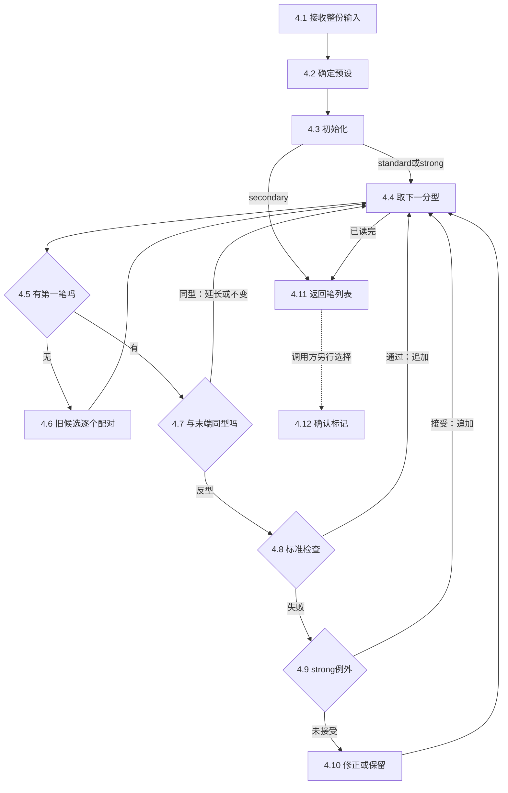
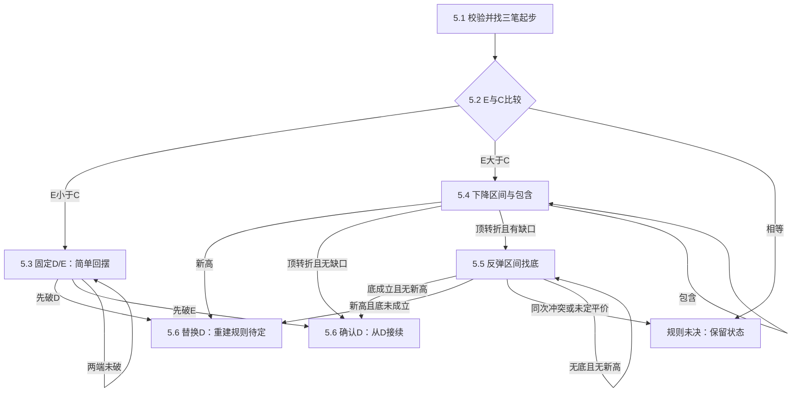
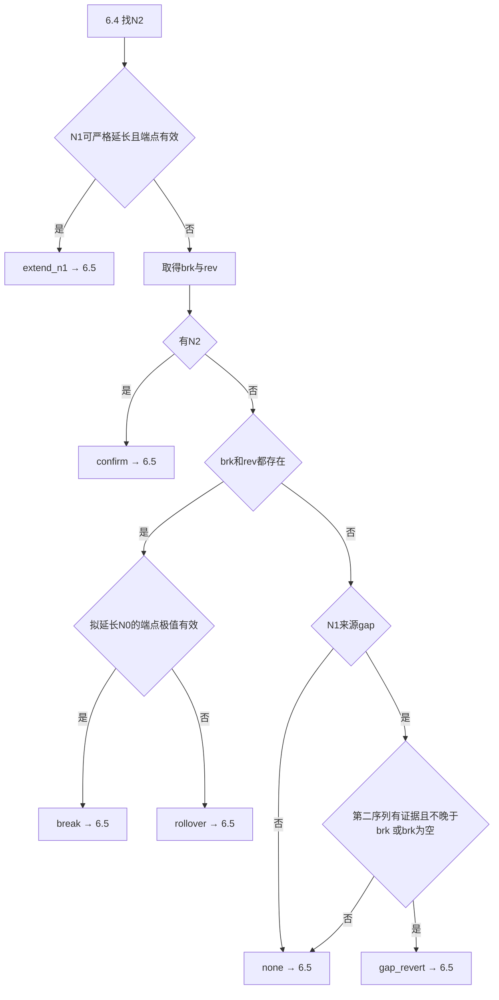

# memo0030_kbar_to_xianduan_summary — OBSOLETE（已废弃）

> [obsolete] 2026-09-15：按用户要求，本篇已废弃。以下正文仅作为历史记录保留，不再作为当前算法说明或实现依据。

[summary] [algorithm] [chan] [figure atlas]

## 0. 全景：原始价格怎样变成线段

> [core] **从 Kbar 到线段，每一层都在同一份价格事实之上增加结构判断：先处理包含，再识别局部转折，再选笔，最后判断哪些笔的转折可以成为线段分界。原始数据不因上层取舍而删除。**

[history update] 2026-09-15：用户判定 [0029（obsolete）](memo0029_xianduan_obsolete.md) 的算法整理失败并将其废弃。本篇第5～6章对0029及其旧版快照的引用仅保留历史来源，不作为当前线段算法依据；尚未形成新的替代算法。

本篇把现有 memo 串成一条可读的主线，先定义对象，再说明比较、状态变化和下一步。算法细节重点依据 [memo0026：笔](memo0026_algo_of_bi.md) 与 [memo0029：线段](history/memo0029_before_cc_rewrite_20260915.md)。当前目录有27篇既有 memo，编号0001～0029，其中0013、0014按已有约定留空；本次未找到0036，暂将请求中的0036理解为0026。完整的来源分工见第8章。


### 0.a 读图路线与算法边界

1. **第1章 Kbar**：一根记录是什么；先保证输入有效。
2. **第2章 合并 K**：价格区间包含时怎样取值，方向尚不明确时怎么办。
3. **第3章 分型**：在三个相邻 M 中识别中间的局部顶或底。
4. **第4章 笔**：完整保留0026的十二步次序，区分标准成笔、强势例外和反弹修正。
5. **第5章 线段分界解释**：完整保留0029旧版第1章的六步及未决出口。
6. **第6章 KWX线段执行**：单独说明0029旧版第4章的候选、冻结、撤销及显示尾段。
7. **第7章 接口、时间与证据**：解释各层如何连起来，以及图不能证明什么。
8. **第8章 全部 memo 的位置**，**第9章 本次核验与下一步**。

[scope] **“整体视图”不意味着已有唯一、无歧义的全链规格。** 笔的参考算法已接入实验类；线段仍有两条不同的叙述：第5章是分界研究规则，第6章是保存的KWX代码行为。前者的平价、复杂结构、换候选重建等规则尚未全部决定；后者有自己的等号、前看和候选生命周期。这里把每个已声明分支展开，也把规则缺口画成出口，不能把缺口补成未经批准的新算法。中枢、走势只在总地图定位，不扩展本次算法范围。

### 0.b 贯穿主例：先有 Kbar，再真正导出笔和线段

**主例是59根人工构造的合法 Kbar，不是只有端点价格的假定笔输入。** 在本次核验中，先经过项目的合并、分型、笔入口，再把实际生成的14根笔转换给保存的线段参考入口。完整原始区间见[数值记录](../../artifacts/experiments/chan_theory/memo0030_checks.json)。

```text
点              A    B    C    D    E    F    G    H    I    J    K    L    M    N    O
端点价格       100  110  105  115  108  112  103  107  101  110  106  114  108  112  102
原始K/M下标      1    5    9   13   17   21   25   29   33   37   41   45   49   53   57
```

主例每根K恰好对应一个M，相邻端点中心差4；K0和K58提供首尾分型外侧的邻居。原始K的O/C取区间中点、V取100，仅用于构造合法教学输入，不表示真实成交。


最终线段参考输出为 `A→D frozen、D→I soft、I→L forming`。**O提供后续结构信息，但显示尾段仍可结束于L。** 图中的粗线只改变上层表示；M、N、O等原始点并未删除。第6章解释这些状态。

后文“独立例”专门暴露主例没有经过的分支，不接到主例后面。尤其0026的 `A顶20…E顶19` 修正例，与这里的 `A底100…O底102` 是不同输入，不能拼接。

## 1. Kbar：先记录一个时间段内的价格事实

### 1.a 一根K是什么

[concept] **Kbar（K线、bar）是一个标的在一个时间周期内的OHLCV记录。** O是开盘价，H是最高价，L是最低价，C是收盘价，V是成交量；`symbol/period/timestamp/source`记录标的、周期、时间和来源。项目对象叫 `Kline`。

```text
例：O=103，H=112，L=100，C=109，V=100
实体长度=|109−103|=6；上影线=112−109=3；下影线=103−100=3。
```


[concept] **价格区间是 `[L,H]`，时间范围则是这根bar所属的周期。** 后面的包含、重叠、缺口主要比较价格区间，不比较实体颜色，也不把休市当成价格缺口。同一根K的H/L不能告诉我们盘中先到H还是先到L。

### 1.b 输入检查：通过才把序列交给合并层

**KlineTSeries是按时间严格递增、同一标的和同一周期的Kline集合。** CSV文件类负责解析文字，Kline负责单根约束，序列负责跨行约束。

- **解析失败、缺必要列或值不合法**：报具体行/字段错误，修正输入后重新读取；不静默补价或跳过坏行。
- **单根有效**：价格与成交量须有限，H不低于O/C/L，L不高于O/C/H，V不为负；再检查序列。V=0及O=C本身不导致拒绝。
- **标的或周期混用、时间重复或逆序**：序列拒绝；原输入保留供定位，不交给合并层。
- **空序列**：当前 `KlineTSeries` 拒绝构造。它与后面“有效输入但零分型/零笔”是不同情况。
- **全部通过**：保留完整K序列，进入2.a。来源不同可以保留，空白source按已有类规则成为`NA`，不能把来源差异等同于标的混用。

[source] [0009 Kline](memo0009_class_kline.md)、[0010 KlineTSeries](memo0010_class_kline_t_series.md)、[0016 CSV接口](memo0016_class_csv_file_kline_t_series.md)。时间戳的输入语义由数据约定负责；不能凭一个datetime字段猜它是开盘时刻还是结束时刻。

## 2. 合并K：消除包含，保留方向与每根原始K

### 2.a 先定义包含和方向

[concept] **包含是一个闭价格区间覆盖另一个。** 对旧区间U、新区间V：

```text
U包含V：H_U≥H_V 且 L_U≤L_V
V包含U：H_V≥H_U 且 L_V≤L_U
例：[9,12] 包含 [10,11]；[9,12] 与 [10,13] 互不包含。
```

**这里的方向是两个区间高低边界同时上移或下移，不是K的C与O比较。** 新高、新低都严格高于旧高、旧低才是up；都严格低于才是down。只一边变化、另一边相等，不建立严格方向；在本配置下通常属于包含处理。


### 2.b 从第一根到最后一根：启动、合并、追加、结束

**一次derive调用重算当前整份输入。** 工作状态是待定前缀P、有效合并组列表M、当前方向d；原始K列表固定，扫描下标从早到晚前进。每轮只读取一根新K。

1. **尚无方向**：将新K加入P。P不足两根，回本步等下一根；已有两根，则比较P最后两根原始候选。
   - 仍无严格方向：P保留，读取下一K，继续1。
   - 第一次严格up/down出现：方向固定为该次关系；按此方向、从左到右折叠P中除最新K之外的所有成员，形成首个M；最新K单独形成下一M。清空P，转2。
   - 输入读完仍无方向：整个P按 `H=max全部H，L=min全部L` 合成一个 `direction_unresolved` 组，转3。**不是每次包含都立即按宽包络定案。**
2. **已有方向，读取下一K，与最新的M比较**：
   - 任一方包含另一方（包括同高、同低、完全相同）：up取 `H=max两高,L=max两低`；down取 `H=min两高,L=min两低`。替换最后一个M，合并来源；方向不变，仍在2读下一K。
   - 互不包含：高低同时上移则新方向up，同时下移则down；追加一个M。下一轮的参照是这个新M，仍在2。
   - 合法数值若竟然互不包含又无严格方向，现有代码抛防御性错误；不能当作普通“未成形”吞掉。
   - 没有下一K：转3。
3. **回填输出**：每根原始K都保留，并加上所属M、合并H/L、方向、状态和锚点标记。返回 `MergedKlineSeries`，本次合并结束，交给分型层。

**每次合并后用新值比较下一根，不能用旧值。** 独立例：已知up，`[9,12]+[10,11]→[10,12]`，再加入`[11,11.5]→[11,12]`。来源仍是三根K；结果既不是原区间并集，也不是交集。

### 2.c 一个M与多根K：时间锚点不一定贡献极值

[concept] **M是一个包含处理后的有效价格区间；项目的MergedKline行是“原始K＋这个区间的标签”，并非每行各有一根独立M。**

- `is_group_first`：这一组的第一根原始K，用作组起点锚。
- `is_group_extreme`：贡献方向关键极值的原始K。并列取first/last由已有配置决定。
- `merged_high/merged_low`：参与下一层计算的价格；原来的`high/low`不被覆盖。


独立例的K0～K2先待定，K2→K3第一次严格向上，首组成为`[7,10]`；整份输入若在K2就结束，则只得到未定方向的`[5,10]`。**不同输入前缀的输出可以不同，不可把事后确定的方向提前赋给当时。**

[source] [0020 合并设计与数值例](memo0020_class_merged_kline_series.md)、[当前合并实现](../../experiments/chan_theory/merged_kline_series.py)。0020数值菜单中的“未定方向用wide range”须结合启动/输入结束条件阅读；本节展开了该条件。

## 3. 分型：三个相邻M中的局部顶或底

### 3.a 比较的对象及四个条件

[concept] **分型是三个相邻、方向已处理的M形成的局部转折；项目把标签记在中间M的全部原始行上。** 三个组记为左、中、右，不是三个碰巧相邻的原始行。

```text
顶：H中>H左 且 H中>H右；L中>L左 且 L中>L右。
底：H中<H左 且 H中<H右；L中<L左 且 L中<L右。
```


独立例：左`[10,12]`、中`[11,14]`、右`[8,12]`，14大于两侧高、11大于两侧低，故中是顶。只有最高价凸起而低价未抬高，不能通过本项目的四项严格顶条件。

### 3.b 逐窗判断的全部出口

1. 校验合并序列并按M分组，初始化每组标签为None。校验失败则报错，不跨坏组拼窗口；通过转2。
2. 固定本次M列表，依次试 `(M0,M1,M2)`、`(M1,M2,M3)`……。移动的是中间组，原始K不动。
   - 不足三个M：所有标签保留None，直接转3。首尾组没有完整邻居，预先保留None，不进入内部中心循环；不补造外侧邻居。
   - 窗口含 `direction_unresolved`：该中心保留None，试下一个原位置的窗口；**不删除未决组后把远处两组拼起来。**
   - 四项顶条件通过：标签top，试下一窗口。
   - 顶不通过而四项底通过：标签bottom，试下一窗口。
   - 两者都不通过，包括任何必要严格比较出现相等：None，试下一窗口。
   - 全部内部中心处理完：转3。
3. 给每根原始行复制上游字段和该M中心标签，返回完整FenxingSeries。零分型也保留全部原始行。选笔层只按M读取一次中心，不能把重复行标签当多个分型。

[concept] **分型端点价格取顶的merged_high或底的merged_low；图的横坐标还需要一个锚点选择。** 组首位置、实际贡献极值位置和右邻证据到达位置是三回事。


主例A位于K1/M1，要有K2/M2才可识别；仅看见K1尚不能宣称A已是底。Bill Williams五根bar、可变邻域、平台峰等是0023比较过的其他方法，不是当前严格三M规则的隐藏分支。

[source] [0023 分型](memo0023_class_fenxing_series.md)、[0024 CSV](memo0024_class_csv_file_fenxing_series.md)、[0025 图](memo0025_class_fenxing_series_chart.md)。

## 4. 笔：从分型中选择连接，而不是把每个转折都连起来

### 4.a 对象、三个列表与十二步总图

[concept] **笔（Bi）是按所选规则接受的一对反型分型端点之间的连接。** 底→顶是向上，顶→底是向下；同型不能增加一笔，但严格新极值可能替换末笔终点。

- 输入分型 `F_i`：当前正式处理的分型；按时间从早到晚前进。
- 起点候选池 `P_j`：还没第一笔时保存的旧候选；内层配对时固定F_i，只换P_j。
- 已接受笔列表S：本次计算已选出的笔；同一次调用持续保留，重新调用才从空列表重算。
- 后查分型 `F_q,q>i`：本次已提供、但尚未轮到主扫描的证据；查它不推进i。



图中的4.1～4.12对应下文粗体步骤，也对应0026的1～12。共享标准检查的返回，必须回自己的调用者，不能一律去strong。

### 4.b 步骤4.1～4.5：准备与分流

**4.1 接收本次完整raw、M、分型、配置。** 空分型列表仍进入4.2；此参考入口不全面修复不对应的下标或时间，上游必须保证一致，异常不能解释成“没有笔”。本步不重复合并或识别分型。

**4.2 确定规则。** 命名预设覆盖其负责的参数；CUSTOM保留自定义组合；配置错误中断调用，否则去4.3。项目包装当前只开放固定`kwx/bi_5k`，以下其他模式是参考算法比较。

| 配置 | 距离与端点要求 | 标准失败之后 |
| --- | --- | --- |
| bi_5k | M中心差≥4，可计价格缺口；half；检查内部极值 | 可反弹修正 |
| bi_4k | 三M窗口不共用M；原始极值下标差≥4 | 不启用缺口折算、额外端点/极值、修正 |
| bi_strong | 先按bi_5k标准检查 | 先strong比例0.95，再考虑修正 |
| bi_secondary | 这版没有实现 | 不扫描分型，返回空 |
| CUSTOM | 保留显式组合 | 按有效开关执行 |


**4.3 初始化P=[]、S=[]。** standard/strong去4.4；secondary直接4.11。每次调用一次初始化，不是每选一笔重置。

**4.4 读取下一分型。** 有下一F_i则交4.5；输入起初为空或后来耗尽，都去4.11；不删除读过的分型。

**4.5 只检查S是否为空。** 空去4.6；非空去4.7；不在此比较价格或修改笔。

### 4.c 共用标准检查：先距离，再端点，再内部极值

**固定起点分型中心M_s、终点中心M_e，s<e。** 任一启用项失败即返回失败，不执行后续项；全部通过返回成功。同型先失败。下列H/L指合并M价格，原始包络另用rH/rL。

**第一项：距离。**

- merged_center：`d=e−s`已达到门槛则过；未达到且不允许缺口折算则失败。
- 允许折算时，对s～e每对相邻M回到其全部原始成员，计算包络 `[rL,rH]`；`max(两rL)>min(两rH)`计一个G。最终 `d+G≥门槛`才过。
- raw_extreme：先看两个三M窗口是否共用M；共用则失败。否则从两个中心M内取相应原始极值K的位置（并列取最早），下标差≥门槛才过；不折算G。
- 通过去第二项；失败返回调用者。[10,14]与[14,18]接触，G不增加；休市也不自动增加G。


**第二项：端点是否拉开。** 所列成对条件都必须满足，相等失败：

| 模式 | 向下：顶s→底e | 向上：底s→顶e |
| --- | --- | --- |
| none | 跳过，去第三项 | 跳过，去第三项 |
| loss | H_s>H_e 且 L_e<L_s | L_s<L_e 且 H_e>H_s |
| half | H_s>max(H_{e−1},H_e) 且 L_e<min(L_s,L_{s+1}) | L_s<min(L_{e−1},L_e) 且 H_e>max(H_s,H_{s+1}) |
| strict | H_s>终点三M最高 且 L_e<起点三M最低 | L_s<终点三M最低 且 H_e>起点三M最高 |
| totally | L_s>终点三M最高 | H_s<终点三M最低 |

[concept] **half是起点取“中心＋右邻”、终点取“左邻＋中心”，只比较朝向笔内部的半边。** 它不是一半价格，也不是漏掉一个端点。strict扩展邻域；totally要求起点中心区间与终点完整窗口分离。


**第三项：内部极值。** require_peak关闭直接成功；开启则固定终点价，按 `M_{s+1}…M_{e−1}`逐个检查：向上要求每个H_k≤H_e，向下每个L_k≥L_e。任一越界失败，全部未越界成功；相等允许，不扩到两端外侧邻居。


**返回谁：** 4.6失败换下一个旧候选；4.8失败去4.9；4.9的假设后笔失败换下一个后续分型；4.10的C→后续分型标准成功反而会阻止修正。**相同检查的意义由调用者决定。**


### 4.d 步骤4.6～4.8：首笔、延长、标准续笔

**4.6 还没有第一笔：固定当前F_i，依次试P_0、P_1……。**

- P空：把F_i入池，回4.4。
- 同型：跳过这一对，保留旧候选；还有P就试下一P，没有则走耗尽。
- 反型但标准失败：同样换下一个P，不进入strong或修正。
- 第一对标准成功：以P_j→F_i建立第一笔，依赖为F_i中心M；清空P，回4.4，不再试剩余P。
- 所有旧候选耗尽：追加F_i到P末尾，S仍空，回4.4；本轮不与自己配对。


**4.7 已有笔：比较当前分型与末笔终点。**

- 同为顶：新顶更高才替换末端；相等或更低保留旧端点。都回4.4。
- 同为底：新底更低才替换；相等或更高保留。都回4.4。
- 替换不检查距离、half或require_peak；笔数不变，依赖取旧依赖与新中心M的最大值。
- 反型：保留S，以末端→当前形成待查的一对，去4.8；此处尚未追加。


**4.8 反向候选执行4.c标准检查。** 成功才追加、依赖记当前中心M，回4.4；失败不动S、同一对候选进入4.9。贯穿主例每对中心差4且其他条件成立，故按时间形成14笔；这不证明任何距离4的分型都必然成笔。

### 4.e 步骤4.9：强势例外，先前笔、后首条合格后笔

[concept] **振幅a(X,Y)=|p_Y−p_X|，单位是价格，不是百分比。** strong用比例ρ衡量未标准通过的候选相对于邻笔是否足够大；该规则不适用于首笔。

1. strong关闭：不计算比例，S不变，去4.10。开启则固定候选X→Y、当前Y，继续2。
2. 前笔振幅>0且 `a(X,Y)≥ρ×前笔振幅`：追加当前候选，标strong_prev、依赖Y中心M，回4.4；不找后笔。否则转3。
3. 固定Y，按后续分型时间先后试 `(Y,F_{i+1})、(Y,F_{i+2})…`：同型跳过；标准失败试下一个；第一条标准成功立即停止搜索，转4；没有或全部失败则去4.10。
4. 只对找到的第一条标准后笔Y→Q比较：后笔振幅>0且 `a(X,Y)≥ρ×a(Y,Q)`，追加X→Y，标strong_next、依赖Q中心M，回4.4。否则去4.10，**不再另找振幅更合适的Q**。Y→Q此时只作证据，未追加。


### 4.f 步骤4.10：标准与强势都未接受，才考虑吸收末笔

**独立修正例**固定 `A顶20→B底8→C顶17` 已有两笔，当前D底6尚未被接受；后续E顶19已经在这次批量输入中。此处字母是0026的局部角色，不是贯穿主例价格。


**目的：新底D比旧底B更低，而中途反弹C未越过A；若后续反向证据支持D，就撤掉B→C，把A→B延长为A→D。** 原始B、C分型不删除。

1. 修正关闭或S少于两笔：原S不变，回4.4。否则转2。
2. 向下修正要求 `D≤B且C≤A`；再要求A到D内部全部M低价≥D。任一失败回4.4；全过转3。这项内部检查不受标准require_peak开关控制。
3. 固定A/B/C/D，依次查看D后第一个、下一个分型Q，按最早决定性证据退出：
   - Q是顶且Q>C：取得许可，停止后查，转4。
   - Q是底且固定C→Q标准通过：立即拒绝修正，原S不变，回4.4；不能跳过它等更晚的新高。
   - 其他：不删Q，有下一Q就试下一Q；全部耗尽仍无许可，原S不变，回4.4。
4. 临时取下B→C。D<B才把A→B延长到D，依赖取旧依赖/D中心/许可中心的最大值；D=B则严格延长失败，放回B→C。都回4.4。

**向上镜像**已有 `A底→B顶→C底`，当前D顶：2要求`D≥B且C≥A`及内部全部H≤D；3中后续底Q<C允许，后续顶且C→Q标准通过拒绝；4只有D>B才吸收，相等回滚。开关、笔数、耗尽出口相同。


4.9后笔起点是D，4.10阻止修正的标准检查起点是C。后查不改变当前D；回4.4仍要正式处理E。**不能把“批量循环处理到D”说成“真实时间到D已经知道E”。**

### 4.g 步骤4.11～4.12：交出结果，再选做确认标记

**4.11** 按S原顺序转换所有笔，输出端点价/时间、方向、规则和来源；S空返回[]；不补笔、不画图、不写CSV，`build_bis()`结束。

**4.12** 是调用方另行选择的标记函数，非4.11内部必做操作。不需要就结束；空笔返回[]；非空先固定末笔依赖状态，再逐笔计算标记，全部计算完返回相同长度布尔列表，不改变笔。

依赖d优先取trace.dep_to_index，无值回退merged_to_index；没有trace或仍无数值则未知。N是本次M总数。某笔以下任一成立就False，否则True：

- 它是末笔；
- 它自身d未知或 `d≥N−2`；
- 它是倒数第二笔，且末笔d未知或 `d≥N−2`。


独立0026例：N=13时输出`20→8→17`，标记`[True,False]`；完整N=17时依赖E而改为`20→6→19`，标记`[False,False]`。True是这份输入下的代码标签，不是跨调用冻结保证。

[source] 本章是[0026十二步及标准检查](memo0026_algo_of_bi.md)的压缩重述；[0027](memo0027_class_bi_series.md)负责项目BiBar/BiSeries包装；[0028](memo0028_class_bi_series_csv_chart.md)负责保存与绘图。参考的多种预设不等于当前包装已全部开放。

## 5. 线段的分界解释：先保持A，再判断D能否结束上行

### 5.a 先定义线段、特征序列、缺口与状态

[concept] **线段（Xianduan）是对连续笔作更高一层的方向分组。** 标准段至少三笔，开始三笔存在公共价格区间；这些只是结构要求，不是第三笔一到就确认结束。

贯穿主例前七点：

```text
A100 → B110 → C105 → D115 → E108 → F112 → G103
       B1     B2     B3     B4     B5     B6
```

**现在的问题是A开始的上行是否在D结束。** A是固定起点，D是待判断的高点；B4以后的笔提供证据，不能因为读取到G就把G当成上行终点。

[concept] **特征序列是按时间排列、用于判断当前运动分界的反向笔价格区间。** 上行取下降B2/B4/B6；下降取上升笔。每个元素有`L=min两端价,H=max两端价`。处理包含后的元素称有效区间；它可保存多根同类原始笔的来源，但不是新造的一笔。

[concept] **特征缺口是参与比较的左侧元素与中间元素之间没有共同价格。** `[105,110]`与`[112,115]`有正宽度缺口；与`[108,115]`重叠；与`[110,115]`接触，后两者都没有缺口。它与4.c的原始K包络缺口、休市时间缺口不是同一对象。

**状态有四种不同含义。** 候选待定是尚无决定；确认是证据满足这一套分界规则；否定是旧D被替换；规则未决是数据已有却缺取舍规则。缺数据要说等哪根笔，缺规则则不能以“再来一笔”掩盖。



图中5.1～5.6对应0029旧版第1章六步；本章严格保留该研究规则的未决项。**第6章才是KWX真实驱动，不应把两张流程图混成一张。**

### 5.b 步骤5.1：第一组起步失败后，具体试谁

**先校验整份已提供笔输入**：时间有序、相接、方向交替、各笔有效。无效则本次不生成新结果，保留输入，修正后从5.1重来；不能跳过坏笔寻找形状。

从B1/B2/B3开始，失败才移到B2/B3/B4，再到B3/B4/B5。外层起点逐笔推进，窗口内三个成员保持连续。第一组使用A/B/C/D，后一组使用B/C/D/E，不重命名原始点。

1. 先算三笔公共区间：`ZL=max三低，ZH=min三高`。
   - ZL>ZH：无重叠，移下一完整窗口，仍在5.1。
   - ZL=ZH：本章点接触起步规则未决，保留该窗口，不跳过。
   - ZL<ZH：转2。
2. A=C或B=D：同方向端点平价未决，暂停该窗口；否则转3。平价在方向失败之前检查。
3. 第一笔向上要求 `A<C<B<D`；向下要求 `A>C>B>D`。
   - 通过：固定起点和候选末点，停止首段搜索，去5.2。主例是A→D，D尚未确认。
   - 在有效交替、正重叠、无平价的前提下，上行C<A或D<B失败；下行C>A或D>B失败。右移一笔回1，不删原始成员。
4. 所有完整窗口试完，剩余不足三笔：无首段候选；保留未试完窗口位置。输入结束报告尚未找到，新增有效笔时从该窗口恢复5.1。


独立失败例`100,110,105,108,102`：A→D虽有重叠，D108<B110失败；下一B→E满足`110>108>105>102`，从B启动。B1作为未归属前缀保留。**这项首段政策不允许在已确认段之间跳笔。** 已确认段末点固定后，下一段必须从共享末点接续。

### 5.c 步骤5.2：E与C只决定下一步

读取B4=D→E，保持A、D及候选成员B1～B3不变：

- E<C：去5.3。
- E>C：去5.4；贯穿主例108>105走此路。
- E=C：保留状态，平价分流规则未决。
- 尚无B4：缺E，等B4后恢复本步。输入结束保留未确认尾部。


本步不检查包含或缺口。进入5.4以后即使后来跌破C，也不回头自动改为5.3。

### 5.d 步骤5.3：已经E<C，在简单回摆中守住D/E

**固定上界D与下界E；按完成笔的时间顺序，第一项严格突破决定旧D。** 独立输入：

```text
点       A    B    C    D    E    F    G    H    I
价格    100  110  105  115  103  111  106  110  101
读取顺序                  F/D → G/E → H/D → I/E
```

- 上升终点严格>D：去5.6否定D，换实际新高F/H/J……；不能一律换成最早的F。
- 下降终点严格<E：去5.6确认D，旧上行成员B1～B3；突破点只是证据，不自动确认下降终点。
- 上升终点<D或下降终点>E：A/D/E不变，读取下一根原始笔，仍在5.3。
- 终点等于对应阈值：平价未决，保留所在位置；不算突破，也不擅自跳过。
- 下一笔未到：说清例如“缺B8的I，要与E比”；输入结束保留候选。


[scope] **以上只适用于简单回摆。** 如何识别必须改由内部线段结构接管的复杂路径尚未完整规定；本章不能据两个阈值包办所有嵌套形态。

### 5.e 步骤5.4：未直接跌破C，处理下降区间

**先判断反弹是否超过D，再处理下降区间；顶转折成立后才检查缺口。** 当前左侧B2=`[C,B]`固定，中间最初B4=`[E,D]`；后续下降笔先尝试B6=`[G,F]`。B2不与跨D后的B4作本次合并。


**5.4-1 新高优先。** 先读B5的F：F>D直接去5.6换候选；F=D未决；F<D才读取B6的G，去5.4-2。后续对应先读B7的H、B9的J，始终与D比。缺哪个端点就等哪个，不能提前构成下一下降区间。

**5.4-2 新低相对当前中间低边。** 最初低边E，合并后使用当前L_T：

- G<E：新区间不被B4包含，转5.4-3。
- G>E：B4包含B6，按up合成 `T=[max(E,G),max(D,F)]=[G,D]`，来源保存B4/B6。有效列表只剩B2/T，D仍待定；回5.4-1读H，再以新低I与L_T比较。
- G=E：同低取舍未决。已合成T后的相等分支也一样。
- 多次包含：每次替换当前T，继续同一顺序；原始B4/B5/B6等全保留，B5并未作为下降元素参与合成。

**为什么G<E之后不再另设四项顶判断？** 起步已保证D>B，5.2已保证E>C，本项前已保证F<D；又有有效上升笔保证F>E。因此G<E后，中间高低必然都高于左右。这是已有前提的推论。合并使中间低边只升不降，仍高于C；下一新低低于L_T就有同样结论。不能脱离这些前提泛化。


独立包含例：`B4=[108,115],B6=[109,113]→T=[109,115]`。方向来自B2→B4高低同时抬高，不是因为B4/B6是下降笔就用min/min。


**5.4-3 缺口比较左侧与当前中间，不比较中间与右侧。** B2高边B固定：

- `B≥当前中间低边`：无正宽缺口，包括同价接触，去5.6确认D。
- `B<当前中间低边`：有缺口，D仍待定，去5.5；不直接确认。


贯穿主例F112<D115、G103<E108，且B110≥E108，所以在G的笔输入具备时，本章规则确认D。**第6章KWX此时只可能显示forming，不可混称frozen。**

### 5.f 步骤5.5：有缺口，固定D继续处理反弹区间

**第一组顶转折已经成立且有缺口，才来到这里。** 第二组取D后上升B5/B7/B9……，寻找它们高低区间先下降再上升的底转折；D始终是待确认分界。

独立缺口例：

```text
点       A    B    C    D    E    F    G    H    I    J
价格    100  110  105  115  112  114  108  111  109  113
区间                      B5[112,114] B7[108,111] B9[109,113]
```

G到达：第一组成立但110<112有缺口。J到达：第二组中间高111低于114/113、低108低于112/109；底转折成立，确认的还是D，不是G或J。


**5.5-1 按时间读相关区间。** 从B5开始整理已读历史；若5.4多次包含后才进入，不能漏掉已读的B7/B9。有效区间列表开始为空，B5先入；中间下降笔也读取，只是不加入这一上升区间列表。

- 新反弹到达前，只有0或1个有效元素，且新反弹高点>D：不可能同时构成三元素底，直接5.6否定D。高点=D则未决。
- 其他情况先5.5-2，再5.5-3和5.5-4，不能见到新高就漏掉“同根也构成底”的冲突。
- 缺数据要具体到“已读H，等B8的I，再等B9的J”；历史整理不把确认时间写到进入本步之前。

**5.5-2 只与最后有效元素比较包含。**

- 互不包含：追加新元素，去5.5-3。
- 任一方包含另一方且方向已建立：用倒数第二有效元素→最后有效元素的高低变化决定方向；up取max/max，down取min/min，替换末元素并保留来源，去5.5-3。
- 列表只有一个旧元素便遇到包含，缺少方向；或遇到尚未决定的平价：保留D、元素和新笔，规则未决，不能按“找底”擅定min/min。


独立例：B5=`[112,114]`→B7=`[108,111]`已向下；B9=`[109,110.5]`被B7包含，故T=`[108,110.5]`，来源B7/B9。再到B11=`[109.5,112]`，比较B5/T/B11，不能继续用旧B7高111。

**5.5-3 每次追加或合并后看最近三个有效元素。** 少于三个则底尚未成立，去5.5-4；三个以上要求中间高低都严格低于左右。已明确不成立仍去5.5-4；相关平价未决。第一组无包含主例中的G<E已被5.4保证，只对该分支成立，不能拿它保证任意后移或合并窗口。

- 当前不成底不删D；下一完整相关区间到来、处理包含后，比较新的最近三个。
- 无包含时顺序B5/B7/B9→B7/B9/B11；发生合并则可为B5/T/B11，不能机械按原始笔编号移动。


**5.5-4 同次更新如何退出。** 新反弹实际高点与D比较，不能用合并后降低的高边替代它：

| 底转折结果 | 新反弹高点 | 对D与下一步 |
| --- | --- | --- |
| 成立 | <D | 5.6确认D；退出第二组，不再索要第三组 |
| 明确未成立 | >D | 5.6否定D；采用实际新高 |
| 明确未成立 | <D | 保留D和有效区间，回5.5-1读下一相关笔 |
| 成立 | >D | 同根同时给出两类证据；冲突规则未决 |
| 任意 | =D，或底判断依赖未定平价 | 保留状态，规则未决 |
| 数据不足 | 下一根相关笔未完整 | 保留确切等待位置，补齐后恢复 |


底转折成立不要求J>F、不要求I>E，也不要求填平原缺口。第5章不是“价格回补缺口即确认”的规则。

### 5.g 步骤5.6：写明成员、证据与下一段

**确认D**：旧上行A→D，成员B1～B3；B6或B9等是证据，不归入旧上行。下一段固定从D、第一成员B4开始。

- D后至少三笔且通过下降起步：建立下降候选。主例`115>112>108>103`，所以D→G待定；读B7的H，按下降5.2比较H/F。H>F去下降5.3，H<F去下降5.4，相等未决。
- 确认时已读到J/L：相关后续笔已经存在，从B7按时间处理，不等它们再到一次。
- D后三笔不足：保存D与尾部，等缺的成员。
- D后三笔明确不合格：不能右移起点漏掉B4；固定D找更长接续的完整规则未决。


**否定D**：A保留；实际新高F则候选A→F、成员B1～B5、下一B6；实际新高H则A→H、成员B1～B7、下一B8。D变内部点，原始笔全保留。新终点左侧特征区间怎样重建尚未完整规定；记录候选和缺规则，不能搬用旧C/E继续分流。


**等待/未决/结束**：缺数据恢复原步骤；缺规则保持候选、扫描位置、阈值、合成来源，说明所缺规则；输入结束只返回已确认部分和未确认尾部，不自动确认最后候选。

### 5.h 下降镜像与未决分支总账

[concept] **方向镜像是把价格p替换成c−p，高低互换，所有严格大小方向交换，时间和原点名不变。** 例如c=300时，主例`A200,B190,C195,D185,E192,F188,G197`：下降起步`200>195>190>185`；E192<C195进入镜像区间分支，检查上升笔B2/B4/B6的底转折。

- 下降直接突破分流：E>C；固定下界D、上界E。先出现下降终点<D则延续下降，先出现上升终点>E则确认D。
- 下降区间分支：新低<D先替换D；未新低再处理上升区间，采用对应min/min。无缺口检查`左低≤中间高`，有缺口为`左低>中间高`。
- 下降第二组：取后续下降笔，找区间顶转折；包含方向仍由有效元素变化决定，不从笔方向猜。
- 成员、共享端点、等待、平价和同次冲突规则都镜像保留。

[source] 本章来源：[0029旧版第0～2章](history/memo0029_before_cc_rewrite_20260915.md)。仍未决定的路径包括：起步点接触/平价取舍、复杂回摆接管、换新候选后的历史重建、固定共享起点的更长接续、第二组起始包含方向、同笔确认/否定冲突、旧笔回改与重算范围。**本章尚未通过完整序列的独立可执行规格验证。**

## 6. KWX线段：候选搜索、冻结与显示是不同动作

### 6.a 先定工作对象，再读执行顺序

**本章记录0029旧版第4章的standard参考代码，不把第5章的未决分支擅自映射成它的行为。** 一次`build_xianduans()`处理本次整份笔列表，重新建立状态；输入必须由上游保证有效。它不执行第5章那套完整输入错误分类。

- N0：较早且尚未冻结的候选，soft_n0。
- N1：紧接N0的反向候选，pending_n1。
- N2：当前刚搜到、紧接N1且方向与N0相同的临时候选。
- frozen：本次运行已冻结的结果列表。
- forming：输出层表示未完成尾段的来源标记；可能由兜底直接画出，不保证通过冻结门槛。

**候选是一份暂定的连续成员笔范围。** 例A→D有B1～B3，保存起终笔、方向、来源、结构依赖dep。候选函数返回A→D不代表它已frozen。


### 6.b 共享候选搜索：固定起点，寻找转折

以下C1～C6是本篇对0029旧版第4.2节的分解；它们是辅助计算，不是主驱动6.1～6.6的第二份执行。

**C1 固定begin和候选方向。** 新建识别器，原始笔按时间扫描，上行只交下降特征笔，下降只交上升特征笔。第一根相关笔放左侧，去C2。没有相关笔或扫描耗尽则返回None给调用者；起点是否右移由调用者决定。

**C2 建中间元素。** 新相关笔与左侧比：

- 左包新（含完全相同）：按固定候选方向合并到左侧，仍只有左；读下一相关笔，留在C2。
- 否则放中间；此时新反包左也不合并。
- 上行中高<左高，或下降中低>左低：去C6重建；否则保留左中，去C3读下一相关笔。相等不自动暂停。

**固定候选方向决定合并值**：上行max/max，下降min/min；所以只有一个旧元素也能合并，不存在第5章那种“须有前两个元素才定方向”的暂停。

**C3 建右侧，包含先于突破。**

- 中包新：合并到中，仍无右；继续C3读下一相关笔。
- 新反包中：通常合并到中；但上行“同高且更低”、下降“同低且更高”这两种例外不合并，而把新元素放右。
- 互不包含：新元素放右。
- 已有右侧：去C4；输入耗尽无转折返回None。

**C4 先实际突破，再转折公式。**

第一序列PRIMARY（候选搜索）：上行要求右低<中间**最后原始成员笔**的低；下降要求右高>该成员高。未过时，前看右侧原始笔后第二笔：上行要求右侧原始笔向下、后第二笔低<右原始笔低；下降镜像。前看不存在或失败→C6；成功把依赖记到前看笔，再检查转折。

第二序列GAP_REVERT（缺口辅助）：上行用右低<**合成中低**，下降用右高>合成中高；不前看。未过→C6，通过才检查公式：

```text
上行找顶：左高<中高，右高≤中高，右低<中低。
下降找底：右高>中高，左低>中低，右低≥中低。
```

任一失败→C6；全过→C5。**这些不是第3章四项严格K分型公式。**

**C5 定位候选末笔并返回。**

- 上行`左高<中低`、下降`左低>中高`则来源gap，否则feature_seq。接触无缺口。
- 在中间元素原始成员中，上行取最大H、下降最小L；并列取最早成员。该成员**前一根原始笔**作为拟议末笔。
- 范围至少三笔，再检查起终点极值：上行先看有无成员低<起点低（start错误），再看高>终点高（end错误）；下降先高>起点高，再低<终点低；相等不失败。
- 范围与极值通过：返回候选、来源和dep，辅助结束，调用者继续自己的步骤；这里不冻结。
- 失败：begin不变，清空识别器，从拟议末笔下一笔重扫，回C1的扫描过程；不是换原始起点。耗尽返回None。
- gap辅助调用只返回首个转折的证据与峰值末笔，**不在此执行完整候选至少三笔/端点极值检查**，后续登记由6.5负责。

**C6 右移重建不是删除输入。** 从本轮已交入的原始特征笔列表去掉第一根，清空有效左中右，将剩余原始特征笔按时间重新交入C2～C4；第一次成功立即交C5。重放耗尽仍未成功，回外层扫描下一原始笔；外层也耗尽则返回None。不能直接删除整个合成元素，因其可能包含多个原始成员。代码重建没有显式清空last_evidence；dep不自动证明最早可知时刻。

**贯穿主例的一个真实合并**：寻找D后下降，取B5=`[108,112]`、B7=`[103,107]`、B9=`[101,110]`。B9在第三元素位置反包B7，down合并成T=`[101,107]`，来源B7/B9。B11=`[106,114]`成为右侧；PRIMARY比较114>原始最后成员B9高110，通过。底公式通过，左低108>中高107有缺口；中间最低101来自B9，所以末笔为B8，返回D→I。不是仍返回D→G。

### 6.c 主驱动6.1～6.3：先找可以相接的两个候选

**6.1 准备。** 少于三笔直接[]，连forming兜底也不画；否则normalize配置、建立空状态，去6.2。standard对应line_only/off/off/peak；配置错误或断言等异常终止调用，不自动换规则。

**6.2 首段搜索。** 固定第一个原始起点、按其首笔方向调用6.b；得到第一候选后，从它末笔下一笔找反向候选。

- 两个都有：停止起点搜索，重算第一候选放N0，N1仍空，去6.3；反向候选此时只是启动证据，稍后重算。
- 第一候选无，或有第一却无反向候选：换下一个原始起点继续6.2。输入保留，允许未覆盖前缀。
- 所有起点试尽，或重算第一候选意外为空：空状态去6.6，可能有forming兜底。

**6.3 只有N0时，先延长它，再登记N1。** 从N0末笔下一笔找反向候选Q。有Q则把新极值搜索截至Q末笔，无Q则截至输入末尾；在该范围按时间找第一根与N0同向、严格超出N0终点极值的笔。

1. 找到新极值且起终点极值检查通过：N0起点不变，延长末端，回6.3重找Q；不冻结。
2. 否则，Q为空且有新极值、极值检查失败原因为start：仍延长N0，标pen_break_absorb，并记录越过起点最深的笔（并列最早），回6.3。这是代码吸收例外。
3. 上两项未执行且Q为空：去6.6保留现态。
4. 其余Q存在：放入N1，N0不变，去6.4。

贯穿主例到L能得到A→D与D→I；在N0末笔之后至Q末笔B8之间，没有同向高点>D115，于是登记N0=A→D、N1=D→I。

### 6.d 主驱动6.4：固定N0/N1，按代码优先级裁决

**先找N2，再先检查N1能否延长。** 从N1末笔下一笔找与N0同向候选N2；有N2则新极值搜索截至N2末笔，无则到输入末尾。第一根N1同向新极值且端点检查通过，决定extend_n1→6.5；未通过才继续。

然后各自从N1之后搜索到输入末尾，取得：

- brk：第一次越过N1**起点价**的笔，不筛笔方向。N1下行看H>起点，N1上行看L<起点。
- rev：第一根与N1同向、超出N1**终点极值**的笔。下行看L更低，上行看H更高。

未找到的为空，相等不算；二者各取第一项，但**下一裁决并非一律比较谁先到达**。



其中：

1. N2存在，优先confirm；不要求brk为空，不另比较N2与brk的时间。
2. N2无而brk/rev皆有：在N0原末笔到rev所在笔闭区间内，选择N0同向最极端笔，平价最早；无同向笔时防御性退回全部笔。用该点拟延长N0；端点有效决定break，否则rollover。此分支不比较brk/rev先后。
3. 前面没决定且N1来源gap：对**当前N1终点**做第二序列。证据存在，且brk为空或证据编号≤brk，才gap_revert，否则none。
4. 非gap且前项未决定：none。

**第二序列从谁开始？** 从N1末笔后的第二根原始笔开始，取与N1同向的笔，识别器用相反候选方向＋GAP_REVERT。例如N1=D→I下降、末笔B8，取B10/B12…下降笔找区间顶。起始笔不存在、方向不符、扫描无转折都返回空；成功只返回证据与峰值末笔，不要求第三序列。

### 6.e 主驱动6.5：执行决定与冻结门槛

**冻结前的gate**：至少三笔、奇数笔、首尾笔方向符合候选、前三笔公共区间非空（允许接触），通常还要求端点极值有效。pen_break_absorb只豁免端点极值，不豁免其他四项。

| 决定 | 实际修改 | 下一步/失败出口 |
| --- | --- | --- |
| extend_n1 | 只延长N1；N0、frozen不变 | 回6.4，重新找N2 |
| confirm(N2) | gate(N0)通过才冻结旧N0；N1升N0，N2入N1 | 通过回6.4；gate失败不冻结，去6.6 |
| break | 移除工作N1，按拟议末点延长N0；不删原始笔 | 回6.3，从更新N0末笔下一笔搜索 |
| rollover | gate(N0)通过才冻结N0；旧N1升N0、清空N1 | 通过回6.3；失败去6.6 |
| gap_revert | gate(N0)、gate(N1)、反向相接全部通过才同时冻结；清空N0/N1 | 任一失败，两段不冻结，去6.6；成功按下段登记 |
| none | 工作候选和frozen均不改 | 停主循环，去6.6 |

gap_revert成功后，两段依赖和confirmation_ts记本次第二序列证据；再从旧N1末笔下一笔、反向建立新候选，末笔用辅助返回的峰值。范围至少三笔且首尾方向正确就直接入N0回6.3，**此登记不重跑完整端点极值或前三笔重叠**；不满足则保持空工作位置去6.6。

普通confirm不把旧dep改成冻结时刻。本次主循环最多4n轮（n为输入笔数），达到上限去6.6；源码没有单独返回上限状态。这是有界退出，不是证明所有结构已找完。

### 6.f 主驱动6.6：输出层还会画未完成尾部

先依次输出frozen，再输出N0的soft。下面只采用第一条适用的尾部规则：

1. 有N1：在其起笔至输入末尾找同向极值（并列最早），显示末笔取候选末笔与所找末笔编号的较大者；来源forming、状态pending_n1、原dep保留。只改输出，不重跑驱动。
2. 无N1而N0后有输入：从N0末笔下一笔画反向forming，依赖记本次最后输入笔。
3. N0/N1都空，而最后frozen之后有输入：从该frozen后画反向forming。
4. 完全没输出：从第一根输入笔按其方向画forming兜底；6.1已保证此时至少三笔。
5. 无可补尾部：只交出现有段。极值早于最后笔时，末尾仍可能未覆盖。

同向极值查找若没有同向笔，辅助防御性返回起笔编号；有效交替输入通常不走此出口。最终转换对象时，几何起终点取成员首尾端点，high/low取**全部成员笔**极值，再聚合来源与状态，返回列表，整个调用结束。

### 6.g 主例跑完以后，我们究竟知道什么

主例点输入A～O见0.b；每一行是一次全新的参考调用：

```text
笔输入截至A～C：少于3笔 → []
笔输入截至D～K：A→D forming/pending_n1
笔输入截至L～N：A→D soft_n0；D→I forming/pending_n1
笔输入截至O：  A→D frozen；D→I soft_n0；I→L forming/pending_n1
```

到G找到A→D局部候选；到L才找到相接D→I、能启动候选链；到O得到I→L这一N2，使旧N0=A→D通过gate并冻结。随后D→I成为N0、I→L成为N1。**本例D→I虽然带gap，仍优先用N2，不强行走第二序列。**

上述“笔输入到O”假定整根Bi已可提供。若从0.b的原始K出发，O在K57处是分型中心，至少要看到右邻K58才识别；不能把段冻结时刻倒写成K57。进一步保证真实时间稳定性，还要检查上游笔回改。

**strong变体的额外分支。** standard_strong/practical可启用strong_bi：紧接前候选的第一根反向笔必须严格越过其起点，且其后能找到相接反向标准候选，才能作为单笔候选。判断位于普通反向候选登记之前、普通N2裁决之前；失败回普通路径。dep来自后续标准候选。单笔候选不延长、不吸收，冻结门槛改成一笔且方向正确；旧N0为strong_bi收到break时改为检查后转接。nonstandard/oscillation字段在保存版本没有相应执行分支。本次未对strong变体作全链执行验证。

[source] [0029旧版第3～4章及完整参考附录](history/memo0029_before_cc_rewrite_20260915.md)、[保存的xianduan.py](../../records/cc/xianduan-study-20260912/reference/manual_rebuild/algo/xianduan.py)。本章是标准参考路径的源代码分支摘要；异常、防御上限和变体有明确出口说明，但不声称已对每个出口取得真实输入见证。

## 7. 串起来以后：结构、存储、绘图和时间各负责什么

### 7.a 同一原始行承载多层解释

**从原始数据派生结构，并不要求把原始行压缩删除。** 当前实验把每层关系回填到完整K轴：

```text
Kline：      原始OHLCV、标的、周期、时间、来源
Merged行：  上述原始字段 + M归属 + 合并边界/方向/锚点
Fenxing行：  上述字段 + 中间M的top/bottom/None标签
BiBar：     上述字段 + 所属笔标签、各笔起终点原始下标
```

同一个M的重复分型标签只表示一个中心。相邻两笔可以在同一原始端点行同时有两个标签。例如0026独立修正例K11是A→D的终点、D→E的起点；它同时属于两笔，但不是两根原始K。线段成员则按笔分组，相邻段共享端点而不重复占用一根成员笔。

**端点、来源窗口、后查依赖是三个范围。** 笔的几何只跨两个价格锚点；分型证据要左右邻居；修正还可能依赖更晚的分型。不能把依赖之后的行都涂成该笔成员，也不能用端点字段代替确认时刻。


### 7.b 保存与画图的分支不应改算法

- **保存basic CSV**：0021/0024/0028保存完整原始行、派生字段、配置，并能恢复来源链。未知配置或行关系不一致应拒绝读取，不静默重算后冒充读回值。
- **保存human_table**：便于人看归属，仅导出；不是可以回读的原始格式，也不是逐步执行日志。
- **画全图**：读取已有对象，按结构去重后画；不在chart里再识别分型或重新选笔。
- **裁剪窗口**：完整输入上的结果先计算，显示时裁剪；跨窗口线仍可见，裁剪交点不是新端点。
- **历史回放**：先截断当时可见原始输入，再重新派生；不能只把全历史图右半边遮住。

### 7.c 同周期的结构层级，不等于换周期聚合

**K→M→分型→笔→线段是在给定同一输入周期上逐层解释结构。** 把15分钟K聚合成日K属于另一种操作；日K再走自己的合并/分型/笔链。15分钟上的一根线段，不因它较长就自动等于日线的一笔。

[memo0019](memo0019_InterfaceChan.md)讨论单周期ChanStudy和跨周期联系；它是架构方向，不是现有全部类的实现清单。[memo0015](memo0015_oop_trading_architecture.md)的多智能体、Qlib/Lean连接同样属于未来边界，不是算法的额外判定条件。

### 7.d 现有文档中需要统一阅读的四点

1. **0019的稀疏structure/items设想，后来细化成0020/0023/0027的完整原始行标签。** 原则仍是分层派生、配置与来源明确；实际调用与字段应按后面的具体类memo，不能照历史草图臆造接口。
2. **0026的标准成笔不是最后输出每根笔必须重新通过的统一门槛。** 同型延长不重跑标准，修正也有自己的条件；strong又是例外。把最终长笔倒拿去重跑首笔标准，不等于重现选择过程。
3. **0029旧版第1章的“确认D”和第4章frozen不同。** 主例在G已有第一章的分界依据，但代码到O才首次frozen；差别不止是延迟，还包括候选搜索、包含位置、等号、前看与优先级。
4. **几何压缩是解释，不能代替规则。** 矩形覆盖、多尺度等观点帮助理解保存了什么；现有代码没有最少矩形、信息价值或全局最优评分。不得将解释性词汇加成未经定义的过滤条件。

### 7.e 将来接上线段类之前，先决定验收对象

[project consequence] **先选定要复现哪套线段合同，再设计持久状态。** 如果目标是KWX，就比较标准配置下完整输出几何、成员、来源、状态和前缀行为；如果目标是第5章独立规则，则必须先补全其未决路径。两者不能靠“图看起来相同”视为已经兼容。

最小的后续决策是：先明确“确认”所指的事件、采用的平价/包含/前看规则、输入回改政策，再确定线段对象需要哪些字段。此总结未批准XianduanSeries实现，也未启动中枢、策略或回测阶段。

## 8. 全部既有memo的阅读位置

本次先逐篇检查范围与结论，再深入与主线有关的定义、数值菜单、类合同、实现结果和参考代码。环境/Python/未来架构篇用于确定边界，未把每个安装命令、研究论文或历史测试数字重新验证。下面每篇都给出其对全景的具体作用；0013、0014是已有保留空号。

### 8.a 项目与工作基础

- [0001 项目设想](memo0001_项目009设想_20260831.md)：第7章限定最小闭环；附录A/B给出CC对象链。长远设想不等于当前实现授权。
- [0002 PythonNotes](memo0002_pythonNotes.md)：Python、数据与研究工具基础，尤其时间对齐、未来数据泄漏、配置与测试；不是缠论成笔条件。
- [0003 memo guidance](memo0003_memoguidance.md)：本篇的编号、定义、数值例、来源和可读性依据。
- [0004 mac setup](memo0004_mac_setup.md)：机器环境与仓库状态分开，本次复用可用环境，不借写总结重建环境。
- [0005 folder structure](memo0005_folder_structure.md)：先保护职责边界、按阶段建目录；本次复用既有docs与artifacts位置。
- [0006 Qlib Windows环境](memo0006_qlib_windows_venv.md)：历史环境记录，不等于当前mac可直接运行的环境。
- [0007 Qlib数据结构](memo0007_qlib_data_structure.md)：项目Kline拥有自己的OHLCV语义，通过适配器连接Qlib；不让Qlib列名决定本域对象。
- [0008 Qlib macOS环境](memo0008_qlib_macos_venv.md)：有需求才验证/修复Qlib环境；不影响本次纯结构研究。

### 8.b 原始K与架构连接

- [0009 Kline](memo0009_class_kline.md)：单根bar事实、价格约束、实体/影线，见第1章。
- [0010 KlineTSeries](memo0010_class_kline_t_series.md)：顺序、标的、周期一致性；domain不负责CSV、图或Qlib。
- [0011 Python class system](memo0011_py_class_system.md)：独立模块与包导出，把调用入口保持清楚，不用一个大文件包办整条链。
- [0012 CC参考地图](memo0012_cc_csv_to_zoushi_reference.md)：K→M→分型→笔→线段→中枢→走势的概念连接；后两层超出本篇算法范围。
- [0015 OOP trading architecture](memo0015_oop_trading_architecture.md)：市场视图与策略/智能体/仿真分离；几何解释与未来架构不扩大当前实现。
- [0016 CSV KlineTSeries](memo0016_class_csv_file_kline_t_series.md)：解析、格式、行错误和读写边界；先取得合法K序列。
- [0017 KlineTSeriesChart](memo0017_class_kline_t_series_chart.md)：已有事实转为可复现图；坐标与显示不反过来修改事实。
- [0018 首次源码迁移](memo0018_first_source_promotion.md)：Kline/序列/CSV/基础图已进入src的证据；不能把所有后续实验也说成已迁移。
- [0019 InterfaceChan](memo0019_InterfaceChan.md)：各阶段显式derive、配置所有权、单周期市场视图与来源；具体行模型以后续类memo为准。

### 8.c 合并、分型、笔和线段

- [0020 MergedKlineSeries](memo0020_class_merged_kline_series.md)：包含处理、方向、原始行证据、未定前缀；见第2章。
- [0021 合并CSV](memo0021_class_csv_file_merged_kline_series.md)：结果保存/恢复；CSV文件类不承担合并算法或绘图。
- [0022 合并图](memo0022_class_merged_kline_series_chart.md)：raw/overlay/merged视图，组首与极值锚点、窗口和合成边界。
- [0023 FenxingSeries](memo0023_class_fenxing_series.md)：严格三M顶底、未决窗口跳过、重复行标签与其他转折方法比较；见第3章。
- [0024 分型CSV](memo0024_class_csv_file_fenxing_series.md)：恢复完整来源链，basic可读回、human仅导出；不读回时静默修复结果。
- [0025 分型图](memo0025_class_fenxing_series_chart.md)：一个中心只画一个标记，横向锚点与价格锚点分开；图5～7复用其核验图。
- [0026 笔算法](memo0026_algo_of_bi.md)：十二步、共享标准检查、strong与修正、依赖和确认；本篇第4章主来源。
- [0027 BiSeries](memo0027_class_bi_series.md)：固定KWX配置、BiBar归属和实际端点映射；算法返回值与项目存储模型之间的边界。
- [0028 笔CSV与图](memo0028_class_bi_series_csv_chart.md)：保持所有原始行与规则指纹，显示模式与跨窗口线裁剪；不恢复不存在的推断日志。
- [0029 线段](history/memo0029_before_cc_rewrite_20260915.md)：第1章分界研究、第3章差异、第4章代码驱动、附录源代码；本篇第5～6章分别对应。

## 9. 本次核验、图源与下一步

### 9.a 本篇完成了什么，尚未证明什么

[verification] 本篇提供从基本对象到两个线段流程的整体导航、实际连通的数值主例、逐步分支和来源对应。**完成的是本次文档综合，不是完整缠论算法认证。**

- **实际原始输入到结果**：59根合法人工K，经现有合并、分型、BiSeries及笔参考结果转换，进入保存的线段公开入口；核对59个M、15个分型、14笔、三段几何与frozen/soft/pending状态。高低镜像也运行同样的入口链。
- **独立合并/分型例**：11根原始K得到7个M、2个分型，实际从raw运行到标签。
- **笔步骤检查**：复用0026的步骤测试；其中真实前缀调用、给定状态、mock局部检查分别保留原测试的范围，不将后两者称作完整行情见证。
- **线段标准驱动**：重跑0029已有42项文档驱动重放，对比原参考公开输出；重放仍复用候选/区间/状态/输出辅助函数，不是全算法独立实现。
- **第5章未决分支**：如实保留，未用代码随意补齐；它尚未通过完整序列可执行验证。
- **未覆盖**：全部异常/循环上限的实际触发、strong线段变体全链、任意长复杂回摆、全部未来前缀稳定性、真实交易可用性。没有重跑大CSV或声称新的性能/收益证据。

### 9.b 图与命令

图0～41共42张PNG：本次生成6张总览/数值图，其余复用0025/0026/0029的现有图；另有3张内嵌Mermaid流程图。每张复用图保留原例的局部范围，不把图中给定的标准检查结果冒充本次全链运行。

图0～4及图40的绘图、主例输入构造与核验在[可复现脚本](../../artifacts/experiments/chan_theory/memo0030_overview.py)。PNG、SVG、脚本及数值JSON位于现有本机artifacts目录，按仓库规则未纳入Git；传给另一台机器时须同时携带这些产物或从对应脚本重新生成。旧图的生成入口在各来源memo及其执行总结中。

在仓库根目录执行：

```bash
PYTHONPATH=src:. MPLBACKEND=Agg MPLCONFIGDIR=/tmp/proj009-mpl .venv/bin/python artifacts/experiments/chan_theory/memo0030_overview.py
PYTHONPATH=src:. MPLBACKEND=Agg MPLCONFIGDIR=/tmp/proj009-mpl .venv/bin/python -m unittest experiments.chan_theory.test_memo0026_steps experiments.chan_theory.test_memo0025_figures
PYTHONDONTWRITEBYTECODE=1 .venv/bin/python artifacts/experiments/chan_theory/memo0029_chapter4_workflow_check.py
```

首次脚本尝试仅设`PYTHONPATH=src`而未包含仓库根目录，无法导入experiments；使用上面的`src:.`后通过。依赖沿用现有.venv，未安装或修改算法库。

### 9.c 下一步

建议先审阅第5章与第6章的规则差异，选定未来线段实现以哪套合同验收。若继续独立分界路线，先处理5.h列出的未决规则；若复现KWX，则围绕6.b～6.f建立正式对象、事件时间与输出合同。两种路线都需后续独立分阶段计划，本篇不替用户作选择。

[execution] 本次实际命令、检查数量、图形检查与局限详见[7.4.94执行总结](../phases/phase-01-warmup/7.4-execution-summary-2026-09-15-whole-chain-summary.md)。
